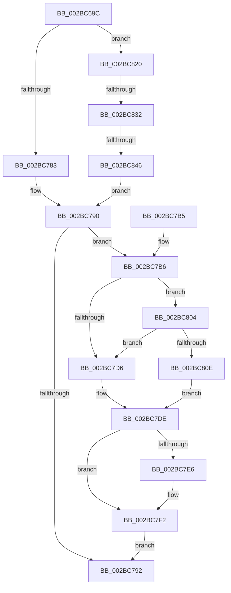

# PopFxDispatchPluginWorkOnce

- RVA: `0x002BC69C`–`0x002BC850` (길이 `436` bytes)
- VA: `0x00000001402BC69C`
- 실행 섹션: `.text`
- PDB 이름 있음: `예`; PDB Function 태그: `예`
- unwind 정보 RVA: `0x0006E154`
- 디코드: `106`개 명령, `436/436` bytes 표시
- 미해석 바이트: `0` (있으면 어셈블리에 `.byte`로 보존)

> 이 문서는 커널 이미지의 기계어와 PDB 기호를 분석해 생성했습니다. 4번과 5번은 함수 원형과 자료형을 바이너리 사용 방식에서 추정한 C 해석이며 원본 소스 복구 결과는 아닙니다.

## 1. Dependencies

- 직접 호출 지점: **10**; 고유 호출 대상: **9**
- 직접 호출자로 확인된 함수: **1**
- RIP 상대 이미지 참조: **7**

### Outgoing calls
- `0x002BC6CE` → [memset](../6C/memset_function_006C6C40.md) (function, `0x006C6C40`)
- `0x002BC750` → [PopFxEnableWorkOrderWatchdog](PopFxEnableWorkOrderWatchdog_function_002BD268.md) (function, `0x002BD268`)
- `0x002BC767` → [memset](../6C/memset_function_006C6C40.md) (function, `0x006C6C40`)
- `0x002BC789` → [PopPepWork](PopPepWork_function_002BCBC0.md) (function, `0x002BCBC0`)
- `0x002BC797` → [PopFxDisableWorkOrderWatchdog](PopFxDisableWorkOrderWatchdog_function_002BC858.md) (function, `0x002BC858`)
- `0x002BC7BD` → [KeAcquireSpinLockRaiseToDpc](../20/KeAcquireSpinLockRaiseToDpc_function_00208470.md) (function, `0x00208470`)
- `0x002BC7ED` → [KiLowerIrqlProcessIrqlFlags](../4F/KiLowerIrqlProcessIrqlFlags_function_004F5698.md) (function, `0x004F5698`)
- `0x002BC7FD` → [PopFxProcessWork](PopFxProcessWork_function_002BD3E0.md) (function, `0x002BD3E0`)
- `0x002BC819` → [KiReleaseSpinLockInstrumented](../39/KiReleaseSpinLockInstrumented_function_00392EF0.md) (function, `0x00392EF0`)
- `0x002BC839` → [guard_dispatch_icall](../6B/guard_dispatch_icall_function_006BAAD0.md) (function, `0x006BAAD0`)

### Direct callers
- [PopFxProcessWorkPool](../49/PopFxProcessWorkPool_function_0049E8A0.md) at `0x0049E9C9`

### Static image references
- `0x002BC6D3` → RVA `0x00E0B3D0` (`.data`; read)
- `0x002BC715` → RVA `0x005D3A40` (`PopFxWorkOrderWatchdog`; read)
- `0x002BC7B6` → RVA `0x00F0E550` (`.data`; read)
- `0x002BC7C2` → RVA `0x00FC6B06` (`ALMOSTRO`; read)
- `0x002BC7D6` → RVA `0x00F0E550` (`.data`; read/write)
- `0x002BC7DE` → RVA `0x00FC6D20` (`ALMOSTRO`; read)
- `0x002BC804` → RVA `0x00F0DE58` (`.data`; read)

## 2. Other-region calls and transfers

- 다른 실행 섹션으로 향하는 call: **0**
- call이 아닌 외부 분기/꼬리 이동: **2**
  - `0x002BC82C` → [sub_006DBF28](../6D/Unknown_function_006DBF28.md) (`tail-transfer`)
  - `0x002BC840` → [sub_006DBF28](../6D/Unknown_function_006DBF28.md) (`tail-transfer`)

## 3. Assembly (complete function range)

```asm
002BC69C  48 8B C4                        mov rax, rsp
002BC69F  48 89 58 08                     mov qword ptr [rax + 8], rbx
002BC6A3  48 89 70 10                     mov qword ptr [rax + 0x10], rsi
002BC6A7  48 89 78 18                     mov qword ptr [rax + 0x18], rdi
002BC6AB  55                              push rbp
002BC6AC  48 8D 68 98                     lea rbp, [rax - 0x68]
002BC6B0  48 81 EC 60 01 00 00            sub rsp, 0x160
002BC6B7  8B FA                           mov edi, edx
002BC6B9  48 8B D9                        mov rbx, rcx
002BC6BC  33 C0                           xor eax, eax
002BC6BE  48 8D 4C 24 70                  lea rcx, [rsp + 0x70]
002BC6C3  33 D2                           xor edx, edx
002BC6C5  89 45 24                        mov dword ptr [rbp + 0x24], eax
002BC6C8  41 B8 B0 00 00 00               mov r8d, 0xb0
002BC6CE  E8 6D A5 40 00                  call 0x1406c6c40
002BC6D3  8B 15 F7 EC B4 00               mov edx, dword ptr [rip + 0xb4ecf7]
002BC6D9  48 8D 44 24 70                  lea rax, [rsp + 0x70]
002BC6DE  48 89 44 24 60                  mov qword ptr [rsp + 0x60], rax
002BC6E3  48 8D 4C 24 30                  lea rcx, [rsp + 0x30]
002BC6E8  33 F6                           xor esi, esi
002BC6EA  C7 45 C0 13 01 00 00            mov dword ptr [rbp - 0x40], 0x113
002BC6F1  0F 57 C0                        xorps xmm0, xmm0
002BC6F4  48 89 75 80                     mov qword ptr [rbp - 0x80], rsi
002BC6F8  48 8D 44 24 30                  lea rax, [rsp + 0x30]
002BC6FD  C6 45 80 08                     mov byte ptr [rbp - 0x80], 8
002BC701  48 89 45 00                     mov qword ptr [rbp], rax
002BC705  48 8D 45 88                     lea rax, [rbp - 0x78]
002BC709  48 89 45 90                     mov qword ptr [rbp - 0x70], rax
002BC70D  48 8D 45 88                     lea rax, [rbp - 0x78]
002BC711  48 89 45 88                     mov qword ptr [rbp - 0x78], rax
002BC715  48 8D 05 24 73 31 00            lea rax, [rip + 0x317324]
002BC71C  48 89 45 D8                     mov qword ptr [rbp - 0x28], rax
002BC720  48 8D 44 24 70                  lea rax, [rsp + 0x70]
002BC725  0F 11 44 24 50                  movups xmmword ptr [rsp + 0x50], xmm0
002BC72A  48 89 45 E0                     mov qword ptr [rbp - 0x20], rax
002BC72E  0F 11 44 24 30                  movups xmmword ptr [rsp + 0x30], xmm0
002BC733  48 89 5C 24 58                  mov qword ptr [rsp + 0x58], rbx
002BC738  0F 11 44 24 40                  movups xmmword ptr [rsp + 0x40], xmm0
002BC73D  48 89 75 98                     mov qword ptr [rbp - 0x68], rsi
002BC741  89 75 BC                        mov dword ptr [rbp - 0x44], esi
002BC744  66 89 75 B8                     mov word ptr [rbp - 0x48], si
002BC748  48 89 75 F8                     mov qword ptr [rbp - 8], rsi
002BC74C  48 89 75 D0                     mov qword ptr [rbp - 0x30], rsi
002BC750  E8 13 0B 00 00                  call 0x1402bd268
002BC755  0F 57 C0                        xorps xmm0, xmm0
002BC758  44 8D 46 40                     lea r8d, [rsi + 0x40]
002BC75C  33 D2                           xor edx, edx
002BC75E  48 8D 4D 20                     lea rcx, [rbp + 0x20]
002BC762  0F 11 44 24 20                  movups xmmword ptr [rsp + 0x20], xmm0
002BC767  E8 D4 A4 40 00                  call 0x1406c6c40
002BC76C  40 88 74 24 28                  mov byte ptr [rsp + 0x28], sil
002BC771  48 8D 45 20                     lea rax, [rbp + 0x20]
002BC775  48 89 44 24 20                  mov qword ptr [rsp + 0x20], rax
002BC77A  48 85 DB                        test rbx, rbx
002BC77D  0F 85 9D 00 00 00               jne 0x1402bc820
002BC783  48 8D 55 20                     lea rdx, [rbp + 0x20]
002BC787  8B CF                           mov ecx, edi
002BC789  E8 32 04 00 00                  call 0x1402bcbc0
002BC78E  84 C0                           test al, al
002BC790  75 24                           jne 0x1402bc7b6
002BC792  48 8D 4C 24 70                  lea rcx, [rsp + 0x70]
002BC797  E8 BC 00 00 00                  call 0x1402bc858
002BC79C  4C 8D 9C 24 60 01 00 00         lea r11, [rsp + 0x160]
002BC7A4  49 8B 5B 10                     mov rbx, qword ptr [r11 + 0x10]
002BC7A8  49 8B 73 18                     mov rsi, qword ptr [r11 + 0x18]
002BC7AC  49 8B 7B 20                     mov rdi, qword ptr [r11 + 0x20]
002BC7B0  49 8B E3                        mov rsp, r11
002BC7B3  5D                              pop rbp
002BC7B4  C3                              ret
002BC7B5  CC                              int3
002BC7B6  48 8D 0D 93 1D C5 00            lea rcx, [rip + 0xc51d93]
002BC7BD  E8 AE BC F4 FF                  call 0x140208470
002BC7C2  F6 05 3D A3 D0 00 01            test byte ptr [rip + 0xd0a33d], 1
002BC7C9  0F B6 F8                        movzx edi, al
002BC7CC  48 8D 45 20                     lea rax, [rbp + 0x20]
002BC7D0  48 89 45 08                     mov qword ptr [rbp + 8], rax
002BC7D4  75 2E                           jne 0x1402bc804
002BC7D6  F0 48 21 35 72 1D C5 00         lock and qword ptr [rip + 0xc51d72], rsi
002BC7DE  39 35 3C A5 D0 00               cmp dword ptr [rip + 0xd0a53c], esi
002BC7E4  74 0C                           je 0x1402bc7f2
002BC7E6  44 0F 20 C1                     mov rcx, cr8
002BC7EA  40 8A D7                        mov dl, dil
002BC7ED  E8 A6 8E 23 00                  call 0x1404f5698
002BC7F2  44 0F 22 C7                     mov cr8, rdi
002BC7F6  48 8D 55 20                     lea rdx, [rbp + 0x20]
002BC7FA  48 8B CB                        mov rcx, rbx
002BC7FD  E8 DE 0B 00 00                  call 0x1402bd3e0
002BC802  EB 8E                           jmp 0x1402bc792
002BC804  8B 15 4E 16 C5 00               mov edx, dword ptr [rip + 0xc5164e]
002BC80A  85 D2                           test edx, edx
002BC80C  75 C8                           jne 0x1402bc7d6
002BC80E  48 8B 55 68                     mov rdx, qword ptr [rbp + 0x68]
002BC812  48 8D 0D 37 1D C5 00            lea rcx, [rip + 0xc51d37]
002BC819  E8 D2 66 0D 00                  call 0x140392ef0
002BC81E  EB BE                           jmp 0x1402bc7de
002BC820  48 8B 43 60                     mov rax, qword ptr [rbx + 0x60]
002BC824  BF 0D 00 00 00                  mov edi, 0xd
002BC829  48 85 C0                        test rax, rax
002BC82C  0F 84 F6 F6 41 00               je 0x1406dbf28
002BC832  48 8D 54 24 20                  lea rdx, [rsp + 0x20]
002BC837  8B CF                           mov ecx, edi
002BC839  E8 92 E2 3F 00                  call 0x1406baad0
002BC83E  84 C0                           test al, al
002BC840  0F 84 E2 F6 41 00               je 0x1406dbf28
002BC846  40 38 74 24 28                  cmp byte ptr [rsp + 0x28], sil
002BC84B  E9 40 FF FF FF                  jmp 0x1402bc790
```

## 4. C-style interpretation (structured pseudocode)

```c
__int64 __fastcall PopFxDispatchPluginWorkOnce(__int64 a1, int a2)
{
    __int64 result;
    __int64 v_rsi;
    __int64 v_rsp;
    unsigned __int64 v_stack_m108;
    unsigned __int64 v_stack_m110;
    unsigned __int64 v_stack_m118;
    unsigned __int64 v_stack_m128;
    unsigned __int64 v_stack_m138;
    unsigned __int8 v_stack_m140;
    unsigned __int64 v_stack_m148;
    unsigned __int64 v_stack_m8;
    unsigned __int64 v_stack_mF8;

    *(unsigned __int64 *)(v_rsp + 8) = v_rbx;
    *(unsigned __int64 *)(v_rsp + 16) = v_rsi;
    *(unsigned __int64 *)(v_rsp + 24) = v_rdi;
    v_rsp = (v_rsp) - (352);
    result = 0;
    a2 = 0;
    *(unsigned int *)(v_rsp - 104 + 36) = 0;
    result = memset(v_stack_mF8, a2, 176, a4);
    v_stack_m108 = v_stack_mF8;
    v_rsi = 0;
    *(unsigned int *)(v_rsp - 104 - 64) = 275;
    *(unsigned __int64 *)(v_rsp - 104 - 128) = 0;
    *(unsigned __int8 *)(v_rsp - 104 - 128) = 8;
    *(unsigned __int64 *)(v_rsp - 104) = v_stack_m138;
    *(unsigned __int64 *)(v_rsp - 104 - 112) = v_rsp - 104 - 120;
    *(unsigned __int64 *)(v_rsp - 104 - 120) = v_rsp - 104 - 120;
    *(unsigned __int64 *)(v_rsp - 104 - 40) = v_rip + 3240740;
    v_stack_m118 = v_xmm0;
    *(unsigned __int64 *)(v_rsp - 104 - 32) = v_stack_mF8;
    v_stack_m138 = v_xmm0;
    v_stack_m110 = a1;
    v_stack_m128 = v_xmm0;
    *(unsigned __int64 *)(v_rsp - 104 - 104) = 0;
    *(unsigned int *)(v_rsp - 104 - 68) = 0;
    *(unsigned __int16 *)(v_rsp - 104 - 72) = 0;
    *(unsigned __int64 *)(v_rsp - 104 - 8) = 0;
    *(unsigned __int64 *)(v_rsp - 104 - 48) = 0;
    result = PopFxEnableWorkOrderWatchdog(v_stack_m138, (unsigned int)(*(unsigned int *)(v_rip + 11857143)), 176, a4);
    a2 = 0;
    v_stack_m148 = v_xmm0;
    result = memset(v_rsp - 104 + 32, a2, v_rsi + 64, a4);
    v_stack_m140 = 0;
    v_stack_m148 = v_rsp - 104 + 32;
    if (a1 != 0) goto loc_002BC820;
    result = PopPepWork((unsigned int)((unsigned int)((unsigned int)(a2))), v_rsp - 104 + 32, v_rsi + 64, a4);
loc_002BC790:
    if ((unsigned __int8)(result) != 0) goto loc_002BC7B6;
loc_002BC792:
    result = PopFxDisableWorkOrderWatchdog(v_stack_mF8, v_rsp - 104 + 32, v_rsi + 64, a4);
    return result;
loc_002BC7B6:
    result = KeAcquireSpinLockRaiseToDpc(v_rip + 12918163, v_rsp - 104 + 32, v_rsi + 64, a4);
    *(unsigned __int64 *)(v_rsp - 104 + 8) = v_rsp - 104 + 32;
    if (((*(unsigned __int8 *)(v_rip + 13673277)) & (1)) != 0) goto loc_002BC804;
loc_002BC7D6:
loc_002BC7DE:
    result = v_rsp - 104 + 32;
    if ((*(unsigned int *)(v_rip + 13673788)) != ((unsigned int)(*(unsigned __int64 *)(v_stack_m8 + 24)))) {
        a1 = v_cr8;
        a2 = (unsigned __int8)((unsigned __int8)(result));
        result = KiLowerIrqlProcessIrqlFlags(a1, a2, v_rsi + 64, a4);
    }
    result = PopFxProcessWork(*(unsigned __int64 *)(v_stack_m8 + 16), v_rsp - 104 + 32, v_rsi + 64, a4);
    goto loc_002BC792;
loc_002BC804:
    if ((unsigned int)((unsigned int)(*(unsigned int *)(v_rip + 12916302))) != 0) goto loc_002BC7D6;
    result = KiReleaseSpinLockInstrumented(v_rip + 12918071, *(unsigned __int64 *)(v_rsp - 104 + 104), v_rsi + 64, a4);
    goto loc_002BC7DE;
loc_002BC820:
    result = guard_dispatch_icall(13, v_stack_m140, v_rsi + 64, a4);
    goto loc_002BC790;
}
```

## 5. (Beta) C Style

```c
int64_t PopFxDispatchPluginWorkOnce(int64_t Arg1, int32_t Arg2)
{
    int64_t result;
    int64_t local_rsi;
    int64_t local_rsp;
    uint64_t v_stack_m108;
    uint64_t v_stack_m110;
    uint64_t v_stack_m118;
    uint64_t v_stack_m128;
    uint64_t v_stack_m138;
    uint8_t v_stack_m140;
    uint64_t v_stack_m148;
    uint64_t v_stack_m8;
    uint64_t v_stack_mF8;

    *(uint64_t *)(local_rsp + 0x8) = local_rbx;
    *(uint64_t *)(local_rsp + 0x10) = local_rsi;
    *(uint64_t *)(local_rsp + 0x18) = local_rdi;
    local_rsp = (local_rsp) - (352);
    result = 0;
    Arg2 = 0;
    *(uint32_t *)(local_rsp - 0x68 + 0x24) = 0;
    result = memset(v_stack_mF8, Arg2, 176, a4);
    v_stack_m108 = v_stack_mF8;
    local_rsi = 0;
    *(uint32_t *)(local_rsp - 0x68 - 0x40) = 275;
    *(uint64_t *)(local_rsp - 0x68 - 0x80) = 0;
    *(uint8_t *)(local_rsp - 0x68 - 0x80) = 8;
    *(uint64_t *)(local_rsp - 0x68) = v_stack_m138;
    *(uint64_t *)(local_rsp - 0x68 - 0x70) = local_rsp - 104 - 120;
    *(uint64_t *)(local_rsp - 0x68 - 0x78) = local_rsp - 104 - 120;
    *(uint64_t *)(local_rsp - 0x68 - 0x28) = v_rip + 3240740;
    v_stack_m118 = v_xmm0;
    *(uint64_t *)(local_rsp - 0x68 - 0x20) = v_stack_mF8;
    v_stack_m138 = v_xmm0;
    v_stack_m110 = Arg1;
    v_stack_m128 = v_xmm0;
    *(uint64_t *)(local_rsp - 0x68 - 0x68) = 0;
    *(uint32_t *)(local_rsp - 0x68 - 0x44) = 0;
    *(uint16_t *)(local_rsp - 0x68 - 0x48) = 0;
    *(uint64_t *)(local_rsp - 0x68 - 0x8) = 0;
    *(uint64_t *)(local_rsp - 0x68 - 0x30) = 0;
    result = PopFxEnableWorkOrderWatchdog(v_stack_m138, (uint32_t)(*(uint32_t *)(v_rip + 0xB4ECF7)), 176, a4);
    Arg2 = 0;
    v_stack_m148 = v_xmm0;
    result = memset(local_rsp - 104 + 32, Arg2, local_rsi + 64, a4);
    v_stack_m140 = 0;
    v_stack_m148 = local_rsp - 104 + 32;
    if (Arg1 != 0) goto loc_002BC820;
    result = PopPepWork((uint32_t)((uint32_t)((uint32_t)(Arg2))), local_rsp - 104 + 32, local_rsi + 64, a4);
loc_002BC790:
    if ((uint8_t)(result) != 0) goto loc_002BC7B6;
loc_002BC792:
    result = PopFxDisableWorkOrderWatchdog(v_stack_mF8, local_rsp - 104 + 32, local_rsi + 64, a4);
    return result;
loc_002BC7B6:
    result = KeAcquireSpinLockRaiseToDpc(v_rip + 12918163, local_rsp - 104 + 32, local_rsi + 64, a4);
    *(uint64_t *)(local_rsp - 0x68 + 0x8) = local_rsp - 104 + 32;
    if (((*(uint8_t *)(v_rip + 0xD0A33D)) & (1)) != 0) goto loc_002BC804;
loc_002BC7D6:
loc_002BC7DE:
    result = local_rsp - 104 + 32;
    if ((*(uint32_t *)(v_rip + 0xD0A53C)) != ((uint32_t)(*(uint64_t *)(v_stack_m8 + 0x18)))) {
        Arg1 = v_cr8;
        Arg2 = (uint8_t)((uint8_t)(result));
        result = KiLowerIrqlProcessIrqlFlags(Arg1, Arg2, local_rsi + 64, a4);
    }
    result = PopFxProcessWork(*(uint64_t *)(v_stack_m8 + 0x10), local_rsp - 104 + 32, local_rsi + 64, a4);
    goto loc_002BC792;
loc_002BC804:
    if ((uint32_t)((uint32_t)(*(uint32_t *)(v_rip + 0xC5164E))) != 0) goto loc_002BC7D6;
    result = KiReleaseSpinLockInstrumented(v_rip + 12918071, *(uint64_t *)(local_rsp - 0x68 + 0x68), local_rsi + 64, a4);
    goto loc_002BC7DE;
loc_002BC820:
    result = guard_dispatch_icall(13, v_stack_m140, local_rsi + 64, a4);
    goto loc_002BC790;
}
```

## 6. Execution-region graph

[열기: 2D/3D 그래프와 함수 탐색 컨트롤 패널](../../../control-panel.html?section=text&rva=0x002BC69C&view=graph)

- 2D 그래프는 위에서 아래로 흐르고, 3D 그래프는 빈 공간을 드래그해 회전합니다. Shift+드래그는 이동, 휠은 확대·축소, 함수 노드 선택은 대상 보고서 이동입니다.

### Static fallback


