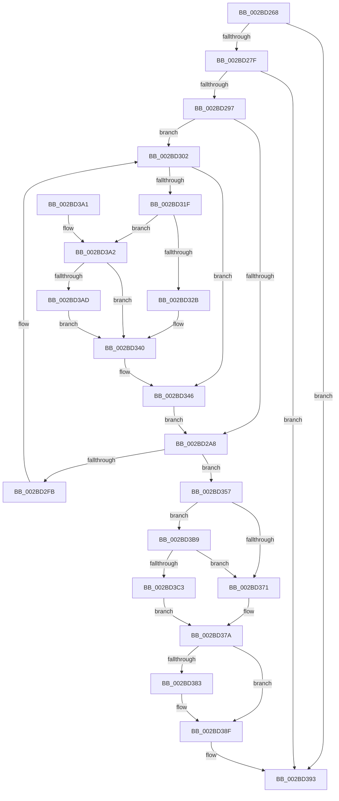

# PopFxEnableWorkOrderWatchdog

- RVA: `0x002BD268`–`0x002BD3D6` (길이 `366` bytes)
- VA: `0x00000001402BD268`
- 실행 섹션: `.text`
- PDB 이름 있음: `예`; PDB Function 태그: `아니요`
- unwind 정보 RVA: `0x0006E1DC`
- 디코드: `86`개 명령, `366/366` bytes 표시
- 미해석 바이트: `0` (있으면 어셈블리에 `.byte`로 보존)

> 이 문서는 커널 이미지의 기계어와 PDB 기호를 분석해 생성했습니다. 4번과 5번은 함수 원형과 자료형을 바이너리 사용 방식에서 추정한 C 해석이며 원본 소스 복구 결과는 아닙니다.

## 1. Dependencies

- 직접 호출 지점: **5**; 고유 호출 대상: **5**
- 직접 호출자로 확인된 함수: **2**
- RIP 상대 이미지 참조: **8**

### Outgoing calls
- `0x002BD2BB` → [KiSetTimerEx](../23/KiSetTimerEx_function_00232CB0.md) (function, `0x00232CB0`)
- `0x002BD2E0` → [KeAcquireSpinLockRaiseToDpc](../20/KeAcquireSpinLockRaiseToDpc_function_00208470.md) (function, `0x00208470`)
- `0x002BD346` → [KiEncodeTolerableDelayValue](../23/KiEncodeTolerableDelayValue_function_0023141C.md) (function, `0x0023141C`)
- `0x002BD38A` → [KiLowerIrqlProcessIrqlFlags](../4F/KiLowerIrqlProcessIrqlFlags_function_004F5698.md) (function, `0x004F5698`)
- `0x002BD3CF` → [KiReleaseSpinLockInstrumented](../39/KiReleaseSpinLockInstrumented_function_00392EF0.md) (function, `0x00392EF0`)

### Direct callers
- [PopFxDispatchPluginWorkOnce](PopFxDispatchPluginWorkOnce_function_002BC69C.md) at `0x002BC750`
- [PopFxHandleDirectedPowerTransition](../4C/PopFxHandleDirectedPowerTransition_function_004C405C.md) at `0x004C40AC`

### Static image references
- `0x002BD2CA` → RVA `0x00F0E550` (`.data`; read)
- `0x002BD2E8` → RVA `0x00F0E560` (`.data`; read)
- `0x002BD2EF` → RVA `0x00F0E568` (`.data`; read)
- `0x002BD361` → RVA `0x00FC6B06` (`ALMOSTRO`; read)
- `0x002BD368` → RVA `0x00F0E568` (`.data`; write)
- `0x002BD371` → RVA `0x00F0E550` (`.data`; read/write)
- `0x002BD37A` → RVA `0x00FC6D20` (`ALMOSTRO`; read)
- `0x002BD3B9` → RVA `0x00F0DE58` (`.data`; read)

## 2. Other-region calls and transfers

- 다른 실행 섹션으로 향하는 call: **0**
- 별도 외부 분기/꼬리 이동을 확인하지 못했습니다.

## 3. Assembly (complete function range)

```asm
002BD268  48 89 5C 24 08                  mov qword ptr [rsp + 8], rbx
002BD26D  57                              push rdi
002BD26E  48 83 EC 30                     sub rsp, 0x30
002BD272  48 8B 59 30                     mov rbx, qword ptr [rcx + 0x30]
002BD276  48 85 DB                        test rbx, rbx
002BD279  0F 84 14 01 00 00               je 0x1402bd393
002BD27F  65 48 8B 04 25 88 01 00 00      mov rax, qword ptr gs:[0x188]
002BD288  48 89 83 A8 00 00 00            mov qword ptr [rbx + 0xa8], rax
002BD28F  85 D2                           test edx, edx
002BD291  0F 84 FC 00 00 00               je 0x1402bd393
002BD297  8B C2                           mov eax, edx
002BD299  45 32 C9                        xor r9b, r9b
002BD29C  4C 69 D0 F0 D8 FF FF            imul r10, rax, -0x2710
002BD2A3  83 FA 0A                        cmp edx, 0xa
002BD2A6  73 5A                           jae 0x1402bd302
002BD2A8  48 8D 43 50                     lea rax, [rbx + 0x50]
002BD2AC  45 33 C0                        xor r8d, r8d
002BD2AF  48 8D 4B 10                     lea rcx, [rbx + 0x10]
002BD2B3  48 89 44 24 20                  mov qword ptr [rsp + 0x20], rax
002BD2B8  49 8B D2                        mov rdx, r10
002BD2BB  E8 F0 59 F7 FF                  call 0x140232cb0
002BD2C0  48 A1 08 00 00 00 80 F7 FF FF   movabs rax, qword ptr [0xfffff78000000008]
002BD2CA  48 8D 0D 7F 12 C5 00            lea rcx, [rip + 0xc5127f]
002BD2D1  48 83 A3 98 00 00 00 00         and qword ptr [rbx + 0x98], 0
002BD2D9  48 89 83 A0 00 00 00            mov qword ptr [rbx + 0xa0], rax
002BD2E0  E8 8B B1 F4 FF                  call 0x140208470
002BD2E5  0F B6 F8                        movzx edi, al
002BD2E8  48 8D 0D 71 12 C5 00            lea rcx, [rip + 0xc51271]
002BD2EF  48 8B 05 72 12 C5 00            mov rax, qword ptr [rip + 0xc51272]
002BD2F6  48 39 08                        cmp qword ptr [rax], rcx
002BD2F9  74 5C                           je 0x1402bd357
002BD2FB  B9 03 00 00 00                  mov ecx, 3
002BD300  CD 29                           int 0x29
002BD302  B8 CD CC CC CC                  mov eax, 0xcccccccd
002BD307  F7 E2                           mul edx
002BD309  C1 EA 03                        shr edx, 3
002BD30C  8B C2                           mov eax, edx
002BD30E  BA 00 7C 92 00                  mov edx, 0x927c00
002BD313  48 69 C8 10 27 00 00            imul rcx, rax, 0x2710
002BD31A  48 3B CA                        cmp rcx, rdx
002BD31D  76 27                           jbe 0x1402bd346
002BD31F  48 81 C1 00 84 6D FF            add rcx, -0x927c00
002BD326  4D 85 D2                        test r10, r10
002BD329  78 77                           js 0x1402bd3a2
002BD32B  4A 8D 04 11                     lea rax, [rcx + r10]
002BD32F  48 B9 FF FF FF FF FF FF FF 7F   movabs rcx, 0x7fffffffffffffff
002BD339  49 3B C2                        cmp rax, r10
002BD33C  48 0F 4C C1                     cmovl rax, rcx
002BD340  48 8B CA                        mov rcx, rdx
002BD343  4C 8B D0                        mov r10, rax
002BD346  E8 D1 40 F7 FF                  call 0x14023141c
002BD34B  44 8A C8                        mov r9b, al
002BD34E  41 C0 E1 02                     shl r9b, 2
002BD352  E9 51 FF FF FF                  jmp 0x1402bd2a8
002BD357  48 89 0B                        mov qword ptr [rbx], rcx
002BD35A  48 89 43 08                     mov qword ptr [rbx + 8], rax
002BD35E  48 89 18                        mov qword ptr [rax], rbx
002BD361  F6 05 9E 97 D0 00 01            test byte ptr [rip + 0xd0979e], 1
002BD368  48 89 1D F9 11 C5 00            mov qword ptr [rip + 0xc511f9], rbx
002BD36F  75 48                           jne 0x1402bd3b9
002BD371  F0 48 83 25 D6 11 C5 00 00      lock and qword ptr [rip + 0xc511d6], 0
002BD37A  83 3D 9F 99 D0 00 00            cmp dword ptr [rip + 0xd0999f], 0
002BD381  74 0C                           je 0x1402bd38f
002BD383  44 0F 20 C1                     mov rcx, cr8
002BD387  40 8A D7                        mov dl, dil
002BD38A  E8 09 83 23 00                  call 0x1404f5698
002BD38F  44 0F 22 C7                     mov cr8, rdi
002BD393  48 8B C3                        mov rax, rbx
002BD396  48 8B 5C 24 40                  mov rbx, qword ptr [rsp + 0x40]
002BD39B  48 83 C4 30                     add rsp, 0x30
002BD39F  5F                              pop rdi
002BD3A0  C3                              ret
002BD3A1  CC                              int3
002BD3A2  49 8B C2                        mov rax, r10
002BD3A5  48 2B C1                        sub rax, rcx
002BD3A8  49 3B C2                        cmp rax, r10
002BD3AB  7E 93                           jle 0x1402bd340
002BD3AD  48 B8 00 00 00 00 00 00 00 80   movabs rax, 0x8000000000000000
002BD3B7  EB 87                           jmp 0x1402bd340
002BD3B9  8B 05 99 0A C5 00               mov eax, dword ptr [rip + 0xc50a99]
002BD3BF  85 C0                           test eax, eax
002BD3C1  75 AE                           jne 0x1402bd371
002BD3C3  48 8B 54 24 38                  mov rdx, qword ptr [rsp + 0x38]
002BD3C8  48 8D 0D 81 11 C5 00            lea rcx, [rip + 0xc51181]
002BD3CF  E8 1C 5B 0D 00                  call 0x140392ef0
002BD3D4  EB A4                           jmp 0x1402bd37a
```

## 4. C-style interpretation (structured pseudocode)

```c
__int64 __fastcall PopFxEnableWorkOrderWatchdog(__int64 a1, int a2, int a3, unsigned __int8 a4)
{
    __int64 result;
    __int64 v_r10;
    __int64 v_rsp;
    unsigned __int64 v_stack_m18;
    unsigned __int64 v_stack_p38;
    unsigned __int64 v_stack_p8;

    v_stack_p8 = v_rbx;
    v_rsp = (v_rsp) - (48);
    if (*(unsigned __int64 *)(a1 + 48) == 0) goto loc_002BD393;
    *(unsigned __int64 *)(*(unsigned __int64 *)(a1 + 48) + 168) = *(unsigned __int64 *)(gs_base + (0 + 392));
    if (a2 == 0) goto loc_002BD393;
    a4 = 0;
    v_r10 = (v_r10) * ((unsigned int)(a2));
    if (a2 >= 10) goto loc_002BD302;
loc_002BD2A8:
    a3 = 0;
    v_stack_m18 = *(unsigned __int64 *)(a1 + 48) + 80;
    result = KiSetTimerEx(*(unsigned __int64 *)(a1 + 48) + 16, v_r10, a3, a4);
    *(unsigned __int64 *)(*(unsigned __int64 *)(a1 + 48) + 160) = result;
    result = KeAcquireSpinLockRaiseToDpc(v_rip + 12915327, v_r10, a3, a4);
    if ((*(unsigned __int64 *)(*(unsigned __int64 *)(v_rip + 12915314))) == (v_rip + 12915313)) goto loc_002BD357;
loc_002BD302:
    a2 = (unsigned int)((v_r10) >> (3));
    a1 = (3) * ((unsigned int)(a2));
    if (a1 <= ((unsigned int)(0x927C00ULL))) goto loc_002BD346;
    a1 = (a1) + (0xFFFFFFFFFF6D8400ULL);
    if (sign_flag) goto loc_002BD3A2;
    result = a1 + v_r10 * 1;
    if ((a1 + v_r10 * 1) < v_r10) { result = a1; }
loc_002BD340:
loc_002BD346:
    result = KiEncodeTolerableDelayValue((unsigned int)(0x927C00ULL), (unsigned int)(0x927C00ULL), a3, a4);
    a4 = (unsigned __int8)(((unsigned __int8)(result)) << (2));
    goto loc_002BD2A8;
loc_002BD357:
    *(unsigned __int64 *)(*(unsigned __int64 *)(a1 + 48)) = (unsigned int)(0x927C00ULL);
    *(unsigned __int64 *)(*(unsigned __int64 *)(a1 + 48) + 8) = result;
    *(unsigned __int64 *)(result) = *(unsigned __int64 *)(a1 + 48);
    *(unsigned __int64 *)(v_rip + 12915193) = *(unsigned __int64 *)(a1 + 48);
    if (((*(unsigned __int8 *)(v_rip + 13670302)) & (1)) != 0) goto loc_002BD3B9;
loc_002BD371:
loc_002BD37A:
    if ((*(unsigned int *)(v_rip + 13670815)) != 0) {
        a1 = v_cr8;
        a2 = (unsigned __int8)((unsigned __int8)(result));
        result = KiLowerIrqlProcessIrqlFlags(a1, a2, a3, a4);
    }
loc_002BD393:
    v_rsp = (v_rsp) + (48);
    return *(unsigned __int64 *)(a1 + 48);
loc_002BD3A2:
    result = (result) - (a1);
    if (result <= result) goto loc_002BD340;
    goto loc_002BD340;
loc_002BD3B9:
    if ((unsigned int)((unsigned int)(*(unsigned int *)(v_rip + 12913305))) != 0) goto loc_002BD371;
    result = KiReleaseSpinLockInstrumented(v_rip + 12915073, v_stack_p38, a3, a4);
    goto loc_002BD37A;
}
```

## 5. (Beta) C Style

```c
int64_t PopFxEnableWorkOrderWatchdog(void *Arg1, int32_t Arg2, int32_t Arg3, uint8_t Arg4)
{
    uint8_t *arg1 = (uint8_t *)Arg1;

    int64_t result;
    int64_t local_r10;
    int64_t local_rsp;
    uint64_t v_stack_m18;
    uint64_t v_stack_p38;
    uint64_t v_stack_p8;

    v_stack_p8 = local_rbx;
    local_rsp = (local_rsp) - (48);
    if (*(uint64_t *)(arg1 + 0x30) == 0) goto loc_002BD393;
    *(uint64_t *)(*(uint64_t *)(arg1 + 0x30) + 0xA8) = *(uint64_t *)(gs_base + (0 + 0x188));
    if (Arg2 == 0) goto loc_002BD393;
    Arg4 = 0;
    local_r10 = (local_r10) * ((uint32_t)(Arg2));
    if (Arg2 >= 10) goto loc_002BD302;
loc_002BD2A8:
    Arg3 = 0;
    v_stack_m18 = *(uint64_t *)(arg1 + 0x30) + 80;
    result = KiSetTimerEx(*(uint64_t *)(arg1 + 0x30) + 16, local_r10, Arg3, Arg4);
    *(uint64_t *)(*(uint64_t *)(arg1 + 0x30) + 0xA0) = result;
    result = KeAcquireSpinLockRaiseToDpc(v_rip + 12915327, local_r10, Arg3, Arg4);
    if ((*(uint64_t *)(*(uint64_t *)(v_rip + 0xC51272))) == (v_rip + 12915313)) goto loc_002BD357;
loc_002BD302:
    Arg2 = (uint32_t)((local_r10) >> (3));
    Arg1 = (3) * ((uint32_t)(Arg2));
    if (Arg1 <= ((uint32_t)(0x927C00ULL))) goto loc_002BD346;
    Arg1 = (Arg1) + (0xFFFFFFFFFF6D8400ULL);
    if (sign_flag) goto loc_002BD3A2;
    result = Arg1 + local_r10 * 1;
    if ((Arg1 + local_r10 * 1) < local_r10) { result = Arg1; }
loc_002BD340:
loc_002BD346:
    result = KiEncodeTolerableDelayValue((uint32_t)(0x927C00ULL), (uint32_t)(0x927C00ULL), Arg3, Arg4);
    Arg4 = (uint8_t)(((uint8_t)(result)) << (2));
    goto loc_002BD2A8;
loc_002BD357:
    *(uint64_t *)(*(uint64_t *)(arg1 + 0x30)) = (uint32_t)(0x927C00ULL);
    *(uint64_t *)(*(uint64_t *)(arg1 + 0x30) + 0x8) = result;
    *(uint64_t *)(result) = *(uint64_t *)(arg1 + 0x30);
    *(uint64_t *)(v_rip + 0xC511F9) = *(uint64_t *)(arg1 + 0x30);
    if (((*(uint8_t *)(v_rip + 0xD0979E)) & (1)) != 0) goto loc_002BD3B9;
loc_002BD371:
loc_002BD37A:
    if ((*(uint32_t *)(v_rip + 0xD0999F)) != 0) {
        Arg1 = v_cr8;
        Arg2 = (uint8_t)((uint8_t)(result));
        result = KiLowerIrqlProcessIrqlFlags(Arg1, Arg2, Arg3, Arg4);
    }
loc_002BD393:
    local_rsp = (local_rsp) + (48);
    return *(uint64_t *)(arg1 + 0x30);
loc_002BD3A2:
    result = (result) - (Arg1);
    if (result <= result) goto loc_002BD340;
    goto loc_002BD340;
loc_002BD3B9:
    if ((uint32_t)((uint32_t)(*(uint32_t *)(v_rip + 0xC50A99))) != 0) goto loc_002BD371;
    result = KiReleaseSpinLockInstrumented(v_rip + 12915073, v_stack_p38, Arg3, Arg4);
    goto loc_002BD37A;
}
```

### 관측된 메모리 오프셋

구조체 형식이 확인되지 않은 접근은 인자 기준의 오프셋으로만 기록했습니다.

| 기준 인자 | 오프셋 표현 | 폭 (bit) | 접근 |
|---|---:|---:|---|
| `Arg1` | `+ 0x30` | `64` | `R` |

## 6. Execution-region graph

[열기: 2D/3D 그래프와 함수 탐색 컨트롤 패널](../../../control-panel.html?section=text&rva=0x002BD268&view=graph)

- 2D 그래프는 위에서 아래로 흐르고, 3D 그래프는 빈 공간을 드래그해 회전합니다. Shift+드래그는 이동, 휠은 확대·축소, 함수 노드 선택은 대상 보고서 이동입니다.

### Static fallback


