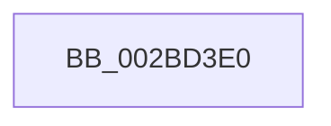

# PopFxProcessWork

- RVA: `0x002BD3E0`–`0x002BD41B` (길이 `59` bytes)
- VA: `0x00000001402BD3E0`
- 실행 섹션: `.text`
- PDB 이름 있음: `예`; PDB Function 태그: `아니요`
- unwind 정보 RVA: `0x0006E1EC`
- 디코드: `17`개 명령, `59/59` bytes 표시
- 미해석 바이트: `0` (있으면 어셈블리에 `.byte`로 보존)

> 이 문서는 커널 이미지의 기계어와 PDB 기호를 분석해 생성했습니다. 4번과 5번은 함수 원형과 자료형을 바이너리 사용 방식에서 추정한 C 해석이며 원본 소스 복구 결과는 아닙니다.

## 1. Dependencies

- 직접 호출 지점: **0**; 고유 호출 대상: **0**
- 직접 호출자로 확인된 함수: **4**
- RIP 상대 이미지 참조: **1**

### Outgoing calls
- 직접 디코드된 call 명령이 없습니다.

### Direct callers
- [PopFxDispatchPluginWorkOnce](PopFxDispatchPluginWorkOnce_function_002BC69C.md) at `0x002BC7FD`
- [PopFxActivateComponentWorker](../2D/PopFxActivateComponentWorker_function_002D9F60.md) at `0x002D9FD9`
- [PopFxIdleWorkerTail](../43/PopFxIdleWorkerTail_function_0043CDA0.md) at `0x0043CEBA`
- [PoFxCompleteIdleState](../46/PoFxCompleteIdleState_function_004666C0.md) at `0x00466751`

### Static image references
- `0x002BD3F4` → RVA `0x00E0A740` (`.data`; read)

## 2. Other-region calls and transfers

- 다른 실행 섹션으로 향하는 call: **0**
- call이 아닌 외부 분기/꼬리 이동: **1**
  - `0x002BD415` → [sub_002BD946](Unknown_function_002BD946.md) (`tail-transfer`)

## 3. Assembly (complete function range)

```asm
002BD3E0  4C 8B DC                        mov r11, rsp
002BD3E3  55                              push rbp
002BD3E4  57                              push rdi
002BD3E5  41 56                           push r14
002BD3E7  41 57                           push r15
002BD3E9  49 8D 6B A1                     lea rbp, [r11 - 0x5f]
002BD3ED  48 81 EC E8 00 00 00            sub rsp, 0xe8
002BD3F4  48 8B 05 45 D3 B4 00            mov rax, qword ptr [rip + 0xb4d345]
002BD3FB  48 33 C4                        xor rax, rsp
002BD3FE  48 89 45 17                     mov qword ptr [rbp + 0x17], rax
002BD402  48 63 02                        movsxd rax, dword ptr [rdx]
002BD405  45 33 FF                        xor r15d, r15d
002BD408  4C 89 7D CF                     mov qword ptr [rbp - 0x31], r15
002BD40C  48 8B FA                        mov rdi, rdx
002BD40F  4C 8B F1                        mov r14, rcx
002BD412  83 F8 08                        cmp eax, 8
002BD415  0F 87 2B 05 00 00               ja 0x1402bd946
```

## 4. C-style interpretation (structured pseudocode)

```c
__int64 __fastcall PopFxProcessWork(__int64 a1, __int64 a2)
{
    __int64 result;
    __int64 v_r15;
    __int64 v_rsp;

    v_rsp = (v_rsp) - (232);
    result = (*(unsigned __int64 *)(v_rip + 11850565)) ^ (v_rsp);
    *(unsigned __int64 *)(v_rsp - 95 + 23) = result;
    v_r15 = 0;
    *(unsigned __int64 *)(v_rsp - 95 - 49) = 0;
}
```

## 5. (Beta) C Style

```c
int64_t PopFxProcessWork(int64_t Arg1, void *Arg2)
{
    uint8_t *arg2 = (uint8_t *)Arg2;

    int64_t result;
    int64_t local_r15;
    int64_t local_rsp;

    local_rsp = (local_rsp) - (232);
    result = (*(uint64_t *)(v_rip + 0xB4D345)) ^ (local_rsp);
    *(uint64_t *)(local_rsp - 0x5F + 0x17) = result;
    local_r15 = 0;
    *(uint64_t *)(local_rsp - 0x5F - 0x31) = 0;
}
```

### 관측된 메모리 오프셋

구조체 형식이 확인되지 않은 접근은 인자 기준의 오프셋으로만 기록했습니다.

| 기준 인자 | 오프셋 표현 | 폭 (bit) | 접근 |
|---|---:|---:|---|
| `Arg2` | `+ 0x0` | `32` | `R` |

## 6. Execution-region graph

[열기: 2D/3D 그래프와 함수 탐색 컨트롤 패널](../../../control-panel.html?section=text&rva=0x002BD3E0&view=graph)

- 2D 그래프는 위에서 아래로 흐르고, 3D 그래프는 빈 공간을 드래그해 회전합니다. Shift+드래그는 이동, 휠은 확대·축소, 함수 노드 선택은 대상 보고서 이동입니다.

### Static fallback


