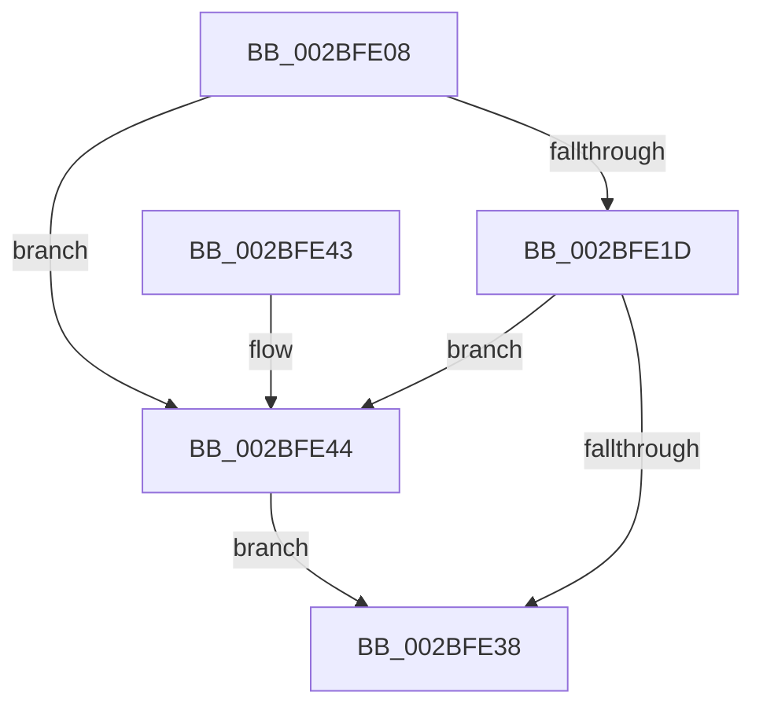

# PopFxQueueWorkItem

- RVA: `0x002BFE08`–`0x002BFE68` (길이 `96` bytes)
- VA: `0x00000001402BFE08`
- 실행 섹션: `.text`
- PDB 이름 있음: `예`; PDB Function 태그: `아니요`
- unwind 정보 RVA: `0x0006E554`
- 디코드: `29`개 명령, `96/96` bytes 표시
- 미해석 바이트: `0` (있으면 어셈블리에 `.byte`로 보존)

> 이 문서는 커널 이미지의 기계어와 PDB 기호를 분석해 생성했습니다. 4번과 5번은 함수 원형과 자료형을 바이너리 사용 방식에서 추정한 C 해석이며 원본 소스 복구 결과는 아닙니다.

## 1. Dependencies

- 직접 호출 지점: **3**; 고유 호출 대상: **3**
- 직접 호출자로 확인된 함수: **1**
- RIP 상대 이미지 참조: **1**

### Outgoing calls
- `0x002BFE2F` → [ExpTryQueueWorkItem](../39/ExpTryQueueWorkItem_function_0039801C.md) (function, `0x0039801C`)
- `0x002BFE4F` → [ExInterlockedInsertTailList](../38/ExInterlockedInsertTailList_function_00386700.md) (function, `0x00386700`)
- `0x002BFE61` → [KeReleaseSemaphore](../39/KeReleaseSemaphore_function_00397080.md) (function, `0x00397080`)

### Direct callers
- [PopFxQueueWorkOrder](PopFxQueueWorkOrder_function_002BFD34.md) at `0x002BFD85`

### Static image references
- `0x002BFE1D` → RVA `0x00FC6EA0` (`ALMOSTRO`; read)

## 2. Other-region calls and transfers

- 다른 실행 섹션으로 향하는 call: **0**
- 별도 외부 분기/꼬리 이동을 확인하지 못했습니다.

## 3. Assembly (complete function range)

```asm
002BFE08  48 89 5C 24 08                  mov qword ptr [rsp + 8], rbx
002BFE0D  57                              push rdi
002BFE0E  48 83 EC 20                     sub rsp, 0x20
002BFE12  48 8B FA                        mov rdi, rdx
002BFE15  48 8B D9                        mov rbx, rcx
002BFE18  45 84 C0                        test r8b, r8b
002BFE1B  75 27                           jne 0x1402bfe44
002BFE1D  48 8B 0D 7C 70 D0 00            mov rcx, qword ptr [rip + 0xd0707c]
002BFE24  45 33 C9                        xor r9d, r9d
002BFE27  48 8B 49 10                     mov rcx, qword ptr [rcx + 0x10]
002BFE2B  45 8D 41 30                     lea r8d, [r9 + 0x30]
002BFE2F  E8 E8 81 0D 00                  call 0x14039801c
002BFE34  84 C0                           test al, al
002BFE36  74 0C                           je 0x1402bfe44
002BFE38  48 8B 5C 24 30                  mov rbx, qword ptr [rsp + 0x30]
002BFE3D  48 83 C4 20                     add rsp, 0x20
002BFE41  5F                              pop rdi
002BFE42  C3                              ret
002BFE43  CC                              int3
002BFE44  4C 8D 43 08                     lea r8, [rbx + 8]
002BFE48  48 8B D7                        mov rdx, rdi
002BFE4B  48 8D 4B 10                     lea rcx, [rbx + 0x10]
002BFE4F  E8 AC 68 0C 00                  call 0x140386700
002BFE54  45 33 C9                        xor r9d, r9d
002BFE57  48 8D 4B 20                     lea rcx, [rbx + 0x20]
002BFE5B  33 D2                           xor edx, edx
002BFE5D  45 8D 41 01                     lea r8d, [r9 + 1]
002BFE61  E8 1A 72 0D 00                  call 0x140397080
002BFE66  EB D0                           jmp 0x1402bfe38
```

## 4. C-style interpretation (structured pseudocode)

```c
__int64 __fastcall PopFxQueueWorkItem(__int64 a1, __int64 a2, unsigned __int8 a3, int a4)
{
    __int64 result;
    __int64 v_rsp;
    unsigned __int64 v_stack_p8;

    v_stack_p8 = v_rbx;
    v_rsp = (v_rsp) - (32);
    if (a3 != 0) goto loc_002BFE44;
    a4 = 0;
    result = ExpTryQueueWorkItem(*(unsigned __int64 *)(*(unsigned __int64 *)(v_rip + 13660284) + 16), a2, a4 + 48, a4);
    if ((unsigned __int8)(result) == 0) goto loc_002BFE44;
loc_002BFE38:
    v_rsp = (v_rsp) + (32);
    return result;
loc_002BFE44:
    result = ExInterlockedInsertTailList(v_stack_p8 + 16, a2, v_stack_p8 + 8, a4);
    a4 = 0;
    a2 = 0;
    result = KeReleaseSemaphore(v_stack_p8 + 32, a2, a4 + 1, a4);
    goto loc_002BFE38;
}
```

## 5. (Beta) C Style

```c
int64_t PopFxQueueWorkItem(void *Arg1, int64_t Arg2, uint8_t Arg3, int32_t Arg4)
{
    uint8_t *arg1 = (uint8_t *)Arg1;

    int64_t result;
    int64_t local_rsp;
    uint64_t v_stack_p8;

    v_stack_p8 = local_rbx;
    local_rsp = (local_rsp) - (32);
    if (Arg3 != 0) goto loc_002BFE44;
    Arg4 = 0;
    result = ExpTryQueueWorkItem(*(uint64_t *)(*(uint64_t *)(v_rip + 0xD0707C) + 0x10), Arg2, Arg4 + 48, Arg4);
    if ((uint8_t)(result) == 0) goto loc_002BFE44;
loc_002BFE38:
    local_rsp = (local_rsp) + (32);
    return result;
loc_002BFE44:
    result = ExInterlockedInsertTailList(v_stack_p8 + 16, Arg2, v_stack_p8 + 8, Arg4);
    Arg4 = 0;
    Arg2 = 0;
    result = KeReleaseSemaphore(v_stack_p8 + 32, Arg2, Arg4 + 1, Arg4);
    goto loc_002BFE38;
}
```

### 관측된 메모리 오프셋

구조체 형식이 확인되지 않은 접근은 인자 기준의 오프셋으로만 기록했습니다.

| 기준 인자 | 오프셋 표현 | 폭 (bit) | 접근 |
|---|---:|---:|---|
| `Arg1` | `+ 0x8` | `64` | `R` |
| `Arg1` | `+ 0x10` | `64` | `R` |
| `Arg1` | `+ 0x20` | `64` | `R` |

## 6. Execution-region graph

[열기: 2D/3D 그래프와 함수 탐색 컨트롤 패널](../../../control-panel.html?section=text&rva=0x002BFE08&view=graph)

- 2D 그래프는 위에서 아래로 흐르고, 3D 그래프는 빈 공간을 드래그해 회전합니다. Shift+드래그는 이동, 휠은 확대·축소, 함수 노드 선택은 대상 보고서 이동입니다.

### Static fallback


