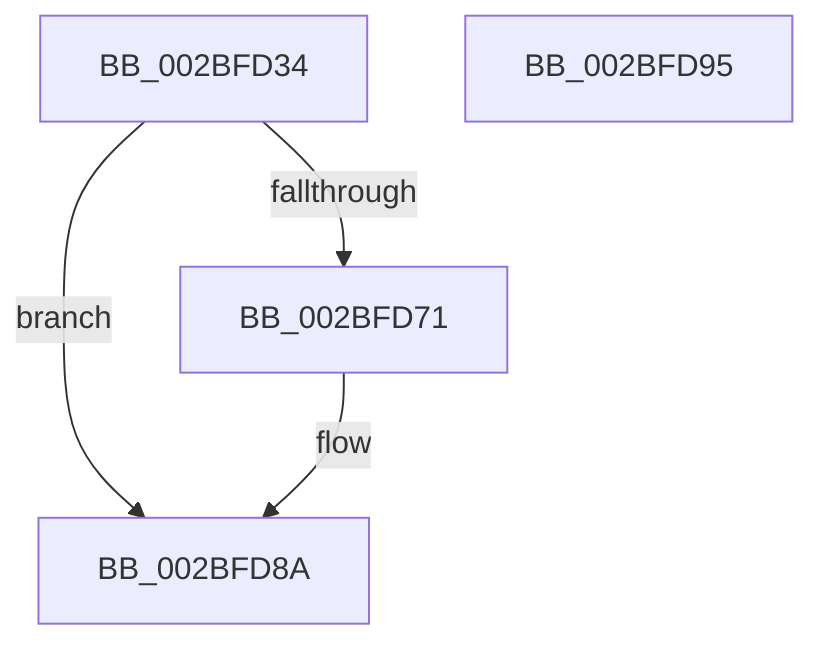

# PopFxQueueWorkOrder

- RVA: `0x002BFD34`–`0x002BFD96` (길이 `98` bytes)
- VA: `0x00000001402BFD34`
- 실행 섹션: `.text`
- PDB 이름 있음: `예`; PDB Function 태그: `아니요`
- unwind 정보 RVA: `0x0005CAAC`
- 디코드: `27`개 명령, `98/98` bytes 표시
- 미해석 바이트: `0` (있으면 어셈블리에 `.byte`로 보존)

> 이 문서는 커널 이미지의 기계어와 PDB 기호를 분석해 생성했습니다. 4번과 5번은 함수 원형과 자료형을 바이너리 사용 방식에서 추정한 C 해석이며 원본 소스 복구 결과는 아닙니다.

## 1. Dependencies

- 직접 호출 지점: **2**; 고유 호출 대상: **2**
- 직접 호출자로 확인된 함수: **4**
- RIP 상대 이미지 참조: **2**

### Outgoing calls
- `0x002BFD77` → [PopFxReferenceDevice](PopFxReferenceDevice_function_002BFD9C.md) (function, `0x002BFD9C`)
- `0x002BFD85` → [PopFxQueueWorkItem](PopFxQueueWorkItem_function_002BFE08.md) (function, `0x002BFE08`)

### Direct callers
- [PopFxIdleComponent](../2C/PopFxIdleComponent_function_002C01D8.md) at `0x002C030E`
- [PoFxCompleteDevicePowerNotRequired](../4A/PoFxCompleteDevicePowerNotRequired_function_004A3BE0.md) at `0x004A3C58`
- [PopFxIssueComponentPerfStateChanges](../4C/PopFxIssueComponentPerfStateChanges_function_004C1940.md) at `0x004C1AEE`
- [PopFxIssueDirectedPowerTransition](../5D/PopFxIssueDirectedPowerTransition_function_005D2E2C.md) at `0x005D2F21`

### Static image references
- `0x002BFD44` → RVA `0x00F0E2A0` (`.data`; read)
- `0x002BFD52` → RVA `0x00F0E580` (`.data`; read)

## 2. Other-region calls and transfers

- 다른 실행 섹션으로 향하는 call: **0**
- 별도 외부 분기/꼬리 이동을 확인하지 못했습니다.

## 3. Assembly (complete function range)

```asm
002BFD34  48 89 5C 24 08                  mov qword ptr [rsp + 8], rbx
002BFD39  57                              push rdi
002BFD3A  48 83 EC 20                     sub rsp, 0x20
002BFD3E  8B 82 60 03 00 00               mov eax, dword ptr [rdx + 0x360]
002BFD44  48 8D 3D 55 E5 C4 00            lea rdi, [rip + 0xc4e555]
002BFD4B  0F BA E0 0C                     bt eax, 0xc
002BFD4F  4C 8B C2                        mov r8, rdx
002BFD52  48 8D 05 27 E8 C4 00            lea rax, [rip + 0xc4e827]
002BFD59  48 8B D9                        mov rbx, rcx
002BFD5C  48 0F 42 F8                     cmovb rdi, rax
002BFD60  B8 01 00 00 00                  mov eax, 1
002BFD65  F0 0F C1 41 20                  lock xadd dword ptr [rcx + 0x20], eax
002BFD6A  FF C0                           inc eax
002BFD6C  83 F8 01                        cmp eax, 1
002BFD6F  75 19                           jne 0x1402bfd8a
002BFD71  8D 50 03                        lea edx, [rax + 3]
002BFD74  49 8B C8                        mov rcx, r8
002BFD77  E8 20 00 00 00                  call 0x1402bfd9c
002BFD7C  45 33 C0                        xor r8d, r8d
002BFD7F  48 8B D3                        mov rdx, rbx
002BFD82  48 8B CF                        mov rcx, rdi
002BFD85  E8 7E 00 00 00                  call 0x1402bfe08
002BFD8A  48 8B 5C 24 30                  mov rbx, qword ptr [rsp + 0x30]
002BFD8F  48 83 C4 20                     add rsp, 0x20
002BFD93  5F                              pop rdi
002BFD94  C3                              ret
002BFD95  CC                              int3
```

## 4. C-style interpretation (structured pseudocode)

```c
__int64 __fastcall PopFxQueueWorkOrder(__int64 a1, __int64 a2)
{
    __int64 result;
    __int64 v_rdi;
    __int64 v_rsp;
    unsigned __int64 v_stack_p8;

    v_stack_p8 = v_rbx;
    v_rsp = (v_rsp) - (32);
    v_rdi = v_rip + 12903765;
    if (condition_is_below) { v_rdi = v_rip + 12904487; }
    result = (unsigned int)((1) + 1);
    if (((unsigned int)(result)) == 1) {
        a2 = result + 3;
        a1 = a2;
        result = PopFxReferenceDevice(a1, a2, a2, a4);
        a3 = 0;
        a2 = a1;
        a1 = v_rdi;
        result = PopFxQueueWorkItem(a1, a2, a3, a4);
    }
    v_rsp = (v_rsp) + (32);
    return result;
}
```

## 5. (Beta) C Style

```c
int64_t PopFxQueueWorkOrder(void *Arg1, void *Arg2)
{
    uint8_t *arg1 = (uint8_t *)Arg1;
    uint8_t *arg2 = (uint8_t *)Arg2;

    int64_t result;
    int64_t local_rdi;
    int64_t local_rsp;
    uint64_t v_stack_p8;

    v_stack_p8 = local_rbx;
    local_rsp = (local_rsp) - (32);
    local_rdi = v_rip + 12903765;
    if (condition_is_below) { local_rdi = v_rip + 12904487; }
    result = (uint32_t)((1) + 1);
    if (((uint32_t)(result)) == 1) {
        Arg2 = result + 3;
        Arg1 = Arg2;
        result = PopFxReferenceDevice(Arg1, Arg2, Arg2, a4);
        a3 = 0;
        Arg2 = Arg1;
        Arg1 = local_rdi;
        result = PopFxQueueWorkItem(Arg1, Arg2, a3, a4);
    }
    local_rsp = (local_rsp) + (32);
    return result;
}
```

### 관측된 메모리 오프셋

구조체 형식이 확인되지 않은 접근은 인자 기준의 오프셋으로만 기록했습니다.

| 기준 인자 | 오프셋 표현 | 폭 (bit) | 접근 |
|---|---:|---:|---|
| `Arg1` | `+ 0x20` | `32` | `R/W` |
| `Arg2` | `+ 0x360` | `32` | `R` |

## 6. Execution-region graph

[열기: 2D/3D 그래프와 함수 탐색 컨트롤 패널](../../../control-panel.html?section=text&rva=0x002BFD34&view=graph)

- 2D 그래프는 위에서 아래로 흐르고, 3D 그래프는 빈 공간을 드래그해 회전합니다. Shift+드래그는 이동, 휠은 확대·축소, 함수 노드 선택은 대상 보고서 이동입니다.

### Static fallback


