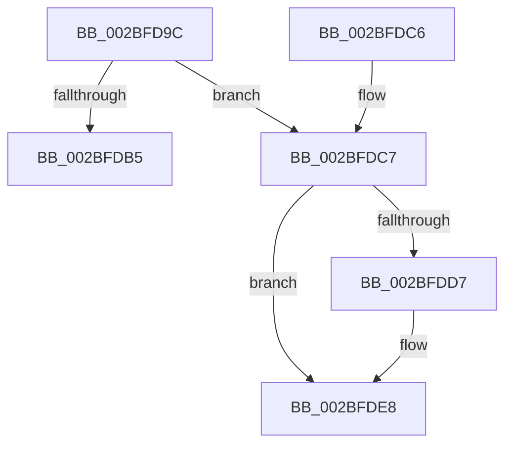

# PopFxReferenceDevice

- RVA: `0x002BFD9C`–`0x002BFE00` (길이 `100` bytes)
- VA: `0x00000001402BFD9C`
- 실행 섹션: `.text`
- PDB 이름 있음: `예`; PDB Function 태그: `아니요`
- unwind 정보 RVA: `0x0005E698`
- 디코드: `26`개 명령, `100/100` bytes 표시
- 미해석 바이트: `0` (있으면 어셈블리에 `.byte`로 보존)

> 이 문서는 커널 이미지의 기계어와 PDB 기호를 분석해 생성했습니다. 4번과 5번은 함수 원형과 자료형을 바이너리 사용 방식에서 추정한 C 해석이며 원본 소스 복구 결과는 아닙니다.

## 1. Dependencies

- 직접 호출 지점: **2**; 고유 호출 대상: **2**
- 직접 호출자로 확인된 함수: **13**
- RIP 상대 이미지 참조: **0**

### Outgoing calls
- `0x002BFDE3` → [KeSetEvent](../33/KeSetEvent_function_0033F310.md) (function, `0x0033F310`)
- `0x002BFDFA` → [PopFxBugCheck](PopFxBugCheck_function_002BFC6C.md) (function, `0x002BFC6C`)

### Direct callers
- [PopFxQueueWorkOrder](PopFxQueueWorkOrder_function_002BFD34.md) at `0x002BFD77`
- [PopFxActivateComponentWorker](../2D/PopFxActivateComponentWorker_function_002D9F60.md) at `0x002D9F8A`
- [PopFxIdleWorkerTail](../43/PopFxIdleWorkerTail_function_0043CDA0.md) at `0x0043CECD`
- [PopFxBuildDirectedDripsCandidateDeviceList](../49/PopFxBuildDirectedDripsCandidateDeviceList_function_00499288.md) at `0x0049936F`
- [PopFxBuildDripsBlockingDeviceList](../49/PopFxBuildDripsBlockingDeviceList_function_0049B5B0.md) at `0x0049B9B3`
- [PopFxActivateDevice](../4A/PopFxActivateDevice_function_004A0DC8.md) at `0x004A0E7F`
- [PopFxClearDeviceConstraints](../4B/PopFxClearDeviceConstraints_function_004B05F8.md) at `0x004B0659`
- [PoFxAddComponentRelation](../5D/PoFxAddComponentRelation_function_005D15E0.md) at `0x005D1680`
- [PoFxAddDeviceRelation](../5D/PoFxAddDeviceRelation_function_005D1850.md) at `0x005D18D2`
- [PoFxRemoveComponentRelation](../5D/PoFxRemoveComponentRelation_function_005D1C90.md) at `0x005D1D35`
- [PoFxRemoveDeviceRelation](../5D/PoFxRemoveDeviceRelation_function_005D1EF0.md) at `0x005D1F6E`
- [PopFxGetParentFxDevice](../5D/PopFxGetParentFxDevice_function_005D2B9C.md) at `0x005D2BD8`
- [PopFxIssueDirectedPowerTransition](../5D/PopFxIssueDirectedPowerTransition_function_005D2E2C.md) at `0x005D2EFA`

### Static image references
- 디코드된 RIP-relative 메모리 참조가 없습니다.

## 2. Other-region calls and transfers

- 다른 실행 섹션으로 향하는 call: **0**
- 별도 외부 분기/꼬리 이동을 확인하지 못했습니다.

## 3. Assembly (complete function range)

```asm
002BFD9C  40 53                           push rbx
002BFD9E  48 83 EC 20                     sub rsp, 0x20
002BFDA2  48 8B D9                        mov rbx, rcx
002BFDA5  F0 FF 81 F4 00 00 00            lock inc dword ptr [rcx + 0xf4]
002BFDAC  80 B9 F0 00 00 00 00            cmp byte ptr [rcx + 0xf0], 0
002BFDB3  75 12                           jne 0x1402bfdc7
002BFDB5  48 63 C2                        movsxd rax, edx
002BFDB8  F0 FF 84 81 10 01 00 00         lock inc dword ptr [rcx + rax*4 + 0x110]
002BFDC0  48 83 C4 20                     add rsp, 0x20
002BFDC4  5B                              pop rbx
002BFDC5  C3                              ret
002BFDC6  CC                              int3
002BFDC7  83 C8 FF                        or eax, 0xffffffff
002BFDCA  F0 0F C1 81 F4 00 00 00         lock xadd dword ptr [rcx + 0xf4], eax
002BFDD2  83 F8 01                        cmp eax, 1
002BFDD5  75 11                           jne 0x1402bfde8
002BFDD7  48 81 C1 F8 00 00 00            add rcx, 0xf8
002BFDDE  45 33 C0                        xor r8d, r8d
002BFDE1  33 D2                           xor edx, edx
002BFDE3  E8 28 F5 07 00                  call 0x14033f310
002BFDE8  45 33 C9                        xor r9d, r9d
002BFDEB  49 C7 C0 56 00 00 C0            mov r8, 0xffffffffc0000056
002BFDF2  48 8B D3                        mov rdx, rbx
002BFDF5  B9 07 06 00 00                  mov ecx, 0x607
002BFDFA  E8 6D FE FF FF                  call 0x1402bfc6c
002BFDFF  CC                              int3
```

## 4. C-style interpretation (structured pseudocode)

```c
__int64 __fastcall PopFxReferenceDevice(__int64 a1, int a2, int a3, int a4)
{
    __int64 result;
    __int64 v_rsp;

    v_rsp = (v_rsp) - (32);
    if ((*(unsigned __int8 *)(a1 + 240)) != 0) goto loc_002BFDC7;
    v_rsp = (v_rsp) + (32);
    return (int)(a2);
loc_002BFDC7:
    result = (unsigned int)(((int)(a2)) | (0xFFFFFFFFULL));
    if (((unsigned int)(result)) == 1) {
        a1 = (a1) + (248);
        a3 = 0;
        a2 = 0;
        result = KeSetEvent(a1, a2, a3, a4);
    }
    a4 = 0;
    result = PopFxBugCheck((unsigned int)(0x607ULL), a1, 0xFFFFFFFFC0000056ULL, a4);
    return result;
}
```

## 5. (Beta) C Style

```c
int64_t PopFxReferenceDevice(void *Arg1, int32_t Arg2, int32_t Arg3, int32_t Arg4)
{
    uint8_t *arg1 = (uint8_t *)Arg1;

    int64_t result;
    int64_t local_rsp;

    local_rsp = (local_rsp) - (32);
    if ((*(uint8_t *)(arg1 + 0xF0)) != 0) goto loc_002BFDC7;
    local_rsp = (local_rsp) + (32);
    return (int32_t)(Arg2);
loc_002BFDC7:
    result = (uint32_t)(((int32_t)(Arg2)) | (0xFFFFFFFFULL));
    if (((uint32_t)(result)) == 1) {
        Arg1 = (Arg1) + (248);
        Arg3 = 0;
        Arg2 = 0;
        result = KeSetEvent(Arg1, Arg2, Arg3, Arg4);
    }
    Arg4 = 0;
    result = PopFxBugCheck((uint32_t)(0x607ULL), Arg1, 0xFFFFFFFFC0000056ULL, Arg4);
    return result;
}
```

### 관측된 메모리 오프셋

구조체 형식이 확인되지 않은 접근은 인자 기준의 오프셋으로만 기록했습니다.

| 기준 인자 | 오프셋 표현 | 폭 (bit) | 접근 |
|---|---:|---:|---|
| `Arg1` | `+ 0xF0` | `8` | `R` |
| `Arg1` | `+ 0xF4` | `32` | `R/W` |
| `Arg1` | `+ 0x110 + rax*4` | `32` | `R/W` |

## 6. Execution-region graph

[열기: 2D/3D 그래프와 함수 탐색 컨트롤 패널](../../../control-panel.html?section=text&rva=0x002BFD9C&view=graph)

- 2D 그래프는 위에서 아래로 흐르고, 3D 그래프는 빈 공간을 드래그해 회전합니다. Shift+드래그는 이동, 휠은 확대·축소, 함수 노드 선택은 대상 보고서 이동입니다.

### Static fallback


