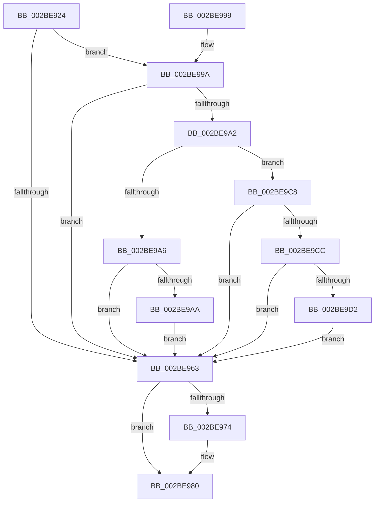

# PopFxUpdateComponentAccountingEnhanced

- RVA: `0x002BE924`–`0x002BE9E9` (길이 `197` bytes)
- VA: `0x00000001402BE924`
- 실행 섹션: `.text`
- PDB 이름 있음: `예`; PDB Function 태그: `아니요`
- unwind 정보 RVA: `0x0006E40C`
- 디코드: `53`개 명령, `197/197` bytes 표시
- 미해석 바이트: `0` (있으면 어셈블리에 `.byte`로 보존)

> 이 문서는 커널 이미지의 기계어와 PDB 기호를 분석해 생성했습니다. 4번과 5번은 함수 원형과 자료형을 바이너리 사용 방식에서 추정한 C 해석이며 원본 소스 복구 결과는 아닙니다.

## 1. Dependencies

- 직접 호출 지점: **4**; 고유 호출 대상: **4**
- 직접 호출자로 확인된 함수: **2**
- RIP 상대 이미지 참조: **1**

### Outgoing calls
- `0x002BE955` → [KeAcquireSpinLockRaiseToDpc](../20/KeAcquireSpinLockRaiseToDpc_function_00208470.md) (function, `0x00208470`)
- `0x002BE966` → [KxReleaseSpinLock](../20/KxReleaseSpinLock_function_00206670.md) (function, `0x00206670`)
- `0x002BE97B` → [KiLowerIrqlProcessIrqlFlags](../4F/KiLowerIrqlProcessIrqlFlags_function_004F5698.md) (function, `0x004F5698`)
- `0x002BE9BD` → [PopFxUpdateAccountingActiveTime](../43/PopFxUpdateAccountingActiveTime_function_0043D2EC.md) (function, `0x0043D2EC`)

### Direct callers
- [PopPepStartComponentIdleStateChangeActivity](PopPepStartComponentIdleStateChangeActivity_function_002BE7C0.md) at `0x002BE8E5`
- [PopPepDeviceDState](PopPepDeviceDState_function_002BFE70.md) at `0x002C00D3`
- [PopPepDeviceDState](PopPepDeviceDState_function_002BFE70.md) at `0x002C0156`

### Static image references
- `0x002BE96B` → RVA `0x00FC6D20` (`ALMOSTRO`; read)

## 2. Other-region calls and transfers

- 다른 실행 섹션으로 향하는 call: **0**
- 별도 외부 분기/꼬리 이동을 확인하지 못했습니다.

## 3. Assembly (complete function range)

```asm
002BE924  48 89 5C 24 08                  mov qword ptr [rsp + 8], rbx
002BE929  48 89 6C 24 10                  mov qword ptr [rsp + 0x10], rbp
002BE92E  48 89 74 24 18                  mov qword ptr [rsp + 0x18], rsi
002BE933  57                              push rdi
002BE934  48 83 EC 20                     sub rsp, 0x20
002BE938  48 8B 81 68 03 00 00            mov rax, qword ptr [rcx + 0x368]
002BE93F  41 8B E9                        mov ebp, r9d
002BE942  8B D2                           mov edx, edx
002BE944  41 8B F8                        mov edi, r8d
002BE947  48 8B 1C D0                     mov rbx, qword ptr [rax + rdx*8]
002BE94B  48 81 C3 C8 00 00 00            add rbx, 0xc8
002BE952  48 8B CB                        mov rcx, rbx
002BE955  E8 16 9B F4 FF                  call 0x140208470
002BE95A  83 7B 10 02                     cmp dword ptr [rbx + 0x10], 2
002BE95E  0F B6 F0                        movzx esi, al
002BE961  74 37                           je 0x1402be99a
002BE963  48 8B CB                        mov rcx, rbx
002BE966  E8 05 7D F4 FF                  call 0x140206670
002BE96B  83 3D AE 83 D0 00 00            cmp dword ptr [rip + 0xd083ae], 0
002BE972  74 0C                           je 0x1402be980
002BE974  44 0F 20 C1                     mov rcx, cr8
002BE978  40 8A D6                        mov dl, sil
002BE97B  E8 18 6D 23 00                  call 0x1404f5698
002BE980  44 0F 22 C6                     mov cr8, rsi
002BE984  48 8B 5C 24 30                  mov rbx, qword ptr [rsp + 0x30]
002BE989  48 8B 6C 24 38                  mov rbp, qword ptr [rsp + 0x38]
002BE98E  48 8B 74 24 40                  mov rsi, qword ptr [rsp + 0x40]
002BE993  48 83 C4 20                     add rsp, 0x20
002BE997  5F                              pop rdi
002BE998  C3                              ret
002BE999  CC                              int3
002BE99A  8B 4B 0C                        mov ecx, dword ptr [rbx + 0xc]
002BE99D  83 F9 FF                        cmp ecx, -1
002BE9A0  74 C1                           je 0x1402be963
002BE9A2  85 ED                           test ebp, ebp
002BE9A4  74 22                           je 0x1402be9c8
002BE9A6  3B F9                           cmp edi, ecx
002BE9A8  72 B9                           jb 0x1402be963
002BE9AA  48 BA 08 00 00 00 80 F7 FF FF   movabs rdx, 0xfffff78000000008
002BE9B4  45 33 C0                        xor r8d, r8d
002BE9B7  48 8B CB                        mov rcx, rbx
002BE9BA  48 8B 12                        mov rdx, qword ptr [rdx]
002BE9BD  E8 2A E9 17 00                  call 0x14043d2ec
002BE9C2  C6 43 08 00                     mov byte ptr [rbx + 8], 0
002BE9C6  EB 9B                           jmp 0x1402be963
002BE9C8  85 FF                           test edi, edi
002BE9CA  75 97                           jne 0x1402be963
002BE9CC  40 38 7B 08                     cmp byte ptr [rbx + 8], dil
002BE9D0  75 91                           jne 0x1402be963
002BE9D2  48 A1 08 00 00 00 80 F7 FF FF   movabs rax, qword ptr [0xfffff78000000008]
002BE9DC  48 89 43 18                     mov qword ptr [rbx + 0x18], rax
002BE9E0  C6 43 08 01                     mov byte ptr [rbx + 8], 1
002BE9E4  E9 7A FF FF FF                  jmp 0x1402be963
```

## 4. C-style interpretation (structured pseudocode)

```c
__int64 __fastcall PopFxUpdateComponentAccountingEnhanced(__int64 a1, int a2, int a3, int a4)
{
    __int64 result;
    __int64 v_rbx;
    __int64 v_rsp;
    unsigned __int64 v_stack_p10;
    unsigned __int64 v_stack_p18;
    unsigned __int64 v_stack_p8;

    v_stack_p8 = v_rbx;
    v_stack_p10 = v_rbp;
    v_stack_p18 = v_rsi;
    v_rsp = (v_rsp) - (32);
    v_rbx = (*(unsigned __int64 *)(*(unsigned __int64 *)(a1 + 872) + (unsigned int)(a2) * 8)) + (200);
    result = KeAcquireSpinLockRaiseToDpc(v_rbx, (unsigned int)(a2), a3, a4);
    if ((*(unsigned int *)(v_rbx + 16)) == 2) goto loc_002BE99A;
loc_002BE963:
    result = KxReleaseSpinLock(v_rbx, (unsigned int)(a2), a3, a4);
    if ((*(unsigned int *)(v_rip + 13665198)) != 0) {
        a1 = v_cr8;
        a2 = (unsigned __int8)((unsigned __int8)(result));
        result = KiLowerIrqlProcessIrqlFlags(a1, a2, a3, a4);
    }
    v_rsp = (v_rsp) + (32);
    return result;
loc_002BE99A:
    if (((unsigned int)((unsigned int)(*(unsigned int *)(v_stack_p8 + 12)))) == -1) goto loc_002BE963;
    if ((unsigned int)(v_stack_p10) == 0) goto loc_002BE9C8;
    if (((unsigned int)((unsigned int)(a3))) < ((unsigned int)((unsigned int)(*(unsigned int *)(v_stack_p8 + 12))))) goto loc_002BE963;
    a3 = 0;
    result = PopFxUpdateAccountingActiveTime(v_stack_p8, *(unsigned __int64 *)(a2), a3, a4);
    *(unsigned __int8 *)(v_stack_p8 + 8) = 0;
    goto loc_002BE963;
loc_002BE9C8:
    if ((unsigned int)((unsigned int)(a3)) != 0) goto loc_002BE963;
    if ((*(unsigned __int8 *)(v_stack_p8 + 8)) != ((unsigned __int8)((unsigned int)(a3)))) goto loc_002BE963;
    *(unsigned __int64 *)(v_stack_p8 + 24) = result;
    *(unsigned __int8 *)(v_stack_p8 + 8) = 1;
    goto loc_002BE963;
}
```

## 5. (Beta) C Style

```c
int64_t PopFxUpdateComponentAccountingEnhanced(void *Arg1, int32_t Arg2, int32_t Arg3, int32_t Arg4)
{
    uint8_t *arg1 = (uint8_t *)Arg1;

    int64_t result;
    int64_t local_rbx;
    int64_t local_rsp;
    uint64_t v_stack_p10;
    uint64_t v_stack_p18;
    uint64_t v_stack_p8;

    v_stack_p8 = local_rbx;
    v_stack_p10 = local_rbp;
    v_stack_p18 = local_rsi;
    local_rsp = (local_rsp) - (32);
    local_rbx = (*(uint64_t *)(*(uint64_t *)(arg1 + 0x368) + (uint32_t)(Arg2) * 8)) + (200);
    result = KeAcquireSpinLockRaiseToDpc(local_rbx, (uint32_t)(Arg2), Arg3, Arg4);
    if ((*(uint32_t *)(local_rbx + 0x10)) == 2) goto loc_002BE99A;
loc_002BE963:
    result = KxReleaseSpinLock(local_rbx, (uint32_t)(Arg2), Arg3, Arg4);
    if ((*(uint32_t *)(v_rip + 0xD083AE)) != 0) {
        Arg1 = v_cr8;
        Arg2 = (uint8_t)((uint8_t)(result));
        result = KiLowerIrqlProcessIrqlFlags(Arg1, Arg2, Arg3, Arg4);
    }
    local_rsp = (local_rsp) + (32);
    return result;
loc_002BE99A:
    if (((uint32_t)((uint32_t)(*(uint32_t *)(v_stack_p8 + 0xC)))) == -1) goto loc_002BE963;
    if ((uint32_t)(v_stack_p10) == 0) goto loc_002BE9C8;
    if (((uint32_t)((uint32_t)(Arg3))) < ((uint32_t)((uint32_t)(*(uint32_t *)(v_stack_p8 + 0xC))))) goto loc_002BE963;
    Arg3 = 0;
    result = PopFxUpdateAccountingActiveTime(v_stack_p8, *(uint64_t *)(Arg2), Arg3, Arg4);
    *(uint8_t *)(v_stack_p8 + 0x8) = 0;
    goto loc_002BE963;
loc_002BE9C8:
    if ((uint32_t)((uint32_t)(Arg3)) != 0) goto loc_002BE963;
    if ((*(uint8_t *)(v_stack_p8 + 0x8)) != ((uint8_t)((uint32_t)(Arg3)))) goto loc_002BE963;
    *(uint64_t *)(v_stack_p8 + 0x18) = result;
    *(uint8_t *)(v_stack_p8 + 0x8) = 1;
    goto loc_002BE963;
}
```

### 관측된 메모리 오프셋

구조체 형식이 확인되지 않은 접근은 인자 기준의 오프셋으로만 기록했습니다.

| 기준 인자 | 오프셋 표현 | 폭 (bit) | 접근 |
|---|---:|---:|---|
| `Arg1` | `+ 0x368` | `64` | `R` |

## 6. Execution-region graph

[열기: 2D/3D 그래프와 함수 탐색 컨트롤 패널](../../../control-panel.html?section=text&rva=0x002BE924&view=graph)

- 2D 그래프는 위에서 아래로 흐르고, 3D 그래프는 빈 공간을 드래그해 회전합니다. Shift+드래그는 이동, 휠은 확대·축소, 함수 노드 선택은 대상 보고서 이동입니다.

### Static fallback


