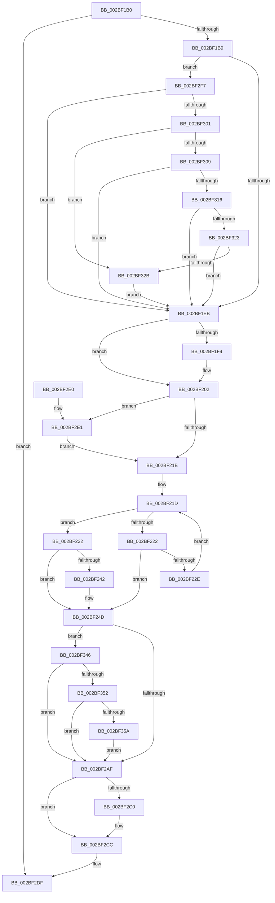

# PopPepCompleteComponentIdleStateChangeActivity

- RVA: `0x002BF1B0`–`0x002BF37B` (길이 `459` bytes)
- VA: `0x00000001402BF1B0`
- 실행 섹션: `.text`
- PDB 이름 있음: `예`; PDB Function 태그: `아니요`
- unwind 정보 RVA: `0x0006E470`
- 디코드: `109`개 명령, `459/459` bytes 표시
- 미해석 바이트: `0` (있으면 어셈블리에 `.byte`로 보존)

> 이 문서는 커널 이미지의 기계어와 PDB 기호를 분석해 생성했습니다. 4번과 5번은 함수 원형과 자료형을 바이너리 사용 방식에서 추정한 C 해석이며 원본 소스 복구 결과는 아닙니다.

## 1. Dependencies

- 직접 호출 지점: **9**; 고유 호출 대상: **9**
- 직접 호출자로 확인된 함수: **1**
- RIP 상대 이미지 참조: **1**

### Outgoing calls
- `0x002BF1FD` → [KeSetEvent](../33/KeSetEvent_function_0033F310.md) (function, `0x0033F310`)
- `0x002BF205` → [PopPepGetComponentPreferedIdleState](PopPepGetComponentPreferedIdleState_function_002BF800.md) (function, `0x002BF800`)
- `0x002BF27C` → [PopPepUpdateIdleStateRefCount](PopPepUpdateIdleStateRefCount_function_002BF930.md) (function, `0x002BF930`)
- `0x002BF29D` → [KeAcquireSpinLockRaiseToDpc](../20/KeAcquireSpinLockRaiseToDpc_function_00208470.md) (function, `0x00208470`)
- `0x002BF2B2` → [KxReleaseSpinLock](../20/KxReleaseSpinLock_function_00206670.md) (function, `0x00206670`)
- `0x002BF2C7` → [KiLowerIrqlProcessIrqlFlags](../4F/KiLowerIrqlProcessIrqlFlags_function_004F5698.md) (function, `0x004F5698`)
- `0x002BF2ED` → [PopPepTriggerActivity](../24/PopPepTriggerActivity_function_0024CDB0.md) (function, `0x0024CDB0`)
- `0x002BF33C` → [PopFxUpdateComponentPerfStateNominalChange](../5D/PopFxUpdateComponentPerfStateNominalChange_function_005D3790.md) (function, `0x005D3790`)
- `0x002BF36D` → [PopFxUpdateAccountingActiveTime](../43/PopFxUpdateAccountingActiveTime_function_0043D2EC.md) (function, `0x0043D2EC`)

### Direct callers
- [PopPepProcessEvent](../24/PopPepProcessEvent_function_0024B930.md) at `0x0024C414`

### Static image references
- `0x002BF2B7` → RVA `0x00FC6D20` (`ALMOSTRO`; read)

## 2. Other-region calls and transfers

- 다른 실행 섹션으로 향하는 call: **0**
- 별도 외부 분기/꼬리 이동을 확인하지 못했습니다.

## 3. Assembly (complete function range)

```asm
002BF1B0  48 85 D2                        test rdx, rdx
002BF1B3  0F 84 26 01 00 00               je 0x1402bf2df
002BF1B9  48 89 5C 24 08                  mov qword ptr [rsp + 8], rbx
002BF1BE  48 89 74 24 10                  mov qword ptr [rsp + 0x10], rsi
002BF1C3  57                              push rdi
002BF1C4  48 83 EC 20                     sub rsp, 0x20
002BF1C8  48 8B 42 40                     mov rax, qword ptr [rdx + 0x40]
002BF1CC  48 8B DA                        mov rbx, rdx
002BF1CF  48 8B F9                        mov rdi, rcx
002BF1D2  83 60 0C 00                     and dword ptr [rax + 0xc], 0
002BF1D6  48 8B 42 40                     mov rax, qword ptr [rdx + 0x40]
002BF1DA  C6 40 10 00                     mov byte ptr [rax + 0x10], 0
002BF1DE  80 BA B8 00 00 00 00            cmp byte ptr [rdx + 0xb8], 0
002BF1E5  0F 85 0C 01 00 00               jne 0x1402bf2f7
002BF1EB  83 BB B0 00 00 00 00            cmp dword ptr [rbx + 0xb0], 0
002BF1F2  75 0E                           jne 0x1402bf202
002BF1F4  48 8D 4B 20                     lea rcx, [rbx + 0x20]
002BF1F8  45 33 C0                        xor r8d, r8d
002BF1FB  33 D2                           xor edx, edx
002BF1FD  E8 0E 01 08 00                  call 0x14033f310
002BF202  48 8B CB                        mov rcx, rbx
002BF205  E8 F6 05 00 00                  call 0x1402bf800
002BF20A  BE 01 00 00 00                  mov esi, 1
002BF20F  3B 83 B0 00 00 00               cmp eax, dword ptr [rbx + 0xb0]
002BF215  0F 85 C6 00 00 00               jne 0x1402bf2e1
002BF21B  8B D6                           mov edx, esi
002BF21D  83 FA 03                        cmp edx, 3
002BF220  77 10                           ja 0x1402bf232
002BF222  8B C2                           mov eax, edx
002BF224  48 8B 4C C3 38                  mov rcx, qword ptr [rbx + rax*8 + 0x38]
002BF229  83 39 00                        cmp dword ptr [rcx], 0
002BF22C  75 1F                           jne 0x1402bf24d
002BF22E  03 D6                           add edx, esi
002BF230  EB EB                           jmp 0x1402bf21d
002BF232  8B 83 BC 00 00 00               mov eax, dword ptr [rbx + 0xbc]
002BF238  2B C6                           sub eax, esi
002BF23A  39 83 B0 00 00 00               cmp dword ptr [rbx + 0xb0], eax
002BF240  75 0B                           jne 0x1402bf24d
002BF242  83 63 04 FD                     and dword ptr [rbx + 4], 0xfffffffd
002BF246  F0 FF 8F 8C 00 00 00            lock dec dword ptr [rdi + 0x8c]
002BF24D  4C 8B 93 C8 00 00 00            mov r10, qword ptr [rbx + 0xc8]
002BF254  4C 8D 8B C0 00 00 00            lea r9, [rbx + 0xc0]
002BF25B  8B B3 B0 00 00 00               mov esi, dword ptr [rbx + 0xb0]
002BF261  45 33 C0                        xor r8d, r8d
002BF264  8B 83 B4 00 00 00               mov eax, dword ptr [rbx + 0xb4]
002BF26A  48 8D 14 76                     lea rdx, [rsi + rsi*2]
002BF26E  41 8B 54 D2 10                  mov edx, dword ptr [r10 + rdx*8 + 0x10]
002BF273  48 8D 0C 40                     lea rcx, [rax + rax*2]
002BF277  41 8B 4C CA 10                  mov ecx, dword ptr [r10 + rcx*8 + 0x10]
002BF27C  E8 AF 06 00 00                  call 0x1402bf930
002BF281  8B 53 08                        mov edx, dword ptr [rbx + 8]
002BF284  48 8B 47 20                     mov rax, qword ptr [rdi + 0x20]
002BF288  48 8B 88 68 03 00 00            mov rcx, qword ptr [rax + 0x368]
002BF28F  48 8B 1C D1                     mov rbx, qword ptr [rcx + rdx*8]
002BF293  48 81 C3 C8 00 00 00            add rbx, 0xc8
002BF29A  48 8B CB                        mov rcx, rbx
002BF29D  E8 CE 91 F4 FF                  call 0x140208470
002BF2A2  83 7B 10 02                     cmp dword ptr [rbx + 0x10], 2
002BF2A6  0F B6 F8                        movzx edi, al
002BF2A9  0F 84 97 00 00 00               je 0x1402bf346
002BF2AF  48 8B CB                        mov rcx, rbx
002BF2B2  E8 B9 73 F4 FF                  call 0x140206670
002BF2B7  83 3D 62 7A D0 00 00            cmp dword ptr [rip + 0xd07a62], 0
002BF2BE  74 0C                           je 0x1402bf2cc
002BF2C0  44 0F 20 C1                     mov rcx, cr8
002BF2C4  40 8A D7                        mov dl, dil
002BF2C7  E8 CC 63 23 00                  call 0x1404f5698
002BF2CC  44 0F 22 C7                     mov cr8, rdi
002BF2D0  48 8B 5C 24 30                  mov rbx, qword ptr [rsp + 0x30]
002BF2D5  48 8B 74 24 38                  mov rsi, qword ptr [rsp + 0x38]
002BF2DA  48 83 C4 20                     add rsp, 0x20
002BF2DE  5F                              pop rdi
002BF2DF  C3                              ret
002BF2E0  CC                              int3
002BF2E1  44 8B C8                        mov r9d, eax
002BF2E4  44 8B C6                        mov r8d, esi
002BF2E7  48 8B D3                        mov rdx, rbx
002BF2EA  48 8B CF                        mov rcx, rdi
002BF2ED  E8 BE DA F8 FF                  call 0x14024cdb0
002BF2F2  E9 24 FF FF FF                  jmp 0x1402bf21b
002BF2F7  80 79 7C 00                     cmp byte ptr [rcx + 0x7c], 0
002BF2FB  0F 84 EA FE FF FF               je 0x1402bf1eb
002BF301  48 8B 42 18                     mov rax, qword ptr [rdx + 0x18]
002BF305  A8 04                           test al, 4
002BF307  75 22                           jne 0x1402bf32b
002BF309  83 BA B4 00 00 00 00            cmp dword ptr [rdx + 0xb4], 0
002BF310  0F 84 D5 FE FF FF               je 0x1402bf1eb
002BF316  83 BA B0 00 00 00 00            cmp dword ptr [rdx + 0xb0], 0
002BF31D  0F 85 C8 FE FF FF               jne 0x1402bf1eb
002BF323  A8 02                           test al, 2
002BF325  0F 84 C0 FE FF FF               je 0x1402bf1eb
002BF32B  44 8B 8A B0 00 00 00            mov r9d, dword ptr [rdx + 0xb0]
002BF332  45 33 C0                        xor r8d, r8d
002BF335  8B 52 08                        mov edx, dword ptr [rdx + 8]
002BF338  48 8B 49 20                     mov rcx, qword ptr [rcx + 0x20]
002BF33C  E8 4F 44 31 00                  call 0x1405d3790
002BF341  E9 A5 FE FF FF                  jmp 0x1402bf1eb
002BF346  8B 4B 0C                        mov ecx, dword ptr [rbx + 0xc]
002BF349  83 F9 FF                        cmp ecx, -1
002BF34C  0F 84 5D FF FF FF               je 0x1402bf2af
002BF352  3B F1                           cmp esi, ecx
002BF354  0F 82 55 FF FF FF               jb 0x1402bf2af
002BF35A  48 BA 08 00 00 00 80 F7 FF FF   movabs rdx, 0xfffff78000000008
002BF364  45 33 C0                        xor r8d, r8d
002BF367  48 8B CB                        mov rcx, rbx
002BF36A  48 8B 12                        mov rdx, qword ptr [rdx]
002BF36D  E8 7A DF 17 00                  call 0x14043d2ec
002BF372  C6 43 08 00                     mov byte ptr [rbx + 8], 0
002BF376  E9 34 FF FF FF                  jmp 0x1402bf2af
```

## 4. C-style interpretation (structured pseudocode)

```c
__int64 __fastcall PopPepCompleteComponentIdleStateChangeActivity(__int64 a1, __int64 a2, int a3)
{
    __int64 result;
    __int64 v_rbx;
    __int64 v_rsp;
    unsigned __int64 v_stack_p10;
    unsigned __int64 v_stack_p8;

    if (a2 == 0) goto loc_002BF2DF;
    v_stack_p8 = v_rbx;
    v_stack_p10 = v_rsi;
    v_rsp = (v_rsp) - (32);
    *(unsigned __int8 *)(*(unsigned __int64 *)(a2 + 64) + 16) = 0;
    if ((*(unsigned __int8 *)(a2 + 184)) != 0) goto loc_002BF2F7;
loc_002BF1EB:
    result = *(unsigned __int64 *)(a2 + 64);
    if ((*(unsigned int *)(a2 + 176)) == 0) {
        a1 = a2 + 32;
        a3 = 0;
        a2 = 0;
        result = KeSetEvent(a1, a2, a3, a4);
    }
    result = PopPepGetComponentPreferedIdleState(0, a2, a3, a4);
    if (((unsigned int)(result)) != (*(unsigned int *)(a2 + 176))) goto loc_002BF2E1;
loc_002BF21B:
loc_002BF21D:
    if (1 > 3) goto loc_002BF232;
    if ((*(unsigned int *)(*(unsigned __int64 *)(a2 + 1 * 8 + 56))) != 0) goto loc_002BF24D;
    a2 = (unsigned int)((1) + (1));
    goto loc_002BF21D;
loc_002BF232:
    result = (unsigned int)(((unsigned int)(*(unsigned int *)(a2 + 188))) - (1));
    if ((*(unsigned int *)(a2 + 176)) == ((unsigned int)(result))) {
    }
    a3 = 0;
    result = PopPepUpdateIdleStateRefCount((unsigned int)(*(unsigned int *)(*(unsigned __int64 *)(a2 + 200) + (unsigned int)(*(unsigned int *)(a2 + 180)) + (unsigned int)(*(unsigned int *)(a2 + 180)) * 2 * 8 + 16)), (unsigned int)(*(unsigned int *)(*(unsigned __int64 *)(a2 + 200) + (unsigned int)(*(unsigned int *)(a2 + 176)) + (unsigned int)(*(unsigned int *)(a2 + 176)) * 2 * 8 + 16)), a3, a2 + 192);
    v_rbx = (*(unsigned __int64 *)(*(unsigned __int64 *)(*(unsigned __int64 *)(a1 + 32) + 872) + (unsigned int)(*(unsigned int *)(a2 + 8)) * 8)) + (200);
    result = KeAcquireSpinLockRaiseToDpc(v_rbx, (unsigned int)(*(unsigned int *)(a2 + 8)), a3, a2 + 192);
    if ((*(unsigned int *)(v_rbx + 16)) == 2) goto loc_002BF346;
loc_002BF2AF:
    result = KxReleaseSpinLock(v_rbx, (unsigned int)(*(unsigned int *)(a2 + 8)), a3, a2 + 192);
    if ((*(unsigned int *)(v_rip + 13662818)) != 0) {
        a1 = v_cr8;
        a2 = (unsigned __int8)((unsigned __int8)(result));
        result = KiLowerIrqlProcessIrqlFlags(a1, a2, a3, a2 + 192);
    }
    v_rsp = (v_rsp) + (32);
loc_002BF2DF:
    return result;
loc_002BF2E1:
    result = PopPepTriggerActivity((unsigned __int8)(result), v_stack_p8, (unsigned int)((unsigned int)(v_stack_p10)), (unsigned int)((unsigned int)(result)));
    goto loc_002BF21B;
loc_002BF2F7:
    if ((*(unsigned __int8 *)((unsigned __int8)(result) + 124)) == 0) goto loc_002BF1EB;
    if ((((unsigned __int8)(*(unsigned __int64 *)(v_stack_p8 + 24))) & (4)) != 0) goto loc_002BF32B;
    if ((*(unsigned int *)(v_stack_p8 + 180)) == 0) goto loc_002BF1EB;
    if ((*(unsigned int *)(v_stack_p8 + 176)) != 0) goto loc_002BF1EB;
    if ((((unsigned __int8)(*(unsigned __int64 *)(v_stack_p8 + 24))) & (2)) == 0) goto loc_002BF1EB;
loc_002BF32B:
    a3 = 0;
    result = PopFxUpdateComponentPerfStateNominalChange(*(unsigned __int64 *)((unsigned __int8)(result) + 32), (unsigned int)(*(unsigned int *)(v_stack_p8 + 8)), a3, (unsigned int)(*(unsigned int *)(v_stack_p8 + 176)));
    goto loc_002BF1EB;
loc_002BF346:
    if (((unsigned int)((unsigned int)(*(unsigned int *)(v_stack_p8 + 12)))) == -1) goto loc_002BF2AF;
    if (((unsigned int)(v_stack_p10)) < ((unsigned int)((unsigned int)(*(unsigned int *)(v_stack_p8 + 12))))) goto loc_002BF2AF;
    a3 = 0;
    result = PopFxUpdateAccountingActiveTime(v_stack_p8, *(unsigned __int64 *)((unsigned int)(*(unsigned int *)(v_stack_p8 + 8))), a3, (unsigned int)(*(unsigned int *)(v_stack_p8 + 176)));
    *(unsigned __int8 *)(v_stack_p8 + 8) = 0;
    goto loc_002BF2AF;
}
```

## 5. (Beta) C Style

```c
int64_t PopPepCompleteComponentIdleStateChangeActivity(void *Arg1, int64_t Arg2, int32_t Arg3)
{
    uint8_t *arg1 = (uint8_t *)Arg1;

    int64_t result;
    int64_t local_rbx;
    int64_t local_rsp;
    uint64_t v_stack_p10;
    uint64_t v_stack_p8;

    if (Arg2 == 0) goto loc_002BF2DF;
    v_stack_p8 = local_rbx;
    v_stack_p10 = local_rsi;
    local_rsp = (local_rsp) - (32);
    *(uint8_t *)(*(uint64_t *)(Arg2 + 0x40) + 0x10) = 0;
    if ((*(uint8_t *)(Arg2 + 0xB8)) != 0) goto loc_002BF2F7;
loc_002BF1EB:
    result = *(uint64_t *)(Arg2 + 0x40);
    if ((*(uint32_t *)(Arg2 + 0xB0)) == 0) {
        Arg1 = Arg2 + 32;
        Arg3 = 0;
        Arg2 = 0;
        result = KeSetEvent(Arg1, Arg2, Arg3, a4);
    }
    result = PopPepGetComponentPreferedIdleState(0, Arg2, Arg3, a4);
    if (((uint32_t)(result)) != (*(uint32_t *)(Arg2 + 0xB0))) goto loc_002BF2E1;
loc_002BF21B:
loc_002BF21D:
    if (1 > 3) goto loc_002BF232;
    if ((*(uint32_t *)(*(uint64_t *)(Arg2 + 0x1 * 8 + 0x38))) != 0) goto loc_002BF24D;
    Arg2 = (uint32_t)((1) + (1));
    goto loc_002BF21D;
loc_002BF232:
    result = (uint32_t)(((uint32_t)(*(uint32_t *)(Arg2 + 0xBC))) - (1));
    if ((*(uint32_t *)(Arg2 + 0xB0)) == ((uint32_t)(result))) {
    }
    Arg3 = 0;
    result = PopPepUpdateIdleStateRefCount((uint32_t)(*(uint32_t *)(*(uint64_t *)(Arg2 + 0xC8) + (uint32_t)(*(uint32_t *)(Arg2 + 0xB4)) + (uint32_t)(*(uint32_t *)(Arg2 + 0xB4)) * 2 * 8 + 0x10)), (uint32_t)(*(uint32_t *)(*(uint64_t *)(Arg2 + 0xC8) + (uint32_t)(*(uint32_t *)(Arg2 + 0xB0)) + (uint32_t)(*(uint32_t *)(Arg2 + 0xB0)) * 2 * 8 + 0x10)), Arg3, Arg2 + 192);
    local_rbx = (*(uint64_t *)(*(uint64_t *)(*(uint64_t *)(arg1 + 0x20) + 0x368) + (uint32_t)(*(uint32_t *)(Arg2 + 0x8)) * 8)) + (200);
    result = KeAcquireSpinLockRaiseToDpc(local_rbx, (uint32_t)(*(uint32_t *)(Arg2 + 0x8)), Arg3, Arg2 + 192);
    if ((*(uint32_t *)(local_rbx + 0x10)) == 2) goto loc_002BF346;
loc_002BF2AF:
    result = KxReleaseSpinLock(local_rbx, (uint32_t)(*(uint32_t *)(Arg2 + 0x8)), Arg3, Arg2 + 192);
    if ((*(uint32_t *)(v_rip + 0xD07A62)) != 0) {
        Arg1 = v_cr8;
        Arg2 = (uint8_t)((uint8_t)(result));
        result = KiLowerIrqlProcessIrqlFlags(Arg1, Arg2, Arg3, Arg2 + 192);
    }
    local_rsp = (local_rsp) + (32);
loc_002BF2DF:
    return result;
loc_002BF2E1:
    result = PopPepTriggerActivity((uint8_t)(result), v_stack_p8, (uint32_t)((uint32_t)(v_stack_p10)), (uint32_t)((uint32_t)(result)));
    goto loc_002BF21B;
loc_002BF2F7:
    if ((*(uint8_t *)((uint8_t)(result) + 0x7C)) == 0) goto loc_002BF1EB;
    if ((((uint8_t)(*(uint64_t *)(v_stack_p8 + 0x18))) & (4)) != 0) goto loc_002BF32B;
    if ((*(uint32_t *)(v_stack_p8 + 0xB4)) == 0) goto loc_002BF1EB;
    if ((*(uint32_t *)(v_stack_p8 + 0xB0)) != 0) goto loc_002BF1EB;
    if ((((uint8_t)(*(uint64_t *)(v_stack_p8 + 0x18))) & (2)) == 0) goto loc_002BF1EB;
loc_002BF32B:
    Arg3 = 0;
    result = PopFxUpdateComponentPerfStateNominalChange(*(uint64_t *)((uint8_t)(result) + 0x20), (uint32_t)(*(uint32_t *)(v_stack_p8 + 0x8)), Arg3, (uint32_t)(*(uint32_t *)(v_stack_p8 + 0xB0)));
    goto loc_002BF1EB;
loc_002BF346:
    if (((uint32_t)((uint32_t)(*(uint32_t *)(v_stack_p8 + 0xC)))) == -1) goto loc_002BF2AF;
    if (((uint32_t)(v_stack_p10)) < ((uint32_t)((uint32_t)(*(uint32_t *)(v_stack_p8 + 0xC))))) goto loc_002BF2AF;
    Arg3 = 0;
    result = PopFxUpdateAccountingActiveTime(v_stack_p8, *(uint64_t *)((uint32_t)(*(uint32_t *)(v_stack_p8 + 0x8))), Arg3, (uint32_t)(*(uint32_t *)(v_stack_p8 + 0xB0)));
    *(uint8_t *)(v_stack_p8 + 0x8) = 0;
    goto loc_002BF2AF;
}
```

### 관측된 메모리 오프셋

구조체 형식이 확인되지 않은 접근은 인자 기준의 오프셋으로만 기록했습니다.

| 기준 인자 | 오프셋 표현 | 폭 (bit) | 접근 |
|---|---:|---:|---|
| `Arg1` | `+ 0x20` | `64` | `R` |
| `Arg1` | `+ 0x7C` | `8` | `R` |
| `Arg1` | `+ 0x8C` | `32` | `R/W` |

## 6. Execution-region graph

[열기: 2D/3D 그래프와 함수 탐색 컨트롤 패널](../../../control-panel.html?section=text&rva=0x002BF1B0&view=graph)

- 2D 그래프는 위에서 아래로 흐르고, 3D 그래프는 빈 공간을 드래그해 회전합니다. Shift+드래그는 이동, 휠은 확대·축소, 함수 노드 선택은 대상 보고서 이동입니다.

### Static fallback


