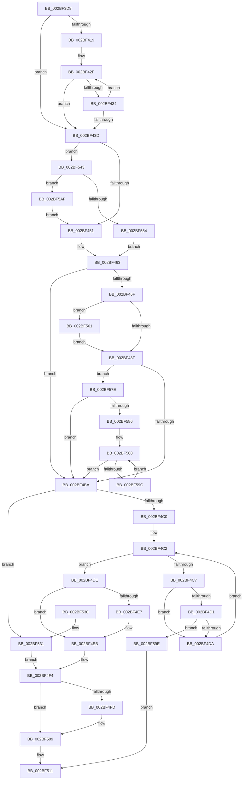

# PopPepComponentSetLatency

- RVA: `0x002BF3D8`–`0x002BF5BE` (길이 `486` bytes)
- VA: `0x00000001402BF3D8`
- 실행 섹션: `.text`
- PDB 이름 있음: `예`; PDB Function 태그: `아니요`
- unwind 정보 RVA: `0x0006E484`
- 디코드: `128`개 명령, `486/486` bytes 표시
- 미해석 바이트: `0` (있으면 어셈블리에 `.byte`로 보존)

> 이 문서는 커널 이미지의 기계어와 PDB 기호를 분석해 생성했습니다. 4번과 5번은 함수 원형과 자료형을 바이너리 사용 방식에서 추정한 C 해석이며 원본 소스 복구 결과는 아닙니다.

## 1. Dependencies

- 직접 호출 지점: **13**; 고유 호출 대상: **12**
- 직접 호출자로 확인된 함수: **1**
- RIP 상대 이미지 참조: **1**

### Outgoing calls
- `0x002BF457` → [ExAcquireSpinLockExclusive](../24/ExAcquireSpinLockExclusive_function_00248690.md) (function, `0x00248690`)
- `0x002BF47E` → [PopPepGetComponentPreferedIdleState](PopPepGetComponentPreferedIdleState_function_002BF800.md) (function, `0x002BF800`)
- `0x002BF49B` → [PopPepPromoteActivities](../24/PopPepPromoteActivities_function_0024D0D0.md) (function, `0x0024D0D0`)
- `0x002BF4EF` → [ExReleaseSpinLockExclusiveFromDpcLevel](../24/ExReleaseSpinLockExclusiveFromDpcLevel_function_002497E0.md) (function, `0x002497E0`)
- `0x002BF504` → [KiLowerIrqlProcessIrqlFlags](../4F/KiLowerIrqlProcessIrqlFlags_function_004F5698.md) (function, `0x004F5698`)
- `0x002BF534` → [ExReleaseSpinLockExclusiveFromDpcLevel](../24/ExReleaseSpinLockExclusiveFromDpcLevel_function_002497E0.md) (function, `0x002497E0`)
- `0x002BF53C` → [ExReleaseSpinLockSharedFromDpcLevel](../24/ExReleaseSpinLockSharedFromDpcLevel_function_0024A590.md) (function, `0x0024A590`)
- `0x002BF546` → [ExAcquireSpinLockShared](../24/ExAcquireSpinLockShared_function_0024DCE0.md) (function, `0x0024DCE0`)
- `0x002BF557` → [ExAcquireSpinLockExclusiveAtDpcLevel](../24/ExAcquireSpinLockExclusiveAtDpcLevel_function_00248E80.md) (function, `0x00248E80`)
- `0x002BF574` → [PopPepTriggerActivity](../24/PopPepTriggerActivity_function_0024CDB0.md) (function, `0x0024CDB0`)
- `0x002BF58D` → [PopFxRequestWorkerInternal](../39/PopFxRequestWorkerInternal_function_00397CC4.md) (function, `0x00397CC4`)
- `0x002BF5A5` → [ExReleaseSpinLockExclusive](../2C/ExReleaseSpinLockExclusive_function_002C0EF0.md) (function, `0x002C0EF0`)
- `0x002BF5B4` → [ExReleaseSpinLockShared](../2F/ExReleaseSpinLockShared_function_002F0EF0.md) (function, `0x002F0EF0`)

### Direct callers
- [PoFxSetComponentLatency](PoFxSetComponentLatency_function_002BF390.md) at `0x002BF3B9`

### Static image references
- `0x002BF4F4` → RVA `0x00FC6D20` (`ALMOSTRO`; read)

## 2. Other-region calls and transfers

- 다른 실행 섹션으로 향하는 call: **0**
- 별도 외부 분기/꼬리 이동을 확인하지 못했습니다.

## 3. Assembly (complete function range)

```asm
002BF3D8  48 8B C4                        mov rax, rsp
002BF3DB  48 89 58 08                     mov qword ptr [rax + 8], rbx
002BF3DF  48 89 68 10                     mov qword ptr [rax + 0x10], rbp
002BF3E3  48 89 70 18                     mov qword ptr [rax + 0x18], rsi
002BF3E7  48 89 78 20                     mov qword ptr [rax + 0x20], rdi
002BF3EB  41 54                           push r12
002BF3ED  41 56                           push r14
002BF3EF  41 57                           push r15
002BF3F1  48 83 EC 20                     sub rsp, 0x20
002BF3F5  8B C2                           mov eax, edx
002BF3F7  48 8D B9 C0 00 00 00            lea rdi, [rcx + 0xc0]
002BF3FE  48 69 D0 D0 00 00 00            imul rdx, rax, 0xd0
002BF405  4D 8B F8                        mov r15, r8
002BF408  48 8B D9                        mov rbx, rcx
002BF40B  48 03 FA                        add rdi, rdx
002BF40E  8B AF BC 00 00 00               mov ebp, dword ptr [rdi + 0xbc]
002BF414  83 ED 01                        sub ebp, 1
002BF417  74 24                           je 0x1402bf43d
002BF419  48 8B 87 C8 00 00 00            mov rax, qword ptr [rdi + 0xc8]
002BF420  48 8D 0C 6D 00 00 00 00         lea rcx, [rbp*2]
002BF428  48 03 CD                        add rcx, rbp
002BF42B  48 8D 14 C8                     lea rdx, [rax + rcx*8]
002BF42F  4C 39 3A                        cmp qword ptr [rdx], r15
002BF432  76 09                           jbe 0x1402bf43d
002BF434  48 83 EA 18                     sub rdx, 0x18
002BF438  83 C5 FF                        add ebp, -1
002BF43B  75 F2                           jne 0x1402bf42f
002BF43D  45 32 E4                        xor r12b, r12b
002BF440  4C 8D 73 40                     lea r14, [rbx + 0x40]
002BF444  83 BB B4 00 00 00 01            cmp dword ptr [rbx + 0xb4], 1
002BF44B  0F 85 F2 00 00 00               jne 0x1402bf543
002BF451  49 8B CE                        mov rcx, r14
002BF454  41 B4 01                        mov r12b, 1
002BF457  E8 34 92 F8 FF                  call 0x140248690
002BF45C  40 8A F0                        mov sil, al
002BF45F  44 88 63 7D                     mov byte ptr [rbx + 0x7d], r12b
002BF463  4C 89 7F 70                     mov qword ptr [rdi + 0x70], r15
002BF467  39 AF 9C 00 00 00               cmp dword ptr [rdi + 0x9c], ebp
002BF46D  74 4B                           je 0x1402bf4ba
002BF46F  89 AF 9C 00 00 00               mov dword ptr [rdi + 0x9c], ebp
002BF475  8B 6B 78                        mov ebp, dword ptr [rbx + 0x78]
002BF478  03 6F 68                        add ebp, dword ptr [rdi + 0x68]
002BF47B  48 8B CF                        mov rcx, rdi
002BF47E  E8 7D 03 00 00                  call 0x1402bf800
002BF483  3B 87 B0 00 00 00               cmp eax, dword ptr [rdi + 0xb0]
002BF489  0F 85 D2 00 00 00               jne 0x1402bf561
002BF48F  41 B8 02 00 00 00               mov r8d, 2
002BF495  48 8B D7                        mov rdx, rdi
002BF498  48 8B CB                        mov rcx, rbx
002BF49B  E8 30 DC F8 FF                  call 0x14024d0d0
002BF4A0  8B 43 78                        mov eax, dword ptr [rbx + 0x78]
002BF4A3  03 47 68                        add eax, dword ptr [rdi + 0x68]
002BF4A6  44 8B 7B 18                     mov r15d, dword ptr [rbx + 0x18]
002BF4AA  49 C1 EF 05                     shr r15, 5
002BF4AE  41 83 E7 01                     and r15d, 1
002BF4B2  3B C5                           cmp eax, ebp
002BF4B4  0F 87 C4 00 00 00               ja 0x1402bf57e
002BF4BA  41 80 FC 01                     cmp r12b, 1
002BF4BE  75 71                           jne 0x1402bf531
002BF4C0  33 C9                           xor ecx, ecx
002BF4C2  83 F9 06                        cmp ecx, 6
002BF4C5  73 17                           jae 0x1402bf4de
002BF4C7  48 8B 54 CB 48                  mov rdx, qword ptr [rbx + rcx*8 + 0x48]
002BF4CC  48 85 D2                        test rdx, rdx
002BF4CF  74 09                           je 0x1402bf4da
002BF4D1  83 3A 00                        cmp dword ptr [rdx], 0
002BF4D4  0F 85 C4 00 00 00               jne 0x1402bf59e
002BF4DA  FF C1                           inc ecx
002BF4DC  EB E4                           jmp 0x1402bf4c2
002BF4DE  80 BB 88 00 00 00 00            cmp byte ptr [rbx + 0x88], 0
002BF4E5  74 04                           je 0x1402bf4eb
002BF4E7  C6 43 7D 00                     mov byte ptr [rbx + 0x7d], 0
002BF4EB  48 8D 4B 40                     lea rcx, [rbx + 0x40]
002BF4EF  E8 EC A2 F8 FF                  call 0x1402497e0
002BF4F4  83 3D 25 78 D0 00 00            cmp dword ptr [rip + 0xd07825], 0
002BF4FB  74 0C                           je 0x1402bf509
002BF4FD  40 8A D6                        mov dl, sil
002BF500  44 0F 20 C1                     mov rcx, cr8
002BF504  E8 8F 61 23 00                  call 0x1404f5698
002BF509  40 0F B6 C6                     movzx eax, sil
002BF50D  44 0F 22 C0                     mov cr8, rax
002BF511  48 8B 5C 24 40                  mov rbx, qword ptr [rsp + 0x40]
002BF516  48 8B 6C 24 48                  mov rbp, qword ptr [rsp + 0x48]
002BF51B  48 8B 74 24 50                  mov rsi, qword ptr [rsp + 0x50]
002BF520  48 8B 7C 24 58                  mov rdi, qword ptr [rsp + 0x58]
002BF525  48 83 C4 20                     add rsp, 0x20
002BF529  41 5F                           pop r15
002BF52B  41 5E                           pop r14
002BF52D  41 5C                           pop r12
002BF52F  C3                              ret
002BF530  CC                              int3
002BF531  48 8B CF                        mov rcx, rdi
002BF534  E8 A7 A2 F8 FF                  call 0x1402497e0
002BF539  49 8B CE                        mov rcx, r14
002BF53C  E8 4F B0 F8 FF                  call 0x14024a590
002BF541  EB B1                           jmp 0x1402bf4f4
002BF543  49 8B CE                        mov rcx, r14
002BF546  E8 95 E7 F8 FF                  call 0x14024dce0
002BF54B  80 7B 7D 01                     cmp byte ptr [rbx + 0x7d], 1
002BF54F  40 8A F0                        mov sil, al
002BF552  74 5B                           je 0x1402bf5af
002BF554  48 8B CF                        mov rcx, rdi
002BF557  E8 24 99 F8 FF                  call 0x140248e80
002BF55C  E9 02 FF FF FF                  jmp 0x1402bf463
002BF561  0F BA E8 1F                     bts eax, 0x1f
002BF565  41 B8 01 00 00 00               mov r8d, 1
002BF56B  44 8B C8                        mov r9d, eax
002BF56E  48 8B D7                        mov rdx, rdi
002BF571  48 8B CB                        mov rcx, rbx
002BF574  E8 37 D8 F8 FF                  call 0x14024cdb0
002BF579  E9 11 FF FF FF                  jmp 0x1402bf48f
002BF57E  2B C5                           sub eax, ebp
002BF580  0F 84 34 FF FF FF               je 0x1402bf4ba
002BF586  8B E8                           mov ebp, eax
002BF588  41 8B D7                        mov edx, r15d
002BF58B  33 C9                           xor ecx, ecx
002BF58D  E8 32 87 0D 00                  call 0x140397cc4
002BF592  48 83 ED 01                     sub rbp, 1
002BF596  0F 84 1E FF FF FF               je 0x1402bf4ba
002BF59C  EB EA                           jmp 0x1402bf588
002BF59E  48 8D 4B 40                     lea rcx, [rbx + 0x40]
002BF5A2  40 8A D6                        mov dl, sil
002BF5A5  E8 46 19 00 00                  call 0x1402c0ef0
002BF5AA  E9 62 FF FF FF                  jmp 0x1402bf511
002BF5AF  8A D0                           mov dl, al
002BF5B1  49 8B CE                        mov rcx, r14
002BF5B4  E8 37 19 03 00                  call 0x1402f0ef0
002BF5B9  E9 93 FE FF FF                  jmp 0x1402bf451
```

## 4. C-style interpretation (structured pseudocode)

```c
__int64 __fastcall PopPepComponentSetLatency(__int64 a1, int a2, __int64 a3)
{
    __int64 result;
    __int64 v_r12;
    __int64 v_r15;
    __int64 v_rbp;
    __int64 v_rdi;
    __int64 v_rsp;
    unsigned __int64 v_stack_p10;
    unsigned __int64 v_stack_p18;
    unsigned __int64 v_stack_p20;
    unsigned __int64 v_stack_p8;

    *(unsigned __int64 *)(v_rsp + 8) = v_rbx;
    *(unsigned __int64 *)(v_rsp + 16) = v_rbp;
    *(unsigned __int64 *)(v_rsp + 24) = v_rsi;
    *(unsigned __int64 *)(v_rsp + 32) = v_rdi;
    v_rsp = (v_rsp) - (32);
    a2 = (a2) * ((unsigned int)(a2));
    v_rdi = (a1 + 192) + (a2);
    v_rbp = (unsigned int)(((unsigned int)(*(unsigned int *)(v_rdi + 188))) - (1));
    if (condition_is_equal) goto loc_002BF43D;
    a1 = (v_rbp * 2) + (v_rbp);
loc_002BF42F:
    if ((*(unsigned __int64 *)(*(unsigned __int64 *)(v_rdi + 200) + a1 * 8)) <= a3) goto loc_002BF43D;
    a2 = (*(unsigned __int64 *)(v_rdi + 200) + a1 * 8) - (24);
    v_rbp = (unsigned int)((v_rbp) + (-1));
    if (condition_is_not_equal) goto loc_002BF42F;
loc_002BF43D:
    v_r12 = 0;
    if ((*(unsigned int *)(a1 + 180)) != 1) goto loc_002BF543;
loc_002BF451:
    result = ExAcquireSpinLockExclusive(a1 + 64, a2, a3, a4);
    *(unsigned __int8 *)(a1 + 125) = 1;
loc_002BF463:
    *(unsigned __int64 *)(v_rdi + 112) = a3;
    if ((*(unsigned int *)(v_rdi + 156)) == ((unsigned int)(v_rbp))) goto loc_002BF4BA;
    *(unsigned int *)(v_rdi + 156) = (unsigned int)(v_rbp);
    v_rbp = (unsigned int)(((unsigned int)(*(unsigned int *)(a1 + 120))) + (*(unsigned int *)(v_rdi + 104)));
    result = PopPepGetComponentPreferedIdleState(v_rdi, a2, a3, a4);
    if (((unsigned int)(result)) != (*(unsigned int *)(v_rdi + 176))) goto loc_002BF561;
loc_002BF48F:
    result = PopPepPromoteActivities(a1, v_rdi, 2, a4);
    result = (unsigned int)(((unsigned int)(*(unsigned int *)(a1 + 120))) + (*(unsigned int *)(v_rdi + 104)));
    v_r15 = ((unsigned int)(*(unsigned int *)(a1 + 24))) >> (5);
    v_r15 = (unsigned int)((v_r15) & (1));
    if (((unsigned int)(result)) > ((unsigned int)(v_rbp))) goto loc_002BF57E;
loc_002BF4BA:
    if (1 != 1) goto loc_002BF531;
    a1 = 0;
loc_002BF4C2:
    if (0 >= 6) goto loc_002BF4DE;
    if (*(unsigned __int64 *)(a1 + a1 * 8 + 72) == 0) goto loc_002BF4DA;
    if ((*(unsigned int *)(*(unsigned __int64 *)(a1 + a1 * 8 + 72))) != 0) goto loc_002BF59E;
loc_002BF4DA:
    a1 = (unsigned int)((a1) + 1);
    goto loc_002BF4C2;
loc_002BF4DE:
    if ((*(unsigned __int8 *)(a1 + 136)) != 0) {
        *(unsigned __int8 *)(a1 + 125) = 0;
    }
    result = ExReleaseSpinLockExclusiveFromDpcLevel(a1 + 64, *(unsigned __int64 *)(a1 + a1 * 8 + 72), 2, a4);
loc_002BF4F4:
    if ((*(unsigned int *)(v_rip + 13662245)) != 0) {
        a2 = (unsigned __int8)((unsigned __int8)(result));
        a1 = v_cr8;
        result = KiLowerIrqlProcessIrqlFlags(a1, a2, 2, a4);
    }
loc_002BF511:
    v_rsp = (v_rsp) + (32);
    return (unsigned __int8)((unsigned __int8)(result));
loc_002BF531:
    result = ExReleaseSpinLockExclusiveFromDpcLevel(v_stack_p20, a2, 2, a4);
    result = ExReleaseSpinLockSharedFromDpcLevel(a1 + 64, a2, 2, a4);
    goto loc_002BF4F4;
loc_002BF543:
    result = ExAcquireSpinLockShared(a1 + 64, a2, 2, a4);
    if ((*(unsigned __int8 *)(v_stack_p8 + 125)) == 1) goto loc_002BF5AF;
    result = ExAcquireSpinLockExclusiveAtDpcLevel(v_stack_p20, a2, 2, a4);
    goto loc_002BF463;
loc_002BF561:
    result = PopPepTriggerActivity(v_stack_p8, v_stack_p20, 1, (unsigned int)((unsigned int)(result)));
    goto loc_002BF48F;
loc_002BF57E:
    result = (unsigned int)((result) - ((unsigned int)(v_stack_p10)));
    if (condition_is_equal) goto loc_002BF4BA;
loc_002BF588:
    a1 = 0;
    result = PopFxRequestWorkerInternal(a1, (unsigned int)((unsigned int)(v_r15)), 1, (unsigned int)((unsigned int)(result)));
    v_rbp = ((unsigned int)((unsigned int)(result))) - (1);
    if (condition_is_equal) goto loc_002BF4BA;
    goto loc_002BF588;
loc_002BF59E:
    result = ExReleaseSpinLockExclusive(v_stack_p8 + 64, (unsigned __int8)((unsigned __int8)(result)), 1, (unsigned int)((unsigned int)(result)));
    goto loc_002BF511;
loc_002BF5AF:
    result = ExReleaseSpinLockShared(a1 + 64, (unsigned __int8)(result), 1, (unsigned int)((unsigned int)(result)));
    goto loc_002BF451;
}
```

## 5. (Beta) C Style

```c
int64_t PopPepComponentSetLatency(void *Arg1, int32_t Arg2, int64_t Arg3)
{
    uint8_t *arg1 = (uint8_t *)Arg1;

    int64_t result;
    int64_t local_r12;
    int64_t local_r15;
    int64_t local_rbp;
    int64_t local_rdi;
    int64_t local_rsp;
    uint64_t v_stack_p10;
    uint64_t v_stack_p18;
    uint64_t v_stack_p20;
    uint64_t v_stack_p8;

    *(uint64_t *)(local_rsp + 0x8) = local_rbx;
    *(uint64_t *)(local_rsp + 0x10) = local_rbp;
    *(uint64_t *)(local_rsp + 0x18) = local_rsi;
    *(uint64_t *)(local_rsp + 0x20) = local_rdi;
    local_rsp = (local_rsp) - (32);
    Arg2 = (Arg2) * ((uint32_t)(Arg2));
    local_rdi = (Arg1 + 192) + (Arg2);
    local_rbp = (uint32_t)(((uint32_t)(*(uint32_t *)(local_rdi + 0xBC))) - (1));
    if (condition_is_equal) goto loc_002BF43D;
    Arg1 = (local_rbp * 2) + (local_rbp);
loc_002BF42F:
    if ((*(uint64_t *)(*(uint64_t *)(local_rdi + 0xC8) + arg1 * 8)) <= Arg3) goto loc_002BF43D;
    Arg2 = (*(uint64_t *)(local_rdi + 0xC8) + Arg1 * 8) - (24);
    local_rbp = (uint32_t)((local_rbp) + (-1));
    if (condition_is_not_equal) goto loc_002BF42F;
loc_002BF43D:
    local_r12 = 0;
    if ((*(uint32_t *)(arg1 + 0xB4)) != 1) goto loc_002BF543;
loc_002BF451:
    result = ExAcquireSpinLockExclusive(Arg1 + 64, Arg2, Arg3, a4);
    *(uint8_t *)(arg1 + 0x7D) = 1;
loc_002BF463:
    *(uint64_t *)(local_rdi + 0x70) = Arg3;
    if ((*(uint32_t *)(local_rdi + 0x9C)) == ((uint32_t)(local_rbp))) goto loc_002BF4BA;
    *(uint32_t *)(local_rdi + 0x9C) = (uint32_t)(local_rbp);
    local_rbp = (uint32_t)(((uint32_t)(*(uint32_t *)(arg1 + 0x78))) + (*(uint32_t *)(local_rdi + 0x68)));
    result = PopPepGetComponentPreferedIdleState(local_rdi, Arg2, Arg3, a4);
    if (((uint32_t)(result)) != (*(uint32_t *)(local_rdi + 0xB0))) goto loc_002BF561;
loc_002BF48F:
    result = PopPepPromoteActivities(Arg1, local_rdi, 2, a4);
    result = (uint32_t)(((uint32_t)(*(uint32_t *)(arg1 + 0x78))) + (*(uint32_t *)(local_rdi + 0x68)));
    local_r15 = ((uint32_t)(*(uint32_t *)(arg1 + 0x18))) >> (5);
    local_r15 = (uint32_t)((local_r15) & (1));
    if (((uint32_t)(result)) > ((uint32_t)(local_rbp))) goto loc_002BF57E;
loc_002BF4BA:
    if (1 != 1) goto loc_002BF531;
    Arg1 = 0;
loc_002BF4C2:
    if (0 >= 6) goto loc_002BF4DE;
    if (*(uint64_t *)(arg1 + arg1 * 8 + 0x48) == 0) goto loc_002BF4DA;
    if ((*(uint32_t *)(*(uint64_t *)(arg1 + arg1 * 8 + 0x48))) != 0) goto loc_002BF59E;
loc_002BF4DA:
    Arg1 = (uint32_t)((Arg1) + 1);
    goto loc_002BF4C2;
loc_002BF4DE:
    if ((*(uint8_t *)(arg1 + 0x88)) != 0) {
        *(uint8_t *)(arg1 + 0x7D) = 0;
    }
    result = ExReleaseSpinLockExclusiveFromDpcLevel(Arg1 + 64, *(uint64_t *)(arg1 + arg1 * 8 + 0x48), 2, a4);
loc_002BF4F4:
    if ((*(uint32_t *)(v_rip + 0xD07825)) != 0) {
        Arg2 = (uint8_t)((uint8_t)(result));
        Arg1 = v_cr8;
        result = KiLowerIrqlProcessIrqlFlags(Arg1, Arg2, 2, a4);
    }
loc_002BF511:
    local_rsp = (local_rsp) + (32);
    return (uint8_t)((uint8_t)(result));
loc_002BF531:
    result = ExReleaseSpinLockExclusiveFromDpcLevel(v_stack_p20, Arg2, 2, a4);
    result = ExReleaseSpinLockSharedFromDpcLevel(Arg1 + 64, Arg2, 2, a4);
    goto loc_002BF4F4;
loc_002BF543:
    result = ExAcquireSpinLockShared(Arg1 + 64, Arg2, 2, a4);
    if ((*(uint8_t *)(v_stack_p8 + 0x7D)) == 1) goto loc_002BF5AF;
    result = ExAcquireSpinLockExclusiveAtDpcLevel(v_stack_p20, Arg2, 2, a4);
    goto loc_002BF463;
loc_002BF561:
    result = PopPepTriggerActivity(v_stack_p8, v_stack_p20, 1, (uint32_t)((uint32_t)(result)));
    goto loc_002BF48F;
loc_002BF57E:
    result = (uint32_t)((result) - ((uint32_t)(v_stack_p10)));
    if (condition_is_equal) goto loc_002BF4BA;
loc_002BF588:
    Arg1 = 0;
    result = PopFxRequestWorkerInternal(Arg1, (uint32_t)((uint32_t)(local_r15)), 1, (uint32_t)((uint32_t)(result)));
    local_rbp = ((uint32_t)((uint32_t)(result))) - (1);
    if (condition_is_equal) goto loc_002BF4BA;
    goto loc_002BF588;
loc_002BF59E:
    result = ExReleaseSpinLockExclusive(v_stack_p8 + 64, (uint8_t)((uint8_t)(result)), 1, (uint32_t)((uint32_t)(result)));
    goto loc_002BF511;
loc_002BF5AF:
    result = ExReleaseSpinLockShared(Arg1 + 64, (uint8_t)(result), 1, (uint32_t)((uint32_t)(result)));
    goto loc_002BF451;
}
```

### 관측된 메모리 오프셋

구조체 형식이 확인되지 않은 접근은 인자 기준의 오프셋으로만 기록했습니다.

| 기준 인자 | 오프셋 표현 | 폭 (bit) | 접근 |
|---|---:|---:|---|
| `Arg1` | `+ 0x18` | `32` | `R` |
| `Arg1` | `+ 0x40` | `64` | `R` |
| `Arg1` | `+ 0x48 + rcx*8` | `64` | `R` |
| `Arg1` | `+ 0x68` | `32` | `R` |
| `Arg1` | `+ 0x70` | `64` | `W` |
| `Arg1` | `+ 0x78` | `32` | `R` |
| `Arg1` | `+ 0x7D` | `8` | `R` |
| `Arg1` | `+ 0x7D` | `8` | `W` |
| `Arg1` | `+ 0x88` | `8` | `R` |
| `Arg1` | `+ 0x9C` | `32` | `R` |
| `Arg1` | `+ 0x9C` | `32` | `W` |
| `Arg1` | `+ 0xB0` | `32` | `R` |
| `Arg1` | `+ 0xB4` | `32` | `R` |
| `Arg1` | `+ 0xBC` | `32` | `R` |
| `Arg1` | `+ 0xC0` | `64` | `R` |
| `Arg1` | `+ 0xC8` | `64` | `R` |

## 6. Execution-region graph

[열기: 2D/3D 그래프와 함수 탐색 컨트롤 패널](../../../control-panel.html?section=text&rva=0x002BF3D8&view=graph)

- 2D 그래프는 위에서 아래로 흐르고, 3D 그래프는 빈 공간을 드래그해 회전합니다. Shift+드래그는 이동, 휠은 확대·축소, 함수 노드 선택은 대상 보고서 이동입니다.

### Static fallback


