# PopPepDeviceDState

- RVA: `0x002BFE70`–`0x002C0193` (길이 `803` bytes)
- VA: `0x00000001402BFE70`
- 실행 섹션: `.text`
- PDB 이름 있음: `예`; PDB Function 태그: `예`
- unwind 정보 RVA: `0x0006E564`
- 디코드: `193`개 명령, `803/803` bytes 표시
- 미해석 바이트: `0` (있으면 어셈블리에 `.byte`로 보존)

> 이 문서는 커널 이미지의 기계어와 PDB 기호를 분석해 생성했습니다. 4번과 5번은 함수 원형과 자료형을 바이너리 사용 방식에서 추정한 C 해석이며 원본 소스 복구 결과는 아닙니다.

## 1. Dependencies

- 직접 호출 지점: **13**; 고유 호출 대상: **6**
- 직접 호출자로 확인된 함수: **3**
- RIP 상대 이미지 참조: **1**

### Outgoing calls
- `0x002BFEC4` → [PopPepUpdateConstraints](../26/PopPepUpdateConstraints_function_0026F5C8.md) (function, `0x0026F5C8`)
- `0x002BFEE1` → [PopPepUpdateConstraints](../26/PopPepUpdateConstraints_function_0026F5C8.md) (function, `0x0026F5C8`)
- `0x002BFF07` → [PopPlNotifyDeviceDState](../48/PopPlNotifyDeviceDState_function_0048958C.md) (function, `0x0048958C`)
- `0x002BFF98` → [guard_dispatch_icall](../6B/guard_dispatch_icall_function_006BAAD0.md) (function, `0x006BAAD0`)
- `0x002BFFD0` → [PopPepUpdateIdleStateRefCount](PopPepUpdateIdleStateRefCount_function_002BF930.md) (function, `0x002BF930`)
- `0x002BFFDF` → [PopFxUpdateDeviceAccountingEnhanced](../43/PopFxUpdateDeviceAccountingEnhanced_function_0043D250.md) (function, `0x0043D250`)
- `0x002BFFFD` → [PopPlNotifyDeviceDState](../48/PopPlNotifyDeviceDState_function_0048958C.md) (function, `0x0048958C`)
- `0x002C0050` → [PopPepUpdateIdleStateRefCount](PopPepUpdateIdleStateRefCount_function_002BF930.md) (function, `0x002BF930`)
- `0x002C005F` → [PopFxUpdateDeviceAccountingEnhanced](../43/PopFxUpdateDeviceAccountingEnhanced_function_0043D250.md) (function, `0x0043D250`)
- `0x002C00BD` → [PopPepUpdateIdleStateRefCount](PopPepUpdateIdleStateRefCount_function_002BF930.md) (function, `0x002BF930`)
- `0x002C00D3` → [PopFxUpdateComponentAccountingEnhanced](PopFxUpdateComponentAccountingEnhanced_function_002BE924.md) (function, `0x002BE924`)
- `0x002C0138` → [PopPepUpdateIdleStateRefCount](PopPepUpdateIdleStateRefCount_function_002BF930.md) (function, `0x002BF930`)
- `0x002C0156` → [PopFxUpdateComponentAccountingEnhanced](PopFxUpdateComponentAccountingEnhanced_function_002BE924.md) (function, `0x002BE924`)

### Direct callers
- [PopIrpWorker](../26/PopIrpWorker_function_0026D410.md) at `0x0026D6FD`
- [PopFxHandleReportDevicePoweredOn](../26/PopFxHandleReportDevicePoweredOn_function_0026D980.md) at `0x0026DA3B`
- [PopHandleDevicePowerIrpCompletion](../26/PopHandleDevicePowerIrpCompletion_function_0026F030.md) at `0x0026F18F`

### Static image references
- `0x002BFFA8` → RVA `0x00E67A60` (`.data`; read)

## 2. Other-region calls and transfers

- 다른 실행 섹션으로 향하는 call: **0**
- call이 아닌 외부 분기/꼬리 이동: **2**
  - `0x002C0172` → [sub_006DC134](../6D/Unknown_function_006DC134.md) (`tail-transfer`)
  - `0x002C018E` → [sub_006DC134](../6D/Unknown_function_006DC134.md) (`tail-transfer`)

## 3. Assembly (complete function range)

```asm
002BFE70  48 89 5C 24 10                  mov qword ptr [rsp + 0x10], rbx
002BFE75  44 89 4C 24 20                  mov dword ptr [rsp + 0x20], r9d
002BFE7A  44 88 44 24 18                  mov byte ptr [rsp + 0x18], r8b
002BFE7F  55                              push rbp
002BFE80  56                              push rsi
002BFE81  57                              push rdi
002BFE82  41 54                           push r12
002BFE84  41 55                           push r13
002BFE86  41 56                           push r14
002BFE88  41 57                           push r15
002BFE8A  48 83 EC 30                     sub rsp, 0x30
002BFE8E  33 ED                           xor ebp, ebp
002BFE90  4C 63 F2                        movsxd r14, edx
002BFE93  41 8B D9                        mov ebx, r9d
002BFE96  45 8A E0                        mov r12b, r8b
002BFE99  48 8B F1                        mov rsi, rcx
002BFE9C  44 8D 6D 04                     lea r13d, [rbp + 4]
002BFEA0  44 8D 7D 01                     lea r15d, [rbp + 1]
002BFEA4  45 84 C0                        test r8b, r8b
002BFEA7  74 22                           je 0x1402bfecb
002BFEA9  45 3B F7                        cmp r14d, r15d
002BFEAC  75 5E                           jne 0x1402bff0c
002BFEAE  83 C8 FF                        or eax, 0xffffffff
002BFEB1  F0 0F C1 81 84 00 00 00         lock xadd dword ptr [rcx + 0x84], eax
002BFEB9  41 3B C7                        cmp eax, r15d
002BFEBC  75 4E                           jne 0x1402bff0c
002BFEBE  45 8A C7                        mov r8b, r15b
002BFEC1  41 8B D5                        mov edx, r13d
002BFEC4  E8 FF F6 FA FF                  call 0x14026f5c8
002BFEC9  EB 41                           jmp 0x1402bff0c
002BFECB  45 3B F7                        cmp r14d, r15d
002BFECE  7E 22                           jle 0x1402bfef2
002BFED0  B8 02 00 00 00                  mov eax, 2
002BFED5  45 33 C0                        xor r8d, r8d
002BFED8  87 81 84 00 00 00               xchg dword ptr [rcx + 0x84], eax
002BFEDE  41 8B D5                        mov edx, r13d
002BFEE1  E8 E2 F6 FA FF                  call 0x14026f5c8
002BFEE6  8D 43 FF                        lea eax, [rbx - 1]
002BFEE9  41 3B C7                        cmp eax, r15d
002BFEEC  0F 86 84 01 00 00               jbe 0x1402c0076
002BFEF2  8B 96 A8 00 00 00               mov edx, dword ptr [rsi + 0xa8]
002BFEF8  41 3B D6                        cmp edx, r14d
002BFEFB  74 0F                           je 0x1402bff0c
002BFEFD  48 8B 4E 20                     mov rcx, qword ptr [rsi + 0x20]
002BFF01  45 8A CC                        mov r9b, r12b
002BFF04  45 8B C6                        mov r8d, r14d
002BFF07  E8 80 96 1C 00                  call 0x14048958c
002BFF0C  40 38 6E 7C                     cmp byte ptr [rsi + 0x7c], bpl
002BFF10  0F 84 F8 00 00 00               je 0x1402c000e
002BFF16  8B FD                           mov edi, ebp
002BFF18  45 3B F5                        cmp r14d, r13d
002BFF1B  0F 85 48 01 00 00               jne 0x1402c0069
002BFF21  48 63 8E A8 00 00 00            movsxd rcx, dword ptr [rsi + 0xa8]
002BFF28  41 3B CD                        cmp ecx, r13d
002BFF2B  89 7C 24 70                     mov dword ptr [rsp + 0x70], edi
002BFF2F  44 8B ED                        mov r13d, ebp
002BFF32  0F 85 EE 00 00 00               jne 0x1402c0026
002BFF38  45 84 E4                        test r12b, r12b
002BFF3B  0F 84 F2 00 00 00               je 0x1402c0033
002BFF41  40 38 6E 7C                     cmp byte ptr [rsi + 0x7c], bpl
002BFF45  75 1B                           jne 0x1402bff62
002BFF47  45 84 E4                        test r12b, r12b
002BFF4A  75 53                           jne 0x1402bff9f
002BFF4C  48 8B 5C 24 78                  mov rbx, qword ptr [rsp + 0x78]
002BFF51  48 83 C4 30                     add rsp, 0x30
002BFF55  41 5F                           pop r15
002BFF57  41 5E                           pop r14
002BFF59  41 5D                           pop r13
002BFF5B  41 5C                           pop r12
002BFF5D  5F                              pop rdi
002BFF5E  5E                              pop rsi
002BFF5F  5D                              pop rbp
002BFF60  C3                              ret
002BFF61  CC                              int3
002BFF62  48 8B 4E 20                     mov rcx, qword ptr [rsi + 0x20]
002BFF66  48 8D 54 24 20                  lea rdx, [rsp + 0x20]
002BFF6B  41 3B DF                        cmp ebx, r15d
002BFF6E  66 89 6C 24 2E                  mov word ptr [rsp + 0x2e], bp
002BFF73  44 89 74 24 28                  mov dword ptr [rsp + 0x28], r14d
002BFF78  44 88 64 24 2C                  mov byte ptr [rsp + 0x2c], r12b
002BFF7D  0F 94 44 24 2D                  sete byte ptr [rsp + 0x2d]
002BFF82  48 8B 41 48                     mov rax, qword ptr [rcx + 0x48]
002BFF86  48 89 44 24 20                  mov qword ptr [rsp + 0x20], rax
002BFF8B  48 8B 41 40                     mov rax, qword ptr [rcx + 0x40]
002BFF8F  B9 05 00 00 00                  mov ecx, 5
002BFF94  48 8B 40 60                     mov rax, qword ptr [rax + 0x60]
002BFF98  E8 33 AB 3F 00                  call 0x1406baad0
002BFF9D  EB A8                           jmp 0x1402bff47
002BFF9F  44 39 B6 A8 00 00 00            cmp dword ptr [rsi + 0xa8], r14d
002BFFA6  74 3C                           je 0x1402bffe4
002BFFA8  39 2D B2 7A BA 00               cmp dword ptr [rip + 0xba7ab2], ebp
002BFFAE  0F 85 B7 01 00 00               jne 0x1402c016b
002BFFB4  44 39 BE A8 00 00 00            cmp dword ptr [rsi + 0xa8], r15d
002BFFBB  0F 84 3B 01 00 00               je 0x1402c00fc
002BFFC1  4C 8D 8E B8 00 00 00            lea r9, [rsi + 0xb8]
002BFFC8  45 33 C0                        xor r8d, r8d
002BFFCB  8B D7                           mov edx, edi
002BFFCD  41 8B CD                        mov ecx, r13d
002BFFD0  E8 5B F9 FF FF                  call 0x1402bf930
002BFFD5  48 8B 4E 20                     mov rcx, qword ptr [rsi + 0x20]
002BFFD9  45 8B C7                        mov r8d, r15d
002BFFDC  41 8B D6                        mov edx, r14d
002BFFDF  E8 6C D2 17 00                  call 0x14043d250
002BFFE4  8B 96 A8 00 00 00               mov edx, dword ptr [rsi + 0xa8]
002BFFEA  41 3B D6                        cmp edx, r14d
002BFFED  0F 84 59 FF FF FF               je 0x1402bff4c
002BFFF3  48 8B 4E 20                     mov rcx, qword ptr [rsi + 0x20]
002BFFF7  45 8A CC                        mov r9b, r12b
002BFFFA  45 8B C6                        mov r8d, r14d
002BFFFD  E8 8A 95 1C 00                  call 0x14048958c
002C0002  44 89 B6 A8 00 00 00            mov dword ptr [rsi + 0xa8], r14d
002C0009  E9 3E FF FF FF                  jmp 0x1402bff4c
002C000E  40 38 AE BC 00 00 00            cmp byte ptr [rsi + 0xbc], bpl
002C0015  0F 85 FB FE FF FF               jne 0x1402bff16
002C001B  45 84 E4                        test r12b, r12b
002C001E  0F 84 28 FF FF FF               je 0x1402bff4c
002C0024  EB BE                           jmp 0x1402bffe4
002C0026  44 8B AC 8E 8C 00 00 00         mov r13d, dword ptr [rsi + rcx*4 + 0x8c]
002C002E  E9 05 FF FF FF                  jmp 0x1402bff38
002C0033  41 3B CE                        cmp ecx, r14d
002C0036  0F 84 05 FF FF FF               je 0x1402bff41
002C003C  45 3B F7                        cmp r14d, r15d
002C003F  74 41                           je 0x1402c0082
002C0041  4C 8D 8E B8 00 00 00            lea r9, [rsi + 0xb8]
002C0048  45 8B C7                        mov r8d, r15d
002C004B  8B D7                           mov edx, edi
002C004D  41 8B CD                        mov ecx, r13d
002C0050  E8 DB F8 FF FF                  call 0x1402bf930
002C0055  48 8B 4E 20                     mov rcx, qword ptr [rsi + 0x20]
002C0059  45 33 C0                        xor r8d, r8d
002C005C  41 8B D6                        mov edx, r14d
002C005F  E8 EC D1 17 00                  call 0x14043d250
002C0064  E9 D8 FE FF FF                  jmp 0x1402bff41
002C0069  42 8B BC B6 8C 00 00 00         mov edi, dword ptr [rsi + r14*4 + 0x8c]
002C0071  E9 AB FE FF FF                  jmp 0x1402bff21
002C0076  F0 FF 8E 84 00 00 00            lock dec dword ptr [rsi + 0x84]
002C007D  E9 70 FE FF FF                  jmp 0x1402bfef2
002C0082  39 AE B4 00 00 00               cmp dword ptr [rsi + 0xb4], ebp
002C0088  76 B7                           jbe 0x1402c0041
002C008A  44 8B E5                        mov r12d, ebp
002C008D  41 8B C4                        mov eax, r12d
002C0090  4C 8D 8E 80 01 00 00            lea r9, [rsi + 0x180]
002C0097  48 69 F8 D0 00 00 00            imul rdi, rax, 0xd0
002C009E  45 8B C7                        mov r8d, r15d
002C00A1  4C 03 CF                        add r9, rdi
002C00A4  8B 9C 37 70 01 00 00            mov ebx, dword ptr [rdi + rsi + 0x170]
002C00AB  48 8B 94 37 88 01 00 00         mov rdx, qword ptr [rdi + rsi + 0x188]
002C00B3  48 8D 0C 5B                     lea rcx, [rbx + rbx*2]
002C00B7  8B 54 CA 10                     mov edx, dword ptr [rdx + rcx*8 + 0x10]
002C00BB  33 C9                           xor ecx, ecx
002C00BD  E8 6E F8 FF FF                  call 0x1402bf930
002C00C2  8B 94 37 C8 00 00 00            mov edx, dword ptr [rdi + rsi + 0xc8]
002C00C9  45 33 C9                        xor r9d, r9d
002C00CC  48 8B 4E 20                     mov rcx, qword ptr [rsi + 0x20]
002C00D0  44 8B C3                        mov r8d, ebx
002C00D3  E8 4C E8 FF FF                  call 0x1402be924
002C00D8  45 03 E7                        add r12d, r15d
002C00DB  44 3B A6 B4 00 00 00            cmp r12d, dword ptr [rsi + 0xb4]
002C00E2  72 A9                           jb 0x1402c008d
002C00E4  44 8A A4 24 80 00 00 00         mov r12b, byte ptr [rsp + 0x80]
002C00EC  8B 7C 24 70                     mov edi, dword ptr [rsp + 0x70]
002C00F0  8B 9C 24 88 00 00 00            mov ebx, dword ptr [rsp + 0x88]
002C00F7  E9 45 FF FF FF                  jmp 0x1402c0041
002C00FC  39 AE B4 00 00 00               cmp dword ptr [rsi + 0xb4], ebp
002C0102  0F 86 B9 FE FF FF               jbe 0x1402bffc1
002C0108  8B C5                           mov eax, ebp
002C010A  4C 8D 8E 80 01 00 00            lea r9, [rsi + 0x180]
002C0111  48 69 D8 D0 00 00 00            imul rbx, rax, 0xd0
002C0118  45 33 C0                        xor r8d, r8d
002C011B  33 D2                           xor edx, edx
002C011D  4C 03 CB                        add r9, rbx
002C0120  8B 84 33 70 01 00 00            mov eax, dword ptr [rbx + rsi + 0x170]
002C0127  48 8B 8C 33 88 01 00 00         mov rcx, qword ptr [rbx + rsi + 0x188]
002C012F  4C 8D 14 40                     lea r10, [rax + rax*2]
002C0133  42 8B 4C D1 10                  mov ecx, dword ptr [rcx + r10*8 + 0x10]
002C0138  E8 F3 F7 FF FF                  call 0x1402bf930
002C013D  44 8B 84 33 7C 01 00 00         mov r8d, dword ptr [rbx + rsi + 0x17c]
002C0145  45 8B CF                        mov r9d, r15d
002C0148  8B 94 33 C8 00 00 00            mov edx, dword ptr [rbx + rsi + 0xc8]
002C014F  45 2B C7                        sub r8d, r15d
002C0152  48 8B 4E 20                     mov rcx, qword ptr [rsi + 0x20]
002C0156  E8 C9 E7 FF FF                  call 0x1402be924
002C015B  41 03 EF                        add ebp, r15d
002C015E  3B AE B4 00 00 00               cmp ebp, dword ptr [rsi + 0xb4]
002C0164  72 A2                           jb 0x1402c0108
002C0166  E9 56 FE FF FF                  jmp 0x1402bffc1
002C016B  40 38 AE B1 00 00 00            cmp byte ptr [rsi + 0xb1], bpl
002C0172  0F 85 BC BF 41 00               jne 0x1406dc134
002C0178  40 38 AE B0 00 00 00            cmp byte ptr [rsi + 0xb0], bpl
002C017F  0F 84 2F FE FF FF               je 0x1402bffb4
002C0185  45 3B F7                        cmp r14d, r15d
002C0188  0F 85 26 FE FF FF               jne 0x1402bffb4
002C018E  E9 A1 BF 41 00                  jmp 0x1406dc134
```

## 4. C-style interpretation (structured pseudocode)

```c
__int64 __fastcall PopPepDeviceDState(__int64 a1, int a2, unsigned __int8 a3, int a4)
{
    __int64 result;
    __int64 v_r12;
    __int64 v_rbp;
    __int64 v_rbx;
    __int64 v_rdi;
    __int64 v_rsp;
    unsigned __int64 v_stack_p10;
    unsigned __int8 v_stack_p18;
    unsigned int v_stack_p20;
    unsigned int v_stack_p28;
    unsigned __int8 v_stack_p2C;
    unsigned __int8 v_stack_p2D;
    unsigned __int16 v_stack_p2E;
    unsigned int v_stack_p70;
    unsigned int v_stack_p8;
    unsigned __int8 v_stack_p80;
    unsigned int v_stack_p88;

    v_stack_p10 = v_rbx;
    v_stack_p20 = a4;
    v_stack_p18 = a3;
    v_rsp = (v_rsp) - (48);
    v_rbp = 0;
    if (a3 == 0) goto loc_002BFECB;
    if (((unsigned int)((int)(a2))) != ((unsigned int)(v_rbp + 1))) goto loc_002BFF0C;
    result = (unsigned int)((result) | (0xFFFFFFFFULL));
    if (((unsigned int)(result)) != ((unsigned int)(v_rbp + 1))) goto loc_002BFF0C;
    result = PopPepUpdateConstraints(a1, (unsigned int)((unsigned int)(v_rbp + 4)), (unsigned __int8)(v_rbp + 1), a4);
    goto loc_002BFF0C;
loc_002BFECB:
    if (((unsigned int)((int)(a2))) <= ((unsigned int)(v_rbp + 1))) goto loc_002BFEF2;
    a3 = 0;
    result = PopPepUpdateConstraints(a1, (unsigned int)((unsigned int)(v_rbp + 4)), a3, a4);
    if (((unsigned int)((unsigned int)(a4) - 1)) <= ((unsigned int)(v_rbp + 1))) goto loc_002C0076;
loc_002BFEF2:
    result = (unsigned int)(a4) - 1;
    if (((unsigned int)((unsigned int)(*(unsigned int *)(a1 + 168)))) != ((unsigned int)((int)(a2)))) {
        a1 = *(unsigned __int64 *)(a1 + 32);
        a4 = 0;
        a3 = (unsigned int)((int)(a2));
        result = PopPlNotifyDeviceDState(a1, (unsigned int)(*(unsigned int *)(a1 + 168)), a3, a4);
    }
    if ((*(unsigned __int8 *)(a1 + 124)) == 0) goto loc_002C000E;
loc_002BFF16:
    if (((unsigned int)((int)(a2))) != ((unsigned int)(v_rbp + 4))) goto loc_002C0069;
loc_002BFF21:
    v_stack_p8 = 0;
    if (((unsigned int)((int)(*(unsigned int *)(a1 + 168)))) != ((unsigned int)(v_rbp + 4))) goto loc_002C0026;
loc_002BFF38:
    if (a3 == 0) goto loc_002C0033;
loc_002BFF41:
    if ((*(unsigned __int8 *)(a1 + 124)) != 0) goto loc_002BFF62;
loc_002BFF47:
    if (a3 != 0) goto loc_002BFF9F;
loc_002BFF4C:
    v_rsp = (v_rsp) + (48);
    return result;
loc_002BFF62:
    v_stack_p2E = 0;
    v_stack_p28 = (unsigned int)((int)(a2));
    v_stack_p2C = a3;
    v_stack_p20 = *(unsigned __int64 *)(*(unsigned __int64 *)(a1 + 32) + 72);
    result = guard_dispatch_icall(5, v_stack_p20, a3, a4);
    goto loc_002BFF47;
loc_002BFF9F:
    if ((*(unsigned int *)(a1 + 168)) == ((unsigned int)((int)(a2)))) goto loc_002BFFE4;
    if ((*(unsigned int *)(v_rip + 12221106)) != 0) goto loc_002C016B;
loc_002BFFB4:
    if ((*(unsigned int *)(a1 + 168)) == ((unsigned int)(v_rbp + 1))) goto loc_002C00FC;
loc_002BFFC1:
    a3 = 0;
    result = PopPepUpdateIdleStateRefCount(0, 0, a3, a1 + 184);
    result = PopFxUpdateDeviceAccountingEnhanced(*(unsigned __int64 *)(a1 + 32), (unsigned int)((unsigned int)((int)(a2))), (unsigned int)((unsigned int)(v_rbp + 1)), a1 + 184);
loc_002BFFE4:
    if (((unsigned int)((unsigned int)(*(unsigned int *)(a1 + 168)))) == ((unsigned int)((int)(a2)))) goto loc_002BFF4C;
    result = PopPlNotifyDeviceDState(*(unsigned __int64 *)(a1 + 32), (unsigned int)(*(unsigned int *)(a1 + 168)), (unsigned int)((unsigned int)((int)(a2))), 0);
    *(unsigned int *)(a1 + 168) = (unsigned int)((int)(a2));
    goto loc_002BFF4C;
loc_002C000E:
    if ((*(unsigned __int8 *)(a1 + 188)) != 0) goto loc_002BFF16;
    if (0 == 0) goto loc_002BFF4C;
    goto loc_002BFFE4;
loc_002C0026:
    goto loc_002BFF38;
loc_002C0033:
    if (((unsigned int)(*(unsigned __int64 *)(a1 + 32))) == ((unsigned int)((int)(a2)))) goto loc_002BFF41;
    if (((unsigned int)((int)(a2))) == ((unsigned int)(v_rbp + 1))) goto loc_002C0082;
loc_002C0041:
    result = PopPepUpdateIdleStateRefCount((unsigned int)((unsigned int)((unsigned int)(*(unsigned int *)(a1 + *(unsigned __int64 *)(a1 + 32) * 4 + 140)))), 0, (unsigned int)((unsigned int)(v_rbp + 1)), a1 + 184);
    a3 = 0;
    result = PopFxUpdateDeviceAccountingEnhanced(*(unsigned __int64 *)(a1 + 32), (unsigned int)((unsigned int)((int)(a2))), a3, a1 + 184);
    goto loc_002BFF41;
loc_002C0069:
    goto loc_002BFF21;
loc_002C0076:
    goto loc_002BFEF2;
loc_002C0082:
    if ((*(unsigned int *)(a1 + 180)) <= 0) goto loc_002C0041;
loc_002C008D:
    v_rdi = ((unsigned int)(*(unsigned int *)(a1 + (int)(a2) * 4 + 140))) * (0);
    a4 = (a1 + 384) + (v_rdi);
    a1 = 0;
    result = PopPepUpdateIdleStateRefCount(a1, (unsigned int)(*(unsigned int *)(*(unsigned __int64 *)(v_rdi + a1 * 1 + 392) + (unsigned int)(*(unsigned int *)(v_rdi + a1 * 1 + 368)) + (unsigned int)(*(unsigned int *)(v_rdi + a1 * 1 + 368)) * 2 * 8 + 16)), (unsigned int)((unsigned int)(v_rbp + 1)), a4);
    a4 = 0;
    result = PopFxUpdateComponentAccountingEnhanced(*(unsigned __int64 *)(a1 + 32), (unsigned int)(*(unsigned int *)(v_rdi + a1 * 1 + 200)), (unsigned int)((unsigned int)((unsigned int)(*(unsigned int *)(v_rdi + a1 * 1 + 368)))), a4);
    v_r12 = (unsigned int)((0) + ((unsigned int)(v_rbp + 1)));
    if (((unsigned int)(v_r12)) < (*(unsigned int *)(a1 + 180))) goto loc_002C008D;
    goto loc_002C0041;
loc_002C00FC:
    if ((*(unsigned int *)(a1 + 180)) <= 0) goto loc_002BFFC1;
loc_002C0108:
    v_rbx = ((unsigned int)(v_stack_p88)) * (0);
    a3 = 0;
    a2 = 0;
    a4 = (a1 + 384) + (v_rbx);
    result = PopPepUpdateIdleStateRefCount((unsigned int)(*(unsigned int *)(*(unsigned __int64 *)(v_rbx + a1 * 1 + 392) + (unsigned int)(*(unsigned int *)(v_rbx + a1 * 1 + 368)) + (unsigned int)(*(unsigned int *)(v_rbx + a1 * 1 + 368)) * 2 * 8 + 16)), a2, a3, a4);
    a3 = (unsigned int)(((unsigned int)(*(unsigned int *)(v_rbx + a1 * 1 + 380))) - ((unsigned int)(v_rbp + 1)));
    result = PopFxUpdateComponentAccountingEnhanced(*(unsigned __int64 *)(a1 + 32), (unsigned int)(*(unsigned int *)(v_rbx + a1 * 1 + 200)), a3, (unsigned int)((unsigned int)(v_rbp + 1)));
    v_rbp = (unsigned int)((v_rbp) + ((unsigned int)(v_rbp + 1)));
    if (((unsigned int)(v_rbp)) < (*(unsigned int *)(a1 + 180))) goto loc_002C0108;
    goto loc_002BFFC1;
loc_002C016B:
    if ((*(unsigned __int8 *)(a1 + 176)) == ((unsigned __int8)(v_rbp))) goto loc_002BFFB4;
    if (((unsigned int)((int)(a2))) != ((unsigned int)(v_rbp + 1))) goto loc_002BFFB4;
}
```

## 5. (Beta) C Style

```c
int64_t PopPepDeviceDState(void *Arg1, int32_t Arg2, uint8_t Arg3, void *Arg4)
{
    uint8_t *arg1 = (uint8_t *)Arg1;
    uint8_t *arg4 = (uint8_t *)Arg4;

    int64_t result;
    int64_t local_r12;
    int64_t local_rbp;
    int64_t local_rbx;
    int64_t local_rdi;
    int64_t local_rsp;
    uint64_t v_stack_p10;
    uint8_t v_stack_p18;
    uint32_t v_stack_p20;
    uint32_t v_stack_p28;
    uint8_t v_stack_p2C;
    uint8_t v_stack_p2D;
    uint16_t v_stack_p2E;
    uint32_t v_stack_p70;
    uint32_t v_stack_p8;
    uint8_t v_stack_p80;
    uint32_t v_stack_p88;

    v_stack_p10 = local_rbx;
    v_stack_p20 = Arg4;
    v_stack_p18 = Arg3;
    local_rsp = (local_rsp) - (48);
    local_rbp = 0;
    if (Arg3 == 0) goto loc_002BFECB;
    if (((uint32_t)((int32_t)(Arg2))) != ((uint32_t)(local_rbp + 1))) goto loc_002BFF0C;
    result = (uint32_t)((result) | (0xFFFFFFFFULL));
    if (((uint32_t)(result)) != ((uint32_t)(local_rbp + 1))) goto loc_002BFF0C;
    result = PopPepUpdateConstraints(Arg1, (uint32_t)((uint32_t)(local_rbp + 4)), (uint8_t)(local_rbp + 1), Arg4);
    goto loc_002BFF0C;
loc_002BFECB:
    if (((uint32_t)((int32_t)(Arg2))) <= ((uint32_t)(local_rbp + 1))) goto loc_002BFEF2;
    Arg3 = 0;
    result = PopPepUpdateConstraints(Arg1, (uint32_t)((uint32_t)(local_rbp + 4)), Arg3, Arg4);
    if (((uint32_t)((uint32_t)(Arg4) - 1)) <= ((uint32_t)(local_rbp + 1))) goto loc_002C0076;
loc_002BFEF2:
    result = (uint32_t)(Arg4) - 1;
    if (((uint32_t)((uint32_t)(*(uint32_t *)(arg1 + 0xA8)))) != ((uint32_t)((int32_t)(Arg2)))) {
        Arg1 = *(uint64_t *)(arg1 + 0x20);
        Arg4 = 0;
        Arg3 = (uint32_t)((int32_t)(Arg2));
        result = PopPlNotifyDeviceDState(Arg1, (uint32_t)(*(uint32_t *)(arg1 + 0xA8)), Arg3, Arg4);
    }
    if ((*(uint8_t *)(arg1 + 0x7C)) == 0) goto loc_002C000E;
loc_002BFF16:
    if (((uint32_t)((int32_t)(Arg2))) != ((uint32_t)(local_rbp + 4))) goto loc_002C0069;
loc_002BFF21:
    v_stack_p8 = 0;
    if (((uint32_t)((int32_t)(*(uint32_t *)(arg1 + 0xA8)))) != ((uint32_t)(local_rbp + 4))) goto loc_002C0026;
loc_002BFF38:
    if (Arg3 == 0) goto loc_002C0033;
loc_002BFF41:
    if ((*(uint8_t *)(arg1 + 0x7C)) != 0) goto loc_002BFF62;
loc_002BFF47:
    if (Arg3 != 0) goto loc_002BFF9F;
loc_002BFF4C:
    local_rsp = (local_rsp) + (48);
    return result;
loc_002BFF62:
    v_stack_p2E = 0;
    v_stack_p28 = (uint32_t)((int32_t)(Arg2));
    v_stack_p2C = Arg3;
    v_stack_p20 = *(uint64_t *)(*(uint64_t *)(arg1 + 0x20) + 0x48);
    result = guard_dispatch_icall(5, v_stack_p20, Arg3, Arg4);
    goto loc_002BFF47;
loc_002BFF9F:
    if ((*(uint32_t *)(arg1 + 0xA8)) == ((uint32_t)((int32_t)(Arg2)))) goto loc_002BFFE4;
    if ((*(uint32_t *)(v_rip + 0xBA7AB2)) != 0) goto loc_002C016B;
loc_002BFFB4:
    if ((*(uint32_t *)(arg1 + 0xA8)) == ((uint32_t)(local_rbp + 1))) goto loc_002C00FC;
loc_002BFFC1:
    Arg3 = 0;
    result = PopPepUpdateIdleStateRefCount(0, 0, Arg3, Arg1 + 184);
    result = PopFxUpdateDeviceAccountingEnhanced(*(uint64_t *)(arg1 + 0x20), (uint32_t)((uint32_t)((int32_t)(Arg2))), (uint32_t)((uint32_t)(local_rbp + 1)), Arg1 + 184);
loc_002BFFE4:
    if (((uint32_t)((uint32_t)(*(uint32_t *)(arg1 + 0xA8)))) == ((uint32_t)((int32_t)(Arg2)))) goto loc_002BFF4C;
    result = PopPlNotifyDeviceDState(*(uint64_t *)(arg1 + 0x20), (uint32_t)(*(uint32_t *)(arg1 + 0xA8)), (uint32_t)((uint32_t)((int32_t)(Arg2))), 0);
    *(uint32_t *)(arg1 + 0xA8) = (uint32_t)((int32_t)(Arg2));
    goto loc_002BFF4C;
loc_002C000E:
    if ((*(uint8_t *)(arg1 + 0xBC)) != 0) goto loc_002BFF16;
    if (0 == 0) goto loc_002BFF4C;
    goto loc_002BFFE4;
loc_002C0026:
    goto loc_002BFF38;
loc_002C0033:
    if (((uint32_t)(*(uint64_t *)(arg1 + 0x20))) == ((uint32_t)((int32_t)(Arg2)))) goto loc_002BFF41;
    if (((uint32_t)((int32_t)(Arg2))) == ((uint32_t)(local_rbp + 1))) goto loc_002C0082;
loc_002C0041:
    result = PopPepUpdateIdleStateRefCount((uint32_t)((uint32_t)((uint32_t)(*(uint32_t *)(arg1 + *(uint64_t *)(arg1 + 0x20) * 4 + 0x8C)))), 0, (uint32_t)((uint32_t)(local_rbp + 1)), Arg1 + 184);
    Arg3 = 0;
    result = PopFxUpdateDeviceAccountingEnhanced(*(uint64_t *)(arg1 + 0x20), (uint32_t)((uint32_t)((int32_t)(Arg2))), Arg3, Arg1 + 184);
    goto loc_002BFF41;
loc_002C0069:
    goto loc_002BFF21;
loc_002C0076:
    goto loc_002BFEF2;
loc_002C0082:
    if ((*(uint32_t *)(arg1 + 0xB4)) <= 0) goto loc_002C0041;
loc_002C008D:
    local_rdi = ((uint32_t)(*(uint32_t *)(arg1 + (int32_t)(Arg2) * 4 + 0x8C))) * (0);
    Arg4 = (Arg1 + 384) + (local_rdi);
    Arg1 = 0;
    result = PopPepUpdateIdleStateRefCount(Arg1, (uint32_t)(*(uint32_t *)(*(uint64_t *)(local_rdi + arg1 * 1 + 0x188) + (uint32_t)(*(uint32_t *)(local_rdi + arg1 * 1 + 0x170)) + (uint32_t)(*(uint32_t *)(local_rdi + arg1 * 1 + 0x170)) * 2 * 8 + 0x10)), (uint32_t)((uint32_t)(local_rbp + 1)), Arg4);
    Arg4 = 0;
    result = PopFxUpdateComponentAccountingEnhanced(*(uint64_t *)(arg1 + 0x20), (uint32_t)(*(uint32_t *)(local_rdi + arg1 * 1 + 0xC8)), (uint32_t)((uint32_t)((uint32_t)(*(uint32_t *)(local_rdi + arg1 * 1 + 0x170)))), Arg4);
    local_r12 = (uint32_t)((0) + ((uint32_t)(local_rbp + 1)));
    if (((uint32_t)(local_r12)) < (*(uint32_t *)(arg1 + 0xB4))) goto loc_002C008D;
    goto loc_002C0041;
loc_002C00FC:
    if ((*(uint32_t *)(arg1 + 0xB4)) <= 0) goto loc_002BFFC1;
loc_002C0108:
    local_rbx = ((uint32_t)(v_stack_p88)) * (0);
    Arg3 = 0;
    Arg2 = 0;
    Arg4 = (Arg1 + 384) + (local_rbx);
    result = PopPepUpdateIdleStateRefCount((uint32_t)(*(uint32_t *)(*(uint64_t *)(local_rbx + arg1 * 1 + 0x188) + (uint32_t)(*(uint32_t *)(local_rbx + arg1 * 1 + 0x170)) + (uint32_t)(*(uint32_t *)(local_rbx + arg1 * 1 + 0x170)) * 2 * 8 + 0x10)), Arg2, Arg3, Arg4);
    Arg3 = (uint32_t)(((uint32_t)(*(uint32_t *)(local_rbx + arg1 * 1 + 0x17C))) - ((uint32_t)(local_rbp + 1)));
    result = PopFxUpdateComponentAccountingEnhanced(*(uint64_t *)(arg1 + 0x20), (uint32_t)(*(uint32_t *)(local_rbx + arg1 * 1 + 0xC8)), Arg3, (uint32_t)((uint32_t)(local_rbp + 1)));
    local_rbp = (uint32_t)((local_rbp) + ((uint32_t)(local_rbp + 1)));
    if (((uint32_t)(local_rbp)) < (*(uint32_t *)(arg1 + 0xB4))) goto loc_002C0108;
    goto loc_002BFFC1;
loc_002C016B:
    if ((*(uint8_t *)(arg1 + 0xB0)) == ((uint8_t)(local_rbp))) goto loc_002BFFB4;
    if (((uint32_t)((int32_t)(Arg2))) != ((uint32_t)(local_rbp + 1))) goto loc_002BFFB4;
}
```

### 관측된 메모리 오프셋

구조체 형식이 확인되지 않은 접근은 인자 기준의 오프셋으로만 기록했습니다.

| 기준 인자 | 오프셋 표현 | 폭 (bit) | 접근 |
|---|---:|---:|---|
| `Arg1` | `+ 0x20` | `64` | `R` |
| `Arg1` | `+ 0x7C` | `8` | `R` |
| `Arg1` | `+ 0x84` | `32` | `R/W` |
| `Arg1` | `+ 0x8C + r14*4` | `32` | `R` |
| `Arg1` | `+ 0x8C + rcx*4` | `32` | `R` |
| `Arg1` | `+ 0xA8` | `32` | `R` |
| `Arg1` | `+ 0xA8` | `32` | `W` |
| `Arg1` | `+ 0xB0` | `8` | `R` |
| `Arg1` | `+ 0xB1` | `8` | `R` |
| `Arg1` | `+ 0xB4` | `32` | `R` |
| `Arg1` | `+ 0xB8` | `64` | `R` |
| `Arg1` | `+ 0xBC` | `8` | `R` |
| `Arg1` | `+ 0x180` | `64` | `R` |
| `Arg4` | `- 0x1` | `32` | `R` |

## 6. Execution-region graph

[열기: 2D/3D 그래프와 함수 탐색 컨트롤 패널](../../../control-panel.html?section=text&rva=0x002BFE70&view=graph)

- 2D 그래프는 위에서 아래로 흐르고, 3D 그래프는 빈 공간을 드래그해 회전합니다. Shift+드래그는 이동, 휠은 확대·축소, 함수 노드 선택은 대상 보고서 이동입니다.

### Static fallback

```mermaid
flowchart TD
  bb_002BFE70[BB_002BFE70]
  bb_002BFEA9[BB_002BFEA9]
  bb_002BFEAE[BB_002BFEAE]
  bb_002BFEBE[BB_002BFEBE]
  bb_002BFECB[BB_002BFECB]
  bb_002BFED0[BB_002BFED0]
  bb_002BFEF2[BB_002BFEF2]
  bb_002BFEFD[BB_002BFEFD]
  bb_002BFF0C[BB_002BFF0C]
  bb_002BFF16[BB_002BFF16]
  bb_002BFF21[BB_002BFF21]
  bb_002BFF38[BB_002BFF38]
  bb_002BFF41[BB_002BFF41]
  bb_002BFF47[BB_002BFF47]
  bb_002BFF4C[BB_002BFF4C]
  bb_002BFF61[BB_002BFF61]
  bb_002BFF62[BB_002BFF62]
  bb_002BFF9F[BB_002BFF9F]
  bb_002BFFA8[BB_002BFFA8]
  bb_002BFFB4[BB_002BFFB4]
  bb_002BFFC1[BB_002BFFC1]
  bb_002BFFE4[BB_002BFFE4]
  bb_002BFFF3[BB_002BFFF3]
  bb_002C000E[BB_002C000E]
  bb_002C001B[BB_002C001B]
  bb_002C0024[BB_002C0024]
  bb_002C0026[BB_002C0026]
  bb_002C0033[BB_002C0033]
  bb_002C003C[BB_002C003C]
  bb_002C0041[BB_002C0041]
  bb_002C0069[BB_002C0069]
  bb_002C0076[BB_002C0076]
  bb_002C0082[BB_002C0082]
  bb_002C008A[BB_002C008A]
  bb_002C008D[BB_002C008D]
  bb_002C00E4[BB_002C00E4]
  bb_002C00FC[BB_002C00FC]
  bb_002C0108[BB_002C0108]
  bb_002C0166[BB_002C0166]
  bb_002C016B[BB_002C016B]
  bb_002C0178[BB_002C0178]
  bb_002C0185[BB_002C0185]
  bb_002C018E[BB_002C018E]
  bb_002BFE70 -->|branch| bb_002BFECB
  bb_002BFE70 -->|fallthrough| bb_002BFEA9
  bb_002BFEA9 -->|branch| bb_002BFF0C
  bb_002BFEA9 -->|fallthrough| bb_002BFEAE
  bb_002BFEAE -->|branch| bb_002BFF0C
  bb_002BFEAE -->|fallthrough| bb_002BFEBE
  bb_002BFEBE -->|branch| bb_002BFF0C
  bb_002BFECB -->|branch| bb_002BFEF2
  bb_002BFECB -->|fallthrough| bb_002BFED0
  bb_002BFED0 -->|branch| bb_002C0076
  bb_002BFED0 -->|fallthrough| bb_002BFEF2
  bb_002BFEF2 -->|branch| bb_002BFF0C
  bb_002BFEF2 -->|fallthrough| bb_002BFEFD
  bb_002BFEFD -->|flow| bb_002BFF0C
  bb_002BFF0C -->|branch| bb_002C000E
  bb_002BFF0C -->|fallthrough| bb_002BFF16
  bb_002BFF16 -->|branch| bb_002C0069
  bb_002BFF16 -->|fallthrough| bb_002BFF21
  bb_002BFF21 -->|branch| bb_002C0026
  bb_002BFF21 -->|fallthrough| bb_002BFF38
  bb_002BFF38 -->|branch| bb_002C0033
  bb_002BFF38 -->|fallthrough| bb_002BFF41
  bb_002BFF41 -->|branch| bb_002BFF62
  bb_002BFF41 -->|fallthrough| bb_002BFF47
  bb_002BFF47 -->|branch| bb_002BFF9F
  bb_002BFF47 -->|fallthrough| bb_002BFF4C
  bb_002BFF61 -->|flow| bb_002BFF62
  bb_002BFF62 -->|branch| bb_002BFF47
  bb_002BFF9F -->|branch| bb_002BFFE4
  bb_002BFF9F -->|fallthrough| bb_002BFFA8
  bb_002BFFA8 -->|branch| bb_002C016B
  bb_002BFFA8 -->|fallthrough| bb_002BFFB4
  bb_002BFFB4 -->|branch| bb_002C00FC
  bb_002BFFB4 -->|fallthrough| bb_002BFFC1
  bb_002BFFC1 -->|flow| bb_002BFFE4
  bb_002BFFE4 -->|branch| bb_002BFF4C
  bb_002BFFE4 -->|fallthrough| bb_002BFFF3
  bb_002BFFF3 -->|branch| bb_002BFF4C
  bb_002C000E -->|branch| bb_002BFF16
  bb_002C000E -->|fallthrough| bb_002C001B
  bb_002C001B -->|branch| bb_002BFF4C
  bb_002C001B -->|fallthrough| bb_002C0024
  bb_002C0024 -->|branch| bb_002BFFE4
  bb_002C0026 -->|branch| bb_002BFF38
  bb_002C0033 -->|branch| bb_002BFF41
  bb_002C0033 -->|fallthrough| bb_002C003C
  bb_002C003C -->|branch| bb_002C0082
  bb_002C003C -->|fallthrough| bb_002C0041
  bb_002C0041 -->|branch| bb_002BFF41
  bb_002C0069 -->|branch| bb_002BFF21
  bb_002C0076 -->|branch| bb_002BFEF2
  bb_002C0082 -->|branch| bb_002C0041
  bb_002C0082 -->|fallthrough| bb_002C008A
  bb_002C008A -->|flow| bb_002C008D
  bb_002C008D -->|branch| bb_002C008D
  bb_002C008D -->|fallthrough| bb_002C00E4
  bb_002C00E4 -->|branch| bb_002C0041
  bb_002C00FC -->|branch| bb_002BFFC1
  bb_002C00FC -->|fallthrough| bb_002C0108
  bb_002C0108 -->|branch| bb_002C0108
  bb_002C0108 -->|fallthrough| bb_002C0166
  bb_002C0166 -->|branch| bb_002BFFC1
  bb_002C016B -->|fallthrough| bb_002C0178
  bb_002C0178 -->|branch| bb_002BFFB4
  bb_002C0178 -->|fallthrough| bb_002C0185
  bb_002C0185 -->|branch| bb_002BFFB4
  bb_002C0185 -->|fallthrough| bb_002C018E
```


