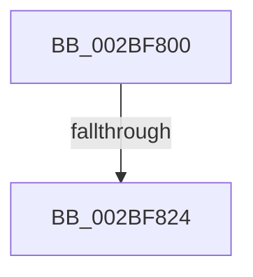

# PopPepGetComponentPreferedIdleState

- RVA: `0x002BF800`–`0x002BF82E` (길이 `46` bytes)
- VA: `0x00000001402BF800`
- 실행 섹션: `.text`
- PDB 이름 있음: `예`; PDB Function 태그: `아니요`
- unwind 정보 RVA: `0x0006E4C0`
- 디코드: `13`개 명령, `46/46` bytes 표시
- 미해석 바이트: `0` (있으면 어셈블리에 `.byte`로 보존)

> 이 문서는 커널 이미지의 기계어와 PDB 기호를 분석해 생성했습니다. 4번과 5번은 함수 원형과 자료형을 바이너리 사용 방식에서 추정한 C 해석이며 원본 소스 복구 결과는 아닙니다.

## 1. Dependencies

- 직접 호출 지점: **0**; 고유 호출 대상: **0**
- 직접 호출자로 확인된 함수: **5**
- RIP 상대 이미지 참조: **0**

### Outgoing calls
- 직접 디코드된 call 명령이 없습니다.

### Direct callers
- [PopPepCompleteComponentActiveActivity](../24/PopPepCompleteComponentActiveActivity_function_0024D5F0.md) at `0x0024D63F`
- [PopPepTriggerComponentActivatingActivity](../24/PopPepTriggerComponentActivatingActivity_function_0024D790.md) at `0x0024D7DD`
- [PopPepCompleteComponentIdleStateChangeActivity](PopPepCompleteComponentIdleStateChangeActivity_function_002BF1B0.md) at `0x002BF205`
- [PopPepComponentSetLatency](PopPepComponentSetLatency_function_002BF3D8.md) at `0x002BF47E`
- [PopPepUpdateIdleState](PopPepUpdateIdleState_function_002BF794.md) at `0x002BF7AF`

### Static image references
- 디코드된 RIP-relative 메모리 참조가 없습니다.

## 2. Other-region calls and transfers

- 다른 실행 섹션으로 향하는 call: **0**
- call이 아닌 외부 분기/꼬리 이동: **1**
  - `0x002BF81E` → [sub_002BF8D5 + 0x6](Unknown_function_002BF8D5.md) (`tail-transfer`)

## 3. Assembly (complete function range)

```asm
002BF800  40 53                           push rbx
002BF802  48 83 EC 20                     sub rsp, 0x20
002BF806  8B 99 A4 00 00 00               mov ebx, dword ptr [rcx + 0xa4]
002BF80C  4C 8B D9                        mov r11, rcx
002BF80F  8B 81 BC 00 00 00               mov eax, dword ptr [rcx + 0xbc]
002BF815  FF C8                           dec eax
002BF817  3B C3                           cmp eax, ebx
002BF819  0F 43 C3                        cmovae eax, ebx
002BF81C  85 C0                           test eax, eax
002BF81E  0F 84 B7 00 00 00               je 0x1402bf8db
002BF824  8B 89 98 00 00 00               mov ecx, dword ptr [rcx + 0x98]
002BF82A  8B D1                           mov edx, ecx
002BF82C  3B C8                           cmp ecx, eax
```

## 4. C-style interpretation (structured pseudocode)

```c
__int64 __fastcall PopPepGetComponentPreferedIdleState(__int64 a1)
{
    __int64 result;
    __int64 v_rsp;

    v_rsp = (v_rsp) - (32);
    result = (unsigned int)(((unsigned int)(*(unsigned int *)(a1 + 188))) - 1);
    if (((unsigned int)(result)) >= ((unsigned int)((unsigned int)(*(unsigned int *)(a1 + 164))))) { result = (unsigned int)((unsigned int)(*(unsigned int *)(a1 + 164))); }
    return result;
}
```

## 5. (Beta) C Style

```c
int64_t PopPepGetComponentPreferedIdleState(void *Arg1)
{
    uint8_t *arg1 = (uint8_t *)Arg1;

    int64_t result;
    int64_t local_rsp;

    local_rsp = (local_rsp) - (32);
    result = (uint32_t)(((uint32_t)(*(uint32_t *)(arg1 + 0xBC))) - 1);
    if (((uint32_t)(result)) >= ((uint32_t)((uint32_t)(*(uint32_t *)(arg1 + 0xA4))))) { result = (uint32_t)((uint32_t)(*(uint32_t *)(arg1 + 0xA4))); }
    return result;
}
```

### 관측된 메모리 오프셋

구조체 형식이 확인되지 않은 접근은 인자 기준의 오프셋으로만 기록했습니다.

| 기준 인자 | 오프셋 표현 | 폭 (bit) | 접근 |
|---|---:|---:|---|
| `Arg1` | `+ 0x98` | `32` | `R` |
| `Arg1` | `+ 0xA4` | `32` | `R` |
| `Arg1` | `+ 0xBC` | `32` | `R` |

## 6. Execution-region graph

[열기: 2D/3D 그래프와 함수 탐색 컨트롤 패널](../../../control-panel.html?section=text&rva=0x002BF800&view=graph)

- 2D 그래프는 위에서 아래로 흐르고, 3D 그래프는 빈 공간을 드래그해 회전합니다. Shift+드래그는 이동, 휠은 확대·축소, 함수 노드 선택은 대상 보고서 이동입니다.

### Static fallback


