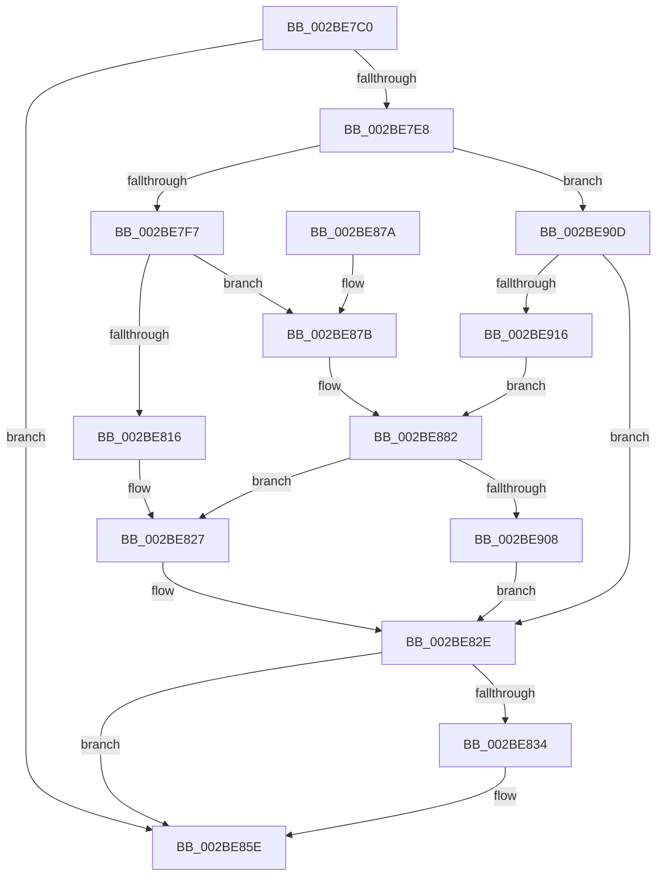

# PopPepStartComponentIdleStateChangeActivity

- RVA: `0x002BE7C0`–`0x002BE91B` (길이 `347` bytes)
- VA: `0x00000001402BE7C0`
- 실행 섹션: `.text`
- PDB 이름 있음: `예`; PDB Function 태그: `아니요`
- unwind 정보 RVA: `0x0006E3F0`
- 디코드: `82`개 명령, `347/347` bytes 표시
- 미해석 바이트: `0` (있으면 어셈블리에 `.byte`로 보존)

> 이 문서는 커널 이미지의 기계어와 PDB 기호를 분석해 생성했습니다. 4번과 5번은 함수 원형과 자료형을 바이너리 사용 방식에서 추정한 C 해석이며 원본 소스 복구 결과는 아닙니다.

## 1. Dependencies

- 직접 호출 지점: **5**; 고유 호출 대상: **4**
- 직접 호출자로 확인된 함수: **0**
- RIP 상대 이미지 참조: **0**

### Outgoing calls
- `0x002BE822` → [PopPlNotifyDeviceFState](PopPlNotifyDeviceFState_function_002BE034.md) (function, `0x002BE034`)
- `0x002BE89C` → [PopPlNotifyDeviceFState](PopPlNotifyDeviceFState_function_002BE034.md) (function, `0x002BE034`)
- `0x002BE8D3` → [PopPepUpdateIdleStateRefCount](PopPepUpdateIdleStateRefCount_function_002BF930.md) (function, `0x002BF930`)
- `0x002BE8E5` → [PopFxUpdateComponentAccountingEnhanced](PopFxUpdateComponentAccountingEnhanced_function_002BE924.md) (function, `0x002BE924`)
- `0x002BE8FB` → [PopPluginNotifyIdleState](PopPluginNotifyIdleState_function_002BFCA0.md) (function, `0x002BFCA0`)

### Direct callers
- 이 함수 시작 RVA로 연결되는 직접 call은 확인되지 않았습니다. 간접 호출은 완전히 역산할 수 없습니다.

### Static image references
- 디코드된 RIP-relative 메모리 참조가 없습니다.

## 2. Other-region calls and transfers

- 다른 실행 섹션으로 향하는 call: **0**
- 별도 외부 분기/꼬리 이동을 확인하지 못했습니다.

## 3. Assembly (complete function range)

```asm
002BE7C0  48 89 5C 24 08                  mov qword ptr [rsp + 8], rbx
002BE7C5  48 89 6C 24 10                  mov qword ptr [rsp + 0x10], rbp
002BE7CA  48 89 74 24 18                  mov qword ptr [rsp + 0x18], rsi
002BE7CF  57                              push rdi
002BE7D0  41 56                           push r14
002BE7D2  41 57                           push r15
002BE7D4  48 83 EC 30                     sub rsp, 0x30
002BE7D8  33 ED                           xor ebp, ebp
002BE7DA  4D 8B F0                        mov r14, r8
002BE7DD  48 8B FA                        mov rdi, rdx
002BE7E0  4C 8B F9                        mov r15, rcx
002BE7E3  48 85 D2                        test rdx, rdx
002BE7E6  74 76                           je 0x1402be85e
002BE7E8  48 8B 72 40                     mov rsi, qword ptr [rdx + 0x40]
002BE7EC  8B 46 0C                        mov eax, dword ptr [rsi + 0xc]
002BE7EF  85 C0                           test eax, eax
002BE7F1  0F 85 16 01 00 00               jne 0x1402be90d
002BE7F7  44 8B 82 B0 00 00 00            mov r8d, dword ptr [rdx + 0xb0]
002BE7FE  44 89 82 B4 00 00 00            mov dword ptr [rdx + 0xb4], r8d
002BE805  44 8B 4E 08                     mov r9d, dword ptr [rsi + 8]
002BE809  44 89 8A B0 00 00 00            mov dword ptr [rdx + 0xb0], r9d
002BE810  40 38 69 7C                     cmp byte ptr [rcx + 0x7c], bpl
002BE814  75 65                           jne 0x1402be87b
002BE816  8B 52 08                        mov edx, dword ptr [rdx + 8]
002BE819  48 8B 49 20                     mov rcx, qword ptr [rcx + 0x20]
002BE81D  40 88 6C 24 20                  mov byte ptr [rsp + 0x20], bpl
002BE822  E8 0D F8 FF FF                  call 0x1402be034
002BE827  C7 46 0C 02 00 00 00            mov dword ptr [rsi + 0xc], 2
002BE82E  83 7E 0C 02                     cmp dword ptr [rsi + 0xc], 2
002BE832  75 2A                           jne 0x1402be85e
002BE834  41 C7 06 01 00 00 00            mov dword ptr [r14], 1
002BE83B  40 B5 01                        mov bpl, 1
002BE83E  49 8B 47 20                     mov rax, qword ptr [r15 + 0x20]
002BE842  49 89 46 08                     mov qword ptr [r14 + 8], rax
002BE846  8B 47 08                        mov eax, dword ptr [rdi + 8]
002BE849  41 89 46 10                     mov dword ptr [r14 + 0x10], eax
002BE84D  8B 87 B0 00 00 00               mov eax, dword ptr [rdi + 0xb0]
002BE853  41 89 46 14                     mov dword ptr [r14 + 0x14], eax
002BE857  C7 46 0C 03 00 00 00            mov dword ptr [rsi + 0xc], 3
002BE85E  48 8B 5C 24 50                  mov rbx, qword ptr [rsp + 0x50]
002BE863  40 8A C5                        mov al, bpl
002BE866  48 8B 6C 24 58                  mov rbp, qword ptr [rsp + 0x58]
002BE86B  48 8B 74 24 60                  mov rsi, qword ptr [rsp + 0x60]
002BE870  48 83 C4 30                     add rsp, 0x30
002BE874  41 5F                           pop r15
002BE876  41 5E                           pop r14
002BE878  5F                              pop rdi
002BE879  C3                              ret
002BE87A  CC                              int3
002BE87B  C7 46 0C 01 00 00 00            mov dword ptr [rsi + 0xc], 1
002BE882  44 8B 8A B0 00 00 00            mov r9d, dword ptr [rdx + 0xb0]
002BE889  44 8B 82 B4 00 00 00            mov r8d, dword ptr [rdx + 0xb4]
002BE890  8B 52 08                        mov edx, dword ptr [rdx + 8]
002BE893  48 8B 49 20                     mov rcx, qword ptr [rcx + 0x20]
002BE897  40 88 6C 24 20                  mov byte ptr [rsp + 0x20], bpl
002BE89C  E8 93 F7 FF FF                  call 0x1402be034
002BE8A1  4C 8B 97 C8 00 00 00            mov r10, qword ptr [rdi + 0xc8]
002BE8A8  4C 8D 8F C0 00 00 00            lea r9, [rdi + 0xc0]
002BE8AF  8B 87 B4 00 00 00               mov eax, dword ptr [rdi + 0xb4]
002BE8B5  41 B8 01 00 00 00               mov r8d, 1
002BE8BB  8B 9F B0 00 00 00               mov ebx, dword ptr [rdi + 0xb0]
002BE8C1  48 8D 0C 40                     lea rcx, [rax + rax*2]
002BE8C5  41 8B 4C CA 10                  mov ecx, dword ptr [r10 + rcx*8 + 0x10]
002BE8CA  48 8D 14 5B                     lea rdx, [rbx + rbx*2]
002BE8CE  41 8B 54 D2 10                  mov edx, dword ptr [r10 + rdx*8 + 0x10]
002BE8D3  E8 58 10 00 00                  call 0x1402bf930
002BE8D8  8B 57 08                        mov edx, dword ptr [rdi + 8]
002BE8DB  45 33 C9                        xor r9d, r9d
002BE8DE  49 8B 4F 20                     mov rcx, qword ptr [r15 + 0x20]
002BE8E2  44 8B C3                        mov r8d, ebx
002BE8E5  E8 3A 00 00 00                  call 0x1402be924
002BE8EA  44 8B 87 B0 00 00 00            mov r8d, dword ptr [rdi + 0xb0]
002BE8F1  45 33 C9                        xor r9d, r9d
002BE8F4  8B 57 08                        mov edx, dword ptr [rdi + 8]
002BE8F7  49 8B 4F 20                     mov rcx, qword ptr [r15 + 0x20]
002BE8FB  E8 A0 13 00 00                  call 0x1402bfca0
002BE900  3C 01                           cmp al, 1
002BE902  0F 84 1F FF FF FF               je 0x1402be827
002BE908  E9 21 FF FF FF                  jmp 0x1402be82e
002BE90D  83 F8 01                        cmp eax, 1
002BE910  0F 85 18 FF FF FF               jne 0x1402be82e
002BE916  E9 67 FF FF FF                  jmp 0x1402be882
```

## 4. C-style interpretation (structured pseudocode)

```c
__int64 __fastcall PopPepStartComponentIdleStateChangeActivity(__int64 a1, __int64 a2, __int64 a3)
{
    __int64 result;
    __int64 v_rbp;
    __int64 v_rsp;
    unsigned __int8 v_stack_m28;
    unsigned __int64 v_stack_p10;
    unsigned __int64 v_stack_p18;
    unsigned __int8 v_stack_p20;
    unsigned __int64 v_stack_p8;

    v_stack_p8 = v_rbx;
    v_stack_p10 = v_rbp;
    v_stack_p18 = v_rsi;
    v_rsp = (v_rsp) - (48);
    v_rbp = 0;
    if (a2 == 0) goto loc_002BE85E;
    if ((unsigned int)((unsigned int)(*(unsigned int *)(*(unsigned __int64 *)(a2 + 64) + 12))) != 0) goto loc_002BE90D;
    *(unsigned int *)(a2 + 180) = (unsigned int)((unsigned int)(*(unsigned int *)(a2 + 176)));
    *(unsigned int *)(a2 + 176) = (unsigned int)((unsigned int)(*(unsigned int *)(*(unsigned __int64 *)(a2 + 64) + 8)));
    if ((*(unsigned __int8 *)(a1 + 124)) != 0) goto loc_002BE87B;
    v_stack_m28 = 0;
    result = PopPlNotifyDeviceFState(*(unsigned __int64 *)(a1 + 32), (unsigned int)(*(unsigned int *)(a2 + 8)), (unsigned int)(*(unsigned int *)(a2 + 176)), (unsigned int)(*(unsigned int *)(*(unsigned __int64 *)(a2 + 64) + 8)));
loc_002BE827:
    *(unsigned int *)(*(unsigned __int64 *)(a2 + 64) + 12) = 2;
loc_002BE82E:
    if ((*(unsigned int *)(*(unsigned __int64 *)(a2 + 64) + 12)) == 2) {
        *(unsigned int *)(a3) = 1;
        v_rbp = 1;
        result = *(unsigned __int64 *)(a1 + 32);
        *(unsigned __int64 *)(a3 + 8) = result;
        result = *(unsigned int *)(a2 + 8);
        *(unsigned int *)(a3 + 16) = (unsigned int)(result);
        result = *(unsigned int *)(a2 + 176);
        *(unsigned int *)(a3 + 20) = (unsigned int)(result);
        *(unsigned int *)(*(unsigned __int64 *)(a2 + 64) + 12) = 3;
    }
    v_rsp = (v_rsp) + (48);
    return (unsigned __int8)(v_rbp);
loc_002BE87B:
    *(unsigned int *)(v_stack_p18 + 12) = 1;
loc_002BE882:
    v_stack_p20 = (unsigned __int8)(v_stack_p10);
    result = PopPlNotifyDeviceFState(*(unsigned __int64 *)(*(unsigned __int64 *)(a1 + 32) + 32), (unsigned int)(*(unsigned int *)((unsigned int)(*(unsigned int *)(a2 + 8)) + 8)), (unsigned int)(*(unsigned int *)((unsigned int)(*(unsigned int *)(a2 + 8)) + 180)), (unsigned int)(*(unsigned int *)((unsigned int)(*(unsigned int *)(a2 + 8)) + 176)));
    result = PopPepUpdateIdleStateRefCount((unsigned int)(*(unsigned int *)(*(unsigned __int64 *)(a2 + 200) + (unsigned int)(*(unsigned int *)(a2 + 180)) + (unsigned int)(*(unsigned int *)(a2 + 180)) * 2 * 8 + 16)), (unsigned int)(*(unsigned int *)(*(unsigned __int64 *)(a2 + 200) + (unsigned int)(*(unsigned int *)(a2 + 176)) + (unsigned int)(*(unsigned int *)(a2 + 176)) * 2 * 8 + 16)), 1, a2 + 192);
    a4 = 0;
    result = PopFxUpdateComponentAccountingEnhanced(*(unsigned __int64 *)(a1 + 32), (unsigned int)(*(unsigned int *)(a2 + 8)), (unsigned int)((unsigned int)((unsigned int)(*(unsigned int *)(a2 + 176)))), a4);
    a4 = 0;
    result = PopPluginNotifyIdleState(*(unsigned __int64 *)(a1 + 32), (unsigned int)(*(unsigned int *)(a2 + 8)), (unsigned int)(*(unsigned int *)(a2 + 176)), a4);
    if (((unsigned __int8)(result)) == 1) goto loc_002BE827;
    goto loc_002BE82E;
loc_002BE90D:
    if (((unsigned int)(result)) != 1) goto loc_002BE82E;
    goto loc_002BE882;
}
```

## 5. (Beta) C Style

```c
int64_t PopPepStartComponentIdleStateChangeActivity(void *Arg1, void *Arg2, void *Arg3)
{
    uint8_t *arg1 = (uint8_t *)Arg1;
    uint8_t *arg2 = (uint8_t *)Arg2;
    uint8_t *arg3 = (uint8_t *)Arg3;

    int64_t result;
    int64_t local_rbp;
    int64_t local_rsp;
    uint8_t v_stack_m28;
    uint64_t v_stack_p10;
    uint64_t v_stack_p18;
    uint8_t v_stack_p20;
    uint64_t v_stack_p8;

    v_stack_p8 = local_rbx;
    v_stack_p10 = local_rbp;
    v_stack_p18 = local_rsi;
    local_rsp = (local_rsp) - (48);
    local_rbp = 0;
    if (Arg2 == NULL) goto loc_002BE85E;
    if ((uint32_t)((uint32_t)(*(uint32_t *)(*(uint64_t *)(arg2 + 0x40) + 0xC))) != 0) goto loc_002BE90D;
    *(uint32_t *)(arg2 + 0xB4) = (uint32_t)((uint32_t)(*(uint32_t *)(arg2 + 0xB0)));
    *(uint32_t *)(arg2 + 0xB0) = (uint32_t)((uint32_t)(*(uint32_t *)(*(uint64_t *)(arg2 + 0x40) + 0x8)));
    if ((*(uint8_t *)(arg1 + 0x7C)) != 0) goto loc_002BE87B;
    v_stack_m28 = 0;
    result = PopPlNotifyDeviceFState(*(uint64_t *)(arg1 + 0x20), (uint32_t)(*(uint32_t *)(arg2 + 0x8)), (uint32_t)(*(uint32_t *)(arg2 + 0xB0)), (uint32_t)(*(uint32_t *)(*(uint64_t *)(arg2 + 0x40) + 0x8)));
loc_002BE827:
    *(uint32_t *)(*(uint64_t *)(arg2 + 0x40) + 0xC) = 2;
loc_002BE82E:
    if ((*(uint32_t *)(*(uint64_t *)(arg2 + 0x40) + 0xC)) == 2) {
        *(uint32_t *)(arg3) = 1;
        local_rbp = 1;
        result = *(uint64_t *)(arg1 + 0x20);
        *(uint64_t *)(arg3 + 0x8) = result;
        result = *(uint32_t *)(arg2 + 0x8);
        *(uint32_t *)(arg3 + 0x10) = (uint32_t)(result);
        result = *(uint32_t *)(arg2 + 0xB0);
        *(uint32_t *)(arg3 + 0x14) = (uint32_t)(result);
        *(uint32_t *)(*(uint64_t *)(arg2 + 0x40) + 0xC) = 3;
    }
    local_rsp = (local_rsp) + (48);
    return (uint8_t)(local_rbp);
loc_002BE87B:
    *(uint32_t *)(v_stack_p18 + 0xC) = 1;
loc_002BE882:
    v_stack_p20 = (uint8_t)(v_stack_p10);
    result = PopPlNotifyDeviceFState(*(uint64_t *)(*(uint64_t *)(arg1 + 0x20) + 0x20), (uint32_t)(*(uint32_t *)((uint32_t)(*(uint32_t *)(arg2 + 0x8)) + 0x8)), (uint32_t)(*(uint32_t *)((uint32_t)(*(uint32_t *)(arg2 + 0x8)) + 0xB4)), (uint32_t)(*(uint32_t *)((uint32_t)(*(uint32_t *)(arg2 + 0x8)) + 0xB0)));
    result = PopPepUpdateIdleStateRefCount((uint32_t)(*(uint32_t *)(*(uint64_t *)(arg2 + 0xC8) + (uint32_t)(*(uint32_t *)(arg2 + 0xB4)) + (uint32_t)(*(uint32_t *)(arg2 + 0xB4)) * 2 * 8 + 0x10)), (uint32_t)(*(uint32_t *)(*(uint64_t *)(arg2 + 0xC8) + (uint32_t)(*(uint32_t *)(arg2 + 0xB0)) + (uint32_t)(*(uint32_t *)(arg2 + 0xB0)) * 2 * 8 + 0x10)), 1, Arg2 + 192);
    a4 = 0;
    result = PopFxUpdateComponentAccountingEnhanced(*(uint64_t *)(arg1 + 0x20), (uint32_t)(*(uint32_t *)(arg2 + 0x8)), (uint32_t)((uint32_t)((uint32_t)(*(uint32_t *)(arg2 + 0xB0)))), a4);
    a4 = 0;
    result = PopPluginNotifyIdleState(*(uint64_t *)(arg1 + 0x20), (uint32_t)(*(uint32_t *)(arg2 + 0x8)), (uint32_t)(*(uint32_t *)(arg2 + 0xB0)), a4);
    if (((uint8_t)(result)) == 1) goto loc_002BE827;
    goto loc_002BE82E;
loc_002BE90D:
    if (((uint32_t)(result)) != 1) goto loc_002BE82E;
    goto loc_002BE882;
}
```

### 관측된 메모리 오프셋

구조체 형식이 확인되지 않은 접근은 인자 기준의 오프셋으로만 기록했습니다.

| 기준 인자 | 오프셋 표현 | 폭 (bit) | 접근 |
|---|---:|---:|---|
| `Arg1` | `+ 0x20` | `64` | `R` |
| `Arg1` | `+ 0x7C` | `8` | `R` |
| `Arg2` | `+ 0x8` | `32` | `R` |
| `Arg2` | `+ 0xB0` | `32` | `R` |
| `Arg2` | `+ 0xB4` | `32` | `R` |
| `Arg2` | `+ 0xC0` | `64` | `R` |
| `Arg2` | `+ 0xC8` | `64` | `R` |
| `Arg3` | `+ 0x0` | `32` | `W` |
| `Arg3` | `+ 0x8` | `64` | `W` |
| `Arg3` | `+ 0x10` | `32` | `W` |
| `Arg3` | `+ 0x14` | `32` | `W` |

## 6. Execution-region graph

[열기: 2D/3D 그래프와 함수 탐색 컨트롤 패널](../../../control-panel.html?section=text&rva=0x002BE7C0&view=graph)

- 2D 그래프는 위에서 아래로 흐르고, 3D 그래프는 빈 공간을 드래그해 회전합니다. Shift+드래그는 이동, 휠은 확대·축소, 함수 노드 선택은 대상 보고서 이동입니다.

### Static fallback


