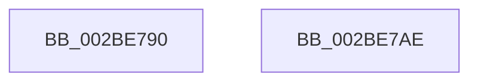

# PopPepStartDevicePowerOffActivity

- RVA: `0x002BE790`–`0x002BE7AF` (길이 `31` bytes)
- VA: `0x00000001402BE790`
- 실행 섹션: `.text`
- PDB 이름 있음: `예`; PDB Function 태그: `아니요`
- unwind 정보 RVA: `0x000DB714`
- 디코드: `8`개 명령, `31/31` bytes 표시
- 미해석 바이트: `0` (있으면 어셈블리에 `.byte`로 보존)

> 이 문서는 커널 이미지의 기계어와 PDB 기호를 분석해 생성했습니다. 4번과 5번은 함수 원형과 자료형을 바이너리 사용 방식에서 추정한 C 해석이며 원본 소스 복구 결과는 아닙니다.

## 1. Dependencies

- 직접 호출 지점: **0**; 고유 호출 대상: **0**
- 직접 호출자로 확인된 함수: **3**
- RIP 상대 이미지 참조: **0**

### Outgoing calls
- 직접 디코드된 call 명령이 없습니다.

### Direct callers
- [PopPepProcessEvent](../24/PopPepProcessEvent_function_0024B930.md) at `0x0024CA7F`
- [PopPepProcessEvent](../24/PopPepProcessEvent_function_0024B930.md) at `0x0024CBC3`
- [PopPepStartActivity](../24/PopPepStartActivity_function_0024D6E0.md) at `0x0024D770`
- [PopPepWork](PopPepWork_function_002BCBC0.md) at `0x002BD04F`
- [PopPepWork](PopPepWork_function_002BCBC0.md) at `0x002BD08C`

### Static image references
- 디코드된 RIP-relative 메모리 참조가 없습니다.

## 2. Other-region calls and transfers

- 다른 실행 섹션으로 향하는 call: **0**
- 별도 외부 분기/꼬리 이동을 확인하지 못했습니다.

## 3. Assembly (complete function range)

```asm
002BE790  C6 81 88 00 00 00 00            mov byte ptr [rcx + 0x88], 0
002BE797  41 C7 00 02 00 00 00            mov dword ptr [r8], 2
002BE79E  48 8B 41 20                     mov rax, qword ptr [rcx + 0x20]
002BE7A2  49 89 40 08                     mov qword ptr [r8 + 8], rax
002BE7A6  B0 01                           mov al, 1
002BE7A8  41 C6 40 10 00                  mov byte ptr [r8 + 0x10], 0
002BE7AD  C3                              ret
002BE7AE  CC                              int3
```

## 4. C-style interpretation (structured pseudocode)

```c
__int64 __fastcall PopPepStartDevicePowerOffActivity(__int64 a1, __int64 a2, __int64 a3)
{
    *(unsigned __int8 *)(a1 + 136) = 0;
    *(unsigned int *)(a3) = 2;
    *(unsigned __int64 *)(a3 + 8) = *(unsigned __int64 *)(a1 + 32);
    *(unsigned __int8 *)(a3 + 16) = 0;
    return 1;
}
```

## 5. (Beta) C Style

```c
int64_t PopPepStartDevicePowerOffActivity(void *Arg1, int64_t Arg2, void *Arg3)
{
    uint8_t *arg1 = (uint8_t *)Arg1;
    uint8_t *arg3 = (uint8_t *)Arg3;

    *(uint8_t *)(arg1 + 0x88) = 0;
    *(uint32_t *)(arg3) = 2;
    *(uint64_t *)(arg3 + 0x8) = *(uint64_t *)(arg1 + 0x20);
    *(uint8_t *)(arg3 + 0x10) = 0;
    return 1;
}
```

### 관측된 메모리 오프셋

구조체 형식이 확인되지 않은 접근은 인자 기준의 오프셋으로만 기록했습니다.

| 기준 인자 | 오프셋 표현 | 폭 (bit) | 접근 |
|---|---:|---:|---|
| `Arg1` | `+ 0x20` | `64` | `R` |
| `Arg1` | `+ 0x88` | `8` | `W` |
| `Arg3` | `+ 0x0` | `32` | `W` |
| `Arg3` | `+ 0x8` | `64` | `W` |
| `Arg3` | `+ 0x10` | `8` | `W` |

## 6. Execution-region graph

[열기: 2D/3D 그래프와 함수 탐색 컨트롤 패널](../../../control-panel.html?section=text&rva=0x002BE790&view=graph)

- 2D 그래프는 위에서 아래로 흐르고, 3D 그래프는 빈 공간을 드래그해 회전합니다. Shift+드래그는 이동, 휠은 확대·축소, 함수 노드 선택은 대상 보고서 이동입니다.

### Static fallback


