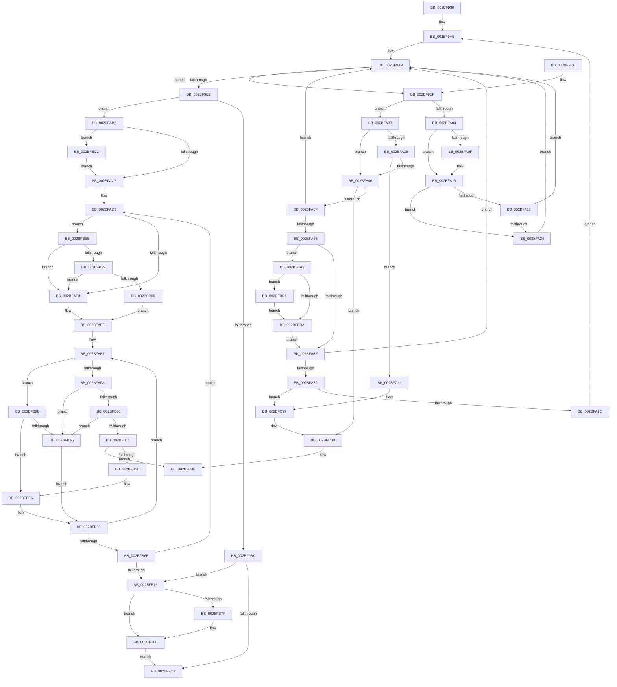

# PopPepUpdateIdleStateRefCount

- RVA: `0x002BF930`–`0x002BFC63` (길이 `819` bytes)
- VA: `0x00000001402BF930`
- 실행 섹션: `.text`
- PDB 이름 있음: `예`; PDB Function 태그: `아니요`
- unwind 정보 RVA: `0x0006E518`
- 디코드: `208`개 명령, `819/819` bytes 표시
- 미해석 바이트: `0` (있으면 어셈블리에 `.byte`로 보존)

> 이 문서는 커널 이미지의 기계어와 PDB 기호를 분석해 생성했습니다. 4번과 5번은 함수 원형과 자료형을 바이너리 사용 방식에서 추정한 C 해석이며 원본 소스 복구 결과는 아닙니다.

## 1. Dependencies

- 직접 호출 지점: **13**; 고유 호출 대상: **8**
- 직접 호출자로 확인된 함수: **8**
- RIP 상대 이미지 참조: **5**

### Outgoing calls
- `0x002BF97A` → [memset](../6C/memset_function_006C6C40.md) (function, `0x006C6C40`)
- `0x002BF9CE` → [_security_check_cookie](../6A/_security_check_cookie_function_006AC640.md) (function, `0x006AC640`)
- `0x002BFA88` → [PopFxPlatformStateAvailable](../30/PopFxPlatformStateAvailable_function_00303F6C.md) (function, `0x00303F6C`)
- `0x002BFB3B` → [PopFxPlatformStateAvailable](../30/PopFxPlatformStateAvailable_function_00303F6C.md) (function, `0x00303F6C`)
- `0x002BFB86` → [KiLowerIrqlProcessIrqlFlags](../4F/KiLowerIrqlProcessIrqlFlags_function_004F5698.md) (function, `0x004F5698`)
- `0x002BFBC7` → [KiRaiseIrqlProcessIrqlFlags](../4F/KiRaiseIrqlProcessIrqlFlags_function_004F56FC.md) (function, `0x004F56FC`)
- `0x002BFBD7` → [KiRaiseIrqlProcessIrqlFlags](../4F/KiRaiseIrqlProcessIrqlFlags_function_004F56FC.md) (function, `0x004F56FC`)
- `0x002BFBF9` → [KiCheckVpBackingLongSpinWaitHypercall](../30/KiCheckVpBackingLongSpinWaitHypercall_function_0030F490.md) (function, `0x0030F490`)
- `0x002BFC09` → [HvlNotifyLongSpinWait](../30/HvlNotifyLongSpinWait_function_0030F460.md) (function, `0x0030F460`)
- `0x002BFC21` → [PopFxBugCheck](PopFxBugCheck_function_002BFC6C.md) (function, `0x002BFC6C`)
- `0x002BFC35` → [PopFxBugCheck](PopFxBugCheck_function_002BFC6C.md) (function, `0x002BFC6C`)
- `0x002BFC49` → [PopFxBugCheck](PopFxBugCheck_function_002BFC6C.md) (function, `0x002BFC6C`)
- `0x002BFC5D` → [PopFxBugCheck](PopFxBugCheck_function_002BFC6C.md) (function, `0x002BFC6C`)

### Direct callers
- [PopPepStartComponentIdleStateChangeActivity](PopPepStartComponentIdleStateChangeActivity_function_002BE7C0.md) at `0x002BE8D3`
- [PopPepCompleteComponentIdleStateChangeActivity](PopPepCompleteComponentIdleStateChangeActivity_function_002BF1B0.md) at `0x002BF27C`
- [PopPepDeviceDState](PopPepDeviceDState_function_002BFE70.md) at `0x002BFFD0`
- [PopPepDeviceDState](PopPepDeviceDState_function_002BFE70.md) at `0x002C0050`
- [PopPepDeviceDState](PopPepDeviceDState_function_002BFE70.md) at `0x002C00BD`
- [PopPepDeviceDState](PopPepDeviceDState_function_002BFE70.md) at `0x002C0138`
- [PopPepUpdateDripsDeviceVetoMask](../4B/PopPepUpdateDripsDeviceVetoMask_function_004B079C.md) at `0x004B0830`
- [PopPepUpdateDripsDeviceVetoMask](../4B/PopPepUpdateDripsDeviceVetoMask_function_004B079C.md) at `0x004B0841`
- [PopPepInitializeVetoMasks](../4C/PopPepInitializeVetoMasks_function_004C9350.md) at `0x004C96AC`
- [PopPepInitializeVetoMasks](../4C/PopPepInitializeVetoMasks_function_004C9350.md) at `0x004C981F`
- [PopPepClearDripsDeviceVetoMask](../5D/PopPepClearDripsDeviceVetoMask_function_005DC8C4.md) at `0x005DC8FF`
- [PopPepClearDripsDeviceVetoMask](../5D/PopPepClearDripsDeviceVetoMask_function_005DC8C4.md) at `0x005DC94E`
- [PopPepPlatformStateRegistered](../5D/PopPepPlatformStateRegistered_function_005DCDB8.md) at `0x005DCFAC`
- [PopPepUnregisterDevice](../../page/A8/PopPepUnregisterDevice_function_00A8B048.md) at `0x00A8B0CE`
- [PopPepUnregisterDevice](../../page/A8/PopPepUnregisterDevice_function_00A8B048.md) at `0x00A8B0FE`

### Static image references
- `0x002BF947` → RVA `0x00E0A740` (`.data`; read)
- `0x002BF985` → RVA `0x00FC52C8` (`ALMOSTRO`; read)
- `0x002BFABA` → RVA `0x00FC6D20` (`ALMOSTRO`; read)
- `0x002BFAD6` → RVA `0x00FC52AC` (`ALMOSTRO`; reference)
- `0x002BFBEB` → RVA `0x00FC6AB8` (`ALMOSTRO`; read)

## 2. Other-region calls and transfers

- 다른 실행 섹션으로 향하는 call: **0**
- 별도 외부 분기/꼬리 이동을 확인하지 못했습니다.

## 3. Assembly (complete function range)

```asm
002BF930  48 89 5C 24 18                  mov qword ptr [rsp + 0x18], rbx
002BF935  55                              push rbp
002BF936  56                              push rsi
002BF937  57                              push rdi
002BF938  41 54                           push r12
002BF93A  41 55                           push r13
002BF93C  41 56                           push r14
002BF93E  41 57                           push r15
002BF940  48 81 EC 40 01 00 00            sub rsp, 0x140
002BF947  48 8B 05 F2 AD B4 00            mov rax, qword ptr [rip + 0xb4adf2]
002BF94E  48 33 C4                        xor rax, rsp
002BF951  48 89 84 24 30 01 00 00         mov qword ptr [rsp + 0x130], rax
002BF959  44 89 44 24 20                  mov dword ptr [rsp + 0x20], r8d
002BF95E  8B FA                           mov edi, edx
002BF960  8B D9                           mov ebx, ecx
002BF962  45 33 E4                        xor r12d, r12d
002BF965  44 21 64 24 24                  and dword ptr [rsp + 0x24], r12d
002BF96A  48 8D 4C 24 30                  lea rcx, [rsp + 0x30]
002BF96F  33 D2                           xor edx, edx
002BF971  41 B8 00 01 00 00               mov r8d, 0x100
002BF977  4D 8B F1                        mov r14, r9
002BF97A  E8 C1 72 40 00                  call 0x1406c6c40
002BF97F  8B 54 24 20                     mov edx, dword ptr [rsp + 0x20]
002BF983  33 F6                           xor esi, esi
002BF985  4C 8B 05 3C 59 D0 00            mov r8, qword ptr [rip + 0xd0593c]
002BF98C  45 32 ED                        xor r13b, r13b
002BF98F  45 32 FF                        xor r15b, r15b
002BF992  4C 89 44 24 28                  mov qword ptr [rsp + 0x28], r8
002BF997  85 D2                           test edx, edx
002BF999  8B EB                           mov ebp, ebx
002BF99B  0F 45 EF                        cmovne ebp, edi
002BF99E  33 FB                           xor edi, ebx
002BF9A0  23 EF                           and ebp, edi
002BF9A2  8D 7E 02                        lea edi, [rsi + 2]
002BF9A5  41 83 C9 FF                     or r9d, 0xffffffff
002BF9A9  0F BC CD                        bsf ecx, ebp
002BF9AC  89 4C 24 24                     mov dword ptr [rsp + 0x24], ecx
002BF9B0  75 3D                           jne 0x1402bf9ef
002BF9B2  85 F6                           test esi, esi
002BF9B4  0F 85 F8 00 00 00               jne 0x1402bfab2
002BF9BA  45 84 ED                        test r13b, r13b
002BF9BD  0F 85 B3 01 00 00               jne 0x1402bfb76
002BF9C3  48 8B 8C 24 30 01 00 00         mov rcx, qword ptr [rsp + 0x130]
002BF9CB  48 33 CC                        xor rcx, rsp
002BF9CE  E8 6D CC 3E 00                  call 0x1406ac640
002BF9D3  48 8B 9C 24 90 01 00 00         mov rbx, qword ptr [rsp + 0x190]
002BF9DB  48 81 C4 40 01 00 00            add rsp, 0x140
002BF9E2  41 5F                           pop r15
002BF9E4  41 5E                           pop r14
002BF9E6  41 5D                           pop r13
002BF9E8  41 5C                           pop r12
002BF9EA  5F                              pop rdi
002BF9EB  5E                              pop rsi
002BF9EC  5D                              pop rbp
002BF9ED  C3                              ret
002BF9EE  CC                              int3
002BF9EF  8D 45 FF                        lea eax, [rbp - 1]
002BF9F2  23 E8                           and ebp, eax
002BF9F4  8B C1                           mov eax, ecx
002BF9F6  48 69 D8 C0 01 00 00            imul rbx, rax, 0x1c0
002BF9FD  49 03 D8                        add rbx, r8
002BFA00  85 D2                           test edx, edx
002BFA02  74 2C                           je 0x1402bfa30
002BFA04  8B 83 80 01 00 00               mov eax, dword ptr [rbx + 0x180]
002BFA0A  4D 85 F6                        test r14, r14
002BFA0D  74 04                           je 0x1402bfa13
002BFA0F  F0 41 FF 06                     lock inc dword ptr [r14]
002BFA13  85 C0                           test eax, eax
002BFA15  7E 0D                           jle 0x1402bfa24
002BFA17  8D 48 01                        lea ecx, [rax + 1]
002BFA1A  F0 0F B1 8B 80 01 00 00         lock cmpxchg dword ptr [rbx + 0x180], ecx
002BFA22  74 85                           je 0x1402bf9a9
002BFA24  48 89 5C F4 30                  mov qword ptr [rsp + rsi*8 + 0x30], rbx
002BFA29  FF C6                           inc esi
002BFA2B  E9 79 FF FF FF                  jmp 0x1402bf9a9
002BFA30  4D 85 F6                        test r14, r14
002BFA33  74 11                           je 0x1402bfa46
002BFA35  41 8B C1                        mov eax, r9d
002BFA38  F0 41 0F C1 06                  lock xadd dword ptr [r14], eax
002BFA3D  41 03 C1                        add eax, r9d
002BFA40  0F 88 CD 01 00 00               js 0x1402bfc13
002BFA46  41 8B C1                        mov eax, r9d
002BFA49  F0 0F C1 83 80 01 00 00         lock xadd dword ptr [rbx + 0x180], eax
002BFA51  41 03 C1                        add eax, r9d
002BFA54  3D 00 00 00 40                  cmp eax, 0x40000000
002BFA59  0F 8C DC 01 00 00               jl 0x1402bfc3b
002BFA5F  0F 85 44 FF FF FF               jne 0x1402bf9a9
002BFA65  45 84 ED                        test r13b, r13b
002BFA68  0F 84 3B 01 00 00               je 0x1402bfba9
002BFA6E  B8 00 00 00 40                  mov eax, 0x40000000
002BFA73  F0 44 0F B1 8B 80 01 00 00      lock cmpxchg dword ptr [rbx + 0x180], r9d
002BFA7C  0F 85 27 FF FF FF               jne 0x1402bf9a9
002BFA82  8B 4C 24 24                     mov ecx, dword ptr [rsp + 0x24]
002BFA86  B2 01                           mov dl, 1
002BFA88  E8 DF 44 04 00                  call 0x140303f6c
002BFA8D  48 63 83 80 01 00 00            movsxd rax, dword ptr [rbx + 0x180]
002BFA94  83 F8 FF                        cmp eax, -1
002BFA97  0F 85 8A 01 00 00               jne 0x1402bfc27
002BFA9D  8B 54 24 20                     mov edx, dword ptr [rsp + 0x20]
002BFAA1  4C 8B 44 24 28                  mov r8, qword ptr [rsp + 0x28]
002BFAA6  44 89 A3 80 01 00 00            mov dword ptr [rbx + 0x180], r12d
002BFAAD  E9 F3 FE FF FF                  jmp 0x1402bf9a5
002BFAB2  44 0F 20 C3                     mov rbx, cr8
002BFAB6  44 0F 22 C7                     mov cr8, rdi
002BFABA  44 39 25 5F 72 D0 00            cmp dword ptr [rip + 0xd0725f], r12d
002BFAC1  0F 85 FB 00 00 00               jne 0x1402bfbc2
002BFAC7  4C 8B 74 24 28                  mov r14, qword ptr [rsp + 0x28]
002BFACC  44 8A FB                        mov r15b, bl
002BFACF  41 83 CD FF                     or r13d, 0xffffffff
002BFAD3  41 FF C4                        inc r12d
002BFAD6  44 85 25 CF 57 D0 00            test dword ptr [rip + 0xd057cf], r12d
002BFADD  0F 84 08 01 00 00               je 0x1402bfbeb
002BFAE3  F3 90                           pause
002BFAE5  33 FF                           xor edi, edi
002BFAE7  48 8B 5C FC 30                  mov rbx, qword ptr [rsp + rdi*8 + 0x30]
002BFAEC  8B 83 80 01 00 00               mov eax, dword ptr [rbx + 0x180]
002BFAF2  85 C0                           test eax, eax
002BFAF4  0F 8F 9E 00 00 00               jg 0x1402bfb98
002BFAFA  0F 85 A5 00 00 00               jne 0x1402bfba5
002BFB00  33 C0                           xor eax, eax
002BFB02  F0 44 0F B1 AB 80 01 00 00      lock cmpxchg dword ptr [rbx + 0x180], r13d
002BFB0B  0F 85 94 00 00 00               jne 0x1402bfba5
002BFB11  48 8B CB                        mov rcx, rbx
002BFB14  48 B8 25 49 92 24 49 92 24 49   movabs rax, 0x4924924924924925
002BFB1E  49 2B CE                        sub rcx, r14
002BFB21  48 F7 E9                        imul rcx
002BFB24  48 8B CA                        mov rcx, rdx
002BFB27  33 D2                           xor edx, edx
002BFB29  48 C1 F9 07                     sar rcx, 7
002BFB2D  48 8B C1                        mov rax, rcx
002BFB30  48 C1 E8 3F                     shr rax, 0x3f
002BFB34  48 03 C8                        add rcx, rax
002BFB37  89 4C 24 24                     mov dword ptr [rsp + 0x24], ecx
002BFB3B  E8 2C 44 04 00                  call 0x140303f6c
002BFB40  48 63 83 80 01 00 00            movsxd rax, dword ptr [rbx + 0x180]
002BFB47  83 F8 FF                        cmp eax, -1
002BFB4A  0F 85 FF 00 00 00               jne 0x1402bfc4f
002BFB50  C7 83 80 01 00 00 01 00 00 40   mov dword ptr [rbx + 0x180], 0x40000001
002BFB5A  FF CE                           dec esi
002BFB5C  48 8B 4C F4 30                  mov rcx, qword ptr [rsp + rsi*8 + 0x30]
002BFB61  48 89 4C FC 30                  mov qword ptr [rsp + rdi*8 + 0x30], rcx
002BFB66  3B FE                           cmp edi, esi
002BFB68  0F 82 79 FF FF FF               jb 0x1402bfae7
002BFB6E  85 F6                           test esi, esi
002BFB70  0F 85 5D FF FF FF               jne 0x1402bfad3
002BFB76  83 3D A3 71 D0 00 00            cmp dword ptr [rip + 0xd071a3], 0
002BFB7D  74 0C                           je 0x1402bfb8b
002BFB7F  44 0F 20 C1                     mov rcx, cr8
002BFB83  41 8A D7                        mov dl, r15b
002BFB86  E8 0D 5B 23 00                  call 0x1404f5698
002BFB8B  41 0F B6 C7                     movzx eax, r15b
002BFB8F  44 0F 22 C0                     mov cr8, rax
002BFB93  E9 2B FE FF FF                  jmp 0x1402bf9c3
002BFB98  8D 48 01                        lea ecx, [rax + 1]
002BFB9B  F0 0F B1 8B 80 01 00 00         lock cmpxchg dword ptr [rbx + 0x180], ecx
002BFBA3  74 B5                           je 0x1402bfb5a
002BFBA5  FF C7                           inc edi
002BFBA7  EB BD                           jmp 0x1402bfb66
002BFBA9  45 0F 20 C7                     mov r15, cr8
002BFBAD  44 0F 22 C7                     mov cr8, rdi
002BFBB1  44 39 25 68 71 D0 00            cmp dword ptr [rip + 0xd07168], r12d
002BFBB8  75 17                           jne 0x1402bfbd1
002BFBBA  41 B5 01                        mov r13b, 1
002BFBBD  E9 AC FE FF FF                  jmp 0x1402bfa6e
002BFBC2  40 8A D7                        mov dl, dil
002BFBC5  8A CB                           mov cl, bl
002BFBC7  E8 30 5B 23 00                  call 0x1404f56fc
002BFBCC  E9 F6 FE FF FF                  jmp 0x1402bfac7
002BFBD1  40 8A D7                        mov dl, dil
002BFBD4  41 8A CF                        mov cl, r15b
002BFBD7  E8 20 5B 23 00                  call 0x1404f56fc
002BFBDC  8B 54 24 20                     mov edx, dword ptr [rsp + 0x20]
002BFBE0  41 83 C9 FF                     or r9d, 0xffffffff
002BFBE4  4C 8B 44 24 28                  mov r8, qword ptr [rsp + 0x28]
002BFBE9  EB CF                           jmp 0x1402bfbba
002BFBEB  8B 05 C7 6E D0 00               mov eax, dword ptr [rip + 0xd06ec7]
002BFBF1  A8 40                           test al, 0x40
002BFBF3  0F 84 EA FE FF FF               je 0x1402bfae3
002BFBF9  E8 92 F8 04 00                  call 0x14030f490
002BFBFE  84 C0                           test al, al
002BFC00  0F 84 DD FE FF FF               je 0x1402bfae3
002BFC06  41 8B CC                        mov ecx, r12d
002BFC09  E8 52 F8 04 00                  call 0x14030f460
002BFC0E  E9 D2 FE FF FF                  jmp 0x1402bfae5
002BFC13  44 8B CD                        mov r9d, ebp
002BFC16  48 8B D3                        mov rdx, rbx
002BFC19  4C 63 C0                        movsxd r8, eax
002BFC1C  B9 68 06 00 00                  mov ecx, 0x668
002BFC21  E8 46 00 00 00                  call 0x1402bfc6c
002BFC26  CC                              int3
002BFC27  4C 8B C0                        mov r8, rax
002BFC2A  45 33 C9                        xor r9d, r9d
002BFC2D  48 8B D3                        mov rdx, rbx
002BFC30  B9 69 06 00 00                  mov ecx, 0x669
002BFC35  E8 32 00 00 00                  call 0x1402bfc6c
002BFC3A  CC                              int3
002BFC3B  44 8B CD                        mov r9d, ebp
002BFC3E  48 8B D3                        mov rdx, rbx
002BFC41  4C 63 C0                        movsxd r8, eax
002BFC44  B9 68 06 00 00                  mov ecx, 0x668
002BFC49  E8 1E 00 00 00                  call 0x1402bfc6c
002BFC4E  CC                              int3
002BFC4F  4C 8B C0                        mov r8, rax
002BFC52  45 33 C9                        xor r9d, r9d
002BFC55  48 8B D3                        mov rdx, rbx
002BFC58  B9 69 06 00 00                  mov ecx, 0x669
002BFC5D  E8 0A 00 00 00                  call 0x1402bfc6c
002BFC62  CC                              int3
```

## 4. C-style interpretation (structured pseudocode)

```c
__int64 __fastcall PopPepUpdateIdleStateRefCount(int a1, int a2, int a3, __int64 a4)
{
    __int64 result;
    __int64 v_r12;
    __int64 v_r13;
    __int64 v_r15;
    __int64 v_rbp;
    __int64 v_rbx;
    __int64 v_rdi;
    __int64 v_rsi;
    __int64 v_rsp;
    unsigned __int64 v_stack_m148;
    unsigned __int64 v_stack_m150;
    unsigned int v_stack_m154;
    unsigned int v_stack_m158;
    unsigned __int64 v_stack_m48;
    unsigned __int64 v_stack_p18;
    unsigned int v_stack_p20;
    unsigned int v_stack_p24;
    unsigned __int64 v_stack_p28;

    v_stack_p18 = v_rbx;
    v_rsp = (v_rsp) - (320);
    result = (*(unsigned __int64 *)(v_rip + 11841010)) ^ (v_rsp);
    v_stack_m48 = result;
    v_stack_m158 = a3;
    v_r12 = 0;
    a2 = 0;
    result = memset(v_stack_m148, a2, 256, a4);
    v_rsi = 0;
    v_r13 = 0;
    v_r15 = 0;
    v_stack_m150 = *(unsigned __int64 *)(v_rip + 13654332);
    v_rbp = (unsigned int)((unsigned int)((unsigned int)(a1)));
    if ((unsigned int)((unsigned int)(v_stack_m158)) != 0) { v_rbp = (unsigned int)((unsigned int)(a2)); }
    v_rdi = (unsigned int)(((unsigned int)(a2)) ^ ((unsigned int)((unsigned int)(a1))));
    v_rbp = (unsigned int)((v_rbp) & ((unsigned int)(v_rdi)));
loc_002BF9A5:
    a4 = (unsigned int)((a4) | (0xFFFFFFFFULL));
loc_002BF9A9:
    v_stack_m154 = (unsigned int)(v_stack_m148);
    if (condition_is_not_equal) goto loc_002BF9EF;
    if (0 != 0) goto loc_002BFAB2;
    if (0 != 0) goto loc_002BFB76;
loc_002BF9C3:
    a1 = (v_stack_m48) ^ (v_rsp);
    result = _security_check_cookie(a1, (unsigned int)(v_stack_m158), *(unsigned __int64 *)(v_rip + 13654332), a4);
    v_rsp = (v_rsp) + (320);
    return result;
loc_002BF9EF:
    v_rbp = (unsigned int)((v_rbp) & ((unsigned int)(v_rbp - 1)));
    v_rbx = (v_stack_p18) * ((unsigned int)(a1));
    v_rbx = (v_rbx) + (*(unsigned __int64 *)(v_rip + 13654332));
    if ((unsigned int)((unsigned int)(v_stack_m158)) == 0) goto loc_002BFA30;
    if (a4 != 0) {
    }
    if (condition_is_less_or_equal) goto loc_002BFA24;
    if ((unsigned int)((unsigned int)(*(unsigned int *)(v_rbx + 384))) == 0) goto loc_002BF9A9;
loc_002BFA24:
    *(unsigned __int64 *)(v_rsp + v_rsi * 8 + 48) = v_rbx;
    v_rsi = (unsigned int)((v_rsi) + 1);
    goto loc_002BF9A9;
loc_002BFA30:
    if (a4 == 0) goto loc_002BFA46;
    result = (unsigned int)(((unsigned int)((unsigned int)(a4))) + ((unsigned int)(a4)));
    if (sign_flag) goto loc_002BFC13;
loc_002BFA46:
    result = (unsigned int)(((unsigned int)((unsigned int)(a4))) + ((unsigned int)(a4)));
    if (((unsigned int)(result)) < 0x40000000ULL) goto loc_002BFC3B;
    if (((unsigned int)(result)) != 0x40000000ULL) goto loc_002BF9A9;
    if (0 == 0) goto loc_002BFBA9;
loc_002BFA6E:
    if (0 != 0) goto loc_002BF9A9;
    result = PopFxPlatformStateAvailable((unsigned int)(v_stack_p24), 1, *(unsigned __int64 *)(v_rip + 13654332), a4);
    if (((unsigned int)((int)(*(unsigned int *)(v_rbx + 384)))) != -1) goto loc_002BFC27;
    *(unsigned int *)(v_rbx + 384) = 0;
    goto loc_002BF9A5;
loc_002BFAB2:
    if ((*(unsigned int *)(v_rip + 13660767)) != 0) goto loc_002BFBC2;
loc_002BFAC7:
    v_r13 = (unsigned int)((v_r13) | (0xFFFFFFFFULL));
loc_002BFAD3:
    v_r12 = (unsigned int)((v_r12) + 1);
    if (((*(unsigned int *)(v_rip + 13653967)) & ((unsigned int)(v_r12))) == 0) goto loc_002BFBEB;
loc_002BFAE3:
loc_002BFAE5:
    v_rdi = 0;
loc_002BFAE7:
    if (condition_is_greater) goto loc_002BFB98;
    if ((unsigned int)((unsigned int)(*(unsigned int *)(*(unsigned __int64 *)(v_rsp + v_rdi * 8 + 48) + 384))) != 0) goto loc_002BFBA5;
    result = 0;
    if (condition_is_not_equal) goto loc_002BFBA5;
    a1 = (*(unsigned __int64 *)(v_rsp + v_rdi * 8 + 48)) - (v_stack_p28);
    a2 = 0;
    a1 = ((unsigned int)(v_stack_p20)) >> (7);
    result = (a1) >> (63);
    a1 = (a1) + (result);
    v_stack_p24 = a1;
    result = PopFxPlatformStateAvailable(a1, a2, v_stack_p28, a4);
    if (((unsigned int)((int)(*(unsigned int *)(*(unsigned __int64 *)(v_rsp + v_rdi * 8 + 48) + 384)))) != -1) goto loc_002BFC4F;
    *(unsigned int *)(*(unsigned __int64 *)(v_rsp + v_rdi * 8 + 48) + 384) = 0x40000001ULL;
loc_002BFB5A:
    v_rsi = (unsigned int)((v_rsi) - 1);
    *(unsigned __int64 *)(v_rsp + v_rdi * 8 + 48) = *(unsigned __int64 *)(v_rsp + v_rsi * 8 + 48);
loc_002BFB66:
    if (0 < ((unsigned int)(v_rsi))) goto loc_002BFAE7;
    if ((unsigned int)(v_rsi) != 0) goto loc_002BFAD3;
loc_002BFB76:
    result = (int)(*(unsigned int *)(*(unsigned __int64 *)(v_rsp + v_rdi * 8 + 48) + 384));
    if ((*(unsigned int *)(v_rip + 13660579)) != 0) {
        a1 = v_rsi + 2;
        a2 = (unsigned __int8)((unsigned __int8)(v_cr8));
        result = KiLowerIrqlProcessIrqlFlags(a1, a2, v_stack_p28, a4);
    }
    goto loc_002BF9C3;
loc_002BFB98:
    if ((*(unsigned int *)(v_rip + 13660579)) == 0) goto loc_002BFB5A;
loc_002BFBA5:
    v_rdi = (unsigned int)((v_rdi) + 1);
    goto loc_002BFB66;
loc_002BFBA9:
    if ((*(unsigned int *)(v_rip + 13660520)) != ((unsigned int)(v_r12))) goto loc_002BFBD1;
loc_002BFBBA:
    goto loc_002BFA6E;
loc_002BFBC2:
    result = KiRaiseIrqlProcessIrqlFlags((unsigned __int8)(*(unsigned __int64 *)(v_rsp + v_rdi * 8 + 48)), (unsigned __int8)(v_rdi), v_stack_p28, a4);
    goto loc_002BFAC7;
loc_002BFBD1:
    result = KiRaiseIrqlProcessIrqlFlags((unsigned __int8)((unsigned __int8)((unsigned __int8)(v_cr8))), (unsigned __int8)(v_rdi), v_stack_p28, a4);
    a4 = (unsigned int)((a4) | (0xFFFFFFFFULL));
    goto loc_002BFBBA;
loc_002BFBEB:
    if ((((unsigned __int8)((unsigned int)(*(unsigned int *)(v_rip + 13659847)))) & (64)) == 0) goto loc_002BFAE3;
    result = KiCheckVpBackingLongSpinWaitHypercall((unsigned __int8)((unsigned __int8)((unsigned __int8)(v_cr8))), (unsigned int)(v_stack_p20), v_stack_p28, a4);
    if ((unsigned __int8)(result) == 0) goto loc_002BFAE3;
    result = HvlNotifyLongSpinWait((unsigned int)((unsigned int)(v_r12)), (unsigned int)(v_stack_p20), v_stack_p28, a4);
    goto loc_002BFAE5;
loc_002BFC13:
    result = PopFxBugCheck((unsigned int)(0x668ULL), *(unsigned __int64 *)(v_rsp + v_rdi * 8 + 48), (int)((unsigned int)(result)), (unsigned int)((unsigned int)(v_rbp)));
loc_002BFC27:
    a4 = 0;
    result = PopFxBugCheck((unsigned int)(0x669ULL), *(unsigned __int64 *)(v_rsp + v_rdi * 8 + 48), result, a4);
loc_002BFC3B:
    result = PopFxBugCheck((unsigned int)(0x668ULL), *(unsigned __int64 *)(v_rsp + v_rdi * 8 + 48), (int)((unsigned int)(result)), (unsigned int)((unsigned int)(v_rbp)));
loc_002BFC4F:
    a4 = 0;
    result = PopFxBugCheck((unsigned int)(0x669ULL), *(unsigned __int64 *)(v_rsp + v_rdi * 8 + 48), result, a4);
    return result;
}
```

## 5. (Beta) C Style

```c
int64_t PopPepUpdateIdleStateRefCount(void *Arg1, int32_t Arg2, int32_t Arg3, int64_t Arg4)
{
    uint8_t *arg1 = (uint8_t *)Arg1;

    int64_t result;
    int64_t local_r12;
    int64_t local_r13;
    int64_t local_r15;
    int64_t local_rbp;
    int64_t local_rbx;
    int64_t local_rdi;
    int64_t local_rsi;
    int64_t local_rsp;
    uint64_t v_stack_m148;
    uint64_t v_stack_m150;
    uint32_t v_stack_m154;
    uint32_t v_stack_m158;
    uint64_t v_stack_m48;
    uint64_t v_stack_p18;
    uint32_t v_stack_p20;
    uint32_t v_stack_p24;
    uint64_t v_stack_p28;

    v_stack_p18 = local_rbx;
    local_rsp = (local_rsp) - (320);
    result = (*(uint64_t *)(v_rip + 0xB4ADF2)) ^ (local_rsp);
    v_stack_m48 = result;
    v_stack_m158 = Arg3;
    local_r12 = 0;
    Arg2 = 0;
    result = memset(v_stack_m148, Arg2, 256, Arg4);
    local_rsi = 0;
    local_r13 = 0;
    local_r15 = 0;
    v_stack_m150 = *(uint64_t *)(v_rip + 0xD0593C);
    local_rbp = (uint32_t)((uint32_t)((uint32_t)(Arg1)));
    if ((uint32_t)((uint32_t)(v_stack_m158)) != 0) { local_rbp = (uint32_t)((uint32_t)(Arg2)); }
    local_rdi = (uint32_t)(((uint32_t)(Arg2)) ^ ((uint32_t)((uint32_t)(Arg1))));
    local_rbp = (uint32_t)((local_rbp) & ((uint32_t)(local_rdi)));
loc_002BF9A5:
    Arg4 = (uint32_t)((Arg4) | (0xFFFFFFFFULL));
loc_002BF9A9:
    v_stack_m154 = (uint32_t)(v_stack_m148);
    if (condition_is_not_equal) goto loc_002BF9EF;
    if (0 != 0) goto loc_002BFAB2;
    if (0 != 0) goto loc_002BFB76;
loc_002BF9C3:
    Arg1 = (v_stack_m48) ^ (local_rsp);
    result = _security_check_cookie(Arg1, (uint32_t)(v_stack_m158), *(uint64_t *)(v_rip + 0xD0593C), Arg4);
    local_rsp = (local_rsp) + (320);
    return result;
loc_002BF9EF:
    local_rbp = (uint32_t)((local_rbp) & ((uint32_t)(local_rbp - 1)));
    local_rbx = (v_stack_p18) * ((uint32_t)(Arg1));
    local_rbx = (local_rbx) + (*(uint64_t *)(v_rip + 0xD0593C));
    if ((uint32_t)((uint32_t)(v_stack_m158)) == 0) goto loc_002BFA30;
    if (Arg4 != 0) {
    }
    if (condition_is_less_or_equal) goto loc_002BFA24;
    if ((uint32_t)((uint32_t)(*(uint32_t *)(local_rbx + 0x180))) == 0) goto loc_002BF9A9;
loc_002BFA24:
    *(uint64_t *)(local_rsp + local_rsi * 8 + 0x30) = local_rbx;
    local_rsi = (uint32_t)((local_rsi) + 1);
    goto loc_002BF9A9;
loc_002BFA30:
    if (Arg4 == 0) goto loc_002BFA46;
    result = (uint32_t)(((uint32_t)((uint32_t)(Arg4))) + ((uint32_t)(Arg4)));
    if (sign_flag) goto loc_002BFC13;
loc_002BFA46:
    result = (uint32_t)(((uint32_t)((uint32_t)(Arg4))) + ((uint32_t)(Arg4)));
    if (((uint32_t)(result)) < 0x40000000ULL) goto loc_002BFC3B;
    if (((uint32_t)(result)) != 0x40000000ULL) goto loc_002BF9A9;
    if (0 == 0) goto loc_002BFBA9;
loc_002BFA6E:
    if (0 != 0) goto loc_002BF9A9;
    result = PopFxPlatformStateAvailable((uint32_t)(v_stack_p24), 1, *(uint64_t *)(v_rip + 0xD0593C), Arg4);
    if (((uint32_t)((int32_t)(*(uint32_t *)(local_rbx + 0x180)))) != -1) goto loc_002BFC27;
    *(uint32_t *)(local_rbx + 0x180) = 0;
    goto loc_002BF9A5;
loc_002BFAB2:
    if ((*(uint32_t *)(v_rip + 0xD0725F)) != 0) goto loc_002BFBC2;
loc_002BFAC7:
    local_r13 = (uint32_t)((local_r13) | (0xFFFFFFFFULL));
loc_002BFAD3:
    local_r12 = (uint32_t)((local_r12) + 1);
    if (((*(uint32_t *)(v_rip + 0xD057CF)) & ((uint32_t)(local_r12))) == 0) goto loc_002BFBEB;
loc_002BFAE3:
loc_002BFAE5:
    local_rdi = 0;
loc_002BFAE7:
    if (condition_is_greater) goto loc_002BFB98;
    if ((uint32_t)((uint32_t)(*(uint32_t *)(*(uint64_t *)(local_rsp + local_rdi * 8 + 0x30) + 0x180))) != 0) goto loc_002BFBA5;
    result = 0;
    if (condition_is_not_equal) goto loc_002BFBA5;
    Arg1 = (*(uint64_t *)(local_rsp + local_rdi * 8 + 0x30)) - (v_stack_p28);
    Arg2 = 0;
    Arg1 = ((uint32_t)(v_stack_p20)) >> (7);
    result = (Arg1) >> (63);
    Arg1 = (Arg1) + (result);
    v_stack_p24 = Arg1;
    result = PopFxPlatformStateAvailable(Arg1, Arg2, v_stack_p28, Arg4);
    if (((uint32_t)((int32_t)(*(uint32_t *)(*(uint64_t *)(local_rsp + local_rdi * 8 + 0x30) + 0x180)))) != -1) goto loc_002BFC4F;
    *(uint32_t *)(*(uint64_t *)(local_rsp + local_rdi * 8 + 0x30) + 0x180) = 0x40000001ULL;
loc_002BFB5A:
    local_rsi = (uint32_t)((local_rsi) - 1);
    *(uint64_t *)(local_rsp + local_rdi * 8 + 0x30) = *(uint64_t *)(local_rsp + local_rsi * 8 + 0x30);
loc_002BFB66:
    if (0 < ((uint32_t)(local_rsi))) goto loc_002BFAE7;
    if ((uint32_t)(local_rsi) != 0) goto loc_002BFAD3;
loc_002BFB76:
    result = (int32_t)(*(uint32_t *)(*(uint64_t *)(local_rsp + local_rdi * 8 + 0x30) + 0x180));
    if ((*(uint32_t *)(v_rip + 0xD071A3)) != 0) {
        Arg1 = local_rsi + 2;
        Arg2 = (uint8_t)((uint8_t)(v_cr8));
        result = KiLowerIrqlProcessIrqlFlags(Arg1, Arg2, v_stack_p28, Arg4);
    }
    goto loc_002BF9C3;
loc_002BFB98:
    if ((*(uint32_t *)(v_rip + 0xD071A3)) == 0) goto loc_002BFB5A;
loc_002BFBA5:
    local_rdi = (uint32_t)((local_rdi) + 1);
    goto loc_002BFB66;
loc_002BFBA9:
    if ((*(uint32_t *)(v_rip + 0xD07168)) != ((uint32_t)(local_r12))) goto loc_002BFBD1;
loc_002BFBBA:
    goto loc_002BFA6E;
loc_002BFBC2:
    result = KiRaiseIrqlProcessIrqlFlags((uint8_t)(*(uint64_t *)(local_rsp + local_rdi * 8 + 0x30)), (uint8_t)(local_rdi), v_stack_p28, Arg4);
    goto loc_002BFAC7;
loc_002BFBD1:
    result = KiRaiseIrqlProcessIrqlFlags((uint8_t)((uint8_t)((uint8_t)(v_cr8))), (uint8_t)(local_rdi), v_stack_p28, Arg4);
    Arg4 = (uint32_t)((Arg4) | (0xFFFFFFFFULL));
    goto loc_002BFBBA;
loc_002BFBEB:
    if ((((uint8_t)((uint32_t)(*(uint32_t *)(v_rip + 0xD06EC7)))) & (64)) == 0) goto loc_002BFAE3;
    result = KiCheckVpBackingLongSpinWaitHypercall((uint8_t)((uint8_t)((uint8_t)(v_cr8))), (uint32_t)(v_stack_p20), v_stack_p28, Arg4);
    if ((uint8_t)(result) == 0) goto loc_002BFAE3;
    result = HvlNotifyLongSpinWait((uint32_t)((uint32_t)(local_r12)), (uint32_t)(v_stack_p20), v_stack_p28, Arg4);
    goto loc_002BFAE5;
loc_002BFC13:
    result = PopFxBugCheck((uint32_t)(0x668ULL), *(uint64_t *)(local_rsp + local_rdi * 8 + 0x30), (int32_t)((uint32_t)(result)), (uint32_t)((uint32_t)(local_rbp)));
loc_002BFC27:
    Arg4 = 0;
    result = PopFxBugCheck((uint32_t)(0x669ULL), *(uint64_t *)(local_rsp + local_rdi * 8 + 0x30), result, Arg4);
loc_002BFC3B:
    result = PopFxBugCheck((uint32_t)(0x668ULL), *(uint64_t *)(local_rsp + local_rdi * 8 + 0x30), (int32_t)((uint32_t)(result)), (uint32_t)((uint32_t)(local_rbp)));
loc_002BFC4F:
    Arg4 = 0;
    result = PopFxBugCheck((uint32_t)(0x669ULL), *(uint64_t *)(local_rsp + local_rdi * 8 + 0x30), result, Arg4);
    return result;
}
```

### 관측된 메모리 오프셋

구조체 형식이 확인되지 않은 접근은 인자 기준의 오프셋으로만 기록했습니다.

| 기준 인자 | 오프셋 표현 | 폭 (bit) | 접근 |
|---|---:|---:|---|
| `Arg1` | `+ 0x180` | `32` | `R` |
| `Arg1` | `+ 0x180` | `32` | `R/W` |
| `Arg1` | `+ 0x180` | `32` | `W` |

## 6. Execution-region graph

[열기: 2D/3D 그래프와 함수 탐색 컨트롤 패널](../../../control-panel.html?section=text&rva=0x002BF930&view=graph)

- 2D 그래프는 위에서 아래로 흐르고, 3D 그래프는 빈 공간을 드래그해 회전합니다. Shift+드래그는 이동, 휠은 확대·축소, 함수 노드 선택은 대상 보고서 이동입니다.

### Static fallback


