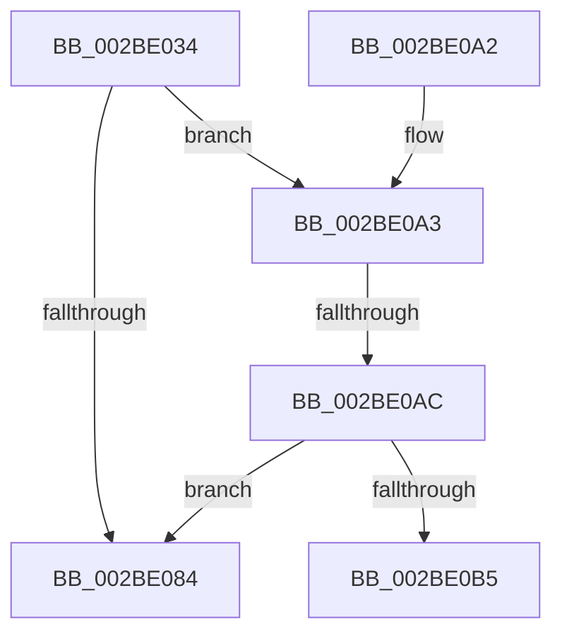

# PopPlNotifyDeviceFState

- RVA: `0x002BE034`–`0x002BE0BD` (길이 `137` bytes)
- VA: `0x00000001402BE034`
- 실행 섹션: `.text`
- PDB 이름 있음: `예`; PDB Function 태그: `예`
- unwind 정보 RVA: `0x0006E298`
- 디코드: `41`개 명령, `137/137` bytes 표시
- 미해석 바이트: `0` (있으면 어셈블리에 `.byte`로 보존)

> 이 문서는 커널 이미지의 기계어와 PDB 기호를 분석해 생성했습니다. 4번과 5번은 함수 원형과 자료형을 바이너리 사용 방식에서 추정한 C 해석이며 원본 소스 복구 결과는 아닙니다.

## 1. Dependencies

- 직접 호출 지점: **1**; 고유 호출 대상: **1**
- 직접 호출자로 확인된 함수: **4**
- RIP 상대 이미지 참조: **1**

### Outgoing calls
- `0x002BE08B` → [_security_check_cookie](../6A/_security_check_cookie_function_006AC640.md) (function, `0x006AC640`)

### Direct callers
- [sub_002BD95A](Unknown_function_002BD95A.md) at `0x002BD9A1`
- [PopPluginComponentIdleState](PopPluginComponentIdleState_function_002BE310.md) at `0x002BE404`
- [PopPepStartComponentIdleStateChangeActivity](PopPepStartComponentIdleStateChangeActivity_function_002BE7C0.md) at `0x002BE822`
- [PopPepStartComponentIdleStateChangeActivity](PopPepStartComponentIdleStateChangeActivity_function_002BE7C0.md) at `0x002BE89C`
- [PopPepCompleteComponentIdleState](../4D/PopPepCompleteComponentIdleState_function_004D8EC4.md) at `0x004D8F9E`

### Static image references
- `0x002BE04B` → RVA `0x00E0A740` (`.data`; read)

## 2. Other-region calls and transfers

- 다른 실행 섹션으로 향하는 call: **0**
- call이 아닌 외부 분기/꼬리 이동: **2**
  - `0x002BE0A6` → [sub_006DBF86](../6D/Unknown_function_006DBF86.md) (`tail-transfer`)
  - `0x002BE0B8` → [sub_006DBF86](../6D/Unknown_function_006DBF86.md) (`tail-transfer`)

## 3. Assembly (complete function range)

```asm
002BE034  40 55                           push rbp
002BE036  53                              push rbx
002BE037  56                              push rsi
002BE038  57                              push rdi
002BE039  41 54                           push r12
002BE03B  41 55                           push r13
002BE03D  41 57                           push r15
002BE03F  48 8D 6C 24 C0                  lea rbp, [rsp - 0x40]
002BE044  48 81 EC 40 01 00 00            sub rsp, 0x140
002BE04B  48 8B 05 EE C6 B4 00            mov rax, qword ptr [rip + 0xb4c6ee]
002BE052  48 33 C4                        xor rax, rsp
002BE055  48 89 45 30                     mov qword ptr [rbp + 0x30], rax
002BE059  48 8B 81 68 03 00 00            mov rax, qword ptr [rcx + 0x368]
002BE060  41 8B F9                        mov edi, r9d
002BE063  89 54 24 40                     mov dword ptr [rsp + 0x40], edx
002BE067  4C 8B E9                        mov r13, rcx
002BE06A  8B D2                           mov edx, edx
002BE06C  44 89 4C 24 48                  mov dword ptr [rsp + 0x48], r9d
002BE071  48 8B 04 D0                     mov rax, qword ptr [rax + rdx*8]
002BE075  48 89 44 24 60                  mov qword ptr [rsp + 0x60], rax
002BE07A  48 83 B8 B0 01 00 00 00         cmp qword ptr [rax + 0x1b0], 0
002BE082  75 1F                           jne 0x1402be0a3
002BE084  48 8B 4D 30                     mov rcx, qword ptr [rbp + 0x30]
002BE088  48 33 CC                        xor rcx, rsp
002BE08B  E8 B0 E5 3E 00                  call 0x1406ac640
002BE090  48 81 C4 40 01 00 00            add rsp, 0x140
002BE097  41 5F                           pop r15
002BE099  41 5D                           pop r13
002BE09B  41 5C                           pop r12
002BE09D  5F                              pop rdi
002BE09E  5E                              pop rsi
002BE09F  5B                              pop rbx
002BE0A0  5D                              pop rbp
002BE0A1  C3                              ret
002BE0A2  CC                              int3
002BE0A3  41 3B F8                        cmp edi, r8d
002BE0A6  0F 86 DA DE 41 00               jbe 0x1406dbf86
002BE0AC  80 BD A0 00 00 00 00            cmp byte ptr [rbp + 0xa0], 0
002BE0B3  74 CF                           je 0x1402be084
002BE0B5  41 3B F8                        cmp edi, r8d
002BE0B8  E9 C9 DE 41 00                  jmp 0x1406dbf86
```

## 4. C-style interpretation (structured pseudocode)

```c
__int64 __fastcall PopPlNotifyDeviceFState(__int64 a1, int a2, int a3, int a4, unsigned __int8 a5)
{
    __int64 result;
    __int64 v_rsp;
    unsigned __int64 v_stack_m118;
    unsigned int v_stack_m130;
    unsigned int v_stack_m138;
    unsigned __int64 v_stack_m48;
    unsigned __int64 v_stack_m78;

    v_rsp = (v_rsp) - (320);
    result = (*(unsigned __int64 *)(v_rip + 11847406)) ^ (v_rsp);
    v_stack_m48 = result;
    v_stack_m138 = a2;
    v_stack_m130 = a4;
    v_stack_m118 = *(unsigned __int64 *)(*(unsigned __int64 *)(a1 + 872) + (unsigned int)(a2) * 8);
    if ((*(unsigned __int64 *)(*(unsigned __int64 *)(*(unsigned __int64 *)(a1 + 872) + (unsigned int)(a2) * 8) + 432)) != 0) goto loc_002BE0A3;
loc_002BE084:
    a1 = (v_stack_m48) ^ (v_rsp);
    result = _security_check_cookie(a1, (unsigned int)(a2), a3, a4);
    v_rsp = (v_rsp) + (320);
    return result;
loc_002BE0A3:
    if (a5 == 0) goto loc_002BE084;
}
```

## 5. (Beta) C Style

```c
int64_t PopPlNotifyDeviceFState(void *Arg1, int32_t Arg2, int32_t Arg3, int32_t Arg4, uint8_t Arg5)
{
    uint8_t *arg1 = (uint8_t *)Arg1;

    int64_t result;
    int64_t local_rsp;
    uint64_t v_stack_m118;
    uint32_t v_stack_m130;
    uint32_t v_stack_m138;
    uint64_t v_stack_m48;
    uint64_t v_stack_m78;

    local_rsp = (local_rsp) - (320);
    result = (*(uint64_t *)(v_rip + 0xB4C6EE)) ^ (local_rsp);
    v_stack_m48 = result;
    v_stack_m138 = Arg2;
    v_stack_m130 = Arg4;
    v_stack_m118 = *(uint64_t *)(*(uint64_t *)(arg1 + 0x368) + (uint32_t)(Arg2) * 8);
    if ((*(uint64_t *)(*(uint64_t *)(*(uint64_t *)(arg1 + 0x368) + (uint32_t)(Arg2) * 8) + 0x1B0)) != 0) goto loc_002BE0A3;
loc_002BE084:
    Arg1 = (v_stack_m48) ^ (local_rsp);
    result = _security_check_cookie(Arg1, (uint32_t)(Arg2), Arg3, Arg4);
    local_rsp = (local_rsp) + (320);
    return result;
loc_002BE0A3:
    if (Arg5 == 0) goto loc_002BE084;
}
```

### 관측된 메모리 오프셋

구조체 형식이 확인되지 않은 접근은 인자 기준의 오프셋으로만 기록했습니다.

| 기준 인자 | 오프셋 표현 | 폭 (bit) | 접근 |
|---|---:|---:|---|
| `Arg1` | `+ 0x368` | `64` | `R` |

## 6. Execution-region graph

[열기: 2D/3D 그래프와 함수 탐색 컨트롤 패널](../../../control-panel.html?section=text&rva=0x002BE034&view=graph)

- 2D 그래프는 위에서 아래로 흐르고, 3D 그래프는 빈 공간을 드래그해 회전합니다. Shift+드래그는 이동, 휠은 확대·축소, 함수 노드 선택은 대상 보고서 이동입니다.

### Static fallback


