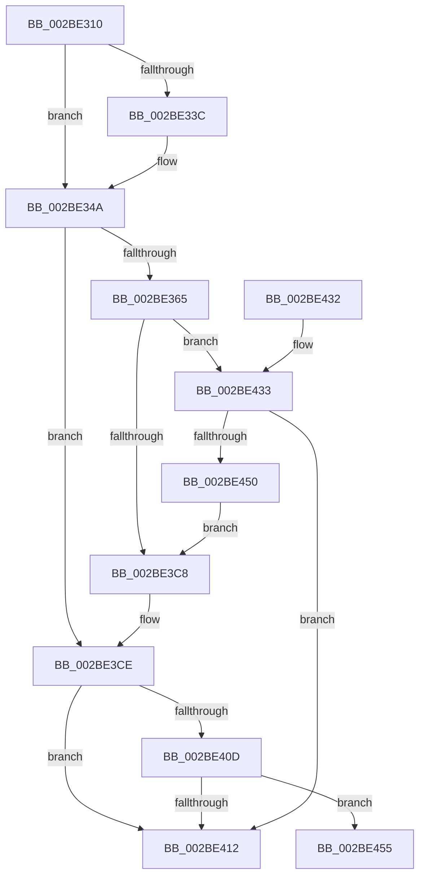

# PopPluginComponentIdleState

- RVA: `0x002BE310`–`0x002BE468` (길이 `344` bytes)
- VA: `0x00000001402BE310`
- 실행 섹션: `.text`
- PDB 이름 있음: `예`; PDB Function 태그: `아니요`
- unwind 정보 RVA: `0x0006E2F4`
- 디코드: `93`개 명령, `344/344` bytes 표시
- 미해석 바이트: `0` (있으면 어셈블리에 `.byte`로 보존)

> 이 문서는 커널 이미지의 기계어와 PDB 기호를 분석해 생성했습니다. 4번과 5번은 함수 원형과 자료형을 바이너리 사용 방식에서 추정한 C 해석이며 원본 소스 복구 결과는 아닙니다.

## 1. Dependencies

- 직접 호출 지점: **6**; 고유 호출 대상: **6**
- 직접 호출자로 확인된 함수: **1**
- RIP 상대 이미지 참조: **0**

### Outgoing calls
- `0x002BE343` → [memset](../6C/memset_function_006C6C40.md) (function, `0x006C6C40`)
- `0x002BE3A8` → [guard_dispatch_icall](../6B/guard_dispatch_icall_function_006BAAD0.md) (function, `0x006BAAD0`)
- `0x002BE3E3` → [PopPepProcessEvent](../24/PopPepProcessEvent_function_0024B930.md) (function, `0x0024B930`)
- `0x002BE404` → [PopPlNotifyDeviceFState](PopPlNotifyDeviceFState_function_002BE034.md) (function, `0x002BE034`)
- `0x002BE441` → [PopFxAddLogEntry](../39/PopFxAddLogEntry_function_00390B94.md) (function, `0x00390B94`)
- `0x002BE462` → [PopFxBugCheck](PopFxBugCheck_function_002BFC6C.md) (function, `0x002BFC6C`)

### Direct callers
- [PoFxCompleteIdleState](../46/PoFxCompleteIdleState_function_004666C0.md) at `0x00466741`

### Static image references
- 디코드된 RIP-relative 메모리 참조가 없습니다.

## 2. Other-region calls and transfers

- 다른 실행 섹션으로 향하는 call: **0**
- 별도 외부 분기/꼬리 이동을 확인하지 못했습니다.

## 3. Assembly (complete function range)

```asm
002BE310  48 89 5C 24 08                  mov qword ptr [rsp + 8], rbx
002BE315  48 89 6C 24 10                  mov qword ptr [rsp + 0x10], rbp
002BE31A  48 89 74 24 18                  mov qword ptr [rsp + 0x18], rsi
002BE31F  57                              push rdi
002BE320  41 54                           push r12
002BE322  41 55                           push r13
002BE324  41 56                           push r14
002BE326  41 57                           push r15
002BE328  48 83 EC 50                     sub rsp, 0x50
002BE32C  44 8B FA                        mov r15d, edx
002BE32F  49 8B F9                        mov rdi, r9
002BE332  33 D2                           xor edx, edx
002BE334  48 8B F1                        mov rsi, rcx
002BE337  4D 85 C9                        test r9, r9
002BE33A  74 0E                           je 0x1402be34a
002BE33C  44 8D 42 40                     lea r8d, [rdx + 0x40]
002BE340  49 8B C9                        mov rcx, r9
002BE343  E8 F8 88 40 00                  call 0x1406c6c40
002BE348  33 D2                           xor edx, edx
002BE34A  48 8B 76 38                     mov rsi, qword ptr [rsi + 0x38]
002BE34E  8A DA                           mov bl, dl
002BE350  49 69 EF D0 00 00 00            imul rbp, r15, 0xd0
002BE357  41 B8 01 00 00 00               mov r8d, 1
002BE35D  48 03 EE                        add rbp, rsi
002BE360  38 56 7C                        cmp byte ptr [rsi + 0x7c], dl
002BE363  74 69                           je 0x1402be3ce
002BE365  4C 8B 6E 20                     mov r13, qword ptr [rsi + 0x20]
002BE369  44 8B A5 C8 00 00 00            mov r12d, dword ptr [rbp + 0xc8]
002BE370  89 54 24 42                     mov dword ptr [rsp + 0x42], edx
002BE374  66 89 54 24 46                  mov word ptr [rsp + 0x46], dx
002BE379  48 8D 54 24 30                  lea rdx, [rsp + 0x30]
002BE37E  49 8B 45 48                     mov rax, qword ptr [r13 + 0x48]
002BE382  49 8B 4D 40                     mov rcx, qword ptr [r13 + 0x40]
002BE386  48 89 44 24 30                  mov qword ptr [rsp + 0x30], rax
002BE38B  8B 85 70 01 00 00               mov eax, dword ptr [rbp + 0x170]
002BE391  89 44 24 3C                     mov dword ptr [rsp + 0x3c], eax
002BE395  44 89 64 24 38                  mov dword ptr [rsp + 0x38], r12d
002BE39A  66 44 89 44 24 40               mov word ptr [rsp + 0x40], r8w
002BE3A0  48 8B 41 60                     mov rax, qword ptr [rcx + 0x60]
002BE3A4  41 8D 48 12                     lea ecx, [r8 + 0x12]
002BE3A8  E8 23 C7 3F 00                  call 0x1406baad0
002BE3AD  44 0F B6 44 24 41               movzx r8d, byte ptr [rsp + 0x41]
002BE3B3  84 C0                           test al, al
002BE3B5  B8 01 00 00 00                  mov eax, 1
002BE3BA  44 0F 44 C0                     cmove r8d, eax
002BE3BE  44 88 44 24 41                  mov byte ptr [rsp + 0x41], r8b
002BE3C3  45 84 C0                        test r8b, r8b
002BE3C6  74 6B                           je 0x1402be433
002BE3C8  41 B8 01 00 00 00               mov r8d, 1
002BE3CE  41 B9 06 00 00 00               mov r9d, 6
002BE3D4  48 89 7C 24 28                  mov qword ptr [rsp + 0x28], rdi
002BE3D9  48 8D 95 C0 00 00 00            lea rdx, [rbp + 0xc0]
002BE3E0  48 8B CE                        mov rcx, rsi
002BE3E3  E8 48 D5 F8 FF                  call 0x14024b930
002BE3E8  44 8B 8D 70 01 00 00            mov r9d, dword ptr [rbp + 0x170]
002BE3EF  41 8B D7                        mov edx, r15d
002BE3F2  44 8B 85 74 01 00 00            mov r8d, dword ptr [rbp + 0x174]
002BE3F9  8A D8                           mov bl, al
002BE3FB  48 8B 4E 20                     mov rcx, qword ptr [rsi + 0x20]
002BE3FF  C6 44 24 20 01                  mov byte ptr [rsp + 0x20], 1
002BE404  E8 2B FC FF FF                  call 0x1402be034
002BE409  84 DB                           test bl, bl
002BE40B  74 05                           je 0x1402be412
002BE40D  48 85 FF                        test rdi, rdi
002BE410  74 43                           je 0x1402be455
002BE412  4C 8D 5C 24 50                  lea r11, [rsp + 0x50]
002BE417  8A C3                           mov al, bl
002BE419  49 8B 5B 30                     mov rbx, qword ptr [r11 + 0x30]
002BE41D  49 8B 6B 38                     mov rbp, qword ptr [r11 + 0x38]
002BE421  49 8B 73 40                     mov rsi, qword ptr [r11 + 0x40]
002BE425  49 8B E3                        mov rsp, r11
002BE428  41 5F                           pop r15
002BE42A  41 5E                           pop r14
002BE42C  41 5D                           pop r13
002BE42E  41 5C                           pop r12
002BE430  5F                              pop rdi
002BE431  C3                              ret
002BE432  CC                              int3
002BE433  49 8B 4D 30                     mov rcx, qword ptr [r13 + 0x30]
002BE437  45 33 C9                        xor r9d, r9d
002BE43A  41 8B D4                        mov edx, r12d
002BE43D  45 8D 41 12                     lea r8d, [r9 + 0x12]
002BE441  E8 4E 27 0D 00                  call 0x140390b94
002BE446  44 8A 44 24 41                  mov r8b, byte ptr [rsp + 0x41]
002BE44B  45 84 C0                        test r8b, r8b
002BE44E  74 C2                           je 0x1402be412
002BE450  E9 73 FF FF FF                  jmp 0x1402be3c8
002BE455  45 33 C9                        xor r9d, r9d
002BE458  45 33 C0                        xor r8d, r8d
002BE45B  33 D2                           xor edx, edx
002BE45D  B9 12 06 00 00                  mov ecx, 0x612
002BE462  E8 05 18 00 00                  call 0x1402bfc6c
002BE467  CC                              int3
```

## 4. C-style interpretation (structured pseudocode)

```c
__int64 __fastcall PopPluginComponentIdleState(__int64 a1, int a2, __int64 a3, __int64 a4)
{
    __int64 result;
    __int64 v_rbp;
    __int64 v_rsp;
    unsigned __int64 v_stack_m28;
    unsigned __int16 v_stack_m32;
    unsigned int v_stack_m36;
    unsigned __int8 v_stack_m37;
    unsigned __int16 v_stack_m38;
    unsigned int v_stack_m3C;
    unsigned int v_stack_m40;
    unsigned __int64 v_stack_m48;
    unsigned __int64 v_stack_m50;
    unsigned __int8 v_stack_m58;
    unsigned __int8 v_stack_mF;
    unsigned __int64 v_stack_p10;
    unsigned __int64 v_stack_p18;
    unsigned __int64 v_stack_p8;

    v_stack_p8 = v_rbx;
    v_stack_p10 = v_rbp;
    v_stack_p18 = v_rsi;
    v_rsp = (v_rsp) - (80);
    a2 = 0;
    if (a4 != 0) {
        a3 = a2 + 64;
        a1 = a4;
        result = memset(a1, a2, a3, a4);
        a2 = 0;
    }
    v_rbp = (v_rbp) * ((unsigned int)(a2));
    v_rbp = (v_rbp) + (*(unsigned __int64 *)(a1 + 56));
    if ((*(unsigned __int8 *)(*(unsigned __int64 *)(a1 + 56) + 124)) == 0) goto loc_002BE3CE;
    v_stack_m36 = 0;
    v_stack_m32 = 0;
    v_stack_m48 = *(unsigned __int64 *)(*(unsigned __int64 *)(*(unsigned __int64 *)(a1 + 56) + 32) + 72);
    v_stack_m3C = (unsigned int)((unsigned int)(*(unsigned int *)(v_rbp + 368)));
    v_stack_m40 = (unsigned int)((unsigned int)(*(unsigned int *)(v_rbp + 200)));
    v_stack_m38 = 1;
    result = guard_dispatch_icall(1 + 18, v_stack_m48, 1, a4);
    a3 = v_stack_m37;
    if ((unsigned __int8)(result) == 0) { a3 = 1; }
    v_stack_m37 = (unsigned __int8)(a3);
    if ((unsigned __int8)(a3) == 0) goto loc_002BE433;
loc_002BE3C8:
loc_002BE3CE:
    v_stack_m50 = a4;
    result = PopPepProcessEvent(*(unsigned __int64 *)(a1 + 56), v_rbp + 192, 1, 6);
    v_stack_m58 = 1;
    result = PopPlNotifyDeviceFState(*(unsigned __int64 *)(*(unsigned __int64 *)(a1 + 56) + 32), (unsigned int)((unsigned int)((unsigned int)(a2))), (unsigned int)(*(unsigned int *)(v_rbp + 372)), (unsigned int)(*(unsigned int *)(v_rbp + 368)));
    if ((unsigned __int8)((unsigned __int8)(result)) == 0) goto loc_002BE412;
    if (a4 == 0) goto loc_002BE455;
loc_002BE412:
    return (unsigned __int8)((unsigned __int8)(result));
loc_002BE433:
    a4 = 0;
    result = PopFxAddLogEntry(*(unsigned __int64 *)(*(unsigned __int64 *)(*(unsigned __int64 *)(a1 + 56) + 32) + 48), (unsigned int)((unsigned int)((unsigned int)(*(unsigned int *)(v_rbp + 200)))), a4 + 18, a4);
    if ((unsigned __int8)(v_stack_mF) == 0) goto loc_002BE412;
    goto loc_002BE3C8;
loc_002BE455:
    a4 = 0;
    a3 = 0;
    a2 = 0;
    result = PopFxBugCheck((unsigned int)(0x612ULL), a2, a3, a4);
    return result;
}
```

## 5. (Beta) C Style

```c
int64_t PopPluginComponentIdleState(void *Arg1, int32_t Arg2, int64_t Arg3, int64_t Arg4)
{
    uint8_t *arg1 = (uint8_t *)Arg1;

    int64_t result;
    int64_t local_rbp;
    int64_t local_rsp;
    uint64_t v_stack_m28;
    uint16_t v_stack_m32;
    uint32_t v_stack_m36;
    uint8_t v_stack_m37;
    uint16_t v_stack_m38;
    uint32_t v_stack_m3C;
    uint32_t v_stack_m40;
    uint64_t v_stack_m48;
    uint64_t v_stack_m50;
    uint8_t v_stack_m58;
    uint8_t v_stack_mF;
    uint64_t v_stack_p10;
    uint64_t v_stack_p18;
    uint64_t v_stack_p8;

    v_stack_p8 = local_rbx;
    v_stack_p10 = local_rbp;
    v_stack_p18 = local_rsi;
    local_rsp = (local_rsp) - (80);
    Arg2 = 0;
    if (Arg4 != 0) {
        Arg3 = Arg2 + 64;
        Arg1 = Arg4;
        result = memset(Arg1, Arg2, Arg3, Arg4);
        Arg2 = 0;
    }
    local_rbp = (local_rbp) * ((uint32_t)(Arg2));
    local_rbp = (local_rbp) + (*(uint64_t *)(arg1 + 0x38));
    if ((*(uint8_t *)(*(uint64_t *)(arg1 + 0x38) + 0x7C)) == 0) goto loc_002BE3CE;
    v_stack_m36 = 0;
    v_stack_m32 = 0;
    v_stack_m48 = *(uint64_t *)(*(uint64_t *)(*(uint64_t *)(arg1 + 0x38) + 0x20) + 0x48);
    v_stack_m3C = (uint32_t)((uint32_t)(*(uint32_t *)(local_rbp + 0x170)));
    v_stack_m40 = (uint32_t)((uint32_t)(*(uint32_t *)(local_rbp + 0xC8)));
    v_stack_m38 = 1;
    result = guard_dispatch_icall(1 + 18, v_stack_m48, 1, Arg4);
    Arg3 = v_stack_m37;
    if ((uint8_t)(result) == 0) { Arg3 = 1; }
    v_stack_m37 = (uint8_t)(Arg3);
    if ((uint8_t)(Arg3) == 0) goto loc_002BE433;
loc_002BE3C8:
loc_002BE3CE:
    v_stack_m50 = Arg4;
    result = PopPepProcessEvent(*(uint64_t *)(arg1 + 0x38), local_rbp + 192, 1, 6);
    v_stack_m58 = 1;
    result = PopPlNotifyDeviceFState(*(uint64_t *)(*(uint64_t *)(arg1 + 0x38) + 0x20), (uint32_t)((uint32_t)((uint32_t)(Arg2))), (uint32_t)(*(uint32_t *)(local_rbp + 0x174)), (uint32_t)(*(uint32_t *)(local_rbp + 0x170)));
    if ((uint8_t)((uint8_t)(result)) == 0) goto loc_002BE412;
    if (Arg4 == 0) goto loc_002BE455;
loc_002BE412:
    return (uint8_t)((uint8_t)(result));
loc_002BE433:
    Arg4 = 0;
    result = PopFxAddLogEntry(*(uint64_t *)(*(uint64_t *)(*(uint64_t *)(arg1 + 0x38) + 0x20) + 0x30), (uint32_t)((uint32_t)((uint32_t)(*(uint32_t *)(local_rbp + 0xC8)))), Arg4 + 18, Arg4);
    if ((uint8_t)(v_stack_mF) == 0) goto loc_002BE412;
    goto loc_002BE3C8;
loc_002BE455:
    Arg4 = 0;
    Arg3 = 0;
    Arg2 = 0;
    result = PopFxBugCheck((uint32_t)(0x612ULL), Arg2, Arg3, Arg4);
    return result;
}
```

### 관측된 메모리 오프셋

구조체 형식이 확인되지 않은 접근은 인자 기준의 오프셋으로만 기록했습니다.

| 기준 인자 | 오프셋 표현 | 폭 (bit) | 접근 |
|---|---:|---:|---|
| `Arg1` | `+ 0x38` | `64` | `R` |

## 6. Execution-region graph

[열기: 2D/3D 그래프와 함수 탐색 컨트롤 패널](../../../control-panel.html?section=text&rva=0x002BE310&view=graph)

- 2D 그래프는 위에서 아래로 흐르고, 3D 그래프는 빈 공간을 드래그해 회전합니다. Shift+드래그는 이동, 휠은 확대·축소, 함수 노드 선택은 대상 보고서 이동입니다.

### Static fallback


