# PopQueueQuerySetIrp

- RVA: `0x002BEF18`–`0x002BF1A5` (길이 `653` bytes)
- VA: `0x00000001402BEF18`
- 실행 섹션: `.text`
- PDB 이름 있음: `예`; PDB Function 태그: `예`
- unwind 정보 RVA: `0x0006E440`
- 디코드: `152`개 명령, `653/653` bytes 표시
- 미해석 바이트: `0` (있으면 어셈블리에 `.byte`로 보존)

> 이 문서는 커널 이미지의 기계어와 PDB 기호를 분석해 생성했습니다. 4번과 5번은 함수 원형과 자료형을 바이너리 사용 방식에서 추정한 C 해석이며 원본 소스 복구 결과는 아닙니다.

## 1. Dependencies

- 직접 호출 지점: **11**; 고유 호출 대상: **11**
- 직접 호출자로 확인된 함수: **3**
- RIP 상대 이미지 참조: **14**

### Outgoing calls
- `0x002BEF97` → [KeAcquireSpinLockRaiseToDpc](../20/KeAcquireSpinLockRaiseToDpc_function_00208470.md) (function, `0x00208470`)
- `0x002BEFB7` → [PopDeepSleepSetDisengageReason](../38/PopDeepSleepSetDisengageReason_function_0038FEC4.md) (function, `0x0038FEC4`)
- `0x002BEFD8` → [ExQueueWorkItem](../2F/ExQueueWorkItem_function_002F9520.md) (function, `0x002F9520`)
- `0x002BEFE7` → [KeReleaseSpinLock](../39/KeReleaseSpinLock_function_00392BA0.md) (function, `0x00392BA0`)
- `0x002BF01F` → [KeAcquireInStackQueuedSpinLock](../27/KeAcquireInStackQueuedSpinLock_function_002757A0.md) (function, `0x002757A0`)
- `0x002BF07E` → [KeReleaseInStackQueuedSpinLock](../34/KeReleaseInStackQueuedSpinLock_function_00342CE0.md) (function, `0x00342CE0`)
- `0x002BF08B` → [PopDiagTraceIrpStart](../47/PopDiagTraceIrpStart_function_0047CBBC.md) (function, `0x0047CBBC`)
- `0x002BF093` → [PopEnableIrpWatchdog](../44/PopEnableIrpWatchdog_function_00447BFC.md) (function, `0x00447BFC`)
- `0x002BF09E` → [IofCallDriver](../29/IofCallDriver_function_0029B4B0.md) (function, `0x0029B4B0`)
- `0x002BF0F8` → [KeAcquireQueuedSpinLock](../27/KeAcquireQueuedSpinLock_function_00273D80.md) (function, `0x00273D80`)
- `0x002BF123` → [KeReleaseQueuedSpinLock](../27/KeReleaseQueuedSpinLock_function_00272540.md) (function, `0x00272540`)

### Direct callers
- [PopRequestPowerIrp](../27/PopRequestPowerIrp_function_00270ED4.md) at `0x00271010`
- [PopFxActivateComponentDependents](PopFxActivateComponentDependents_function_002BE9F0.md) at `0x002BEB57`
- [PopNotifyDevice](../../pagelk/B7/PopNotifyDevice_function_00B7DAAC.md) at `0x00B7DC1A`

### Static image references
- `0x002BEF90` → RVA `0x00F0CA20` (`.data`; read)
- `0x002BEF9C` → RVA `0x00F0BCDC` (`.data`; read)
- `0x002BEFA7` → RVA `0x00F0BCDC` (`.data`; write)
- `0x002BEFBC` → RVA `0x00F0BCE0` (`.data`; read)
- `0x002BEFCA` → RVA `0x00F0BCE0` (`.data`; write)
- `0x002BEFD1` → RVA `0x00F0CA00` (`.data`; read)
- `0x002BF018` → RVA `0x00F0CA50` (`.data`; read)
- `0x002BF02D` → RVA `0x00F0BD28` (`.data`; write)
- `0x002BF071` → RVA `0x00F0BD28` (`.data`; read/write)
- `0x002BF134` → RVA `0x00F0CA38` (`.data`; read)
- `0x002BF13B` → RVA `0x00F0CA30` (`.data`; read)
- `0x002BF155` → RVA `0x00F0CA38` (`.data`; write)
- `0x002BF16A` → RVA `0x00F0BCE8` (`.data`; read)
- `0x002BF17B` → RVA `0x00F0BCE8` (`.data`; write)

## 2. Other-region calls and transfers

- 다른 실행 섹션으로 향하는 call: **0**
- call이 아닌 외부 분기/꼬리 이동: **4**
  - `0x002BF145` → [sub_006DC118 + 0x15](../6D/Unknown_function_006DC118.md) (`tail-transfer`)
  - `0x002BF165` → [sub_006DC118 + 0x7](../6D/Unknown_function_006DC118.md) (`tail-transfer`)
  - `0x002BF186` → [sub_006DC118 + 0x15](../6D/Unknown_function_006DC118.md) (`tail-transfer`)
  - `0x002BF193` → [sub_006DC118 + 0x15](../6D/Unknown_function_006DC118.md) (`tail-transfer`)

## 3. Assembly (complete function range)

```asm
002BEF18  4C 8B DC                        mov r11, rsp
002BEF1B  49 89 5B 08                     mov qword ptr [r11 + 8], rbx
002BEF1F  49 89 6B 10                     mov qword ptr [r11 + 0x10], rbp
002BEF23  49 89 73 18                     mov qword ptr [r11 + 0x18], rsi
002BEF27  49 89 7B 20                     mov qword ptr [r11 + 0x20], rdi
002BEF2B  41 54                           push r12
002BEF2D  41 56                           push r14
002BEF2F  41 57                           push r15
002BEF31  48 83 EC 40                     sub rsp, 0x40
002BEF35  4C 8B B9 B8 00 00 00            mov r15, qword ptr [rcx + 0xb8]
002BEF3C  33 C0                           xor eax, eax
002BEF3E  0F 57 C0                        xorps xmm0, xmm0
002BEF41  45 32 F6                        xor r14b, r14b
002BEF44  0F 11 44 24 20                  movups xmmword ptr [rsp + 0x20], xmm0
002BEF49  49 89 43 D8                     mov qword ptr [r11 - 0x28], rax
002BEF4D  48 8B D9                        mov rbx, rcx
002BEF50  48 0F BE 41 42                  movsx rax, byte ptr [rcx + 0x42]
002BEF55  48 8D 14 C0                     lea rdx, [rax + rax*8]
002BEF59  48 8B BC D1 C8 00 00 00         mov rdi, qword ptr [rcx + rdx*8 + 0xc8]
002BEF61  48 8B 47 18                     mov rax, qword ptr [rdi + 0x18]
002BEF65  48 85 C0                        test rax, rax
002BEF68  0F 84 BF 01 00 00               je 0x1402bf12d
002BEF6E  48 8B 80 38 01 00 00            mov rax, qword ptr [rax + 0x138]
002BEF75  48 8B 68 28                     mov rbp, qword ptr [rax + 0x28]
002BEF79  8A 87 B8 00 00 00               mov al, byte ptr [rdi + 0xb8]
002BEF7F  4C 8B 67 20                     mov r12, qword ptr [rdi + 0x20]
002BEF83  3C 02                           cmp al, 2
002BEF85  75 6B                           jne 0x1402beff2
002BEF87  83 BF BC 00 00 00 01            cmp dword ptr [rdi + 0xbc], 1
002BEF8E  75 62                           jne 0x1402beff2
002BEF90  48 8D 0D 89 DA C4 00            lea rcx, [rip + 0xc4da89]
002BEF97  E8 D4 94 F4 FF                  call 0x140208470
002BEF9C  8B 0D 3A CD C4 00               mov ecx, dword ptr [rip + 0xc4cd3a]
002BEFA2  40 8A F0                        mov sil, al
002BEFA5  FF C1                           inc ecx
002BEFA7  89 0D 2F CD C4 00               mov dword ptr [rip + 0xc4cd2f], ecx
002BEFAD  83 F9 01                        cmp ecx, 1
002BEFB0  75 2B                           jne 0x1402befdd
002BEFB2  B9 02 00 00 00                  mov ecx, 2
002BEFB7  E8 08 0F 0D 00                  call 0x14038fec4
002BEFBC  44 38 35 1D CD C4 00            cmp byte ptr [rip + 0xc4cd1d], r14b
002BEFC3  75 18                           jne 0x1402befdd
002BEFC5  BA 01 00 00 00                  mov edx, 1
002BEFCA  C6 05 0F CD C4 00 01            mov byte ptr [rip + 0xc4cd0f], 1
002BEFD1  48 8D 0D 28 DA C4 00            lea rcx, [rip + 0xc4da28]
002BEFD8  E8 43 A5 03 00                  call 0x1402f9520
002BEFDD  40 8A D6                        mov dl, sil
002BEFE0  48 8D 0D 39 DA C4 00            lea rcx, [rip + 0xc4da39]
002BEFE7  E8 B4 3B 0D 00                  call 0x140392ba0
002BEFEC  8A 87 B8 00 00 00               mov al, byte ptr [rdi + 0xb8]
002BEFF2  8B B7 BC 00 00 00               mov esi, dword ptr [rdi + 0xbc]
002BEFF8  BF 08 01 00 00                  mov edi, 0x108
002BEFFD  83 FE 01                        cmp esi, 1
002BF000  8D 4F 10                        lea ecx, [rdi + 0x10]
002BF003  0F 45 F9                        cmovne edi, ecx
002BF006  3C 02                           cmp al, 2
002BF008  0F 84 D0 00 00 00               je 0x1402bf0de
002BF00E  48 83 63 78 00                  and qword ptr [rbx + 0x78], 0
002BF013  48 8D 54 24 20                  lea rdx, [rsp + 0x20]
002BF018  48 8D 0D 31 DA C4 00            lea rcx, [rip + 0xc4da31]
002BF01F  E8 7C 67 FB FF                  call 0x1402757a0
002BF024  65 48 8B 04 25 88 01 00 00      mov rax, qword ptr gs:[0x188]
002BF02D  48 89 05 F4 CC C4 00            mov qword ptr [rip + 0xc4ccf4], rax
002BF034  48 8D 83 A8 00 00 00            lea rax, [rbx + 0xa8]
002BF03B  45 84 F6                        test r14b, r14b
002BF03E  0F 85 F0 00 00 00               jne 0x1402bf134
002BF044  41 B8 10 01 00 00               mov r8d, 0x110
002BF04A  83 FE 01                        cmp esi, 1
002BF04D  41 8B D0                        mov edx, r8d
002BF050  45 8D 48 10                     lea r9d, [r8 + 0x10]
002BF054  41 0F 45 D1                     cmovne edx, r9d
002BF058  48 8B 0C 2A                     mov rcx, qword ptr [rdx + rbp]
002BF05C  48 85 C9                        test rcx, rcx
002BF05F  0F 85 FC 00 00 00               jne 0x1402bf161
002BF065  48 89 1C 2A                     mov qword ptr [rdx + rbp], rbx
002BF069  48 39 0C 2F                     cmp qword ptr [rdi + rbp], rcx
002BF06D  74 54                           je 0x1402bf0c3
002BF06F  33 DB                           xor ebx, ebx
002BF071  48 83 25 AF CC C4 00 00         and qword ptr [rip + 0xc4ccaf], 0
002BF079  48 8D 4C 24 20                  lea rcx, [rsp + 0x20]
002BF07E  E8 5D 3C 08 00                  call 0x140342ce0
002BF083  48 85 DB                        test rbx, rbx
002BF086  74 1B                           je 0x1402bf0a3
002BF088  48 8B D3                        mov rdx, rbx
002BF08B  E8 2C DB 1B 00                  call 0x14047cbbc
002BF090  48 8B CB                        mov rcx, rbx
002BF093  E8 64 8B 18 00                  call 0x140447bfc
002BF098  48 8B D3                        mov rdx, rbx
002BF09B  49 8B CC                        mov rcx, r12
002BF09E  E8 0D C4 FD FF                  call 0x14029b4b0
002BF0A3  48 8B 5C 24 60                  mov rbx, qword ptr [rsp + 0x60]
002BF0A8  48 8B 6C 24 68                  mov rbp, qword ptr [rsp + 0x68]
002BF0AD  48 8B 74 24 70                  mov rsi, qword ptr [rsp + 0x70]
002BF0B2  48 8B 7C 24 78                  mov rdi, qword ptr [rsp + 0x78]
002BF0B7  48 83 C4 40                     add rsp, 0x40
002BF0BB  41 5F                           pop r15
002BF0BD  41 5E                           pop r14
002BF0BF  41 5C                           pop r12
002BF0C1  C3                              ret
002BF0C2  CC                              int3
002BF0C3  45 84 F6                        test r14b, r14b
002BF0C6  0F 85 9E 00 00 00               jne 0x1402bf16a
002BF0CC  83 FE 01                        cmp esi, 1
002BF0CF  48 89 1C 2F                     mov qword ptr [rdi + rbp], rbx
002BF0D3  4D 0F 45 C1                     cmovne r8, r9
002BF0D7  49 83 24 28 00                  and qword ptr [r8 + rbp], 0
002BF0DC  EB 93                           jmp 0x1402bf071
002BF0DE  83 FE 01                        cmp esi, 1
002BF0E1  0F 85 27 FF FF FF               jne 0x1402bf00e
002BF0E7  41 39 77 D0                     cmp dword ptr [r15 - 0x30], esi
002BF0EB  0F 85 1D FF FF FF               jne 0x1402bf00e
002BF0F1  44 8D 7E 09                     lea r15d, [rsi + 9]
002BF0F5  41 8B CF                        mov ecx, r15d
002BF0F8  E8 83 4C FB FF                  call 0x140273d80
002BF0FD  49 8B D4                        mov rdx, r12
002BF100  48 85 D2                        test rdx, rdx
002BF103  74 19                           je 0x1402bf11e
002BF105  F7 42 30 00 40 00 00            test dword ptr [rdx + 0x30], 0x4000
002BF10C  75 0D                           jne 0x1402bf11b
002BF10E  48 8B 8A 38 01 00 00            mov rcx, qword ptr [rdx + 0x138]
002BF115  48 8B 51 30                     mov rdx, qword ptr [rcx + 0x30]
002BF119  EB E5                           jmp 0x1402bf100
002BF11B  41 B6 01                        mov r14b, 1
002BF11E  8A D0                           mov dl, al
002BF120  49 8B CF                        mov rcx, r15
002BF123  E8 18 34 FB FF                  call 0x140272540
002BF128  E9 E1 FE FF FF                  jmp 0x1402bf00e
002BF12D  33 ED                           xor ebp, ebp
002BF12F  E9 45 FE FF FF                  jmp 0x1402bef79
002BF134  48 8B 0D FD D8 C4 00            mov rcx, qword ptr [rip + 0xc4d8fd]
002BF13B  48 8D 15 EE D8 C4 00            lea rdx, [rip + 0xc4d8ee]
002BF142  48 39 11                        cmp qword ptr [rcx], rdx
002BF145  0F 85 E2 CF 41 00               jne 0x1406dc12d
002BF14B  48 89 10                        mov qword ptr [rax], rdx
002BF14E  48 89 48 08                     mov qword ptr [rax + 8], rcx
002BF152  48 89 01                        mov qword ptr [rcx], rax
002BF155  48 89 05 DC D8 C4 00            mov qword ptr [rip + 0xc4d8dc], rax
002BF15C  E9 E3 FE FF FF                  jmp 0x1402bf044
002BF161  48 8B 41 78                     mov rax, qword ptr [rcx + 0x78]
002BF165  E9 B5 CF 41 00                  jmp 0x1406dc11f
002BF16A  48 83 3D 76 CB C4 00 00         cmp qword ptr [rip + 0xc4cb76], 0
002BF172  0F 85 F7 FE FF FF               jne 0x1402bf06f
002BF178  48 8B 10                        mov rdx, qword ptr [rax]
002BF17B  48 89 1D 66 CB C4 00            mov qword ptr [rip + 0xc4cb66], rbx
002BF182  48 39 42 08                     cmp qword ptr [rdx + 8], rax
002BF186  0F 85 A1 CF 41 00               jne 0x1406dc12d
002BF18C  48 8B 48 08                     mov rcx, qword ptr [rax + 8]
002BF190  48 39 01                        cmp qword ptr [rcx], rax
002BF193  0F 85 94 CF 41 00               jne 0x1406dc12d
002BF199  48 89 11                        mov qword ptr [rcx], rdx
002BF19C  48 89 4A 08                     mov qword ptr [rdx + 8], rcx
002BF1A0  E9 27 FF FF FF                  jmp 0x1402bf0cc
```

## 4. C-style interpretation (structured pseudocode)

```c
__int64 __fastcall PopQueueQuerySetIrp(__int64 a1)
{
    __int64 result;
    __int64 v_r14;
    __int64 v_rbp;
    __int64 v_rbx;
    __int64 v_rdi;
    __int64 v_rsp;
    unsigned __int64 v_stack_m38;
    unsigned __int64 v_stack_p10;
    unsigned __int64 v_stack_p18;
    unsigned __int64 v_stack_p20;
    unsigned __int64 v_stack_p8;

    *(unsigned __int64 *)(v_rsp + 8) = v_rbx;
    *(unsigned __int64 *)(v_rsp + 16) = v_rbp;
    *(unsigned __int64 *)(v_rsp + 24) = v_rsi;
    *(unsigned __int64 *)(v_rsp + 32) = v_rdi;
    v_rsp = (v_rsp) - (64);
    result = 0;
    v_r14 = 0;
    v_stack_m38 = v_xmm0;
    *(unsigned __int64 *)(v_rsp - 40) = 0;
    if (*(unsigned __int64 *)(*(unsigned __int64 *)(a1 + (__int8)(*(unsigned __int8 *)(a1 + 66)) + (__int8)(*(unsigned __int8 *)(a1 + 66)) * 8 * 8 + 200) + 24) == 0) goto loc_002BF12D;
loc_002BEF79:
    if (((unsigned __int8)(*(unsigned __int8 *)(*(unsigned __int64 *)(a1 + (__int8)(*(unsigned __int8 *)(a1 + 66)) + (__int8)(*(unsigned __int8 *)(a1 + 66)) * 8 * 8 + 200) + 184))) != 2) goto loc_002BEFF2;
    if ((*(unsigned int *)(*(unsigned __int64 *)(a1 + (__int8)(*(unsigned __int8 *)(a1 + 66)) + (__int8)(*(unsigned __int8 *)(a1 + 66)) * 8 * 8 + 200) + 188)) != 1) goto loc_002BEFF2;
    result = KeAcquireSpinLockRaiseToDpc(v_rip + 12901001, (__int8)(*(unsigned __int8 *)(a1 + 66)) + (__int8)(*(unsigned __int8 *)(a1 + 66)) * 8, a3, a4);
    a1 = (unsigned int)(((unsigned int)(*(unsigned int *)(v_rip + 12897594))) + 1);
    *(unsigned int *)(v_rip + 12897583) = (unsigned int)(a1);
    if (((unsigned int)(a1)) != 1) goto loc_002BEFDD;
    result = PopDeepSleepSetDisengageReason(2, (__int8)(*(unsigned __int8 *)(a1 + 66)) + (__int8)(*(unsigned __int8 *)(a1 + 66)) * 8, a3, a4);
    if ((*(unsigned __int8 *)(v_rip + 12897565)) == 0) {
        a2 = 1;
        *(unsigned __int8 *)(v_rip + 12897551) = 1;
        a1 = v_rip + 12900904;
        result = ExQueueWorkItem(a1, a2, a3, a4);
    }
    result = KeReleaseSpinLock(v_rip + 12900921, (unsigned __int8)((unsigned __int8)(result)), a3, a4);
loc_002BEFF2:
    v_rdi = 264;
    if (((unsigned int)((unsigned int)(*(unsigned int *)(*(unsigned __int64 *)(a1 + (__int8)(*(unsigned __int8 *)(a1 + 66)) + (__int8)(*(unsigned __int8 *)(a1 + 66)) * 8 * 8 + 200) + 188)))) != 1) { v_rdi = (unsigned int)(264 + 16); }
    if (((unsigned __int8)(*(unsigned __int8 *)(*(unsigned __int64 *)(a1 + (__int8)(*(unsigned __int8 *)(a1 + 66)) + (__int8)(*(unsigned __int8 *)(a1 + 66)) * 8 * 8 + 200) + 184))) == 2) goto loc_002BF0DE;
loc_002BF00E:
    result = KeAcquireInStackQueuedSpinLock(v_rip + 12900913, v_stack_m38, a3, a4);
    *(unsigned __int64 *)(v_rip + 12897524) = *(unsigned __int64 *)(gs_base + (0 + 392));
    if (0 != 0) goto loc_002BF134;
loc_002BF044:
    a2 = 272;
    if (((unsigned int)((unsigned int)(*(unsigned int *)(*(unsigned __int64 *)(a1 + (__int8)(*(unsigned __int8 *)(a1 + 66)) + (__int8)(*(unsigned __int8 *)(a1 + 66)) * 8 * 8 + 200) + 188)))) != 1) { a2 = (unsigned int)(272 + 16); }
    if (*(unsigned __int64 *)(a2 + *(unsigned __int64 *)(*(unsigned __int64 *)(*(unsigned __int64 *)(*(unsigned __int64 *)(a1 + (__int8)(*(unsigned __int8 *)(a1 + 66)) + (__int8)(*(unsigned __int8 *)(a1 + 66)) * 8 * 8 + 200) + 24) + 312) + 40) * 1) != 0) goto loc_002BF161;
    *(unsigned __int64 *)(a2 + *(unsigned __int64 *)(*(unsigned __int64 *)(*(unsigned __int64 *)(*(unsigned __int64 *)(a1 + (__int8)(*(unsigned __int8 *)(a1 + 66)) + (__int8)(*(unsigned __int8 *)(a1 + 66)) * 8 * 8 + 200) + 24) + 312) + 40) * 1) = a1;
    if ((*(unsigned __int64 *)(v_rdi + *(unsigned __int64 *)(*(unsigned __int64 *)(*(unsigned __int64 *)(*(unsigned __int64 *)(a1 + (__int8)(*(unsigned __int8 *)(a1 + 66)) + (__int8)(*(unsigned __int8 *)(a1 + 66)) * 8 * 8 + 200) + 24) + 312) + 40) * 1)) == (*(unsigned __int64 *)(a2 + *(unsigned __int64 *)(*(unsigned __int64 *)(*(unsigned __int64 *)(*(unsigned __int64 *)(a1 + (__int8)(*(unsigned __int8 *)(a1 + 66)) + (__int8)(*(unsigned __int8 *)(a1 + 66)) * 8 * 8 + 200) + 24) + 312) + 40) * 1))) goto loc_002BF0C3;
loc_002BF06F:
    v_rbx = 0;
loc_002BF071:
    result = KeReleaseInStackQueuedSpinLock(v_stack_m38, a2, 272, 272 + 16);
    if (0 != 0) {
        a2 = 0;
        result = PopDiagTraceIrpStart(v_stack_m38, a2, 272, 272 + 16);
        a1 = 0;
        result = PopEnableIrpWatchdog(a1, a2, 272, 272 + 16);
        a2 = 0;
        a1 = *(unsigned __int64 *)(*(unsigned __int64 *)(a1 + (__int8)(*(unsigned __int8 *)(a1 + 66)) + (__int8)(*(unsigned __int8 *)(a1 + 66)) * 8 * 8 + 200) + 32);
        result = IofCallDriver(a1, a2, 272, 272 + 16);
    }
    v_rsp = (v_rsp) + (64);
    return result;
loc_002BF0C3:
    if (0 != 0) goto loc_002BF16A;
loc_002BF0CC:
    *(unsigned __int64 *)(v_stack_p20 + v_stack_p10 * 1) = v_stack_p8;
    a3 = 272;
    if (((unsigned int)(v_stack_p18)) != 1) { a3 = 272 + 16; }
    goto loc_002BF071;
loc_002BF0DE:
    if (((unsigned int)(v_stack_p18)) != 1) goto loc_002BF00E;
    if ((*(unsigned int *)(*(unsigned __int64 *)(a1 + 184) - 48)) != ((unsigned int)(v_stack_p18))) goto loc_002BF00E;
    result = KeAcquireQueuedSpinLock((unsigned int)((unsigned int)(v_stack_p18 + 9)), a2, a3, 272 + 16);
loc_002BF100:
    if (*(unsigned __int64 *)(*(unsigned __int64 *)(a1 + (__int8)(*(unsigned __int8 *)(a1 + 66)) + (__int8)(*(unsigned __int8 *)(a1 + 66)) * 8 * 8 + 200) + 32) == 0) goto loc_002BF11E;
    if (((*(unsigned int *)(*(unsigned __int64 *)(*(unsigned __int64 *)(a1 + (__int8)(*(unsigned __int8 *)(a1 + 66)) + (__int8)(*(unsigned __int8 *)(a1 + 66)) * 8 * 8 + 200) + 32) + 48)) & (0x4000ULL)) != 0) goto loc_002BF11B;
    goto loc_002BF100;
loc_002BF11B:
loc_002BF11E:
    result = KeReleaseQueuedSpinLock(v_stack_p18 + 9, (unsigned __int8)(result), a3, 272 + 16);
    goto loc_002BF00E;
loc_002BF12D:
    v_rbp = 0;
    goto loc_002BEF79;
loc_002BF134:
    *(unsigned __int64 *)(result) = v_rip + 12900590;
    *(unsigned __int64 *)(result + 8) = *(unsigned __int64 *)(v_rip + 12900605);
    *(unsigned __int64 *)(*(unsigned __int64 *)(v_rip + 12900605)) = result;
    *(unsigned __int64 *)(v_rip + 12900572) = result;
    goto loc_002BF044;
loc_002BF161:
loc_002BF16A:
    if ((*(unsigned __int64 *)(v_rip + 12897142)) != 0) goto loc_002BF06F;
    *(unsigned __int64 *)(v_rip + 12897126) = v_stack_p8;
    *(unsigned __int64 *)(*(unsigned __int64 *)(*(unsigned __int64 *)(*(unsigned __int64 *)(v_rip + 12900605) + 120) + 8)) = *(unsigned __int64 *)(*(unsigned __int64 *)(*(unsigned __int64 *)(v_rip + 12900605) + 120));
    *(unsigned __int64 *)(*(unsigned __int64 *)(*(unsigned __int64 *)(*(unsigned __int64 *)(v_rip + 12900605) + 120)) + 8) = *(unsigned __int64 *)(*(unsigned __int64 *)(*(unsigned __int64 *)(v_rip + 12900605) + 120) + 8);
    goto loc_002BF0CC;
}
```

## 5. (Beta) C Style

```c
int64_t PopQueueQuerySetIrp(void *Arg1)
{
    uint8_t *arg1 = (uint8_t *)Arg1;

    int64_t result;
    int64_t local_r14;
    int64_t local_rbp;
    int64_t local_rbx;
    int64_t local_rdi;
    int64_t local_rsp;
    uint64_t v_stack_m38;
    uint64_t v_stack_p10;
    uint64_t v_stack_p18;
    uint64_t v_stack_p20;
    uint64_t v_stack_p8;

    *(uint64_t *)(local_rsp + 0x8) = local_rbx;
    *(uint64_t *)(local_rsp + 0x10) = local_rbp;
    *(uint64_t *)(local_rsp + 0x18) = local_rsi;
    *(uint64_t *)(local_rsp + 0x20) = local_rdi;
    local_rsp = (local_rsp) - (64);
    result = 0;
    local_r14 = 0;
    v_stack_m38 = v_xmm0;
    *(uint64_t *)(local_rsp - 0x28) = 0;
    if (*(uint64_t *)(*(uint64_t *)(arg1 + (int8_t)(*(uint8_t *)(arg1 + 0x42)) + (int8_t)(*(uint8_t *)(arg1 + 0x42)) * 8 * 8 + 0xC8) + 0x18) == 0) goto loc_002BF12D;
loc_002BEF79:
    if (((uint8_t)(*(uint8_t *)(*(uint64_t *)(arg1 + (int8_t)(*(uint8_t *)(arg1 + 0x42)) + (int8_t)(*(uint8_t *)(arg1 + 0x42)) * 8 * 8 + 0xC8) + 0xB8))) != 2) goto loc_002BEFF2;
    if ((*(uint32_t *)(*(uint64_t *)(arg1 + (int8_t)(*(uint8_t *)(arg1 + 0x42)) + (int8_t)(*(uint8_t *)(arg1 + 0x42)) * 8 * 8 + 0xC8) + 0xBC)) != 1) goto loc_002BEFF2;
    result = KeAcquireSpinLockRaiseToDpc(v_rip + 12901001, (int8_t)(*(uint8_t *)(arg1 + 0x42)) + (int8_t)(*(uint8_t *)(arg1 + 0x42)) * 8, a3, a4);
    Arg1 = (uint32_t)(((uint32_t)(*(uint32_t *)(v_rip + 0xC4CD3A))) + 1);
    *(uint32_t *)(v_rip + 0xC4CD2F) = (uint32_t)(Arg1);
    if (((uint32_t)(Arg1)) != 1) goto loc_002BEFDD;
    result = PopDeepSleepSetDisengageReason(2, (int8_t)(*(uint8_t *)(arg1 + 0x42)) + (int8_t)(*(uint8_t *)(arg1 + 0x42)) * 8, a3, a4);
    if ((*(uint8_t *)(v_rip + 0xC4CD1D)) == 0) {
        a2 = 1;
        *(uint8_t *)(v_rip + 0xC4CD0F) = 1;
        Arg1 = v_rip + 12900904;
        result = ExQueueWorkItem(Arg1, a2, a3, a4);
    }
    result = KeReleaseSpinLock(v_rip + 12900921, (uint8_t)((uint8_t)(result)), a3, a4);
loc_002BEFF2:
    local_rdi = 264;
    if (((uint32_t)((uint32_t)(*(uint32_t *)(*(uint64_t *)(arg1 + (int8_t)(*(uint8_t *)(arg1 + 0x42)) + (int8_t)(*(uint8_t *)(arg1 + 0x42)) * 8 * 8 + 0xC8) + 0xBC)))) != 1) { local_rdi = (uint32_t)(264 + 16); }
    if (((uint8_t)(*(uint8_t *)(*(uint64_t *)(arg1 + (int8_t)(*(uint8_t *)(arg1 + 0x42)) + (int8_t)(*(uint8_t *)(arg1 + 0x42)) * 8 * 8 + 0xC8) + 0xB8))) == 2) goto loc_002BF0DE;
loc_002BF00E:
    result = KeAcquireInStackQueuedSpinLock(v_rip + 12900913, v_stack_m38, a3, a4);
    *(uint64_t *)(v_rip + 0xC4CCF4) = *(uint64_t *)(gs_base + (0 + 0x188));
    if (0 != 0) goto loc_002BF134;
loc_002BF044:
    a2 = 272;
    if (((uint32_t)((uint32_t)(*(uint32_t *)(*(uint64_t *)(arg1 + (int8_t)(*(uint8_t *)(arg1 + 0x42)) + (int8_t)(*(uint8_t *)(arg1 + 0x42)) * 8 * 8 + 0xC8) + 0xBC)))) != 1) { a2 = (uint32_t)(272 + 16); }
    if (*(uint64_t *)(a2 + *(uint64_t *)(*(uint64_t *)(*(uint64_t *)(*(uint64_t *)(arg1 + (int8_t)(*(uint8_t *)(arg1 + 0x42)) + (int8_t)(*(uint8_t *)(arg1 + 0x42)) * 8 * 8 + 0xC8) + 0x18) + 0x138) + 0x28) * 1) != 0) goto loc_002BF161;
    *(void **)(a2 + *(uint64_t *)(*(uint64_t *)(*(uint64_t *)(*(uint64_t *)(arg1 + (int8_t)(*(uint8_t *)(arg1 + 0x42)) + (int8_t)(*(uint8_t *)(arg1 + 0x42)) * 8 * 8 + 0xC8) + 0x18) + 0x138) + 0x28) * 1) = Arg1;
    if ((*(uint64_t *)(local_rdi + *(uint64_t *)(*(uint64_t *)(*(uint64_t *)(*(uint64_t *)(arg1 + (int8_t)(*(uint8_t *)(arg1 + 0x42)) + (int8_t)(*(uint8_t *)(arg1 + 0x42)) * 8 * 8 + 0xC8) + 0x18) + 0x138) + 0x28) * 1)) == (*(uint64_t *)(a2 + *(uint64_t *)(*(uint64_t *)(*(uint64_t *)(*(uint64_t *)(arg1 + (int8_t)(*(uint8_t *)(arg1 + 0x42)) + (int8_t)(*(uint8_t *)(arg1 + 0x42)) * 8 * 8 + 0xC8) + 0x18) + 0x138) + 0x28) * 1))) goto loc_002BF0C3;
loc_002BF06F:
    local_rbx = 0;
loc_002BF071:
    result = KeReleaseInStackQueuedSpinLock(v_stack_m38, a2, 272, 272 + 16);
    if (0 != 0) {
        a2 = 0;
        result = PopDiagTraceIrpStart(v_stack_m38, a2, 272, 272 + 16);
        Arg1 = 0;
        result = PopEnableIrpWatchdog(Arg1, a2, 272, 272 + 16);
        a2 = 0;
        Arg1 = *(uint64_t *)(*(uint64_t *)(arg1 + (int8_t)(*(uint8_t *)(arg1 + 0x42)) + (int8_t)(*(uint8_t *)(arg1 + 0x42)) * 8 * 8 + 0xC8) + 0x20);
        result = IofCallDriver(Arg1, a2, 272, 272 + 16);
    }
    local_rsp = (local_rsp) + (64);
    return result;
loc_002BF0C3:
    if (0 != 0) goto loc_002BF16A;
loc_002BF0CC:
    *(uint64_t *)(v_stack_p20 + v_stack_p10 * 1) = v_stack_p8;
    a3 = 272;
    if (((uint32_t)(v_stack_p18)) != 1) { a3 = 272 + 16; }
    goto loc_002BF071;
loc_002BF0DE:
    if (((uint32_t)(v_stack_p18)) != 1) goto loc_002BF00E;
    if ((*(uint32_t *)(*(uint64_t *)(arg1 + 0xB8) - 0x30)) != ((uint32_t)(v_stack_p18))) goto loc_002BF00E;
    result = KeAcquireQueuedSpinLock((uint32_t)((uint32_t)(v_stack_p18 + 9)), a2, a3, 272 + 16);
loc_002BF100:
    if (*(uint64_t *)(*(uint64_t *)(arg1 + (int8_t)(*(uint8_t *)(arg1 + 0x42)) + (int8_t)(*(uint8_t *)(arg1 + 0x42)) * 8 * 8 + 0xC8) + 0x20) == 0) goto loc_002BF11E;
    if (((*(uint32_t *)(*(uint64_t *)(*(uint64_t *)(arg1 + (int8_t)(*(uint8_t *)(arg1 + 0x42)) + (int8_t)(*(uint8_t *)(arg1 + 0x42)) * 8 * 8 + 0xC8) + 0x20) + 0x30)) & (0x4000ULL)) != 0) goto loc_002BF11B;
    goto loc_002BF100;
loc_002BF11B:
loc_002BF11E:
    result = KeReleaseQueuedSpinLock(v_stack_p18 + 9, (uint8_t)(result), a3, 272 + 16);
    goto loc_002BF00E;
loc_002BF12D:
    local_rbp = 0;
    goto loc_002BEF79;
loc_002BF134:
    *(uint64_t *)(result) = v_rip + 12900590;
    *(uint64_t *)(result + 0x8) = *(uint64_t *)(v_rip + 0xC4D8FD);
    *(uint64_t *)(*(uint64_t *)(v_rip + 0xC4D8FD)) = result;
    *(uint64_t *)(v_rip + 0xC4D8DC) = result;
    goto loc_002BF044;
loc_002BF161:
loc_002BF16A:
    if ((*(uint64_t *)(v_rip + 0xC4CB76)) != 0) goto loc_002BF06F;
    *(uint64_t *)(v_rip + 0xC4CB66) = v_stack_p8;
    *(uint64_t *)(*(uint64_t *)(*(uint64_t *)(*(uint64_t *)(v_rip + 0xC4D8FD) + 0x78) + 0x8)) = *(uint64_t *)(*(uint64_t *)(*(uint64_t *)(v_rip + 0xC4D8FD) + 0x78));
    *(uint64_t *)(*(uint64_t *)(*(uint64_t *)(*(uint64_t *)(v_rip + 0xC4D8FD) + 0x78)) + 0x8) = *(uint64_t *)(*(uint64_t *)(*(uint64_t *)(v_rip + 0xC4D8FD) + 0x78) + 0x8);
    goto loc_002BF0CC;
}
```

### 관측된 메모리 오프셋

구조체 형식이 확인되지 않은 접근은 인자 기준의 오프셋으로만 기록했습니다.

| 기준 인자 | 오프셋 표현 | 폭 (bit) | 접근 |
|---|---:|---:|---|
| `Arg1` | `+ 0x0` | `64` | `R` |
| `Arg1` | `+ 0x0` | `64` | `W` |
| `Arg1` | `+ 0x8` | `64` | `R` |
| `Arg1` | `+ 0x8` | `64` | `W` |
| `Arg1` | `+ 0x42` | `8` | `R` |
| `Arg1` | `+ 0x78` | `64` | `R/W` |
| `Arg1` | `+ 0xA8` | `64` | `R` |
| `Arg1` | `+ 0xB8` | `64` | `R` |
| `Arg1` | `+ 0xC8 + rdx*8` | `64` | `R` |

## 6. Execution-region graph

[열기: 2D/3D 그래프와 함수 탐색 컨트롤 패널](../../../control-panel.html?section=text&rva=0x002BEF18&view=graph)

- 2D 그래프는 위에서 아래로 흐르고, 3D 그래프는 빈 공간을 드래그해 회전합니다. Shift+드래그는 이동, 휠은 확대·축소, 함수 노드 선택은 대상 보고서 이동입니다.

### Static fallback

```mermaid
flowchart TD
  bb_002BEF18[BB_002BEF18]
  bb_002BEF6E[BB_002BEF6E]
  bb_002BEF79[BB_002BEF79]
  bb_002BEF87[BB_002BEF87]
  bb_002BEF90[BB_002BEF90]
  bb_002BEFB2[BB_002BEFB2]
  bb_002BEFC5[BB_002BEFC5]
  bb_002BEFDD[BB_002BEFDD]
  bb_002BEFF2[BB_002BEFF2]
  bb_002BF00E[BB_002BF00E]
  bb_002BF044[BB_002BF044]
  bb_002BF065[BB_002BF065]
  bb_002BF06F[BB_002BF06F]
  bb_002BF071[BB_002BF071]
  bb_002BF088[BB_002BF088]
  bb_002BF0A3[BB_002BF0A3]
  bb_002BF0C2[BB_002BF0C2]
  bb_002BF0C3[BB_002BF0C3]
  bb_002BF0CC[BB_002BF0CC]
  bb_002BF0DE[BB_002BF0DE]
  bb_002BF0E7[BB_002BF0E7]
  bb_002BF0F1[BB_002BF0F1]
  bb_002BF100[BB_002BF100]
  bb_002BF105[BB_002BF105]
  bb_002BF10E[BB_002BF10E]
  bb_002BF11B[BB_002BF11B]
  bb_002BF11E[BB_002BF11E]
  bb_002BF12D[BB_002BF12D]
  bb_002BF134[BB_002BF134]
  bb_002BF14B[BB_002BF14B]
  bb_002BF161[BB_002BF161]
  bb_002BF16A[BB_002BF16A]
  bb_002BF178[BB_002BF178]
  bb_002BF18C[BB_002BF18C]
  bb_002BF199[BB_002BF199]
  bb_002BEF18 -->|branch| bb_002BF12D
  bb_002BEF18 -->|fallthrough| bb_002BEF6E
  bb_002BEF6E -->|flow| bb_002BEF79
  bb_002BEF79 -->|branch| bb_002BEFF2
  bb_002BEF79 -->|fallthrough| bb_002BEF87
  bb_002BEF87 -->|branch| bb_002BEFF2
  bb_002BEF87 -->|fallthrough| bb_002BEF90
  bb_002BEF90 -->|branch| bb_002BEFDD
  bb_002BEF90 -->|fallthrough| bb_002BEFB2
  bb_002BEFB2 -->|branch| bb_002BEFDD
  bb_002BEFB2 -->|fallthrough| bb_002BEFC5
  bb_002BEFC5 -->|flow| bb_002BEFDD
  bb_002BEFDD -->|flow| bb_002BEFF2
  bb_002BEFF2 -->|branch| bb_002BF0DE
  bb_002BEFF2 -->|fallthrough| bb_002BF00E
  bb_002BF00E -->|branch| bb_002BF134
  bb_002BF00E -->|fallthrough| bb_002BF044
  bb_002BF044 -->|branch| bb_002BF161
  bb_002BF044 -->|fallthrough| bb_002BF065
  bb_002BF065 -->|branch| bb_002BF0C3
  bb_002BF065 -->|fallthrough| bb_002BF06F
  bb_002BF06F -->|flow| bb_002BF071
  bb_002BF071 -->|branch| bb_002BF0A3
  bb_002BF071 -->|fallthrough| bb_002BF088
  bb_002BF088 -->|flow| bb_002BF0A3
  bb_002BF0C2 -->|flow| bb_002BF0C3
  bb_002BF0C3 -->|branch| bb_002BF16A
  bb_002BF0C3 -->|fallthrough| bb_002BF0CC
  bb_002BF0CC -->|branch| bb_002BF071
  bb_002BF0DE -->|branch| bb_002BF00E
  bb_002BF0DE -->|fallthrough| bb_002BF0E7
  bb_002BF0E7 -->|branch| bb_002BF00E
  bb_002BF0E7 -->|fallthrough| bb_002BF0F1
  bb_002BF0F1 -->|flow| bb_002BF100
  bb_002BF100 -->|branch| bb_002BF11E
  bb_002BF100 -->|fallthrough| bb_002BF105
  bb_002BF105 -->|branch| bb_002BF11B
  bb_002BF105 -->|fallthrough| bb_002BF10E
  bb_002BF10E -->|branch| bb_002BF100
  bb_002BF11B -->|flow| bb_002BF11E
  bb_002BF11E -->|branch| bb_002BF00E
  bb_002BF12D -->|branch| bb_002BEF79
  bb_002BF134 -->|fallthrough| bb_002BF14B
  bb_002BF14B -->|branch| bb_002BF044
  bb_002BF16A -->|branch| bb_002BF06F
  bb_002BF16A -->|fallthrough| bb_002BF178
  bb_002BF178 -->|fallthrough| bb_002BF18C
  bb_002BF18C -->|fallthrough| bb_002BF199
  bb_002BF199 -->|branch| bb_002BF0CC
```


