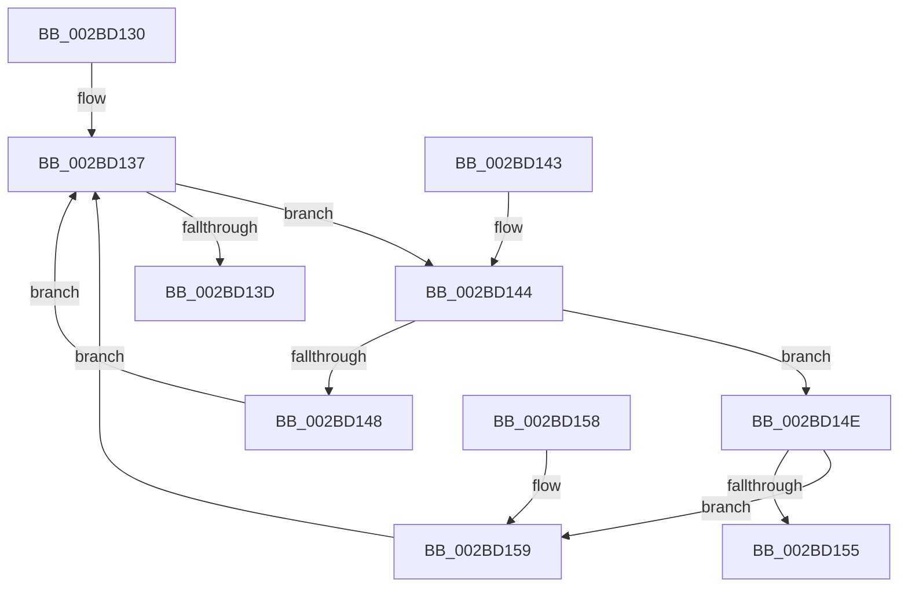

# TRY_ACQUIRE_EXLOCK_EXCLUSIVE

- RVA: `0x002BD130`–`0x002BD15F` (길이 `47` bytes)
- VA: `0x00000001402BD130`
- 실행 섹션: `.text`
- PDB 이름 있음: `예`; PDB Function 태그: `아니요`
- unwind 정보 RVA: `0x000DB714`
- 디코드: `18`개 명령, `47/47` bytes 표시
- 미해석 바이트: `0` (있으면 어셈블리에 `.byte`로 보존)

> 이 문서는 커널 이미지의 기계어와 PDB 기호를 분석해 생성했습니다. 4번과 5번은 함수 원형과 자료형을 바이너리 사용 방식에서 추정한 C 해석이며 원본 소스 복구 결과는 아닙니다.

## 1. Dependencies

- 직접 호출 지점: **0**; 고유 호출 대상: **0**
- 직접 호출자로 확인된 함수: **5**
- RIP 상대 이미지 참조: **0**

### Outgoing calls
- 직접 디코드된 call 명령이 없습니다.

### Direct callers
- [MiLockStealUserVm](MiLockStealUserVm_function_002B3EDC.md) at `0x002B4002`
- [ExTryAcquireSpinLockExclusiveAtDpcLevel](ExTryAcquireSpinLockExclusiveAtDpcLevel_function_002BB800.md) at `0x002BB80D`
- [MiLockSectionControlArea](MiLockSectionControlArea_function_002BC930.md) at `0x002BCA62`
- [PopPepWork](PopPepWork_function_002BCBC0.md) at `0x002BCCE3`
- [ExpTryAcquireSpinLockExclusiveAtDpcLevelInstrumented](ExpTryAcquireSpinLockExclusiveAtDpcLevelInstrumented_function_002BE6A0.md) at `0x002BE6BF`

### Static image references
- 디코드된 RIP-relative 메모리 참조가 없습니다.

## 2. Other-region calls and transfers

- 다른 실행 섹션으로 향하는 call: **0**
- 별도 외부 분기/꼬리 이동을 확인하지 못했습니다.

## 3. Assembly (complete function range)

```asm
002BD130  33 C0                           xor eax, eax
002BD132  BA 00 00 00 80                  mov edx, 0x80000000
002BD137  F0 0F B1 11                     lock cmpxchg dword ptr [rcx], edx
002BD13B  75 07                           jne 0x1402bd144
002BD13D  B8 01 00 00 00                  mov eax, 1
002BD142  C3                              ret
002BD143  CC                              int3
002BD144  85 C0                           test eax, eax
002BD146  75 06                           jne 0x1402bd14e
002BD148  0F BA F2 1E                     btr edx, 0x1e
002BD14C  EB E9                           jmp 0x1402bd137
002BD14E  3D 00 00 00 40                  cmp eax, 0x40000000
002BD153  74 04                           je 0x1402bd159
002BD155  33 C0                           xor eax, eax
002BD157  C3                              ret
002BD158  CC                              int3
002BD159  0F BA EA 1E                     bts edx, 0x1e
002BD15D  EB D8                           jmp 0x1402bd137
```

## 4. C-style interpretation (structured pseudocode)

```c
__int64 __fastcall TRY_ACQUIRE_EXLOCK_EXCLUSIVE(__int64 a1)
{
    __int64 result;

    result = 0;
loc_002BD137:
    if (condition_is_not_equal) goto loc_002BD144;
    return 1;
loc_002BD144:
    if (1 != 0) goto loc_002BD14E;
    goto loc_002BD137;
loc_002BD14E:
    if (1 == 0x40000000ULL) goto loc_002BD159;
    result = 0;
    return result;
loc_002BD159:
    goto loc_002BD137;
}
```

## 5. (Beta) C Style

```c
int64_t TRY_ACQUIRE_EXLOCK_EXCLUSIVE(void *Arg1)
{
    uint8_t *arg1 = (uint8_t *)Arg1;

    int64_t result;

    result = 0;
loc_002BD137:
    if (condition_is_not_equal) goto loc_002BD144;
    return 1;
loc_002BD144:
    if (1 != 0) goto loc_002BD14E;
    goto loc_002BD137;
loc_002BD14E:
    if (1 == 0x40000000ULL) goto loc_002BD159;
    result = 0;
    return result;
loc_002BD159:
    goto loc_002BD137;
}
```

### 관측된 메모리 오프셋

구조체 형식이 확인되지 않은 접근은 인자 기준의 오프셋으로만 기록했습니다.

| 기준 인자 | 오프셋 표현 | 폭 (bit) | 접근 |
|---|---:|---:|---|
| `Arg1` | `+ 0x0` | `32` | `R` |

## 6. Execution-region graph

[열기: 2D/3D 그래프와 함수 탐색 컨트롤 패널](../../../control-panel.html?section=text&rva=0x002BD130&view=graph)

- 2D 그래프는 위에서 아래로 흐르고, 3D 그래프는 빈 공간을 드래그해 회전합니다. Shift+드래그는 이동, 휠은 확대·축소, 함수 노드 선택은 대상 보고서 이동입니다.

### Static fallback


