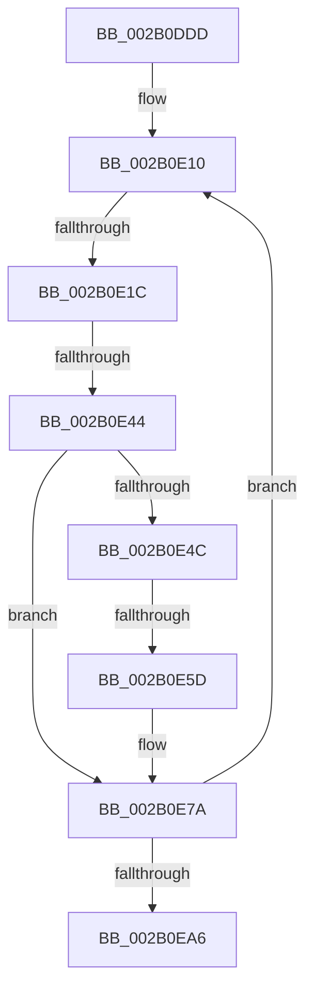

# sub_002B0DDD

- RVA: `0x002B0DDD`–`0x002B0EBA` (길이 `221` bytes)
- VA: `0x00000001402B0DDD`
- 실행 섹션: `.text`
- PDB 이름 있음: `아니요`; PDB Function 태그: `아니요`
- unwind 정보 RVA: `0x0006D598`
- 디코드: `45`개 명령, `221/221` bytes 표시
- 미해석 바이트: `0` (있으면 어셈블리에 `.byte`로 보존)

> 이 문서는 커널 이미지의 기계어와 PDB 기호를 분석해 생성했습니다. 4번과 5번은 함수 원형과 자료형을 바이너리 사용 방식에서 추정한 C 해석이며 원본 소스 복구 결과는 아닙니다.

## 1. Dependencies

- 직접 호출 지점: **1**; 고유 호출 대상: **1**
- 직접 호출자로 확인된 함수: **0**
- RIP 상대 이미지 참조: **0**

### Outgoing calls
- `0x002B0E4F` → [MI_NODE_FROM_PFN](MI_NODE_FROM_PFN_function_002B0F30.md) (function, `0x002B0F30`)

### Direct callers
- 이 함수 시작 RVA로 연결되는 직접 call은 확인되지 않았습니다. 간접 호출은 완전히 역산할 수 없습니다.

### Static image references
- 디코드된 RIP-relative 메모리 참조가 없습니다.

## 2. Other-region calls and transfers

- 다른 실행 섹션으로 향하는 call: **0**
- call이 아닌 외부 분기/꼬리 이동: **3**
  - `0x002B0E16` → [sub_002B0ECA](Unknown_function_002B0ECA.md) (`tail-transfer`)
  - `0x002B0E3E` → [sub_002B0ECA + 0x6](Unknown_function_002B0ECA.md) (`tail-transfer`)
  - `0x002B0E57` → [sub_002B0ECA + 0x21](Unknown_function_002B0ECA.md) (`tail-transfer`)

## 3. Assembly (complete function range)

```asm
002B0DDD  48 89 5C 24 50                  mov qword ptr [rsp + 0x50], rbx
002B0DE2  48 BA FF FF FF FF FF 00 00 00   movabs rdx, 0xffffffffff
002B0DEC  48 89 6C 24 58                  mov qword ptr [rsp + 0x58], rbp
002B0DF1  48 89 74 24 60                  mov qword ptr [rsp + 0x60], rsi
002B0DF6  4C 89 6C 24 20                  mov qword ptr [rsp + 0x20], r13
002B0DFB  45 33 ED                        xor r13d, r13d
002B0DFE  48 B9 00 00 00 00 00 DE FF FF   movabs rcx, 0xffffde0000000000
002B0E08  0F 1F 84 00 00 00 00 00         nop dword ptr [rax + rax]
002B0E10  49 8B 1E                        mov rbx, qword ptr [r14]
002B0E13  F6 C3 01                        test bl, 1
002B0E16  0F 84 AE 00 00 00               je 0x1402b0eca
002B0E1C  48 8B C3                        mov rax, rbx
002B0E1F  48 C1 E8 0C                     shr rax, 0xc
002B0E23  48 23 C2                        and rax, rdx
002B0E26  48 8D 34 40                     lea rsi, [rax + rax*2]
002B0E2A  48 C1 E6 04                     shl rsi, 4
002B0E2E  48 8B C1                        mov rax, rcx
002B0E31  48 03 F0                        add rsi, rax
002B0E34  41 8B ED                        mov ebp, r13d
002B0E37  F0 48 0F BA 6E 18 3F            lock bts qword ptr [rsi + 0x18], 0x3f
002B0E3E  0F 82 8C 00 00 00               jb 0x1402b0ed0
002B0E44  49 8B 06                        mov rax, qword ptr [r14]
002B0E47  48 3B D8                        cmp rbx, rax
002B0E4A  75 2E                           jne 0x1402b0e7a
002B0E4C  48 8B CE                        mov rcx, rsi
002B0E4F  E8 DC 00 00 00                  call 0x1402b0f30
002B0E54  83 FF FF                        cmp edi, -1
002B0E57  0F 84 8E 00 00 00               je 0x1402b0eeb
002B0E5D  3B F8                           cmp edi, eax
002B0E5F  45 0F 45 FD                     cmovne r15d, r13d
002B0E63  48 8B 06                        mov rax, qword ptr [rsi]
002B0E66  48 B9 01 00 00 00 00 F0 FF FF   movabs rcx, 0xfffff00000000001
002B0E70  48 23 C1                        and rax, rcx
002B0E73  48 89 06                        mov qword ptr [rsi], rax
002B0E76  49 83 C6 08                     add r14, 8
002B0E7A  48 B8 FF FF FF FF FF FF FF 7F   movabs rax, 0x7fffffffffffffff
002B0E84  F0 48 21 46 18                  lock and qword ptr [rsi + 0x18], rax
002B0E89  48 B9 00 00 00 00 00 DE FF FF   movabs rcx, 0xffffde0000000000
002B0E93  48 BA FF FF FF FF FF 00 00 00   movabs rdx, 0xffffffffff
002B0E9D  4D 3B F4                        cmp r14, r12
002B0EA0  0F 82 6A FF FF FF               jb 0x1402b0e10
002B0EA6  4C 8B 6C 24 20                  mov r13, qword ptr [rsp + 0x20]
002B0EAB  48 8B 74 24 60                  mov rsi, qword ptr [rsp + 0x60]
002B0EB0  48 8B 6C 24 58                  mov rbp, qword ptr [rsp + 0x58]
002B0EB5  48 8B 5C 24 50                  mov rbx, qword ptr [rsp + 0x50]
```

## 4. C-style interpretation (structured pseudocode)

```c
__int64 __fastcall sub_002B0DDD(__int64 a1, __int64 a2, __int64 a3, __int64 a4, __int64 a5, __int64 a6, __int64 a7, __int64 a8, __int64 a9, __int64 a10, __int64 a11, __int64 a12)
{
    __int64 result;
    __int64 v_r13;
    __int64 v_r14;
    __int64 v_r15;
    __int64 v_rsi;
    unsigned __int64 v_stack_p20;
    unsigned __int64 v_stack_p50;
    unsigned __int64 v_stack_p58;
    unsigned __int64 v_stack_p60;

    v_stack_p50 = v_rbx;
    v_stack_p58 = v_rbp;
    v_stack_p60 = v_rsi;
    v_stack_p20 = v_r13;
    v_r13 = 0;
loc_002B0E10:
    result = (*(unsigned __int64 *)(v_r14)) >> (12);
    result = (result) & (a2);
    v_rsi = (result + result * 2) << (4);
    v_rsi = (v_rsi) + (a1);
    if ((*(unsigned __int64 *)(v_r14)) != (*(unsigned __int64 *)(v_r14))) goto loc_002B0E7A;
    result = MI_NODE_FROM_PFN(v_rsi, a2, a3, a4);
    if (((unsigned int)(v_rdi)) != ((unsigned int)(result))) { v_r15 = 0; }
    result = (*(unsigned __int64 *)(v_rsi)) & (v_rsi);
    *(unsigned __int64 *)(v_rsi) = result;
    v_r14 = (v_r14) + (8);
loc_002B0E7A:
    if (v_r14 < v_r12) goto loc_002B0E10;
    return result;
}
```

## 5. (Beta) C Style

```c
int64_t sub_002B0DDD(int64_t Arg1, int64_t Arg2, int64_t Arg3, int64_t Arg4, uint64_t Arg5, uint64_t Arg6, uint64_t Arg7, uint64_t Arg8, uint64_t Arg9, int64_t Arg10, int64_t Arg11, int64_t Arg12)
{
    int64_t result;
    int64_t local_r13;
    int64_t local_r14;
    int64_t local_r15;
    int64_t local_rsi;
    uint64_t v_stack_p20;
    uint64_t v_stack_p50;
    uint64_t v_stack_p58;
    uint64_t v_stack_p60;

    v_stack_p50 = local_rbx;
    v_stack_p58 = local_rbp;
    v_stack_p60 = local_rsi;
    v_stack_p20 = local_r13;
    local_r13 = 0;
loc_002B0E10:
    result = (*(uint64_t *)(local_r14)) >> (12);
    result = (result) & (Arg2);
    local_rsi = (result + result * 2) << (4);
    local_rsi = (local_rsi) + (Arg1);
    if ((*(uint64_t *)(local_r14)) != (*(uint64_t *)(local_r14))) goto loc_002B0E7A;
    result = MI_NODE_FROM_PFN(local_rsi, Arg2, Arg3, Arg4);
    if (((uint32_t)(local_rdi)) != ((uint32_t)(result))) { local_r15 = 0; }
    result = (*(uint64_t *)(local_rsi)) & (local_rsi);
    *(uint64_t *)(local_rsi) = result;
    local_r14 = (local_r14) + (8);
loc_002B0E7A:
    if (local_r14 < local_r12) goto loc_002B0E10;
    return result;
}
```

## 6. Execution-region graph

[열기: 2D/3D 그래프와 함수 탐색 컨트롤 패널](../../../control-panel.html?section=text&rva=0x002B0DDD&view=graph)

- 2D 그래프는 위에서 아래로 흐르고, 3D 그래프는 빈 공간을 드래그해 회전합니다. Shift+드래그는 이동, 휠은 확대·축소, 함수 노드 선택은 대상 보고서 이동입니다.

### Static fallback


