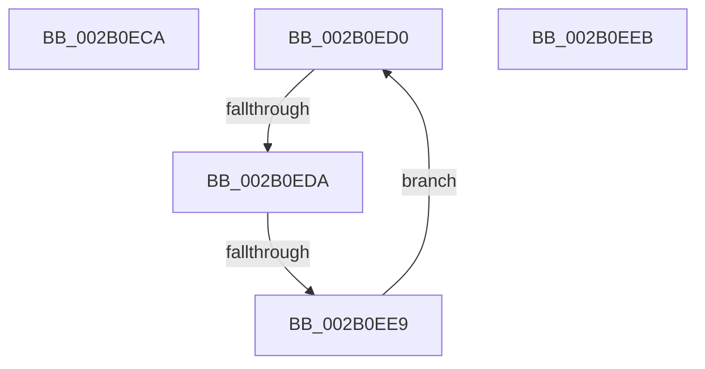

# sub_002B0ECA

- RVA: `0x002B0ECA`–`0x002B0EF2` (길이 `40` bytes)
- VA: `0x00000001402B0ECA`
- 실행 섹션: `.text`
- PDB 이름 있음: `아니요`; PDB Function 태그: `아니요`
- unwind 정보 RVA: `0x0006D5CC`
- 디코드: `12`개 명령, `40/40` bytes 표시
- 미해석 바이트: `0` (있으면 어셈블리에 `.byte`로 보존)

> 이 문서는 커널 이미지의 기계어와 PDB 기호를 분석해 생성했습니다. 4번과 5번은 함수 원형과 자료형을 바이너리 사용 방식에서 추정한 C 해석이며 원본 소스 복구 결과는 아닙니다.

## 1. Dependencies

- 직접 호출 지점: **0**; 고유 호출 대상: **0**
- 직접 호출자로 확인된 함수: **0**
- RIP 상대 이미지 참조: **1**

### Outgoing calls
- 직접 디코드된 call 명령이 없습니다.

### Direct callers
- 이 함수 시작 RVA로 연결되는 직접 call은 확인되지 않았습니다. 간접 호출은 완전히 역산할 수 없습니다.

### Static image references
- `0x002B0ED2` → RVA `0x00FC52AC` (`ALMOSTRO`; reference)

## 2. Other-region calls and transfers

- 다른 실행 섹션으로 향하는 call: **0**
- call이 아닌 외부 분기/꼬리 이동: **4**
  - `0x002B0ECE` → [sub_002B0DDD + 0xC0](Unknown_function_002B0DDD.md) (`tail-transfer`)
  - `0x002B0ED8` → [sub_002B0F0E](Unknown_function_002B0F0E.md) (`tail-transfer`)
  - `0x002B0EE3` → [sub_002B0DDD + 0x5A](Unknown_function_002B0DDD.md) (`tail-transfer`)
  - `0x002B0EED` → [sub_002B0DDD + 0x86](Unknown_function_002B0DDD.md) (`tail-transfer`)

## 3. Assembly (complete function range)

```asm
002B0ECA  49 83 C6 08                     add r14, 8
002B0ECE  EB CD                           jmp 0x1402b0e9d
002B0ED0  FF C5                           inc ebp
002B0ED2  85 2D D4 43 D1 00               test dword ptr [rip + 0xd143d4], ebp
002B0ED8  74 34                           je 0x1402b0f0e
002B0EDA  F3 90                           pause
002B0EDC  48 8B 46 18                     mov rax, qword ptr [rsi + 0x18]
002B0EE0  48 85 C0                        test rax, rax
002B0EE3  0F 89 4E FF FF FF               jns 0x1402b0e37
002B0EE9  EB E5                           jmp 0x1402b0ed0
002B0EEB  8B F8                           mov edi, eax
002B0EED  E9 71 FF FF FF                  jmp 0x1402b0e63
```

## 4. C-style interpretation (structured pseudocode)

```c
__int64 __fastcall sub_002B0ECA(void)
{
    __int64 v_r14;

    v_r14 = (v_r14) + (8);
}
```

## 5. (Beta) C Style

```c
void sub_002B0ECA(void)
{
    int64_t local_r14;

    local_r14 = (local_r14) + (8);
}
```

## 6. Execution-region graph

[열기: 2D/3D 그래프와 함수 탐색 컨트롤 패널](../../../control-panel.html?section=text&rva=0x002B0ECA&view=graph)

- 2D 그래프는 위에서 아래로 흐르고, 3D 그래프는 빈 공간을 드래그해 회전합니다. Shift+드래그는 이동, 휠은 확대·축소, 함수 노드 선택은 대상 보고서 이동입니다.

### Static fallback


