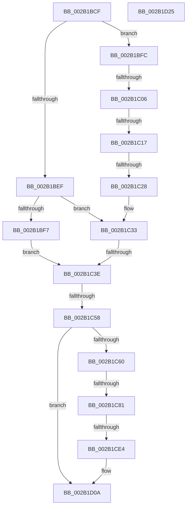

# sub_002B1BCF

- RVA: `0x002B1BCF`–`0x002B1D26` (길이 `343` bytes)
- VA: `0x00000001402B1BCF`
- 실행 섹션: `.text`
- PDB 이름 있음: `아니요`; PDB Function 태그: `아니요`
- unwind 정보 RVA: `0x0006D684`
- 디코드: `85`개 명령, `343/343` bytes 표시
- 미해석 바이트: `0` (있으면 어셈블리에 `.byte`로 보존)

> 이 문서는 커널 이미지의 기계어와 PDB 기호를 분석해 생성했습니다. 4번과 5번은 함수 원형과 자료형을 바이너리 사용 방식에서 추정한 C 해석이며 원본 소스 복구 결과는 아닙니다.

## 1. Dependencies

- 직접 호출 지점: **5**; 고유 호출 대상: **5**
- 직접 호출자로 확인된 함수: **0**
- RIP 상대 이미지 참조: **2**

### Outgoing calls
- `0x002B1BDA` → [MiGetPagePrivilege](../28/MiGetPagePrivilege_function_00285420.md) (function, `0x00285420`)
- `0x002B1C99` → [MiGetPteMappingSet](../32/MiGetPteMappingSet_function_00322EB0.md) (function, `0x00322EB0`)
- `0x002B1CAE` → [MiGetPteFromCopyList](MiGetPteFromCopyList_function_002B20E0.md) (function, `0x002B20E0`)
- `0x002B1CED` → [KeCopyPage](../6B/KeCopyPage_function_006BA0F0.md) (function, `0x006BA0F0`)
- `0x002B1D05` → [MiReturnPteMappingSet](MiReturnPteMappingSet_function_002B2600.md) (function, `0x002B2600`)

### Direct callers
- 이 함수 시작 RVA로 연결되는 직접 call은 확인되지 않았습니다. 간접 호출은 완전히 역산할 수 없습니다.

### Static image references
- `0x002B1C06` → RVA `0x00FC6A88` (`ALMOSTRO`; read)
- `0x002B1CF2` → RVA `0x00010880` (`.rdata`; read)

## 2. Other-region calls and transfers

- 다른 실행 섹션으로 향하는 call: **0**
- call이 아닌 외부 분기/꼬리 이동: **7**
  - `0x002B1C00` → [sub_002B1D4E + 0x24E](Unknown_function_002B1D4E.md) (`tail-transfer`)
  - `0x002B1C11` → [sub_002B1D4E + 0x58](Unknown_function_002B1D4E.md) (`tail-transfer`)
  - `0x002B1C22` → [sub_002B1D4E + 0x2E0](Unknown_function_002B1D4E.md) (`tail-transfer`)
  - `0x002B1C38` → [sub_002B1D4E + 0x82](Unknown_function_002B1D4E.md) (`tail-transfer`)
  - `0x002B1C52` → [sub_002B1D4E](Unknown_function_002B1D4E.md) (`tail-transfer`)
  - `0x002B1C7B` → [sub_002B1D4E + 0x360](Unknown_function_002B1D4E.md) (`tail-transfer`)
  - `0x002B1CDE` → [sub_002B1D4E + 0x3C](Unknown_function_002B1D4E.md) (`tail-transfer`)

## 3. Assembly (complete function range)

```asm
002B1BCF  48 89 B4 24 98 00 00 00         mov qword ptr [rsp + 0x98], rsi
002B1BD7  48 8B CD                        mov rcx, rbp
002B1BDA  E8 41 38 FD FF                  call 0x140285420
002B1BDF  49 B8 00 00 00 00 80 F6 FF FF   movabs r8, 0xfffff68000000000
002B1BE9  8B D0                           mov edx, eax
002B1BEB  85 C0                           test eax, eax
002B1BED  75 0D                           jne 0x1402b1bfc
002B1BEF  41 8B F7                        mov esi, r15d
002B1BF2  41 23 F6                        and esi, r14d
002B1BF5  75 3C                           jne 0x1402b1c33
002B1BF7  8D 58 04                        lea ebx, [rax + 4]
002B1BFA  EB 42                           jmp 0x1402b1c3e
002B1BFC  41 F6 C7 12                     test r15b, 0x12
002B1C00  0F 85 96 03 00 00               jne 0x1402b1f9c
002B1C06  48 F7 05 77 4E D1 00 00 80 00 00  test qword ptr [rip + 0xd14e77], 0x8000
002B1C11  0F 85 8F 01 00 00               jne 0x1402b1da6
002B1C17  48 F7 05 66 4E D1 00 00 00 02 00  test qword ptr [rip + 0xd14e66], 0x20000
002B1C22  0F 85 06 04 00 00               jne 0x1402b202e
002B1C28  BB 04 00 00 00                  mov ebx, 4
002B1C2D  41 8B F7                        mov esi, r15d
002B1C30  41 23 F6                        and esi, r14d
002B1C33  8B CE                           mov ecx, esi
002B1C35  41 84 DE                        test r14b, bl
002B1C38  0F 85 92 01 00 00               jne 0x1402b1dd0
002B1C3E  4C 8B A4 24 E0 00 00 00         mov r12, qword ptr [rsp + 0xe0]
002B1C46  48 8B 45 28                     mov rax, qword ptr [rbp + 0x28]
002B1C4A  48 C1 E8 3C                     shr rax, 0x3c
002B1C4E  24 07                           and al, 7
002B1C50  3C 03                           cmp al, 3
002B1C52  0F 84 F6 00 00 00               je 0x1402b1d4e
002B1C58  85 FF                           test edi, edi
002B1C5A  0F 89 AA 00 00 00               jns 0x1402b1d0a
002B1C60  8B 45 20                        mov eax, dword ptr [rbp + 0x20]
002B1C63  C1 E8 10                        shr eax, 0x10
002B1C66  0F B6 F8                        movzx edi, al
002B1C69  41 8B 45 20                     mov eax, dword ptr [r13 + 0x20]
002B1C6D  C1 E8 10                        shr eax, 0x10
002B1C70  0F B6 C0                        movzx eax, al
002B1C73  C1 E8 06                        shr eax, 6
002B1C76  C1 EF 06                        shr edi, 6
002B1C79  3B C7                           cmp eax, edi
002B1C7B  0F 85 2D 04 00 00               jne 0x1402b20ae
002B1C81  BE 01 00 00 00                  mov esi, 1
002B1C86  4C 8D 44 24 70                  lea r8, [rsp + 0x70]
002B1C8B  41 F6 C7 01                     test r15b, 1
002B1C8F  49 8B D6                        mov rdx, r14
002B1C92  0F 45 DE                        cmovne ebx, esi
002B1C95  23 DE                           and ebx, esi
002B1C97  8B CB                           mov ecx, ebx
002B1C99  E8 12 12 07 00                  call 0x140322eb0
002B1C9E  4C 8B 84 24 E8 00 00 00         mov r8, qword ptr [rsp + 0xe8]
002B1CA6  48 8D 4C 24 70                  lea rcx, [rsp + 0x70]
002B1CAB  49 8B D4                        mov rdx, r12
002B1CAE  E8 2D 04 00 00                  call 0x1402b20e0
002B1CB3  4C 8B C8                        mov r9, rax
002B1CB6  48 8B D8                        mov rbx, rax
002B1CB9  49 C1 E1 19                     shl r9, 0x19
002B1CBD  48 B8 00 00 00 00 80 F6 FF FF   movabs rax, 0xfffff68000000000
002B1CC7  48 8B C8                        mov rcx, rax
002B1CCA  48 C1 E1 19                     shl rcx, 0x19
002B1CCE  4C 2B C9                        sub r9, rcx
002B1CD1  49 C1 F9 10                     sar r9, 0x10
002B1CD5  49 8D 91 00 10 00 00            lea rdx, [r9 + 0x1000]
002B1CDC  3B FE                           cmp edi, esi
002B1CDE  0F 85 A6 00 00 00               jne 0x1402b1d8a
002B1CE4  44 8B F6                        mov r14d, esi
002B1CE7  45 8B C6                        mov r8d, r14d
002B1CEA  49 8B C9                        mov rcx, r9
002B1CED  E8 FE 83 40 00                  call 0x1406ba0f0
002B1CF2  48 8B 05 87 EB D5 FF            mov rax, qword ptr [rip - 0x2a1479]
002B1CF9  48 8D 4C 24 70                  lea rcx, [rsp + 0x70]
002B1CFE  48 89 03                        mov qword ptr [rbx], rax
002B1D01  48 89 43 08                     mov qword ptr [rbx + 8], rax
002B1D05  E8 F6 08 00 00                  call 0x1402b2600
002B1D0A  48 8B B4 24 98 00 00 00         mov rsi, qword ptr [rsp + 0x98]
002B1D12  48 81 C4 A0 00 00 00            add rsp, 0xa0
002B1D19  41 5F                           pop r15
002B1D1B  41 5E                           pop r14
002B1D1D  41 5D                           pop r13
002B1D1F  41 5C                           pop r12
002B1D21  5F                              pop rdi
002B1D22  5D                              pop rbp
002B1D23  5B                              pop rbx
002B1D24  C3                              ret
002B1D25  CC                              int3
```

## 4. C-style interpretation (structured pseudocode)

```c
__int64 __fastcall sub_002B1BCF(__int64 a1, __int64 a2, __int64 a3, __int64 a4, __int64 a5, __int64 a6, __int64 a7, __int64 a8, __int64 a9, __int64 a10, __int64 a11, __int64 a12, __int64 a13, __int64 a14, __int64 a15, __int64 a16, __int64 a17, __int64 a18, __int64 a19, __int64 a20, __int64 a21, __int64 a22, __int64 a23, __int64 a24, __int64 a25, __int64 a26, __int64 a27, __int64 a28, __int64 a29)
{
    __int64 result;
    __int64 v_rbx;
    __int64 v_rdi;
    __int64 v_rsi;
    __int64 v_rsp;
    unsigned __int64 v_stack_p98;

    v_stack_p98 = v_rsi;
    result = MiGetPagePrivilege(v_rbp, a2, a3, a4);
    if ((unsigned int)(result) != 0) goto loc_002B1BFC;
    v_rsi = (unsigned int)(((unsigned int)((unsigned int)(v_r15))) & ((unsigned int)(v_r14)));
    if (condition_is_not_equal) goto loc_002B1C33;
    goto loc_002B1C3E;
loc_002B1BFC:
    v_rsi = (unsigned int)(((unsigned int)((unsigned int)(v_r15))) & ((unsigned int)(v_r14)));
loc_002B1C33:
loc_002B1C3E:
    result = (*(unsigned __int64 *)(v_rbp + 40)) >> (60);
    result = (unsigned __int8)((result) & (7));
    if (!sign_flag) goto loc_002B1D0A;
    result = (unsigned int)(((unsigned int)(*(unsigned int *)(v_rbp + 32))) >> (16));
    result = (unsigned int)(((unsigned int)(*(unsigned int *)(v_r13 + 32))) >> (16));
    result = (unsigned int)(((unsigned __int8)(result)) >> (6));
    v_rdi = (unsigned int)(((unsigned __int8)(result)) >> (6));
    v_rbx = 4;
    if ((((unsigned __int8)(v_r15)) & (1)) != 0) { v_rbx = 1; }
    v_rbx = (unsigned int)((v_rbx) & (1));
    result = MiGetPteMappingSet((unsigned int)((unsigned int)(v_rbx)), v_r14, a14, a4);
    result = MiGetPteFromCopyList(a14, a28, a29, a4);
    a4 = (result) << (25);
    a1 = (result) << (25);
    a4 = (a4) - (a1);
    a4 = (a4) >> (16);
    result = KeCopyPage(a4, a4 + 4096, 1, a4);
    *(unsigned __int64 *)(result) = *(unsigned __int64 *)(v_rip - 2757753);
    *(unsigned __int64 *)(result + 8) = *(unsigned __int64 *)(v_rip - 2757753);
    result = MiReturnPteMappingSet(a14, a4 + 4096, 1, a4);
loc_002B1D0A:
    v_rsp = (v_rsp) + (160);
    return result;
}
```

## 5. (Beta) C Style

```c
int64_t sub_002B1BCF(int64_t Arg1, int64_t Arg2, int64_t Arg3, int64_t Arg4, uint64_t Arg5, uint64_t Arg6, uint64_t Arg7, uint64_t Arg8, uint64_t Arg9, uint64_t Arg10, uint64_t Arg11, uint64_t Arg12, uint64_t Arg13, int64_t Arg14, uint64_t Arg15, uint64_t Arg16, uint64_t Arg17, uint64_t Arg18, int64_t Arg19, uint64_t Arg20, uint64_t Arg21, uint64_t Arg22, uint64_t Arg23, uint64_t Arg24, uint64_t Arg25, uint64_t Arg26, uint64_t Arg27, int64_t Arg28, int64_t Arg29)
{
    int64_t result;
    int64_t local_rbx;
    int64_t local_rdi;
    int64_t local_rsi;
    int64_t local_rsp;
    uint64_t v_stack_p98;

    v_stack_p98 = local_rsi;
    result = MiGetPagePrivilege(local_rbp, Arg2, Arg3, Arg4);
    if ((uint32_t)(result) != 0) goto loc_002B1BFC;
    local_rsi = (uint32_t)(((uint32_t)((uint32_t)(local_r15))) & ((uint32_t)(local_r14)));
    if (condition_is_not_equal) goto loc_002B1C33;
    goto loc_002B1C3E;
loc_002B1BFC:
    local_rsi = (uint32_t)(((uint32_t)((uint32_t)(local_r15))) & ((uint32_t)(local_r14)));
loc_002B1C33:
loc_002B1C3E:
    result = (*(uint64_t *)(local_rbp + 0x28)) >> (60);
    result = (uint8_t)((result) & (7));
    if (!sign_flag) goto loc_002B1D0A;
    result = (uint32_t)(((uint32_t)(*(uint32_t *)(local_rbp + 0x20))) >> (16));
    result = (uint32_t)(((uint32_t)(*(uint32_t *)(local_r13 + 0x20))) >> (16));
    result = (uint32_t)(((uint8_t)(result)) >> (6));
    local_rdi = (uint32_t)(((uint8_t)(result)) >> (6));
    local_rbx = 4;
    if ((((uint8_t)(local_r15)) & (1)) != 0) { local_rbx = 1; }
    local_rbx = (uint32_t)((local_rbx) & (1));
    result = MiGetPteMappingSet((uint32_t)((uint32_t)(local_rbx)), local_r14, Arg14, Arg4);
    result = MiGetPteFromCopyList(Arg14, Arg28, Arg29, Arg4);
    Arg4 = (result) << (25);
    Arg1 = (result) << (25);
    Arg4 = (Arg4) - (Arg1);
    Arg4 = (Arg4) >> (16);
    result = KeCopyPage(Arg4, Arg4 + 4096, 1, Arg4);
    *(uint64_t *)(result) = *(uint64_t *)(v_rip - 0x2A1479);
    *(uint64_t *)(result + 0x8) = *(uint64_t *)(v_rip - 0x2A1479);
    result = MiReturnPteMappingSet(Arg14, Arg4 + 4096, 1, Arg4);
loc_002B1D0A:
    local_rsp = (local_rsp) + (160);
    return result;
}
```

## 6. Execution-region graph

[열기: 2D/3D 그래프와 함수 탐색 컨트롤 패널](../../../control-panel.html?section=text&rva=0x002B1BCF&view=graph)

- 2D 그래프는 위에서 아래로 흐르고, 3D 그래프는 빈 공간을 드래그해 회전합니다. Shift+드래그는 이동, 휠은 확대·축소, 함수 노드 선택은 대상 보고서 이동입니다.

### Static fallback


