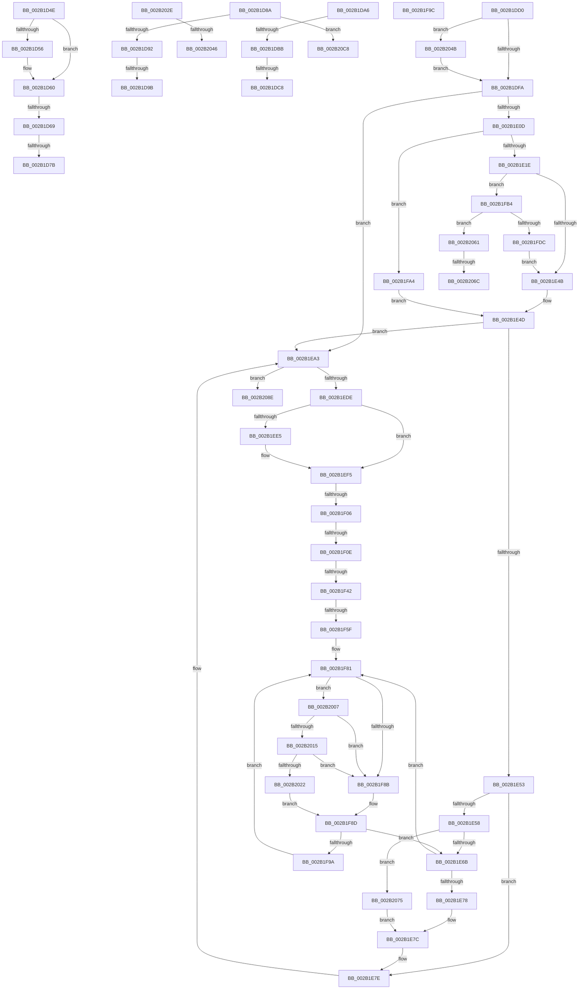

# sub_002B1D4E

- RVA: `0x002B1D4E`–`0x002B20D0` (길이 `898` bytes)
- VA: `0x00000001402B1D4E`
- 실행 섹션: `.text`
- PDB 이름 있음: `아니요`; PDB Function 태그: `아니요`
- unwind 정보 RVA: `0x0006D6AC`
- 디코드: `197`개 명령, `898/898` bytes 표시
- 미해석 바이트: `0` (있으면 어셈블리에 `.byte`로 보존)

> 이 문서는 커널 이미지의 기계어와 PDB 기호를 분석해 생성했습니다. 4번과 5번은 함수 원형과 자료형을 바이너리 사용 방식에서 추정한 C 해석이며 원본 소스 복구 결과는 아닙니다.

## 1. Dependencies

- 직접 호출 지점: **14**; 고유 호출 대상: **12**
- 직접 호출자로 확인된 함수: **0**
- RIP 상대 이미지 참조: **3**

### Outgoing calls
- `0x002B1D5B` → [MiClearPfnImageVerified](../40/MiClearPfnImageVerified_function_00407000.md) (function, `0x00407000`)
- `0x002B1D80` → [MiMarkPfnVerified](../38/MiMarkPfnVerified_function_003833C4.md) (function, `0x003833C4`)
- `0x002B1ECE` → [VslCopyProtectedPage](../49/VslCopyProtectedPage_function_0049781C.md) (function, `0x0049781C`)
- `0x002B1EF0` → [MiUnlockPage](../31/MiUnlockPage_function_0031A3E0.md) (function, `0x0031A3E0`)
- `0x002B1F50` → [KeSetPagePrivilege](../40/KeSetPagePrivilege_function_00407970.md) (function, `0x00407970`)
- `0x002B1F7B` → [KeBugCheckEx](../4F/KeBugCheckEx_function_004FD660.md) (function, `0x004FD660`)
- `0x002B1FE4` → [MiMarkPfnVerified](../38/MiMarkPfnVerified_function_003833C4.md) (function, `0x003833C4`)
- `0x002B1FEC` → [MiAbortCombineScan](../2A/MiAbortCombineScan_function_002A1160.md) (function, `0x002A1160`)
- `0x002B2015` → [KiCheckVpBackingLongSpinWaitHypercall](../30/KiCheckVpBackingLongSpinWaitHypercall_function_0030F490.md) (function, `0x0030F490`)
- `0x002B2024` → [HvlNotifyLongSpinWait](../30/HvlNotifyLongSpinWait_function_0030F460.md) (function, `0x0030F460`)
- `0x002B204B` → [MiFlushEntireTbDueToAttributeChange](../30/MiFlushEntireTbDueToAttributeChange_function_00308AE0.md) (function, `0x00308AE0`)
- `0x002B2078` → [MiLockPageInline](../31/MiLockPageInline_function_0031A340.md) (function, `0x0031A340`)
- `0x002B20A8` → [KeBugCheckEx](../4F/KeBugCheckEx_function_004FD660.md) (function, `0x004FD660`)
- `0x002B20BE` → [MiChangePageAttribute](../33/MiChangePageAttribute_function_00332ECC.md) (function, `0x00332ECC`)

### Direct callers
- 이 함수 시작 RVA로 연결되는 직접 call은 확인되지 않았습니다. 간접 호출은 완전히 역산할 수 없습니다.

### Static image references
- `0x002B1DD0` → RVA `0x00FC6A88` (`ALMOSTRO`; read)
- `0x002B1F83` → RVA `0x00FC52AC` (`ALMOSTRO`; reference)
- `0x002B2007` → RVA `0x00FC6AB8` (`ALMOSTRO`; read)

## 2. Other-region calls and transfers

- 다른 실행 섹션으로 향하는 call: **0**
- call이 아닌 외부 분기/꼬리 이동: **19**
  - `0x002B1D63` → [sub_002B1BCF + 0x89](Unknown_function_002B1BCF.md) (`tail-transfer`)
  - `0x002B1D75` → [sub_002B1BCF + 0x89](Unknown_function_002B1BCF.md) (`tail-transfer`)
  - `0x002B1D85` → [sub_002B1BCF + 0x89](Unknown_function_002B1BCF.md) (`tail-transfer`)
  - `0x002B1D95` → [sub_002B1BCF + 0x118](Unknown_function_002B1BCF.md) (`tail-transfer`)
  - `0x002B1DA1` → [sub_002B1BCF + 0x118](Unknown_function_002B1BCF.md) (`tail-transfer`)
  - `0x002B1DB5` → [sub_002B1BCF + 0x48](Unknown_function_002B1BCF.md) (`tail-transfer`)
  - `0x002B1DC2` → [sub_002B1BCF + 0x48](Unknown_function_002B1BCF.md) (`tail-transfer`)
  - `0x002B1DCB` → [sub_002B1BCF + 0x5E](Unknown_function_002B1BCF.md) (`tail-transfer`)
  - `0x002B1F00` → [sub_002B1BCF + 0x77](Unknown_function_002B1BCF.md) (`tail-transfer`)
  - `0x002B1F08` → [sub_002B1BCF + 0x77](Unknown_function_002B1BCF.md) (`tail-transfer`)
  - `0x002B1F3C` → [sub_002B1BCF + 0x77](Unknown_function_002B1BCF.md) (`tail-transfer`)
  - `0x002B1F59` → [sub_002B1BCF + 0x77](Unknown_function_002B1BCF.md) (`tail-transfer`)
  - `0x002B1F9F` → [sub_002B1BCF + 0x5E](Unknown_function_002B1BCF.md) (`tail-transfer`)
  - `0x002B2040` → [sub_002B1BCF + 0x5E](Unknown_function_002B1BCF.md) (`tail-transfer`)
  - `0x002B2046` → [sub_002B1BCF + 0x59](Unknown_function_002B1BCF.md) (`tail-transfer`)
  - `0x002B2066` → [sub_006DB64E + 0x1E](../6D/Unknown_function_006DB64E.md) (`tail-transfer`)
  - `0x002B2070` → [sub_006DB64E](../6D/Unknown_function_006DB64E.md) (`tail-transfer`)
  - `0x002B20C3` → [sub_002B1BCF + 0xB2](Unknown_function_002B1BCF.md) (`tail-transfer`)
  - `0x002B20CB` → [sub_002B1BCF + 0x118](Unknown_function_002B1BCF.md) (`tail-transfer`)

## 3. Assembly (complete function range)

```asm
002B1D4E  85 F6                           test esi, esi
002B1D50  8B 74 24 30                     mov esi, dword ptr [rsp + 0x30]
002B1D54  74 0A                           je 0x1402b1d60
002B1D56  8B D6                           mov edx, esi
002B1D58  48 8B CD                        mov rcx, rbp
002B1D5B  E8 A0 52 15 00                  call 0x140407000
002B1D60  F6 C3 04                        test bl, 4
002B1D63  0F 85 EF FE FF FF               jne 0x1402b1c58
002B1D69  49 8B 45 28                     mov rax, qword ptr [r13 + 0x28]
002B1D6D  48 C1 E8 3C                     shr rax, 0x3c
002B1D71  24 07                           and al, 7
002B1D73  3C 03                           cmp al, 3
002B1D75  0F 84 DD FE FF FF               je 0x1402b1c58
002B1D7B  8B D6                           mov edx, esi
002B1D7D  49 8B CD                        mov rcx, r13
002B1D80  E8 3F 16 0D 00                  call 0x1403833c4
002B1D85  E9 CE FE FF FF                  jmp 0x1402b1c58
002B1D8A  85 FF                           test edi, edi
002B1D8C  0F 84 36 03 00 00               je 0x1402b20c8
002B1D92  41 3B FE                        cmp edi, r14d
002B1D95  0F 84 4C FF FF FF               je 0x1402b1ce7
002B1D9B  41 BE FF FF FF FF               mov r14d, 0xffffffff
002B1DA1  E9 41 FF FF FF                  jmp 0x1402b1ce7
002B1DA6  F6 C2 01                        test dl, 1
002B1DA9  0F 95 C1                        setne cl
002B1DAC  41 F6 C7 08                     test r15b, 8
002B1DB0  0F 94 C0                        sete al
002B1DB3  84 C8                           test al, cl
002B1DB5  0F 84 5C FE FF FF               je 0x1402b1c17
002B1DBB  48 8B 45 28                     mov rax, qword ptr [rbp + 0x28]
002B1DBF  48 85 C0                        test rax, rax
002B1DC2  0F 88 4F FE FF FF               js 0x1402b1c17
002B1DC8  41 8B DE                        mov ebx, r14d
002B1DCB  E9 5D FE FF FF                  jmp 0x1402b1c2d
002B1DD0  48 F7 05 AD 4C D1 00 00 00 02 00  test qword ptr [rip + 0xd14cad], 0x20000
002B1DDB  C6 84 24 F0 00 00 00 11         mov byte ptr [rsp + 0xf0], 0x11
002B1DE3  C7 44 24 34 00 00 00 00         mov dword ptr [rsp + 0x34], 0
002B1DEB  48 C7 44 24 58 00 00 00 00      mov qword ptr [rsp + 0x58], 0
002B1DF4  0F 85 51 02 00 00               jne 0x1402b204b
002B1DFA  33 FF                           xor edi, edi
002B1DFC  48 F7 05 81 4C D1 00 00 40 00 00  test qword ptr [rip + 0xd14c81], 0x4000
002B1E07  0F 84 96 00 00 00               je 0x1402b1ea3
002B1E0D  49 8D 55 08                     lea rdx, [r13 + 8]
002B1E11  48 89 54 24 40                  mov qword ptr [rsp + 0x40], rdx
002B1E16  85 F6                           test esi, esi
002B1E18  0F 85 86 01 00 00               jne 0x1402b1fa4
002B1E1E  48 8B 0A                        mov rcx, qword ptr [rdx]
002B1E21  48 C1 E1 19                     shl rcx, 0x19
002B1E25  49 8B C0                        mov rax, r8
002B1E28  48 C1 E0 19                     shl rax, 0x19
002B1E2C  48 2B C8                        sub rcx, rax
002B1E2F  48 B8 00 00 00 00 00 80 FF FF   movabs rax, 0xffff800000000000
002B1E39  48 C1 F9 10                     sar rcx, 0x10
002B1E3D  48 89 4C 24 50                  mov qword ptr [rsp + 0x50], rcx
002B1E42  48 3B C8                        cmp rcx, rax
002B1E45  0F 82 69 01 00 00               jb 0x1402b1fb4
002B1E4B  8B CE                           mov ecx, esi
002B1E4D  41 F6 C7 20                     test r15b, 0x20
002B1E51  74 50                           je 0x1402b1ea3
002B1E53  45 85 E4                        test r12d, r12d
002B1E56  75 26                           jne 0x1402b1e7e
002B1E58  C7 44 24 34 01 00 00 00         mov dword ptr [rsp + 0x34], 1
002B1E60  41 0F BA E7 08                  bt r15d, 8
002B1E65  0F 83 0A 02 00 00               jae 0x1402b2075
002B1E6B  F0 49 0F BA 6D 18 3F            lock bts qword ptr [r13 + 0x18], 0x3f
002B1E72  0F 82 09 01 00 00               jb 0x1402b1f81
002B1E78  49 8D 55 08                     lea rdx, [r13 + 8]
002B1E7C  8B CE                           mov ecx, esi
002B1E7E  49 8B 45 28                     mov rax, qword ptr [r13 + 0x28]
002B1E82  48 8B 3A                        mov rdi, qword ptr [rdx]
002B1E85  48 BA FF FF FF FF FF 00 00 00   movabs rdx, 0xffffffffff
002B1E8F  48 23 C2                        and rax, rdx
002B1E92  81 E7 FF 0F 00 00               and edi, 0xfff
002B1E98  48 C1 E0 0C                     shl rax, 0xc
002B1E9C  48 03 F8                        add rdi, rax
002B1E9F  48 83 CF 01                     or rdi, 1
002B1EA3  4C 8B A4 24 E0 00 00 00         mov r12, qword ptr [rsp + 0xe0]
002B1EAB  4C 8D 4C 24 50                  lea r9, [rsp + 0x50]
002B1EB0  85 C9                           test ecx, ecx
002B1EB2  48 8D 54 24 60                  lea rdx, [rsp + 0x60]
002B1EB7  48 8B 8C 24 E8 00 00 00         mov rcx, qword ptr [rsp + 0xe8]
002B1EBF  4D 8B C4                        mov r8, r12
002B1EC2  0F 95 C0                        setne al
002B1EC5  88 44 24 28                     mov byte ptr [rsp + 0x28], al
002B1EC9  48 89 7C 24 20                  mov qword ptr [rsp + 0x20], rdi
002B1ECE  E8 49 59 1E 00                  call 0x14049781c
002B1ED3  48 63 F8                        movsxd rdi, eax
002B1ED6  85 C0                           test eax, eax
002B1ED8  0F 88 B0 01 00 00               js 0x1402b208e
002B1EDE  83 7C 24 34 00                  cmp dword ptr [rsp + 0x34], 0
002B1EE3  74 10                           je 0x1402b1ef5
002B1EE5  0F B6 94 24 F0 00 00 00         movzx edx, byte ptr [rsp + 0xf0]
002B1EED  49 8B CD                        mov rcx, r13
002B1EF0  E8 EB 84 06 00                  call 0x14031a3e0
002B1EF5  48 F7 05 88 4B D1 00 00 00 02 00  test qword ptr [rip + 0xd14b88], 0x20000
002B1F00  0F 84 40 FD FF FF               je 0x1402b1c46
002B1F06  85 F6                           test esi, esi
002B1F08  0F 85 38 FD FF FF               jne 0x1402b1c46
002B1F0E  49 8B 4D 08                     mov rcx, qword ptr [r13 + 8]
002B1F12  48 B8 00 00 00 00 00 00 00 80   movabs rax, 0x8000000000000000
002B1F1C  48 0B C8                        or rcx, rax
002B1F1F  48 B8 00 00 00 00 80 F6 FF FF   movabs rax, 0xfffff68000000000
002B1F29  48 8B C0                        mov rax, rax
002B1F2C  48 BA 00 00 00 00 40 00 00 00   movabs rdx, 0x4000000000
002B1F36  48 03 C2                        add rax, rdx
002B1F39  48 3B C8                        cmp rcx, rax
002B1F3C  0F 83 04 FD FF FF               jae 0x1402b1c46
002B1F42  44 8D 4E 04                     lea r9d, [rsi + 4]
002B1F46  33 D2                           xor edx, edx
002B1F48  4C 8D 44 24 50                  lea r8, [rsp + 0x50]
002B1F4D  49 8B CC                        mov rcx, r12
002B1F50  E8 1B 5A 15 00                  call 0x140407970
002B1F55  8B F8                           mov edi, eax
002B1F57  85 C0                           test eax, eax
002B1F59  0F 89 E7 FC FF FF               jns 0x1402b1c46
002B1F5F  4C 8B 84 24 E8 00 00 00         mov r8, qword ptr [rsp + 0xe8]
002B1F67  8D 4E 1A                        lea ecx, [rsi + 0x1a]
002B1F6A  4D 8B CC                        mov r9, r12
002B1F6D  48 C7 44 24 20 00 00 00 00      mov qword ptr [rsp + 0x20], 0
002B1F76  BA 0D 15 05 00                  mov edx, 0x5150d
002B1F7B  E8 E0 B6 24 00                  call 0x1404fd660
002B1F80  CC                              int3
002B1F81  FF C7                           inc edi
002B1F83  85 3D 23 33 D1 00               test dword ptr [rip + 0xd13323], edi
002B1F89  74 7C                           je 0x1402b2007
002B1F8B  F3 90                           pause
002B1F8D  49 8B 45 18                     mov rax, qword ptr [r13 + 0x18]
002B1F91  48 85 C0                        test rax, rax
002B1F94  0F 89 D1 FE FF FF               jns 0x1402b1e6b
002B1F9A  EB E5                           jmp 0x1402b1f81
002B1F9C  41 8B DE                        mov ebx, r14d
002B1F9F  E9 89 FC FF FF                  jmp 0x1402b1c2d
002B1FA4  0F 28 44 24 60                  movaps xmm0, xmmword ptr [rsp + 0x60]
002B1FA9  66 0F 7F 44 24 50               movdqa xmmword ptr [rsp + 0x50], xmm0
002B1FAF  E9 99 FE FF FF                  jmp 0x1402b1e4d
002B1FB4  65 48 8B 04 25 88 01 00 00      mov rax, qword ptr gs:[0x188]
002B1FBD  83 CB 08                        or ebx, 8
002B1FC0  48 8B 88 B8 00 00 00            mov rcx, qword ptr [rax + 0xb8]
002B1FC7  48 8B 81 70 01 00 00            mov rax, qword ptr [rcx + 0x170]
002B1FCE  48 89 44 24 58                  mov qword ptr [rsp + 0x58], rax
002B1FD3  45 85 E4                        test r12d, r12d
002B1FD6  0F 84 85 00 00 00               je 0x1402b2061
002B1FDC  BA 04 00 00 00                  mov edx, 4
002B1FE1  49 8B CD                        mov rcx, r13
002B1FE4  E8 DB 13 0D 00                  call 0x1403833c4
002B1FE9  49 8B CD                        mov rcx, r13
002B1FEC  E8 6F F1 FE FF                  call 0x1402a1160
002B1FF1  49 8D 55 08                     lea rdx, [r13 + 8]
002B1FF5  C6 84 24 F0 00 00 00 11         mov byte ptr [rsp + 0xf0], 0x11
002B1FFD  48 89 54 24 40                  mov qword ptr [rsp + 0x40], rdx
002B2002  E9 44 FE FF FF                  jmp 0x1402b1e4b
002B2007  8B 05 AB 4A D1 00               mov eax, dword ptr [rip + 0xd14aab]
002B200D  A8 40                           test al, 0x40
002B200F  0F 84 76 FF FF FF               je 0x1402b1f8b
002B2015  E8 76 D4 05 00                  call 0x14030f490
002B201A  84 C0                           test al, al
002B201C  0F 84 69 FF FF FF               je 0x1402b1f8b
002B2022  8B CF                           mov ecx, edi
002B2024  E8 37 D4 05 00                  call 0x14030f460
002B2029  E9 5F FF FF FF                  jmp 0x1402b1f8d
002B202E  41 84 D6                        test r14b, dl
002B2031  41 8B DE                        mov ebx, r14d
002B2034  0F 95 C1                        setne cl
002B2037  41 F6 C7 08                     test r15b, 8
002B203B  0F 94 C0                        sete al
002B203E  84 C8                           test al, cl
002B2040  0F 85 E7 FB FF FF               jne 0x1402b1c2d
002B2046  E9 DD FB FF FF                  jmp 0x1402b1c28
002B204B  E8 90 6A 05 00                  call 0x140308ae0
002B2050  8B CE                           mov ecx, esi
002B2052  49 B8 00 00 00 00 80 F6 FF FF   movabs r8, 0xfffff68000000000
002B205C  E9 99 FD FF FF                  jmp 0x1402b1dfa
002B2061  41 0F BA E7 08                  bt r15d, 8
002B2066  0F 83 00 96 42 00               jae 0x1406db66c
002B206C  89 7C 24 38                     mov dword ptr [rsp + 0x38], edi
002B2070  E9 D9 95 42 00                  jmp 0x1406db64e
002B2075  49 8B CD                        mov rcx, r13
002B2078  E8 C3 82 06 00                  call 0x14031a340
002B207D  48 8B 54 24 40                  mov rdx, qword ptr [rsp + 0x40]
002B2082  88 84 24 F0 00 00 00            mov byte ptr [rsp + 0xf0], al
002B2089  E9 EE FD FF FF                  jmp 0x1402b1e7c
002B208E  4C 8B 84 24 E8 00 00 00         mov r8, qword ptr [rsp + 0xe8]
002B2096  4D 8B CC                        mov r9, r12
002B2099  BA 0A 15 05 00                  mov edx, 0x5150a
002B209E  48 89 7C 24 20                  mov qword ptr [rsp + 0x20], rdi
002B20A3  B9 1A 00 00 00                  mov ecx, 0x1a
002B20A8  E8 B3 B5 24 00                  call 0x1404fd660
002B20AD  CC                              int3
002B20AE  45 8B C7                        mov r8d, r15d
002B20B1  8B D7                           mov edx, edi
002B20B3  41 C1 E8 04                     shr r8d, 4
002B20B7  49 8B CD                        mov rcx, r13
002B20BA  41 83 E0 10                     and r8d, 0x10
002B20BE  E8 09 0E 08 00                  call 0x140332ecc
002B20C3  E9 B9 FB FF FF                  jmp 0x1402b1c81
002B20C8  45 33 F6                        xor r14d, r14d
002B20CB  E9 17 FC FF FF                  jmp 0x1402b1ce7
```

## 4. C-style interpretation (structured pseudocode)

```c
__int64 __fastcall sub_002B1D4E(__int64 a1, __int64 a2, __int64 a3, __int64 a4, __int64 a5, unsigned int a6)
{
    __int64 result;
    unsigned __int64 v_stack_p20;
    unsigned __int8 v_stack_p28;
    unsigned int v_stack_p34;
    unsigned int v_stack_p38;
    unsigned __int64 v_stack_p40;
    unsigned __int64 v_stack_p50;
    unsigned __int64 v_stack_p58;
    unsigned __int64 v_stack_p60;
    unsigned __int64 v_stack_pE0;
    unsigned __int64 v_stack_pE8;
    unsigned __int8 v_stack_pF0;

    if ((unsigned int)(v_rsi) != 0) {
        a2 = (unsigned int)((unsigned int)(a6));
        a1 = v_rbp;
        result = MiClearPfnImageVerified(a1, a2, a3, a4);
    }
    result = (*(unsigned __int64 *)(v_r13 + 40)) >> (60);
    result = (unsigned __int8)((result) & (7));
    result = MiMarkPfnVerified(v_r13, (unsigned int)((unsigned int)((unsigned int)(a6))), a3, a4);
}
```

## 5. (Beta) C Style

```c
int64_t sub_002B1D4E(int64_t Arg1, int64_t Arg2, int64_t Arg3, int64_t Arg4, uint64_t Arg5, uint32_t Arg6)
{
    int64_t result;
    uint64_t v_stack_p20;
    uint8_t v_stack_p28;
    uint32_t v_stack_p34;
    uint32_t v_stack_p38;
    uint64_t v_stack_p40;
    uint64_t v_stack_p50;
    uint64_t v_stack_p58;
    uint64_t v_stack_p60;
    uint64_t v_stack_pE0;
    uint64_t v_stack_pE8;
    uint8_t v_stack_pF0;

    if ((uint32_t)(local_rsi) != 0) {
        Arg2 = (uint32_t)((uint32_t)(Arg6));
        Arg1 = local_rbp;
        result = MiClearPfnImageVerified(Arg1, Arg2, Arg3, Arg4);
    }
    result = (*(uint64_t *)(local_r13 + 0x28)) >> (60);
    result = (uint8_t)((result) & (7));
    result = MiMarkPfnVerified(local_r13, (uint32_t)((uint32_t)((uint32_t)(Arg6))), Arg3, Arg4);
}
```

## 6. Execution-region graph

[열기: 2D/3D 그래프와 함수 탐색 컨트롤 패널](../../../control-panel.html?section=text&rva=0x002B1D4E&view=graph)

- 2D 그래프는 위에서 아래로 흐르고, 3D 그래프는 빈 공간을 드래그해 회전합니다. Shift+드래그는 이동, 휠은 확대·축소, 함수 노드 선택은 대상 보고서 이동입니다.

### Static fallback


