# sub_002B21A1

- RVA: `0x002B21A1`–`0x002B25C9` (길이 `1,064` bytes)
- VA: `0x00000001402B21A1`
- 실행 섹션: `.text`
- PDB 이름 있음: `아니요`; PDB Function 태그: `아니요`
- unwind 정보 RVA: `0x0006D6F4`
- 디코드: `223`개 명령, `1,064/1,064` bytes 표시
- 미해석 바이트: `0` (있으면 어셈블리에 `.byte`로 보존)

> 이 문서는 커널 이미지의 기계어와 PDB 기호를 분석해 생성했습니다. 4번과 5번은 함수 원형과 자료형을 바이너리 사용 방식에서 추정한 C 해석이며 원본 소스 복구 결과는 아닙니다.

## 1. Dependencies

- 직접 호출 지점: **5**; 고유 호출 대상: **3**
- 직접 호출자로 확인된 함수: **0**
- RIP 상대 이미지 참조: **6**

### Outgoing calls
- `0x002B240F` → [_security_check_cookie](../6A/_security_check_cookie_function_006AC640.md) (function, `0x006AC640`)
- `0x002B24D9` → [MiUserPdeOrAbove](../2C/MiUserPdeOrAbove_function_002C57F0.md) (function, `0x002C57F0`)
- `0x002B252B` → [MiUserPdeOrAbove](../2C/MiUserPdeOrAbove_function_002C57F0.md) (function, `0x002C57F0`)
- `0x002B2587` → [MiCheckLinearProtectedPteAccessedBit](../29/MiCheckLinearProtectedPteAccessedBit_function_00292D80.md) (function, `0x00292D80`)
- `0x002B25BF` → [MiCheckLinearProtectedPteAccessedBit](../29/MiCheckLinearProtectedPteAccessedBit_function_00292D80.md) (function, `0x00292D80`)

### Direct callers
- 이 함수 시작 RVA로 연결되는 직접 call은 확인되지 않았습니다. 간접 호출은 완전히 역산할 수 없습니다.

### Static image references
- `0x002B226E` → RVA `0x00E2EE85` (`.data`; read)
- `0x002B2283` → RVA `0x00E2EE84` (`.data`; read)
- `0x002B22C4` → RVA `0x00FC6A88` (`ALMOSTRO`; read)
- `0x002B2322` → RVA `0x00010990` (`.rdata`; read)
- `0x002B2433` → RVA `0x00E2F380` (`.data`; read)
- `0x002B248B` → RVA `0x00E2F390` (`.data`; read)

## 2. Other-region calls and transfers

- 다른 실행 섹션으로 향하는 call: **0**
- call이 아닌 외부 분기/꼬리 이동: **3**
  - `0x002B2300` → [sub_002B25D3](Unknown_function_002B25D3.md) (`tail-transfer`)
  - `0x002B24CD` → [sub_002B25D3 + 0xB](Unknown_function_002B25D3.md) (`tail-transfer`)
  - `0x002B2515` → [sub_002B25D3 + 0x13](Unknown_function_002B25D3.md) (`tail-transfer`)

## 3. Assembly (complete function range)

```asm
002B21A1  4C 89 AC 24 68 01 00 00         mov qword ptr [rsp + 0x168], r13
002B21A9  48 8B 1C D8                     mov rbx, qword ptr [rax + rbx*8]
002B21AD  48 B8 7F 0E 00 00 00 00 F0 FF   movabs rax, 0xfff0000000000e7f
002B21B7  48 23 D8                        and rbx, rax
002B21BA  48 B8 FF FF FF FF FF 00 00 00   movabs rax, 0xffffffffff
002B21C4  48 23 F8                        and rdi, rax
002B21C7  48 C1 E7 0C                     shl rdi, 0xc
002B21CB  48 0B DF                        or rbx, rdi
002B21CE  48 83 CB 21                     or rbx, 0x21
002B21D2  49 8B C0                        mov rax, r8
002B21D5  49 BD FF FF FF FF FF F6 FF FF   movabs r13, 0xfffff6ffffffffff
002B21DF  48 3B F0                        cmp rsi, rax
002B21E2  0F 82 87 02 00 00               jb 0x1402b246f
002B21E8  49 8B C5                        mov rax, r13
002B21EB  48 3B F0                        cmp rsi, rax
002B21EE  0F 87 7B 02 00 00               ja 0x1402b246f
002B21F4  48 BF 00 00 00 40 FB F6 FF FF   movabs rdi, 0xfffff6fb40000000
002B21FE  48 8B C7                        mov rax, rdi
002B2201  48 BF FF FF FF 7F FB F6 FF FF   movabs rdi, 0xfffff6fb7fffffff
002B220B  48 BA FF FF FF FF FF FF FF 7F   movabs rdx, 0x7fffffffffffffff
002B2215  48 B9 68 DF BE 7D FB F6 FF FF   movabs rcx, 0xfffff6fb7dbedf68
002B221F  49 B8 00 00 00 00 00 00 00 80   movabs r8, 0x8000000000000000
002B2229  48 3B F0                        cmp rsi, rax
002B222C  0F 83 89 02 00 00               jae 0x1402b24bb
002B2232  48 8B CE                        mov rcx, rsi
002B2235  49 B8 00 00 00 00 80 F6 FF FF   movabs r8, 0xfffff68000000000
002B223F  48 C1 E1 19                     shl rcx, 0x19
002B2243  49 8B C0                        mov rax, r8
002B2246  48 C1 E0 19                     shl rax, 0x19
002B224A  48 BD FF FF FF FF FF 7F FF FF   movabs rbp, 0xffff7fffffffffff
002B2254  48 2B C8                        sub rcx, rax
002B2257  49 BE FF FF FE FF FF 7F 00 00   movabs r14, 0x7ffffffeffff
002B2261  48 C1 F9 10                     sar rcx, 0x10
002B2265  48 3B CD                        cmp rcx, rbp
002B2268  0F 87 DD 01 00 00               ja 0x1402b244b
002B226E  0F B6 15 10 CC B7 00            movzx edx, byte ptr [rip + 0xb7cc10]
002B2275  48 8B C3                        mov rax, rbx
002B2278  48 83 C8 04                     or rax, 4
002B227C  49 3B CE                        cmp rcx, r14
002B227F  48 0F 47 C3                     cmova rax, rbx
002B2283  0F B6 0D FA CB B7 00            movzx ecx, byte ptr [rip + 0xb7cbfa]
002B228A  48 83 C8 42                     or rax, 0x42
002B228E  48 C1 E1 08                     shl rcx, 8
002B2292  48 BA 00 00 00 00 40 00 00 00   movabs rdx, 0x4000000000
002B229C  48 8B D9                        mov rbx, rcx
002B229F  48 33 D8                        xor rbx, rax
002B22A2  48 B8 FF FF FF FF FF FF FF FA   movabs rax, 0xfaffffffffffffff
002B22AC  48 0F BA F3 08                  btr rbx, 8
002B22B1  48 33 D9                        xor rbx, rcx
002B22B4  48 23 D8                        and rbx, rax
002B22B7  48 B8 00 00 00 00 00 00 00 0A   movabs rax, 0xa00000000000000
002B22C1  48 0B D8                        or rbx, rax
002B22C4  48 0F BA 25 BB 47 D1 00 24      bt qword ptr [rip + 0xd147bb], 0x24
002B22CD  0F 82 90 02 00 00               jb 0x1402b2563
002B22D3  48 89 1E                        mov qword ptr [rsi], rbx
002B22D6  49 83 FF FF                     cmp r15, -1
002B22DA  0F 84 19 01 00 00               je 0x1402b23f9
002B22E0  4B 8D 0C 7F                     lea rcx, [r15 + r15*2]
002B22E4  48 B8 00 00 00 00 00 DE FF FF   movabs rax, 0xffffde0000000000
002B22EE  48 C1 E1 04                     shl rcx, 4
002B22F2  48 8B C0                        mov rax, rax
002B22F5  48 03 C8                        add rcx, rax
002B22F8  8B 41 20                        mov eax, dword ptr [rcx + 0x20]
002B22FB  C1 E8 10                        shr eax, 0x10
002B22FE  3C 40                           cmp al, 0x40
002B2300  0F 82 CD 02 00 00               jb 0x1402b25d3
002B2306  8B 41 20                        mov eax, dword ptr [rcx + 0x20]
002B2309  C1 E8 10                        shr eax, 0x10
002B230C  24 C0                           and al, 0xc0
002B230E  3C 80                           cmp al, 0x80
002B2310  75 06                           jne 0x1402b2318
002B2312  41 BC 19 00 00 00               mov r12d, 0x19
002B2318  48 B8 7F 0E 00 00 00 00 F0 FF   movabs rax, 0xfff0000000000e7f
002B2322  48 8D 3D 67 E6 D5 FF            lea rdi, [rip - 0x2a1999]
002B2329  4A 8B 3C E7                     mov rdi, qword ptr [rdi + r12*8]
002B232D  48 23 F8                        and rdi, rax
002B2330  48 B8 FF FF FF FF FF 00 00 00   movabs rax, 0xffffffffff
002B233A  4C 23 F8                        and r15, rax
002B233D  49 C1 E7 0C                     shl r15, 0xc
002B2341  49 0B FF                        or rdi, r15
002B2344  49 BF 00 00 00 00 80 F6 FF FF   movabs r15, 0xfffff68000000000
002B234E  48 83 CF 21                     or rdi, 0x21
002B2352  49 8B C7                        mov rax, r15
002B2355  48 3B F0                        cmp rsi, rax
002B2358  0F 82 E5 00 00 00               jb 0x1402b2443
002B235E  49 8B C5                        mov rax, r13
002B2361  48 3B F0                        cmp rsi, rax
002B2364  0F 87 D9 00 00 00               ja 0x1402b2443
002B236A  48 B8 00 00 00 40 FB F6 FF FF   movabs rax, 0xfffff6fb40000000
002B2374  48 8B C0                        mov rax, rax
002B2377  48 3B F0                        cmp rsi, rax
002B237A  0F 83 6F 01 00 00               jae 0x1402b24ef
002B2380  48 8B C6                        mov rax, rsi
002B2383  48 C1 E0 19                     shl rax, 0x19
002B2387  49 8B CF                        mov rcx, r15
002B238A  48 C1 E1 19                     shl rcx, 0x19
002B238E  48 2B C1                        sub rax, rcx
002B2391  48 C1 F8 10                     sar rax, 0x10
002B2395  48 3B C5                        cmp rax, rbp
002B2398  0F 87 89 00 00 00               ja 0x1402b2427
002B239E  0F B6 0D E0 CA B7 00            movzx ecx, byte ptr [rip + 0xb7cae0]
002B23A5  48 8B DF                        mov rbx, rdi
002B23A8  48 83 CB 04                     or rbx, 4
002B23AC  49 3B C6                        cmp rax, r14
002B23AF  48 0F 47 DF                     cmova rbx, rdi
002B23B3  0F B6 05 CA CA B7 00            movzx eax, byte ptr [rip + 0xb7caca]
002B23BA  48 8D 7E 08                     lea rdi, [rsi + 8]
002B23BE  48 C1 E0 08                     shl rax, 8
002B23C2  48 33 D8                        xor rbx, rax
002B23C5  48 0F BA F3 08                  btr rbx, 8
002B23CA  48 33 D8                        xor rbx, rax
002B23CD  48 B8 FF FF FF FF FF FF FF FA   movabs rax, 0xfaffffffffffffff
002B23D7  48 23 D8                        and rbx, rax
002B23DA  48 B8 00 00 00 00 00 00 00 0A   movabs rax, 0xa00000000000000
002B23E4  48 0B D8                        or rbx, rax
002B23E7  48 0F BA 25 98 46 D1 00 24      bt qword ptr [rip + 0xd14698], 0x24
002B23F0  0F 82 9B 01 00 00               jb 0x1402b2591
002B23F6  48 89 1F                        mov qword ptr [rdi], rbx
002B23F9  4C 8B AC 24 68 01 00 00         mov r13, qword ptr [rsp + 0x168]
002B2401  48 8B C6                        mov rax, rsi
002B2404  48 8B 8C 24 00 01 00 00         mov rcx, qword ptr [rsp + 0x100]
002B240C  48 33 CC                        xor rcx, rsp
002B240F  E8 2C A2 3F 00                  call 0x1406ac640
002B2414  48 81 C4 10 01 00 00            add rsp, 0x110
002B241B  41 5F                           pop r15
002B241D  41 5E                           pop r14
002B241F  41 5C                           pop r12
002B2421  5F                              pop rdi
002B2422  5E                              pop rsi
002B2423  5D                              pop rbp
002B2424  5B                              pop rbx
002B2425  C3                              ret
002B2426  CC                              int3
002B2427  49 8B CF                        mov rcx, r15
002B242A  48 3B C1                        cmp rax, rcx
002B242D  0F 83 1F 01 00 00               jae 0x1402b2552
002B2433  48 3B 05 46 CF B7 00            cmp rax, qword ptr [rip + 0xb7cf46]
002B243A  73 67                           jae 0x1402b24a3
002B243C  0F B6 0D 41 CA B7 00            movzx ecx, byte ptr [rip + 0xb7ca41]
002B2443  48 8B DF                        mov rbx, rdi
002B2446  E9 68 FF FF FF                  jmp 0x1402b23b3
002B244B  49 8B C0                        mov rax, r8
002B244E  48 3B C8                        cmp rcx, rax
002B2451  0F 83 EA 00 00 00               jae 0x1402b2541
002B2457  48 3B 0D 22 CF B7 00            cmp rcx, qword ptr [rip + 0xb7cf22]
002B245E  73 2B                           jae 0x1402b248b
002B2460  0F B6 15 1D CA B7 00            movzx edx, byte ptr [rip + 0xb7ca1d]
002B2467  48 8B C3                        mov rax, rbx
002B246A  E9 14 FE FF FF                  jmp 0x1402b2283
002B246F  48 BD FF FF FF FF FF 7F FF FF   movabs rbp, 0xffff7fffffffffff
002B2479  49 BE FF FF FE FF FF 7F 00 00   movabs r14, 0x7ffffffeffff
002B2483  48 8B C3                        mov rax, rbx
002B2486  E9 F8 FD FF FF                  jmp 0x1402b2283
002B248B  48 3B 0D FE CE B7 00            cmp rcx, qword ptr [rip + 0xb7cefe]
002B2492  77 CC                           ja 0x1402b2460
002B2494  0F B6 15 EA C9 B7 00            movzx edx, byte ptr [rip + 0xb7c9ea]
002B249B  48 8B C3                        mov rax, rbx
002B249E  E9 E0 FD FF FF                  jmp 0x1402b2283
002B24A3  48 3B 05 E6 CE B7 00            cmp rax, qword ptr [rip + 0xb7cee6]
002B24AA  77 90                           ja 0x1402b243c
002B24AC  0F B6 0D D2 C9 B7 00            movzx ecx, byte ptr [rip + 0xb7c9d2]
002B24B3  48 8B DF                        mov rbx, rdi
002B24B6  E9 F8 FE FF FF                  jmp 0x1402b23b3
002B24BB  48 8B C7                        mov rax, rdi
002B24BE  48 3B F0                        cmp rsi, rax
002B24C1  0F 87 6B FD FF FF               ja 0x1402b2232
002B24C7  48 8B C1                        mov rax, rcx
002B24CA  48 3B F0                        cmp rsi, rax
002B24CD  0F 84 0B 01 00 00               je 0x1402b25de
002B24D3  48 23 DA                        and rbx, rdx
002B24D6  48 8B CE                        mov rcx, rsi
002B24D9  E8 12 33 01 00                  call 0x1402c57f0
002B24DE  85 C0                           test eax, eax
002B24E0  0F 84 4C FD FF FF               je 0x1402b2232
002B24E6  48 83 CB 04                     or rbx, 4
002B24EA  E9 43 FD FF FF                  jmp 0x1402b2232
002B24EF  48 B8 FF FF FF 7F FB F6 FF FF   movabs rax, 0xfffff6fb7fffffff
002B24F9  48 8B C0                        mov rax, rax
002B24FC  48 3B F0                        cmp rsi, rax
002B24FF  0F 87 7B FE FF FF               ja 0x1402b2380
002B2505  48 B8 68 DF BE 7D FB F6 FF FF   movabs rax, 0xfffff6fb7dbedf68
002B250F  48 8B C0                        mov rax, rax
002B2512  48 3B F0                        cmp rsi, rax
002B2515  0F 84 CB 00 00 00               je 0x1402b25e6
002B251B  48 B8 FF FF FF FF FF FF FF 7F   movabs rax, 0x7fffffffffffffff
002B2525  48 23 F8                        and rdi, rax
002B2528  48 8B CE                        mov rcx, rsi
002B252B  E8 C0 32 01 00                  call 0x1402c57f0
002B2530  85 C0                           test eax, eax
002B2532  0F 84 48 FE FF FF               je 0x1402b2380
002B2538  48 83 CF 04                     or rdi, 4
002B253C  E9 3F FE FF FF                  jmp 0x1402b2380
002B2541  49 8B C5                        mov rax, r13
002B2544  48 3B C8                        cmp rcx, rax
002B2547  0F 87 0A FF FF FF               ja 0x1402b2457
002B254D  E9 31 FF FF FF                  jmp 0x1402b2483
002B2552  49 8B CD                        mov rcx, r13
002B2555  48 3B C1                        cmp rax, rcx
002B2558  0F 87 D5 FE FF FF               ja 0x1402b2433
002B255E  E9 E0 FE FF FF                  jmp 0x1402b2443
002B2563  F6 C3 20                        test bl, 0x20
002B2566  0F 85 67 FD FF FF               jne 0x1402b22d3
002B256C  49 8B C0                        mov rax, r8
002B256F  48 03 C2                        add rax, rdx
002B2572  48 3B F0                        cmp rsi, rax
002B2575  0F 82 58 FD FF FF               jb 0x1402b22d3
002B257B  41 B8 80 00 00 00               mov r8d, 0x80
002B2581  48 8B D3                        mov rdx, rbx
002B2584  48 8B CE                        mov rcx, rsi
002B2587  E8 F4 07 FE FF                  call 0x140292d80
002B258C  E9 42 FD FF FF                  jmp 0x1402b22d3
002B2591  F6 C3 20                        test bl, 0x20
002B2594  0F 85 5C FE FF FF               jne 0x1402b23f6
002B259A  49 8B CF                        mov rcx, r15
002B259D  48 B8 00 00 00 00 40 00 00 00   movabs rax, 0x4000000000
002B25A7  48 03 C8                        add rcx, rax
002B25AA  48 3B F9                        cmp rdi, rcx
002B25AD  0F 82 43 FE FF FF               jb 0x1402b23f6
002B25B3  41 B8 80 00 00 00               mov r8d, 0x80
002B25B9  48 8B D3                        mov rdx, rbx
002B25BC  48 8B CF                        mov rcx, rdi
002B25BF  E8 BC 07 FE FF                  call 0x140292d80
002B25C4  E9 2D FE FF FF                  jmp 0x1402b23f6
```

## 4. C-style interpretation (structured pseudocode)

```c
__int64 __fastcall sub_002B21A1(__int64 a1, __int64 a2, __int64 a3, __int64 a4, __int64 a5, __int64 a6, __int64 a7, __int64 a8, __int64 a9, __int64 a10, __int64 a11, __int64 a12, __int64 a13, __int64 a14, __int64 a15, __int64 a16, __int64 a17, __int64 a18, __int64 a19, __int64 a20, __int64 a21, __int64 a22, __int64 a23, __int64 a24, __int64 a25, __int64 a26, __int64 a27, __int64 a28, __int64 a29, __int64 a30, __int64 a31, __int64 a32, __int64 a33, __int64 a34, __int64 a35, __int64 a36, __int64 a37, __int64 a38, __int64 a39, __int64 a40, __int64 a41, __int64 a42, __int64 a43, __int64 a44, __int64 a45)
{
    __int64 result;
    __int64 v_r12;
    __int64 v_r15;
    __int64 v_rbx;
    __int64 v_rdi;
    __int64 v_rsp;
    unsigned __int64 v_stack_p168;

    v_stack_p168 = v_r13;
    v_rbx = (*(unsigned __int64 *)(result + v_rbx * 8)) & (result);
    v_rdi = (v_rdi) & (result);
    v_rdi = (v_rdi) << (12);
    v_rbx = (v_rbx) | (v_rdi);
    v_rbx = (v_rbx) | (33);
    if (v_rsi < a3) goto loc_002B246F;
    if (v_rsi > v_r13) goto loc_002B246F;
    if (v_rsi >= v_rdi) goto loc_002B24BB;
loc_002B2232:
    a1 = (v_rsi) << (25);
    result = (a3) << (25);
    a1 = (a1) - (result);
    a1 = (a1) >> (16);
    if (a1 > v_rbp) goto loc_002B244B;
    result = (v_rbx) | (4);
    if (a1 > v_r14) { result = v_rbx; }
loc_002B2283:
    result = (result) | (66);
    a1 = (*(unsigned __int8 *)(v_rip + 12045306)) << (8);
    v_rbx = (a1) ^ (result);
    v_rbx = (v_rbx) ^ (a1);
    v_rbx = (v_rbx) & (result);
    v_rbx = (v_rbx) | (result);
    if (condition_is_below) goto loc_002B2563;
loc_002B22D3:
    *(unsigned __int64 *)(v_rsi) = v_rbx;
    if (v_r15 == -1) goto loc_002B23F9;
    a1 = (v_r15 + v_r15 * 2) << (4);
    a1 = (a1) + (result);
    result = (unsigned int)(((unsigned int)(*(unsigned int *)(a1 + 32))) >> (16));
    result = (unsigned int)(((unsigned int)(*(unsigned int *)(a1 + 32))) >> (16));
    result = (unsigned __int8)((result) & (192));
    if (((unsigned __int8)(result)) == 128) {
        v_r12 = 25;
    }
    v_rdi = (*(unsigned __int64 *)(v_rip - 2759065 + v_r12 * 8)) & (result);
    v_r15 = (v_r15) & (result);
    v_r15 = (v_r15) << (12);
    v_rdi = (v_rdi) | (v_r15);
    v_rdi = (v_rdi) | (33);
    if (v_rsi < v_r15) goto loc_002B2443;
    if (v_rsi > v_r13) goto loc_002B2443;
    if (v_rsi >= v_r13) goto loc_002B24EF;
loc_002B2380:
    result = (v_rsi) << (25);
    a1 = (v_r15) << (25);
    result = (result) - (a1);
    result = (result) >> (16);
    if (result > v_rbp) goto loc_002B2427;
    v_rbx = (v_rdi) | (4);
    if (result > v_r14) { v_rbx = v_rdi; }
loc_002B23B3:
    result = (*(unsigned __int8 *)(v_rip + 12045002)) << (8);
    v_rbx = (v_rbx) ^ (result);
    v_rbx = (v_rbx) ^ (result);
    v_rbx = (v_rbx) & (result);
    v_rbx = (v_rbx) | (result);
    if (condition_is_below) goto loc_002B2591;
loc_002B23F6:
    *(unsigned __int64 *)(v_rsi + 8) = v_rbx;
loc_002B23F9:
    a1 = (a32) ^ (v_rsp);
    result = _security_check_cookie(a1, *(unsigned __int8 *)(v_rip + 12045328), a3, a4);
    v_rsp = (v_rsp) + (272);
    return result;
loc_002B2427:
    if (result >= v_r15) goto loc_002B2552;
loc_002B2433:
    if (result >= (*(unsigned __int64 *)(v_rip + 12046150))) goto loc_002B24A3;
loc_002B243C:
loc_002B2443:
    goto loc_002B23B3;
loc_002B244B:
    if ((*(unsigned __int8 *)(v_rip + 12044865)) >= a3) goto loc_002B2541;
loc_002B2457:
    if ((*(unsigned __int8 *)(v_rip + 12044865)) >= (*(unsigned __int64 *)(v_rip + 12046114))) goto loc_002B248B;
loc_002B2460:
    goto loc_002B2283;
loc_002B246F:
loc_002B2483:
    goto loc_002B2283;
loc_002B248B:
    if ((*(unsigned __int8 *)(v_rip + 12044865)) > (*(unsigned __int64 *)(v_rip + 12046078))) goto loc_002B2460;
    goto loc_002B2283;
loc_002B24A3:
    if ((v_rsi + 8) > (*(unsigned __int64 *)(v_rip + 12046054))) goto loc_002B243C;
    goto loc_002B23B3;
loc_002B24BB:
    if (v_rsi > (v_rsi + 8)) goto loc_002B2232;
    v_rbx = (v_rsi + 8) & (*(unsigned __int8 *)(v_rip + 12044778));
    result = MiUserPdeOrAbove(v_rsi, *(unsigned __int8 *)(v_rip + 12044778), a3, a4);
    if ((unsigned int)(result) == 0) goto loc_002B2232;
    v_rbx = (v_rbx) | (4);
    goto loc_002B2232;
loc_002B24EF:
    if (v_rsi > result) goto loc_002B2380;
    v_rdi = (v_rsi + 8) & (result);
    result = MiUserPdeOrAbove(v_rsi, *(unsigned __int8 *)(v_rip + 12044778), a3, a4);
    if ((unsigned int)(result) == 0) goto loc_002B2380;
    v_rdi = (v_rdi) | (4);
    goto loc_002B2380;
loc_002B2541:
    if (v_rsi > a45) goto loc_002B2457;
    goto loc_002B2483;
loc_002B2552:
    if (a45 > a45) goto loc_002B2433;
    goto loc_002B2443;
loc_002B2563:
    if ((((unsigned __int8)(v_rbx)) & (32)) != 0) goto loc_002B22D3;
    result = (a3) + (*(unsigned __int8 *)(v_rip + 12044778));
    if (v_rsi < result) goto loc_002B22D3;
    result = MiCheckLinearProtectedPteAccessedBit(v_rsi, v_rbx, 128, a4);
    goto loc_002B22D3;
loc_002B2591:
    if ((((unsigned __int8)(v_rbx)) & (32)) != 0) goto loc_002B23F6;
    a1 = (v_r15) + (result);
    if (v_rdi < a1) goto loc_002B23F6;
    result = MiCheckLinearProtectedPteAccessedBit(v_rdi, v_rbx, 128, a4);
    goto loc_002B23F6;
}
```

## 5. (Beta) C Style

```c
int64_t sub_002B21A1(int64_t Arg1, int64_t Arg2, int64_t Arg3, int64_t Arg4, uint64_t Arg5, uint64_t Arg6, uint64_t Arg7, uint64_t Arg8, uint64_t Arg9, uint64_t Arg10, uint64_t Arg11, uint64_t Arg12, uint64_t Arg13, uint64_t Arg14, uint64_t Arg15, uint64_t Arg16, uint64_t Arg17, uint64_t Arg18, uint64_t Arg19, uint64_t Arg20, uint64_t Arg21, uint64_t Arg22, uint64_t Arg23, uint64_t Arg24, uint64_t Arg25, uint64_t Arg26, uint64_t Arg27, uint64_t Arg28, uint64_t Arg29, uint64_t Arg30, uint64_t Arg31, int64_t Arg32, uint64_t Arg33, uint64_t Arg34, uint64_t Arg35, uint64_t Arg36, uint64_t Arg37, uint64_t Arg38, uint64_t Arg39, uint64_t Arg40, uint64_t Arg41, uint64_t Arg42, uint64_t Arg43, uint64_t Arg44, int64_t Arg45)
{
    int64_t result;
    int64_t local_r12;
    int64_t local_r15;
    int64_t local_rbx;
    int64_t local_rdi;
    int64_t local_rsp;
    uint64_t v_stack_p168;

    v_stack_p168 = local_r13;
    local_rbx = (*(uint64_t *)(result + local_rbx * 8)) & (result);
    local_rdi = (local_rdi) & (result);
    local_rdi = (local_rdi) << (12);
    local_rbx = (local_rbx) | (local_rdi);
    local_rbx = (local_rbx) | (33);
    if (local_rsi < Arg3) goto loc_002B246F;
    if (local_rsi > local_r13) goto loc_002B246F;
    if (local_rsi >= local_rdi) goto loc_002B24BB;
loc_002B2232:
    Arg1 = (local_rsi) << (25);
    result = (Arg3) << (25);
    Arg1 = (Arg1) - (result);
    Arg1 = (Arg1) >> (16);
    if (Arg1 > local_rbp) goto loc_002B244B;
    result = (local_rbx) | (4);
    if (Arg1 > local_r14) { result = local_rbx; }
loc_002B2283:
    result = (result) | (66);
    Arg1 = (*(uint8_t *)(v_rip + 0xB7CBFA)) << (8);
    local_rbx = (Arg1) ^ (result);
    local_rbx = (local_rbx) ^ (Arg1);
    local_rbx = (local_rbx) & (result);
    local_rbx = (local_rbx) | (result);
    if (condition_is_below) goto loc_002B2563;
loc_002B22D3:
    *(uint64_t *)(local_rsi) = local_rbx;
    if (local_r15 == -1) goto loc_002B23F9;
    Arg1 = (local_r15 + local_r15 * 2) << (4);
    Arg1 = (Arg1) + (result);
    result = (uint32_t)(((uint32_t)(*(uint32_t *)(Arg1 + 0x20))) >> (16));
    result = (uint32_t)(((uint32_t)(*(uint32_t *)(Arg1 + 0x20))) >> (16));
    result = (uint8_t)((result) & (192));
    if (((uint8_t)(result)) == 128) {
        local_r12 = 25;
    }
    local_rdi = (*(uint64_t *)(v_rip - 0x2A1999 + local_r12 * 8)) & (result);
    local_r15 = (local_r15) & (result);
    local_r15 = (local_r15) << (12);
    local_rdi = (local_rdi) | (local_r15);
    local_rdi = (local_rdi) | (33);
    if (local_rsi < local_r15) goto loc_002B2443;
    if (local_rsi > local_r13) goto loc_002B2443;
    if (local_rsi >= local_r13) goto loc_002B24EF;
loc_002B2380:
    result = (local_rsi) << (25);
    Arg1 = (local_r15) << (25);
    result = (result) - (Arg1);
    result = (result) >> (16);
    if (result > local_rbp) goto loc_002B2427;
    local_rbx = (local_rdi) | (4);
    if (result > local_r14) { local_rbx = local_rdi; }
loc_002B23B3:
    result = (*(uint8_t *)(v_rip + 0xB7CACA)) << (8);
    local_rbx = (local_rbx) ^ (result);
    local_rbx = (local_rbx) ^ (result);
    local_rbx = (local_rbx) & (result);
    local_rbx = (local_rbx) | (result);
    if (condition_is_below) goto loc_002B2591;
loc_002B23F6:
    *(uint64_t *)(local_rsi + 0x8) = local_rbx;
loc_002B23F9:
    Arg1 = (Arg32) ^ (local_rsp);
    result = _security_check_cookie(Arg1, *(uint8_t *)(v_rip + 0xB7CC10), Arg3, Arg4);
    local_rsp = (local_rsp) + (272);
    return result;
loc_002B2427:
    if (result >= local_r15) goto loc_002B2552;
loc_002B2433:
    if (result >= (*(uint64_t *)(v_rip + 0xB7CF46))) goto loc_002B24A3;
loc_002B243C:
loc_002B2443:
    goto loc_002B23B3;
loc_002B244B:
    if ((*(uint8_t *)(v_rip + 0xB7CA41)) >= Arg3) goto loc_002B2541;
loc_002B2457:
    if ((*(uint8_t *)(v_rip + 0xB7CA41)) >= (*(uint64_t *)(v_rip + 0xB7CF22))) goto loc_002B248B;
loc_002B2460:
    goto loc_002B2283;
loc_002B246F:
loc_002B2483:
    goto loc_002B2283;
loc_002B248B:
    if ((*(uint8_t *)(v_rip + 0xB7CA41)) > (*(uint64_t *)(v_rip + 0xB7CEFE))) goto loc_002B2460;
    goto loc_002B2283;
loc_002B24A3:
    if ((local_rsi + 8) > (*(uint64_t *)(v_rip + 0xB7CEE6))) goto loc_002B243C;
    goto loc_002B23B3;
loc_002B24BB:
    if (local_rsi > (local_rsi + 8)) goto loc_002B2232;
    local_rbx = (local_rsi + 8) & (*(uint8_t *)(v_rip + 0xB7C9EA));
    result = MiUserPdeOrAbove(local_rsi, *(uint8_t *)(v_rip + 0xB7C9EA), Arg3, Arg4);
    if ((uint32_t)(result) == 0) goto loc_002B2232;
    local_rbx = (local_rbx) | (4);
    goto loc_002B2232;
loc_002B24EF:
    if (local_rsi > result) goto loc_002B2380;
    local_rdi = (local_rsi + 8) & (result);
    result = MiUserPdeOrAbove(local_rsi, *(uint8_t *)(v_rip + 0xB7C9EA), Arg3, Arg4);
    if ((uint32_t)(result) == 0) goto loc_002B2380;
    local_rdi = (local_rdi) | (4);
    goto loc_002B2380;
loc_002B2541:
    if (local_rsi > Arg45) goto loc_002B2457;
    goto loc_002B2483;
loc_002B2552:
    if (Arg45 > Arg45) goto loc_002B2433;
    goto loc_002B2443;
loc_002B2563:
    if ((((uint8_t)(local_rbx)) & (32)) != 0) goto loc_002B22D3;
    result = (Arg3) + (*(uint8_t *)(v_rip + 0xB7C9EA));
    if (local_rsi < result) goto loc_002B22D3;
    result = MiCheckLinearProtectedPteAccessedBit(local_rsi, local_rbx, 128, Arg4);
    goto loc_002B22D3;
loc_002B2591:
    if ((((uint8_t)(local_rbx)) & (32)) != 0) goto loc_002B23F6;
    Arg1 = (local_r15) + (result);
    if (local_rdi < Arg1) goto loc_002B23F6;
    result = MiCheckLinearProtectedPteAccessedBit(local_rdi, local_rbx, 128, Arg4);
    goto loc_002B23F6;
}
```

## 6. Execution-region graph

[열기: 2D/3D 그래프와 함수 탐색 컨트롤 패널](../../../control-panel.html?section=text&rva=0x002B21A1&view=graph)

- 2D 그래프는 위에서 아래로 흐르고, 3D 그래프는 빈 공간을 드래그해 회전합니다. Shift+드래그는 이동, 휠은 확대·축소, 함수 노드 선택은 대상 보고서 이동입니다.

### Static fallback

```mermaid
flowchart TD
  bb_002B21A1[BB_002B21A1]
  bb_002B21E8[BB_002B21E8]
  bb_002B21F4[BB_002B21F4]
  bb_002B2232[BB_002B2232]
  bb_002B226E[BB_002B226E]
  bb_002B2283[BB_002B2283]
  bb_002B22D3[BB_002B22D3]
  bb_002B22E0[BB_002B22E0]
  bb_002B2306[BB_002B2306]
  bb_002B2312[BB_002B2312]
  bb_002B2318[BB_002B2318]
  bb_002B235E[BB_002B235E]
  bb_002B236A[BB_002B236A]
  bb_002B2380[BB_002B2380]
  bb_002B239E[BB_002B239E]
  bb_002B23B3[BB_002B23B3]
  bb_002B23F6[BB_002B23F6]
  bb_002B23F9[BB_002B23F9]
  bb_002B2426[BB_002B2426]
  bb_002B2427[BB_002B2427]
  bb_002B2433[BB_002B2433]
  bb_002B243C[BB_002B243C]
  bb_002B2443[BB_002B2443]
  bb_002B244B[BB_002B244B]
  bb_002B2457[BB_002B2457]
  bb_002B2460[BB_002B2460]
  bb_002B246F[BB_002B246F]
  bb_002B2483[BB_002B2483]
  bb_002B248B[BB_002B248B]
  bb_002B2494[BB_002B2494]
  bb_002B24A3[BB_002B24A3]
  bb_002B24AC[BB_002B24AC]
  bb_002B24BB[BB_002B24BB]
  bb_002B24C7[BB_002B24C7]
  bb_002B24D3[BB_002B24D3]
  bb_002B24E6[BB_002B24E6]
  bb_002B24EF[BB_002B24EF]
  bb_002B2505[BB_002B2505]
  bb_002B251B[BB_002B251B]
  bb_002B2538[BB_002B2538]
  bb_002B2541[BB_002B2541]
  bb_002B254D[BB_002B254D]
  bb_002B2552[BB_002B2552]
  bb_002B255E[BB_002B255E]
  bb_002B2563[BB_002B2563]
  bb_002B256C[BB_002B256C]
  bb_002B257B[BB_002B257B]
  bb_002B2591[BB_002B2591]
  bb_002B259A[BB_002B259A]
  bb_002B25B3[BB_002B25B3]
  bb_002B21A1 -->|branch| bb_002B246F
  bb_002B21A1 -->|fallthrough| bb_002B21E8
  bb_002B21E8 -->|branch| bb_002B246F
  bb_002B21E8 -->|fallthrough| bb_002B21F4
  bb_002B21F4 -->|branch| bb_002B24BB
  bb_002B21F4 -->|fallthrough| bb_002B2232
  bb_002B2232 -->|branch| bb_002B244B
  bb_002B2232 -->|fallthrough| bb_002B226E
  bb_002B226E -->|flow| bb_002B2283
  bb_002B2283 -->|branch| bb_002B2563
  bb_002B2283 -->|fallthrough| bb_002B22D3
  bb_002B22D3 -->|branch| bb_002B23F9
  bb_002B22D3 -->|fallthrough| bb_002B22E0
  bb_002B22E0 -->|fallthrough| bb_002B2306
  bb_002B2306 -->|branch| bb_002B2318
  bb_002B2306 -->|fallthrough| bb_002B2312
  bb_002B2312 -->|flow| bb_002B2318
  bb_002B2318 -->|branch| bb_002B2443
  bb_002B2318 -->|fallthrough| bb_002B235E
  bb_002B235E -->|branch| bb_002B2443
  bb_002B235E -->|fallthrough| bb_002B236A
  bb_002B236A -->|branch| bb_002B24EF
  bb_002B236A -->|fallthrough| bb_002B2380
  bb_002B2380 -->|branch| bb_002B2427
  bb_002B2380 -->|fallthrough| bb_002B239E
  bb_002B239E -->|flow| bb_002B23B3
  bb_002B23B3 -->|branch| bb_002B2591
  bb_002B23B3 -->|fallthrough| bb_002B23F6
  bb_002B23F6 -->|flow| bb_002B23F9
  bb_002B2426 -->|flow| bb_002B2427
  bb_002B2427 -->|branch| bb_002B2552
  bb_002B2427 -->|fallthrough| bb_002B2433
  bb_002B2433 -->|branch| bb_002B24A3
  bb_002B2433 -->|fallthrough| bb_002B243C
  bb_002B243C -->|flow| bb_002B2443
  bb_002B2443 -->|branch| bb_002B23B3
  bb_002B244B -->|branch| bb_002B2541
  bb_002B244B -->|fallthrough| bb_002B2457
  bb_002B2457 -->|branch| bb_002B248B
  bb_002B2457 -->|fallthrough| bb_002B2460
  bb_002B2460 -->|branch| bb_002B2283
  bb_002B246F -->|flow| bb_002B2483
  bb_002B2483 -->|branch| bb_002B2283
  bb_002B248B -->|branch| bb_002B2460
  bb_002B248B -->|fallthrough| bb_002B2494
  bb_002B2494 -->|branch| bb_002B2283
  bb_002B24A3 -->|branch| bb_002B243C
  bb_002B24A3 -->|fallthrough| bb_002B24AC
  bb_002B24AC -->|branch| bb_002B23B3
  bb_002B24BB -->|branch| bb_002B2232
  bb_002B24BB -->|fallthrough| bb_002B24C7
  bb_002B24C7 -->|fallthrough| bb_002B24D3
  bb_002B24D3 -->|branch| bb_002B2232
  bb_002B24D3 -->|fallthrough| bb_002B24E6
  bb_002B24E6 -->|branch| bb_002B2232
  bb_002B24EF -->|branch| bb_002B2380
  bb_002B24EF -->|fallthrough| bb_002B2505
  bb_002B2505 -->|fallthrough| bb_002B251B
  bb_002B251B -->|branch| bb_002B2380
  bb_002B251B -->|fallthrough| bb_002B2538
  bb_002B2538 -->|branch| bb_002B2380
  bb_002B2541 -->|branch| bb_002B2457
  bb_002B2541 -->|fallthrough| bb_002B254D
  bb_002B254D -->|branch| bb_002B2483
  bb_002B2552 -->|branch| bb_002B2433
  bb_002B2552 -->|fallthrough| bb_002B255E
  bb_002B255E -->|branch| bb_002B2443
  bb_002B2563 -->|branch| bb_002B22D3
  bb_002B2563 -->|fallthrough| bb_002B256C
  bb_002B256C -->|branch| bb_002B22D3
  bb_002B256C -->|fallthrough| bb_002B257B
  bb_002B257B -->|branch| bb_002B22D3
  bb_002B2591 -->|branch| bb_002B23F6
  bb_002B2591 -->|fallthrough| bb_002B259A
  bb_002B259A -->|branch| bb_002B23F6
  bb_002B259A -->|fallthrough| bb_002B25B3
  bb_002B25B3 -->|branch| bb_002B23F6
```


