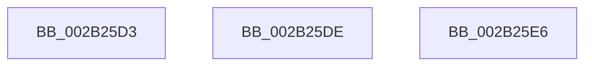

# sub_002B25D3

- RVA: `0x002B25D3`–`0x002B25F8` (길이 `37` bytes)
- VA: `0x00000001402B25D3`
- 실행 섹션: `.text`
- PDB 이름 있음: `아니요`; PDB Function 태그: `아니요`
- unwind 정보 RVA: `0x0006D71C`
- 디코드: `7`개 명령, `37/37` bytes 표시
- 미해석 바이트: `0` (있으면 어셈블리에 `.byte`로 보존)

> 이 문서는 커널 이미지의 기계어와 PDB 기호를 분석해 생성했습니다. 4번과 5번은 함수 원형과 자료형을 바이너리 사용 방식에서 추정한 C 해석이며 원본 소스 복구 결과는 아닙니다.

## 1. Dependencies

- 직접 호출 지점: **0**; 고유 호출 대상: **0**
- 직접 호출자로 확인된 함수: **0**
- RIP 상대 이미지 참조: **0**

### Outgoing calls
- 직접 디코드된 call 명령이 없습니다.

### Direct callers
- 이 함수 시작 RVA로 연결되는 직접 call은 확인되지 않았습니다. 간접 호출은 완전히 역산할 수 없습니다.

### Static image references
- 디코드된 RIP-relative 메모리 참조가 없습니다.

## 2. Other-region calls and transfers

- 다른 실행 섹션으로 향하는 call: **0**
- call이 아닌 외부 분기/꼬리 이동: **3**
  - `0x002B25D9` → [sub_002B21A1 + 0x177](Unknown_function_002B21A1.md) (`tail-transfer`)
  - `0x002B25E1` → [sub_002B21A1 + 0x335](Unknown_function_002B21A1.md) (`tail-transfer`)
  - `0x002B25F3` → [sub_002B21A1 + 0x387](Unknown_function_002B21A1.md) (`tail-transfer`)

## 3. Assembly (complete function range)

```asm
002B25D3  41 BC 09 00 00 00               mov r12d, 9
002B25D9  E9 3A FD FF FF                  jmp 0x1402b2318
002B25DE  49 0B D8                        or rbx, r8
002B25E1  E9 F0 FE FF FF                  jmp 0x1402b24d6
002B25E6  48 B8 00 00 00 00 00 00 00 80   movabs rax, 0x8000000000000000
002B25F0  48 0B F8                        or rdi, rax
002B25F3  E9 30 FF FF FF                  jmp 0x1402b2528
```

## 4. C-style interpretation (structured pseudocode)

```c
__int64 __fastcall sub_002B25D3(__int64 a1, __int64 a2, __int64 a3)
{
}
```

## 5. (Beta) C Style

```c
int64_t sub_002B25D3(int64_t Arg1, int64_t Arg2, int64_t Arg3)
{
}
```

## 6. Execution-region graph

[열기: 2D/3D 그래프와 함수 탐색 컨트롤 패널](../../../control-panel.html?section=text&rva=0x002B25D3&view=graph)

- 2D 그래프는 위에서 아래로 흐르고, 3D 그래프는 빈 공간을 드래그해 회전합니다. Shift+드래그는 이동, 휠은 확대·축소, 함수 노드 선택은 대상 보고서 이동입니다.

### Static fallback


