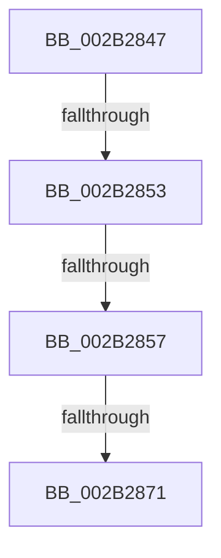

# sub_002B2847

- RVA: `0x002B2847`–`0x002B2894` (길이 `77` bytes)
- VA: `0x00000001402B2847`
- 실행 섹션: `.text`
- PDB 이름 있음: `아니요`; PDB Function 태그: `아니요`
- unwind 정보 RVA: `0x0006D764`
- 디코드: `21`개 명령, `77/77` bytes 표시
- 미해석 바이트: `0` (있으면 어셈블리에 `.byte`로 보존)

> 이 문서는 커널 이미지의 기계어와 PDB 기호를 분석해 생성했습니다. 4번과 5번은 함수 원형과 자료형을 바이너리 사용 방식에서 추정한 C 해석이며 원본 소스 복구 결과는 아닙니다.

## 1. Dependencies

- 직접 호출 지점: **2**; 고유 호출 대상: **2**
- 직접 호출자로 확인된 함수: **0**
- RIP 상대 이미지 참조: **0**

### Outgoing calls
- `0x002B285A` → [MiIsFreeZeroPfnCold](../31/MiIsFreeZeroPfnCold_function_0031E5E4.md) (function, `0x0031E5E4`)
- `0x002B2865` → [MI_READ_PTE_LOCK_FREE](../28/MI_READ_PTE_LOCK_FREE_function_002828A0.md) (function, `0x002828A0`)

### Direct callers
- 이 함수 시작 RVA로 연결되는 직접 call은 확인되지 않았습니다. 간접 호출은 완전히 역산할 수 없습니다.

### Static image references
- 디코드된 RIP-relative 메모리 참조가 없습니다.

## 2. Other-region calls and transfers

- 다른 실행 섹션으로 향하는 call: **0**
- call이 아닌 외부 분기/꼬리 이동: **4**
  - `0x002B2851` → [sub_002B2894 + 0x12](Unknown_function_002B2894.md) (`tail-transfer`)
  - `0x002B2855` → [sub_002B2894 + 0x12](Unknown_function_002B2894.md) (`tail-transfer`)
  - `0x002B286F` → [sub_002B2894](Unknown_function_002B2894.md) (`tail-transfer`)
  - `0x002B288F` → [MiCopyPfnEntryEx + 0x136](MiCopyPfnEntryEx_function_002B2670.md) (`tail-transfer`)

## 3. Assembly (complete function range)

```asm
002B2847  48 89 9C 24 D8 00 00 00         mov qword ptr [rsp + 0xd8], rbx
002B284F  A8 FA                           test al, 0xfa
002B2851  75 53                           jne 0x1402b28a6
002B2853  3C 04                           cmp al, 4
002B2855  74 4F                           je 0x1402b28a6
002B2857  48 8B CE                        mov rcx, rsi
002B285A  E8 85 BD 06 00                  call 0x14031e5e4
002B285F  8B D8                           mov ebx, eax
002B2861  48 8D 4D C7                     lea rcx, [rbp - 0x39]
002B2865  E8 36 00 FD FF                  call 0x1402828a0
002B286A  48 0F BA E0 0A                  bt rax, 0xa
002B286F  72 23                           jb 0x1402b2894
002B2871  F7 DB                           neg ebx
002B2873  48 1B C9                        sbb rcx, rcx
002B2876  83 E1 08                        and ecx, 8
002B2879  48 83 E0 F7                     and rax, 0xfffffffffffffff7
002B287D  48 8B 9C 24 D8 00 00 00         mov rbx, qword ptr [rsp + 0xd8]
002B2885  48 0B C8                        or rcx, rax
002B2888  48 8D 45 C7                     lea rax, [rbp - 0x39]
002B288C  48 89 08                        mov qword ptr [rax], rcx
002B288F  E9 12 FF FF FF                  jmp 0x1402b27a6
```

## 4. C-style interpretation (structured pseudocode)

```c
__int64 __fastcall sub_002B2847(__int64 a1, __int64 a2, __int64 a3, __int64 a4, __int64 a5, __int64 a6, __int64 a7, __int64 a8, __int64 a9, __int64 a10, __int64 a11, __int64 a12, __int64 a13, __int64 a14, __int64 a15, __int64 a16, __int64 a17, __int64 a18, __int64 a19, __int64 a20, __int64 a21, __int64 a22, __int64 a23, __int64 a24, __int64 a25, __int64 a26, __int64 a27)
{
    __int64 result;
    __int64 v_rbx;
    unsigned __int64 v_stack_pD8;

    v_stack_pD8 = v_rbx;
    result = MiIsFreeZeroPfnCold(v_rsi, a2, a3, a4);
    result = MI_READ_PTE_LOCK_FREE(v_rbp - 57, a2, a3, a4);
    v_rbx = (unsigned int)(-((unsigned int)((unsigned int)(result))));
    a1 = (unsigned int)((v_rbp - 57) & (8));
    result = (result) & (-9);
    a1 = (a1) | (result);
    *(unsigned __int64 *)(v_rbp - 57) = a1;
}
```

## 5. (Beta) C Style

```c
int64_t sub_002B2847(int64_t Arg1, int64_t Arg2, int64_t Arg3, int64_t Arg4, uint64_t Arg5, uint64_t Arg6, uint64_t Arg7, uint64_t Arg8, uint64_t Arg9, uint64_t Arg10, uint64_t Arg11, uint64_t Arg12, uint64_t Arg13, uint64_t Arg14, uint64_t Arg15, uint64_t Arg16, uint64_t Arg17, uint64_t Arg18, uint64_t Arg19, uint64_t Arg20, uint64_t Arg21, uint64_t Arg22, uint64_t Arg23, uint64_t Arg24, uint64_t Arg25, uint64_t Arg26, int64_t Arg27)
{
    int64_t result;
    int64_t local_rbx;
    uint64_t v_stack_pD8;

    v_stack_pD8 = local_rbx;
    result = MiIsFreeZeroPfnCold(local_rsi, Arg2, Arg3, Arg4);
    result = MI_READ_PTE_LOCK_FREE(local_rbp - 57, Arg2, Arg3, Arg4);
    local_rbx = (uint32_t)(-((uint32_t)((uint32_t)(result))));
    Arg1 = (uint32_t)((local_rbp - 57) & (8));
    result = (result) & (-9);
    Arg1 = (Arg1) | (result);
    *(uint64_t *)(local_rbp - 0x39) = Arg1;
}
```

## 6. Execution-region graph

[열기: 2D/3D 그래프와 함수 탐색 컨트롤 패널](../../../control-panel.html?section=text&rva=0x002B2847&view=graph)

- 2D 그래프는 위에서 아래로 흐르고, 3D 그래프는 빈 공간을 드래그해 회전합니다. Shift+드래그는 이동, 휠은 확대·축소, 함수 노드 선택은 대상 보고서 이동입니다.

### Static fallback


