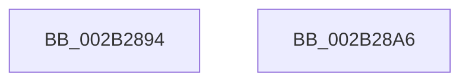

# sub_002B2894

- RVA: `0x002B2894`–`0x002B28C9` (길이 `53` bytes)
- VA: `0x00000001402B2894`
- 실행 섹션: `.text`
- PDB 이름 있음: `아니요`; PDB Function 태그: `아니요`
- unwind 정보 RVA: `0x0006D778`
- 디코드: `15`개 명령, `53/53` bytes 표시
- 미해석 바이트: `0` (있으면 어셈블리에 `.byte`로 보존)

> 이 문서는 커널 이미지의 기계어와 PDB 기호를 분석해 생성했습니다. 4번과 5번은 함수 원형과 자료형을 바이너리 사용 방식에서 추정한 C 해석이며 원본 소스 복구 결과는 아닙니다.

## 1. Dependencies

- 직접 호출 지점: **0**; 고유 호출 대상: **0**
- 직접 호출자로 확인된 함수: **0**
- RIP 상대 이미지 참조: **0**

### Outgoing calls
- 직접 디코드된 call 명령이 없습니다.

### Direct callers
- 이 함수 시작 RVA로 연결되는 직접 call은 확인되지 않았습니다. 간접 호출은 완전히 역산할 수 없습니다.

### Static image references
- 디코드된 RIP-relative 메모리 참조가 없습니다.

## 2. Other-region calls and transfers

- 다른 실행 섹션으로 향하는 call: **0**
- call이 아닌 외부 분기/꼬리 이동: **2**
  - `0x002B28A4` → [sub_002B2847 + 0x36](Unknown_function_002B2847.md) (`tail-transfer`)
  - `0x002B28C7` → [sub_002B2847 + 0x1A](Unknown_function_002B2847.md) (`tail-transfer`)

## 3. Assembly (complete function range)

```asm
002B2894  F7 DB                           neg ebx
002B2896  48 1B C9                        sbb rcx, rcx
002B2899  81 E1 00 08 00 00               and ecx, 0x800
002B289F  48 0F BA F0 0B                  btr rax, 0xb
002B28A4  EB D7                           jmp 0x1402b287d
002B28A6  48 8B 5E 10                     mov rbx, qword ptr [rsi + 0x10]
002B28AA  48 8B CB                        mov rcx, rbx
002B28AD  48 8B C3                        mov rax, rbx
002B28B0  48 C1 E8 0B                     shr rax, 0xb
002B28B4  81 E1 00 04 00 00               and ecx, 0x400
002B28BA  48 C1 EB 03                     shr rbx, 3
002B28BE  48 85 C9                        test rcx, rcx
002B28C1  0F 45 D8                        cmovne ebx, eax
002B28C4  83 E3 01                        and ebx, 1
002B28C7  EB 98                           jmp 0x1402b2861
```

## 4. C-style interpretation (structured pseudocode)

```c
__int64 __fastcall sub_002B2894(__int64 a1)
{
    __int64 v_rbx;

    v_rbx = (unsigned int)(-(v_rbx));
    a1 = (unsigned int)((a1) & (0x800ULL));
}
```

## 5. (Beta) C Style

```c
int64_t sub_002B2894(int64_t Arg1)
{
    int64_t local_rbx;

    local_rbx = (uint32_t)(-(local_rbx));
    Arg1 = (uint32_t)((Arg1) & (0x800ULL));
}
```

## 6. Execution-region graph

[열기: 2D/3D 그래프와 함수 탐색 컨트롤 패널](../../../control-panel.html?section=text&rva=0x002B2894&view=graph)

- 2D 그래프는 위에서 아래로 흐르고, 3D 그래프는 빈 공간을 드래그해 회전합니다. Shift+드래그는 이동, 휠은 확대·축소, 함수 노드 선택은 대상 보고서 이동입니다.

### Static fallback


