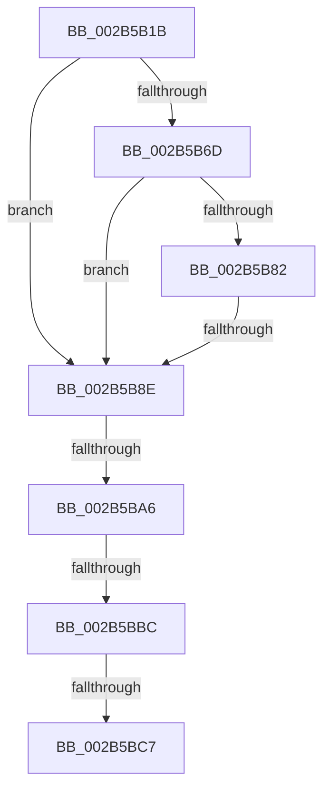

# sub_002B5B1B

- RVA: `0x002B5B1B`–`0x002B5BF4` (길이 `217` bytes)
- VA: `0x00000001402B5B1B`
- 실행 섹션: `.text`
- PDB 이름 있음: `아니요`; PDB Function 태그: `아니요`
- unwind 정보 RVA: `0x0006D8A4`
- 디코드: `46`개 명령, `217/217` bytes 표시
- 미해석 바이트: `0` (있으면 어셈블리에 `.byte`로 보존)

> 이 문서는 커널 이미지의 기계어와 PDB 기호를 분석해 생성했습니다. 4번과 5번은 함수 원형과 자료형을 바이너리 사용 방식에서 추정한 C 해석이며 원본 소스 복구 결과는 아닙니다.

## 1. Dependencies

- 직접 호출 지점: **3**; 고유 호출 대상: **3**
- 직접 호출자로 확인된 함수: **0**
- RIP 상대 이미지 참조: **0**

### Outgoing calls
- `0x002B5B47` → [MiComputeFaultNode](MiComputeFaultNode_function_002B60C0.md) (function, `0x002B60C0`)
- `0x002B5B95` → [MI_READ_PTE_LOCK_FREE](../28/MI_READ_PTE_LOCK_FREE_function_002828A0.md) (function, `0x002828A0`)
- `0x002B5BD7` → [MiResolvePrivateZeroFault](../32/MiResolvePrivateZeroFault_function_0032F760.md) (function, `0x0032F760`)

### Direct callers
- 이 함수 시작 RVA로 연결되는 직접 call은 확인되지 않았습니다. 간접 호출은 완전히 역산할 수 없습니다.

### Static image references
- 디코드된 RIP-relative 메모리 참조가 없습니다.

## 2. Other-region calls and transfers

- 다른 실행 섹션으로 향하는 call: **0**
- call이 아닌 외부 분기/꼬리 이동: **4**
  - `0x002B5B88` → [sub_002B5C0F](Unknown_function_002B5C0F.md) (`tail-transfer`)
  - `0x002B5BA0` → [sub_002B5C0F + 0x3B](Unknown_function_002B5C0F.md) (`tail-transfer`)
  - `0x002B5BB6` → [sub_002B5C0F + 0xD7](Unknown_function_002B5C0F.md) (`tail-transfer`)
  - `0x002B5BC1` → [sub_002B5C0F + 0xE4](Unknown_function_002B5C0F.md) (`tail-transfer`)

## 3. Assembly (complete function range)

```asm
002B5B1B  4C 89 AC 24 78 01 00 00         mov qword ptr [rsp + 0x178], r13
002B5B23  33 D2                           xor edx, edx
002B5B25  4C 89 B4 24 70 01 00 00         mov qword ptr [rsp + 0x170], r14
002B5B2D  48 8B CF                        mov rcx, rdi
002B5B30  4C 89 BC 24 68 01 00 00         mov qword ptr [rsp + 0x168], r15
002B5B38  4C 8B A8 B8 00 00 00            mov r13, qword ptr [rax + 0xb8]
002B5B3F  4C 8B 3F                        mov r15, qword ptr [rdi]
002B5B42  48 89 5C 24 48                  mov qword ptr [rsp + 0x48], rbx
002B5B47  E8 74 05 00 00                  call 0x1402b60c0
002B5B4C  4C 8B 74 24 48                  mov r14, qword ptr [rsp + 0x48]
002B5B51  89 45 90                        mov dword ptr [rbp - 0x70], eax
002B5B54  4C 89 7C 24 70                  mov qword ptr [rsp + 0x70], r15
002B5B59  48 89 7C 24 68                  mov qword ptr [rsp + 0x68], rdi
002B5B5E  48 BA 00 00 00 00 80 F6 FF FF   movabs rdx, 0xfffff68000000000
002B5B68  4D 85 F6                        test r14, r14
002B5B6B  75 21                           jne 0x1402b5b8e
002B5B6D  48 8B C2                        mov rax, rdx
002B5B70  48 B9 78 FF FF FF 3F 00 00 00   movabs rcx, 0x3fffffff78
002B5B7A  48 03 C1                        add rax, rcx
002B5B7D  48 3B F0                        cmp rsi, rax
002B5B80  77 0C                           ja 0x1402b5b8e
002B5B82  48 8B C2                        mov rax, rdx
002B5B85  48 3B F0                        cmp rsi, rax
002B5B88  0F 83 81 00 00 00               jae 0x1402b5c0f
002B5B8E  48 8B CE                        mov rcx, rsi
002B5B91  4C 89 75 A0                     mov qword ptr [rbp - 0x60], r14
002B5B95  E8 06 CD FC FF                  call 0x1402828a0
002B5B9A  4C 8B E8                        mov r13, rax
002B5B9D  4D 85 E4                        test r12, r12
002B5BA0  0F 85 A4 00 00 00               jne 0x1402b5c4a
002B5BA6  48 8B C8                        mov rcx, rax
002B5BA9  48 8B 47 10                     mov rax, qword ptr [rdi + 0x10]
002B5BAD  48 C1 E9 05                     shr rcx, 5
002B5BB1  83 E1 1F                        and ecx, 0x1f
002B5BB4  A8 01                           test al, 1
002B5BB6  0F 85 2A 01 00 00               jne 0x1402b5ce6
002B5BBC  49 0F BA E5 0A                  bt r13, 0xa
002B5BC1  0F 82 2C 01 00 00               jb 0x1402b5cf3
002B5BC7  89 4D 80                        mov dword ptr [rbp - 0x80], ecx
002B5BCA  89 4D 84                        mov dword ptr [rbp - 0x7c], ecx
002B5BCD  48 8D 4C 24 60                  lea rcx, [rsp + 0x60]
002B5BD2  48 89 5C 24 78                  mov qword ptr [rsp + 0x78], rbx
002B5BD7  E8 84 9B 07 00                  call 0x14032f760
002B5BDC  4C 8B B4 24 70 01 00 00         mov r14, qword ptr [rsp + 0x170]
002B5BE4  4C 8B AC 24 78 01 00 00         mov r13, qword ptr [rsp + 0x178]
002B5BEC  4C 8B BC 24 68 01 00 00         mov r15, qword ptr [rsp + 0x168]
```

## 4. C-style interpretation (structured pseudocode)

```c
__int64 __fastcall sub_002B5B1B(__int64 a1, int a2, __int64 a3, __int64 a4, __int64 a5, __int64 a6, __int64 a7, __int64 a8, __int64 a9, __int64 a10, __int64 a11, __int64 a12, __int64 a13, __int64 a14, __int64 a15, __int64 a16, __int64 a17, __int64 a18, __int64 a19, __int64 a20, __int64 a21, __int64 a22, __int64 a23, __int64 a24, __int64 a25, __int64 a26, __int64 a27, __int64 a28, __int64 a29, __int64 a30, __int64 a31, __int64 a32, __int64 a33, __int64 a34, __int64 a35, __int64 a36, __int64 a37, __int64 a38, __int64 a39, __int64 a40, __int64 a41, __int64 a42, __int64 a43, __int64 a44, __int64 a45, __int64 a46, __int64 a47)
{
    __int64 result;
    unsigned __int64 v_stack_p168;
    unsigned __int64 v_stack_p170;
    unsigned __int64 v_stack_p178;
    unsigned __int64 v_stack_p48;
    unsigned __int64 v_stack_p68;
    unsigned __int64 v_stack_p70;
    unsigned __int64 v_stack_p78;

    v_stack_p178 = v_r13;
    a2 = 0;
    v_stack_p170 = v_r14;
    v_stack_p168 = v_r15;
    v_stack_p48 = v_rbx;
    result = MiComputeFaultNode(v_rdi, a2, a3, a4);
    *(unsigned int *)(v_rbp - 112) = (unsigned int)(result);
    v_stack_p70 = *(unsigned __int64 *)(v_rdi);
    v_stack_p68 = v_rdi;
    if (a9 != 0) goto loc_002B5B8E;
    result = (0) + (v_rdi);
    if (v_rsi > result) goto loc_002B5B8E;
loc_002B5B8E:
    *(unsigned __int64 *)(v_rbp - 96) = a9;
    result = MI_READ_PTE_LOCK_FREE(v_rsi, a2, a3, a4);
    a1 = (result) >> (5);
    a1 = (unsigned int)((a1) & (31));
    *(unsigned int *)(v_rbp - 128) = (unsigned int)(a1);
    *(unsigned int *)(v_rbp - 124) = (unsigned int)(a1);
    v_stack_p78 = v_rbx;
    result = MiResolvePrivateZeroFault(a12, a2, a3, a4);
    return result;
}
```

## 5. (Beta) C Style

```c
int64_t sub_002B5B1B(int64_t Arg1, int32_t Arg2, int64_t Arg3, int64_t Arg4, uint64_t Arg5, uint64_t Arg6, uint64_t Arg7, uint64_t Arg8, int64_t Arg9, uint64_t Arg10, uint64_t Arg11, int64_t Arg12, uint64_t Arg13, uint64_t Arg14, uint64_t Arg15, uint64_t Arg16, uint64_t Arg17, uint64_t Arg18, uint64_t Arg19, uint64_t Arg20, uint64_t Arg21, uint64_t Arg22, uint64_t Arg23, uint64_t Arg24, uint64_t Arg25, uint64_t Arg26, uint64_t Arg27, uint64_t Arg28, uint64_t Arg29, uint64_t Arg30, uint64_t Arg31, uint64_t Arg32, uint64_t Arg33, uint64_t Arg34, uint64_t Arg35, uint64_t Arg36, uint64_t Arg37, uint64_t Arg38, uint64_t Arg39, uint64_t Arg40, uint64_t Arg41, uint64_t Arg42, uint64_t Arg43, uint64_t Arg44, int64_t Arg45, int64_t Arg46, int64_t Arg47)
{
    int64_t result;
    uint64_t v_stack_p168;
    uint64_t v_stack_p170;
    uint64_t v_stack_p178;
    uint64_t v_stack_p48;
    uint64_t v_stack_p68;
    uint64_t v_stack_p70;
    uint64_t v_stack_p78;

    v_stack_p178 = local_r13;
    Arg2 = 0;
    v_stack_p170 = local_r14;
    v_stack_p168 = local_r15;
    v_stack_p48 = local_rbx;
    result = MiComputeFaultNode(local_rdi, Arg2, Arg3, Arg4);
    *(uint32_t *)(local_rbp - 0x70) = (uint32_t)(result);
    v_stack_p70 = *(uint64_t *)(local_rdi);
    v_stack_p68 = local_rdi;
    if (Arg9 != 0) goto loc_002B5B8E;
    result = (0) + (local_rdi);
    if (local_rsi > result) goto loc_002B5B8E;
loc_002B5B8E:
    *(uint64_t *)(local_rbp - 0x60) = Arg9;
    result = MI_READ_PTE_LOCK_FREE(local_rsi, Arg2, Arg3, Arg4);
    Arg1 = (result) >> (5);
    Arg1 = (uint32_t)((Arg1) & (31));
    *(uint32_t *)(local_rbp - 0x80) = (uint32_t)(Arg1);
    *(uint32_t *)(local_rbp - 0x7C) = (uint32_t)(Arg1);
    v_stack_p78 = local_rbx;
    result = MiResolvePrivateZeroFault(Arg12, Arg2, Arg3, Arg4);
    return result;
}
```

## 6. Execution-region graph

[열기: 2D/3D 그래프와 함수 탐색 컨트롤 패널](../../../control-panel.html?section=text&rva=0x002B5B1B&view=graph)

- 2D 그래프는 위에서 아래로 흐르고, 3D 그래프는 빈 공간을 드래그해 회전합니다. Shift+드래그는 이동, 휠은 확대·축소, 함수 노드 선택은 대상 보고서 이동입니다.

### Static fallback


