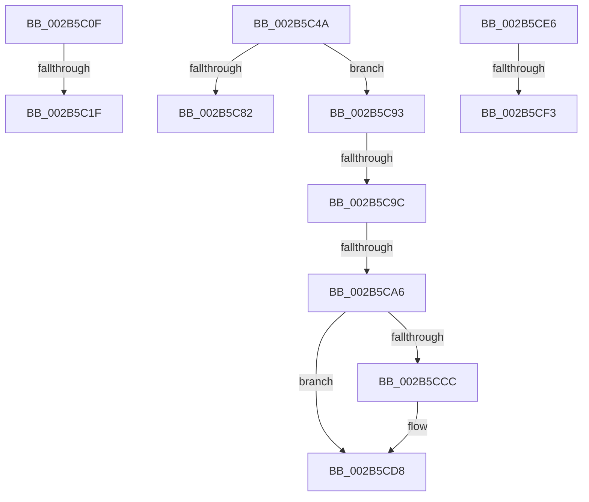

# sub_002B5C0F

- RVA: `0x002B5C0F`–`0x002B5CFD` (길이 `238` bytes)
- VA: `0x00000001402B5C0F`
- 실행 섹션: `.text`
- PDB 이름 있음: `아니요`; PDB Function 태그: `아니요`
- unwind 정보 RVA: `0x0006D8D4`
- 디코드: `58`개 명령, `238/238` bytes 표시
- 미해석 바이트: `0` (있으면 어셈블리에 `.byte`로 보존)

> 이 문서는 커널 이미지의 기계어와 PDB 기호를 분석해 생성했습니다. 4번과 5번은 함수 원형과 자료형을 바이너리 사용 방식에서 추정한 C 해석이며 원본 소스 복구 결과는 아닙니다.

## 1. Dependencies

- 직접 호출 지점: **7**; 고유 호출 대상: **6**
- 직접 호출자로 확인된 함수: **0**
- RIP 상대 이미지 참조: **0**

### Outgoing calls
- `0x002B5C12` → [MiIsStoreProcess](MiIsStoreProcess_function_002B62E0.md) (function, `0x002B62E0`)
- `0x002B5C24` → [MiLockVadTree](../27/MiLockVadTree_function_0027C0F0.md) (function, `0x0027C0F0`)
- `0x002B5C2C` → [MiLocateAddress](../31/MiLocateAddress_function_003168D0.md) (function, `0x003168D0`)
- `0x002B5C40` → [MiUnlockVadTree](../29/MiUnlockVadTree_function_00297020.md) (function, `0x00297020`)
- `0x002B5C87` → [MiUnlockProtoPoolPage](../24/MiUnlockProtoPoolPage_function_00246090.md) (function, `0x00246090`)
- `0x002B5CB8` → [MiCheckVirtualAddress](../32/MiCheckVirtualAddress_function_0032E4F0.md) (function, `0x0032E4F0`)
- `0x002B5CD3` → [MiUnlockVadTree](../29/MiUnlockVadTree_function_00297020.md) (function, `0x00297020`)

### Direct callers
- 이 함수 시작 RVA로 연결되는 직접 call은 확인되지 않았습니다. 간접 호출은 완전히 역산할 수 없습니다.

### Static image references
- 디코드된 RIP-relative 메모리 참조가 없습니다.

## 2. Other-region calls and transfers

- 다른 실행 섹션으로 향하는 call: **0**
- call이 아닌 외부 분기/꼬리 이동: **8**
  - `0x002B5C19` → [sub_002B5B1B + 0x73](Unknown_function_002B5B1B.md) (`tail-transfer`)
  - `0x002B5C45` → [sub_002B5B1B + 0x73](Unknown_function_002B5B1B.md) (`tail-transfer`)
  - `0x002B5C8E` → [sub_002B5B1B + 0xC1](Unknown_function_002B5B1B.md) (`tail-transfer`)
  - `0x002B5C96` → [sub_002B5D4A](Unknown_function_002B5D4A.md) (`tail-transfer`)
  - `0x002B5CA0` → [sub_002B5D4A](Unknown_function_002B5D4A.md) (`tail-transfer`)
  - `0x002B5CE4` → [sub_002B5D4A + 0x9](Unknown_function_002B5D4A.md) (`tail-transfer`)
  - `0x002B5CED` → [sub_002B5B1B + 0xA1](Unknown_function_002B5B1B.md) (`tail-transfer`)
  - `0x002B5CF8` → [sub_002B5B1B + 0xAC](Unknown_function_002B5B1B.md) (`tail-transfer`)

## 3. Assembly (complete function range)

```asm
002B5C0F  49 8B CD                        mov rcx, r13
002B5C12  E8 C9 06 00 00                  call 0x1402b62e0
002B5C17  85 C0                           test eax, eax
002B5C19  0F 84 6F FF FF FF               je 0x1402b5b8e
002B5C1F  B9 01 00 00 00                  mov ecx, 1
002B5C24  E8 C7 64 FC FF                  call 0x14027c0f0
002B5C29  49 8B CF                        mov rcx, r15
002B5C2C  E8 9F 0C 06 00                  call 0x1403168d0
002B5C31  B2 11                           mov dl, 0x11
002B5C33  48 89 44 24 48                  mov qword ptr [rsp + 0x48], rax
002B5C38  B9 01 00 00 00                  mov ecx, 1
002B5C3D  4C 8B F0                        mov r14, rax
002B5C40  E8 DB 13 FE FF                  call 0x140297020
002B5C45  E9 44 FF FF FF                  jmp 0x1402b5b8e
002B5C4A  48 8B 45 98                     mov rax, qword ptr [rbp - 0x68]
002B5C4E  8B 4C 24 60                     mov ecx, dword ptr [rsp + 0x60]
002B5C52  48 89 45 B0                     mov qword ptr [rbp - 0x50], rax
002B5C56  B8 18 00 00 00                  mov eax, 0x18
002B5C5B  89 44 24 38                     mov dword ptr [rsp + 0x38], eax
002B5C5F  89 44 24 34                     mov dword ptr [rsp + 0x34], eax
002B5C63  8B C1                           mov eax, ecx
002B5C65  24 0E                           and al, 0xe
002B5C67  48 89 74 24 78                  mov qword ptr [rsp + 0x78], rsi
002B5C6C  48 C7 44 24 50 01 00 00 00      mov qword ptr [rsp + 0x50], 1
002B5C75  48 89 5C 24 40                  mov qword ptr [rsp + 0x40], rbx
002B5C7A  88 5C 24 30                     mov byte ptr [rsp + 0x30], bl
002B5C7E  3C 02                           cmp al, 2
002B5C80  75 11                           jne 0x1402b5c93
002B5C82  B2 11                           mov dl, 0x11
002B5C84  49 8B CC                        mov rcx, r12
002B5C87  E8 04 04 F9 FF                  call 0x140246090
002B5C8C  33 C0                           xor eax, eax
002B5C8E  E9 49 FF FF FF                  jmp 0x1402b5bdc
002B5C93  F6 C1 43                        test cl, 0x43
002B5C96  0F 84 AE 00 00 00               je 0x1402b5d4a
002B5C9C  0F BA E1 08                     bt ecx, 8
002B5CA0  0F 83 A4 00 00 00               jae 0x1402b5d4a
002B5CA6  4C 8D 44 24 48                  lea r8, [rsp + 0x48]
002B5CAB  C6 44 24 30 01                  mov byte ptr [rsp + 0x30], 1
002B5CB0  48 8D 54 24 34                  lea rdx, [rsp + 0x34]
002B5CB5  49 8B CF                        mov rcx, r15
002B5CB8  E8 33 88 07 00                  call 0x14032e4f0
002B5CBD  4C 8B 74 24 48                  mov r14, qword ptr [rsp + 0x48]
002B5CC2  48 89 44 24 40                  mov qword ptr [rsp + 0x40], rax
002B5CC7  4D 85 F6                        test r14, r14
002B5CCA  74 0C                           je 0x1402b5cd8
002B5CCC  B2 11                           mov dl, 0x11
002B5CCE  B9 01 00 00 00                  mov ecx, 1
002B5CD3  E8 48 13 FE FF                  call 0x140297020
002B5CD8  8B 4C 24 34                     mov ecx, dword ptr [rsp + 0x34]
002B5CDC  89 4C 24 38                     mov dword ptr [rsp + 0x38], ecx
002B5CE0  8B 4C 24 60                     mov ecx, dword ptr [rsp + 0x60]
002B5CE4  EB 6D                           jmp 0x1402b5d53
002B5CE6  48 83 E0 FE                     and rax, 0xfffffffffffffffe
002B5CEA  80 38 04                        cmp byte ptr [rax], 4
002B5CED  0F 85 C9 FE FF FF               jne 0x1402b5bbc
002B5CF3  B9 04 00 00 00                  mov ecx, 4
002B5CF8  E9 CA FE FF FF                  jmp 0x1402b5bc7
```

## 4. C-style interpretation (structured pseudocode)

```c
__int64 __fastcall sub_002B5C0F(void)
{
    __int64 result;
    unsigned __int8 v_stack_p30;
    unsigned int v_stack_p34;
    unsigned int v_stack_p38;
    unsigned __int64 v_stack_p40;
    unsigned __int64 v_stack_p48;
    unsigned __int64 v_stack_p50;
    unsigned int v_stack_p60;
    unsigned __int64 v_stack_p78;

    result = MiIsStoreProcess(v_r13, a2, a3, a4);
    result = MiLockVadTree(1, a2, a3, a4);
    result = MiLocateAddress(v_r15, a2, a3, a4);
    v_stack_p48 = result;
    result = MiUnlockVadTree(1, 17, a3, a4);
}
```

## 5. (Beta) C Style

```c
void sub_002B5C0F(void)
{
    int64_t result;
    uint8_t v_stack_p30;
    uint32_t v_stack_p34;
    uint32_t v_stack_p38;
    uint64_t v_stack_p40;
    uint64_t v_stack_p48;
    uint64_t v_stack_p50;
    uint32_t v_stack_p60;
    uint64_t v_stack_p78;

    result = MiIsStoreProcess(local_r13, a2, a3, a4);
    result = MiLockVadTree(1, a2, a3, a4);
    result = MiLocateAddress(local_r15, a2, a3, a4);
    v_stack_p48 = result;
    result = MiUnlockVadTree(1, 17, a3, a4);
}
```

## 6. Execution-region graph

[열기: 2D/3D 그래프와 함수 탐색 컨트롤 패널](../../../control-panel.html?section=text&rva=0x002B5C0F&view=graph)

- 2D 그래프는 위에서 아래로 흐르고, 3D 그래프는 빈 공간을 드래그해 회전합니다. Shift+드래그는 이동, 휠은 확대·축소, 함수 노드 선택은 대상 보고서 이동입니다.

### Static fallback


