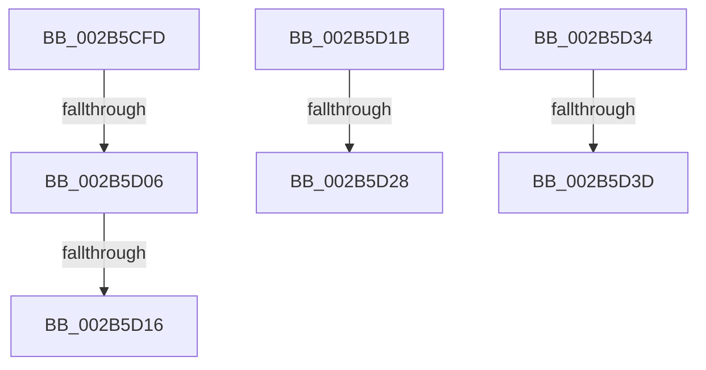

# sub_002B5CFD

- RVA: `0x002B5CFD`–`0x002B5D4A` (길이 `77` bytes)
- VA: `0x00000001402B5CFD`
- 실행 섹션: `.text`
- PDB 이름 있음: `아니요`; PDB Function 태그: `아니요`
- unwind 정보 RVA: `0x0006D8F0`
- 디코드: `18`개 명령, `77/77` bytes 표시
- 미해석 바이트: `0` (있으면 어셈블리에 `.byte`로 보존)

> 이 문서는 커널 이미지의 기계어와 PDB 기호를 분석해 생성했습니다. 4번과 5번은 함수 원형과 자료형을 바이너리 사용 방식에서 추정한 C 해석이며 원본 소스 복구 결과는 아닙니다.

## 1. Dependencies

- 직접 호출 지점: **0**; 고유 호출 대상: **0**
- 직접 호출자로 확인된 함수: **0**
- RIP 상대 이미지 참조: **0**

### Outgoing calls
- 직접 디코드된 call 명령이 없습니다.

### Direct callers
- 이 함수 시작 RVA로 연결되는 직접 call은 확인되지 않았습니다. 간접 호출은 완전히 역산할 수 없습니다.

### Static image references
- 디코드된 RIP-relative 메모리 참조가 없습니다.

## 2. Other-region calls and transfers

- 다른 실행 섹션으로 향하는 call: **0**
- call이 아닌 외부 분기/꼬리 이동: **7**
  - `0x002B5D00` → [sub_002B5F67 + 0x1B](Unknown_function_002B5F67.md) (`tail-transfer`)
  - `0x002B5D10` → [MiResolveDemandZeroFault + 0x8D](MiResolveDemandZeroFault_function_002B5A40.md) (`tail-transfer`)
  - `0x002B5D16` → [MiResolveDemandZeroFault + 0x84](MiResolveDemandZeroFault_function_002B5A40.md) (`tail-transfer`)
  - `0x002B5D22` → [sub_002B5F67](Unknown_function_002B5F67.md) (`tail-transfer`)
  - `0x002B5D2F` → [MiResolveDemandZeroFault + 0xA2](MiResolveDemandZeroFault_function_002B5A40.md) (`tail-transfer`)
  - `0x002B5D37` → [MiResolveDemandZeroFault + 0x99](MiResolveDemandZeroFault_function_002B5A40.md) (`tail-transfer`)
  - `0x002B5D45` → [MiResolveDemandZeroFault + 0x99](MiResolveDemandZeroFault_function_002B5A40.md) (`tail-transfer`)

## 3. Assembly (complete function range)

```asm
002B5CFD  80 3A 02                        cmp byte ptr [rdx], 2
002B5D00  0F 85 7C 02 00 00               jne 0x1402b5f82
002B5D06  83 C9 01                        or ecx, 1
002B5D09  89 4C 24 60                     mov dword ptr [rsp + 0x60], ecx
002B5D0D  80 3A 04                        cmp byte ptr [rdx], 4
002B5D10  0F 84 B7 FD FF FF               je 0x1402b5acd
002B5D16  E9 A9 FD FF FF                  jmp 0x1402b5ac4
002B5D1B  8B 42 50                        mov eax, dword ptr [rdx + 0x50]
002B5D1E  0F BA E0 12                     bt eax, 0x12
002B5D22  0F 83 3F 02 00 00               jae 0x1402b5f67
002B5D28  83 C9 08                        or ecx, 8
002B5D2B  89 4C 24 60                     mov dword ptr [rsp + 0x60], ecx
002B5D2F  E9 AE FD FF FF                  jmp 0x1402b5ae2
002B5D34  80 3A 04                        cmp byte ptr [rdx], 4
002B5D37  0F 85 9C FD FF FF               jne 0x1402b5ad9
002B5D3D  48 8B 42 30                     mov rax, qword ptr [rdx + 0x30]
002B5D41  48 89 45 A8                     mov qword ptr [rbp - 0x58], rax
002B5D45  E9 8F FD FF FF                  jmp 0x1402b5ad9
```

## 4. C-style interpretation (structured pseudocode)

```c
__int64 __fastcall sub_002B5CFD(int a1, __int64 a2)
{
    unsigned int v_stack_p60;

    a1 = (unsigned int)((a1) | (1));
    v_stack_p60 = a1;
}
```

## 5. (Beta) C Style

```c
int64_t sub_002B5CFD(int32_t Arg1, void *Arg2)
{
    uint8_t *arg2 = (uint8_t *)Arg2;

    uint32_t v_stack_p60;

    Arg1 = (uint32_t)((Arg1) | (1));
    v_stack_p60 = Arg1;
}
```

### 관측된 메모리 오프셋

구조체 형식이 확인되지 않은 접근은 인자 기준의 오프셋으로만 기록했습니다.

| 기준 인자 | 오프셋 표현 | 폭 (bit) | 접근 |
|---|---:|---:|---|
| `Arg2` | `+ 0x0` | `8` | `R` |

## 6. Execution-region graph

[열기: 2D/3D 그래프와 함수 탐색 컨트롤 패널](../../../control-panel.html?section=text&rva=0x002B5CFD&view=graph)

- 2D 그래프는 위에서 아래로 흐르고, 3D 그래프는 빈 공간을 드래그해 회전합니다. Shift+드래그는 이동, 휠은 확대·축소, 함수 노드 선택은 대상 보고서 이동입니다.

### Static fallback


