# sub_002B5D4A

- RVA: `0x002B5D4A`–`0x002B5F1B` (길이 `465` bytes)
- VA: `0x00000001402B5D4A`
- 실행 섹션: `.text`
- PDB 이름 있음: `아니요`; PDB Function 태그: `아니요`
- unwind 정보 RVA: `0x0006D900`
- 디코드: `114`개 명령, `465/465` bytes 표시
- 미해석 바이트: `0` (있으면 어셈블리에 `.byte`로 보존)

> 이 문서는 커널 이미지의 기계어와 PDB 기호를 분석해 생성했습니다. 4번과 5번은 함수 원형과 자료형을 바이너리 사용 방식에서 추정한 C 해석이며 원본 소스 복구 결과는 아닙니다.

## 1. Dependencies

- 직접 호출 지점: **4**; 고유 호출 대상: **4**
- 직접 호출자로 확인된 함수: **0**
- RIP 상대 이미지 참조: **0**

### Outgoing calls
- `0x002B5D87` → [MiCreateSharedZeroPages](MiCreateSharedZeroPages_function_002B6318.md) (function, `0x002B6318`)
- `0x002B5E1A` → [MiUnlockProtoPoolPage](../24/MiUnlockProtoPoolPage_function_00246090.md) (function, `0x00246090`)
- `0x002B5E75` → [MiCompleteProtoPteFault](../34/MiCompleteProtoPteFault_function_00345710.md) (function, `0x00345710`)
- `0x002B5F14` → [MiReturnPfnReferenceCountAtDpc](../36/MiReturnPfnReferenceCountAtDpc_function_00364010.md) (function, `0x00364010`)

### Direct callers
- 이 함수 시작 RVA로 연결되는 직접 call은 확인되지 않았습니다. 간접 호출은 완전히 역산할 수 없습니다.

### Static image references
- 디코드된 RIP-relative 메모리 참조가 없습니다.

## 2. Other-region calls and transfers

- 다른 실행 섹션으로 향하는 call: **0**
- call이 아닌 외부 분기/꼬리 이동: **9**
  - `0x002B5D4D` → [sub_002B5FA0 + 0xB8](Unknown_function_002B5FA0.md) (`tail-transfer`)
  - `0x002B5D60` → [sub_002B5FA0 + 0x3D](Unknown_function_002B5FA0.md) (`tail-transfer`)
  - `0x002B5D77` → [sub_002B5FA0](Unknown_function_002B5FA0.md) (`tail-transfer`)
  - `0x002B5D91` → [sub_002B5FA0 + 0xA6](Unknown_function_002B5FA0.md) (`tail-transfer`)
  - `0x002B5D9C` → [sub_002B5FA0 + 0xA6](Unknown_function_002B5FA0.md) (`tail-transfer`)
  - `0x002B5DCD` → [sub_002B5F52](Unknown_function_002B5F52.md) (`tail-transfer`)
  - `0x002B5EC4` → [sub_002B5B1B + 0xC1](Unknown_function_002B5B1B.md) (`tail-transfer`)
  - `0x002B5EDA` → [sub_002B5C0F + 0x73](Unknown_function_002B5C0F.md) (`tail-transfer`)
  - `0x002B5EE3` → [sub_002B5C0F + 0x73](Unknown_function_002B5C0F.md) (`tail-transfer`)

## 3. Assembly (complete function range)

```asm
002B5D4A  4D 85 F6                        test r14, r14
002B5D4D  0F 85 05 03 00 00               jne 0x1402b6058
002B5D53  8B 44 24 38                     mov eax, dword ptr [rsp + 0x38]
002B5D57  89 45 80                        mov dword ptr [rbp - 0x80], eax
002B5D5A  89 45 84                        mov dword ptr [rbp - 0x7c], eax
002B5D5D  F6 C1 08                        test cl, 8
002B5D60  0F 85 77 02 00 00               jne 0x1402b5fdd
002B5D66  F6 C1 04                        test cl, 4
002B5D69  8B 4C 24 38                     mov ecx, dword ptr [rsp + 0x38]
002B5D6D  0F 85 56 01 00 00               jne 0x1402b5ec9
002B5D73  38 5C 24 30                     cmp byte ptr [rsp + 0x30], bl
002B5D77  0F 85 23 02 00 00               jne 0x1402b5fa0
002B5D7D  48 8D 54 24 50                  lea rdx, [rsp + 0x50]
002B5D82  48 8D 4C 24 60                  lea rcx, [rsp + 0x60]
002B5D87  E8 8C 05 00 00                  call 0x1402b6318
002B5D8C  44 8B F0                        mov r14d, eax
002B5D8F  85 C0                           test eax, eax
002B5D91  0F 88 AF 02 00 00               js 0x1402b6046
002B5D97  F6 44 24 60 10                  test byte ptr [rsp + 0x60], 0x10
002B5D9C  0F 85 A4 02 00 00               jne 0x1402b6046
002B5DA2  48 8B 44 24 70                  mov rax, qword ptr [rsp + 0x70]
002B5DA7  8B D3                           mov edx, ebx
002B5DA9  4C 2B F8                        sub r15, rax
002B5DAC  48 89 44 24 40                  mov qword ptr [rsp + 0x40], rax
002B5DB1  49 C1 EF 0C                     shr r15, 0xc
002B5DB5  41 8B CF                        mov ecx, r15d
002B5DB8  48 F7 D9                        neg rcx
002B5DBB  4C 8D 04 CE                     lea r8, [rsi + rcx*8]
002B5DBF  48 8B 74 24 50                  mov rsi, qword ptr [rsp + 0x50]
002B5DC4  4C 89 44 24 38                  mov qword ptr [rsp + 0x38], r8
002B5DC9  48 83 FE 10                     cmp rsi, 0x10
002B5DCD  0F 83 7F 01 00 00               jae 0x1402b5f52
002B5DD3  45 32 FF                        xor r15b, r15b
002B5DD6  44 88 7C 24 30                  mov byte ptr [rsp + 0x30], r15b
002B5DDB  48 85 F6                        test rsi, rsi
002B5DDE  74 35                           je 0x1402b5e15
002B5DE0  49 BF FF FF FF FF FF 00 00 00   movabs r15, 0xffffffffff
002B5DEA  49 8B 00                        mov rax, qword ptr [r8]
002B5DED  49 83 C0 08                     add r8, 8
002B5DF1  48 C1 E8 0C                     shr rax, 0xc
002B5DF5  8B CA                           mov ecx, edx
002B5DF7  49 23 C7                        and rax, r15
002B5DFA  FF C2                           inc edx
002B5DFC  48 89 44 CD D0                  mov qword ptr [rbp + rcx*8 - 0x30], rax
002B5E01  48 83 EE 01                     sub rsi, 1
002B5E05  75 E3                           jne 0x1402b5dea
002B5E07  48 8B 74 24 50                  mov rsi, qword ptr [rsp + 0x50]
002B5E0C  44 0F B6 FB                     movzx r15d, bl
002B5E10  4C 89 44 24 38                  mov qword ptr [rsp + 0x38], r8
002B5E15  B2 11                           mov dl, 0x11
002B5E17  49 8B CC                        mov rcx, r12
002B5E1A  E8 71 02 F9 FF                  call 0x140246090
002B5E1F  F6 44 24 60 20                  test byte ptr [rsp + 0x60], 0x20
002B5E24  48 8B CB                        mov rcx, rbx
002B5E27  4C 8B 2F                        mov r13, qword ptr [rdi]
002B5E2A  48 0F 45 4D B0                  cmovne rcx, qword ptr [rbp - 0x50]
002B5E2F  48 89 4D B0                     mov qword ptr [rbp - 0x50], rcx
002B5E33  4C 89 6D C8                     mov qword ptr [rbp - 0x38], r13
002B5E37  48 85 F6                        test rsi, rsi
002B5E3A  74 75                           je 0x1402b5eb1
002B5E3C  4C 8B 7D B8                     mov r15, qword ptr [rbp - 0x48]
002B5E40  4C 8D 6D D0                     lea r13, [rbp - 0x30]
002B5E44  4C 8B 64 24 38                  mov r12, qword ptr [rsp + 0x38]
002B5E49  48 8B 44 24 40                  mov rax, qword ptr [rsp + 0x40]
002B5E4E  80 7C 24 30 00                  cmp byte ptr [rsp + 0x30], 0
002B5E53  0F 85 95 00 00 00               jne 0x1402b5eee
002B5E59  49 8B 55 00                     mov rdx, qword ptr [r13]
002B5E5D  49 83 C5 08                     add r13, 8
002B5E61  48 89 4C 24 20                  mov qword ptr [rsp + 0x20], rcx
002B5E66  41 B9 01 00 00 00               mov r9d, 1
002B5E6C  48 8B CF                        mov rcx, rdi
002B5E6F  48 89 07                        mov qword ptr [rdi], rax
002B5E72  4D 8B C7                        mov r8, r15
002B5E75  E8 96 F8 08 00                  call 0x140345710
002B5E7A  8B C8                           mov ecx, eax
002B5E7C  48 8B 44 24 40                  mov rax, qword ptr [rsp + 0x40]
002B5E81  48 05 00 10 00 00               add rax, 0x1000
002B5E87  48 89 44 24 40                  mov qword ptr [rsp + 0x40], rax
002B5E8C  48 85 DB                        test rbx, rbx
002B5E8F  75 06                           jne 0x1402b5e97
002B5E91  85 C9                           test ecx, ecx
002B5E93  44 0F 48 F1                     cmovs r14d, ecx
002B5E97  48 8B 4D B0                     mov rcx, qword ptr [rbp - 0x50]
002B5E9B  48 FF C3                        inc rbx
002B5E9E  48 3B DE                        cmp rbx, rsi
002B5EA1  72 AB                           jb 0x1402b5e4e
002B5EA3  4C 8B 65 C0                     mov r12, qword ptr [rbp - 0x40]
002B5EA7  44 0F B6 7C 24 30               movzx r15d, byte ptr [rsp + 0x30]
002B5EAD  4C 8B 6D C8                     mov r13, qword ptr [rbp - 0x38]
002B5EB1  45 84 FF                        test r15b, r15b
002B5EB4  75 5B                           jne 0x1402b5f11
002B5EB6  65 01 34 25 9C 2E 00 00         add dword ptr gs:[0x2e9c], esi
002B5EBE  41 8B C6                        mov eax, r14d
002B5EC1  4C 89 2F                        mov qword ptr [rdi], r13
002B5EC4  E9 13 FD FF FF                  jmp 0x1402b5bdc
002B5EC9  8B C1                           mov eax, ecx
002B5ECB  C1 E8 03                        shr eax, 3
002B5ECE  83 F8 01                        cmp eax, 1
002B5ED1  0F 84 9C FE FF FF               je 0x1402b5d73
002B5ED7  83 F8 03                        cmp eax, 3
002B5EDA  0F 85 A2 FD FF FF               jne 0x1402b5c82
002B5EE0  F6 C1 07                        test cl, 7
002B5EE3  0F 84 99 FD FF FF               je 0x1402b5c82
002B5EE9  E9 85 FE FF FF                  jmp 0x1402b5d73
002B5EEE  49 8B 14 24                     mov rdx, qword ptr [r12]
002B5EF2  49 B8 FF FF FF FF FF 00 00 00   movabs r8, 0xffffffffff
002B5EFC  48 8B 74 24 50                  mov rsi, qword ptr [rsp + 0x50]
002B5F01  48 C1 EA 0C                     shr rdx, 0xc
002B5F05  49 23 D0                        and rdx, r8
002B5F08  49 83 C4 08                     add r12, 8
002B5F0C  E9 50 FF FF FF                  jmp 0x1402b5e61
002B5F11  49 8B CC                        mov rcx, r12
002B5F14  E8 F7 E0 0A 00                  call 0x140364010
002B5F19  EB 9B                           jmp 0x1402b5eb6
```

## 4. C-style interpretation (structured pseudocode)

```c
__int64 __fastcall sub_002B5D4A(unsigned __int8 a1, __int64 a2, __int64 a3, __int64 a4, __int64 a5, unsigned __int8 a6, unsigned int a7, __int64 a8, __int64 a9, __int64 a10, __int64 a11, unsigned __int8 a12, __int64 a13, __int64 a14)
{
    __int64 result;
    __int64 v_r12;
    __int64 v_r13;
    __int64 v_r14;
    __int64 v_r15;
    __int64 v_rbx;
    __int64 v_rsi;
    unsigned __int64 v_stack_p20;
    unsigned __int8 v_stack_p30;
    unsigned __int64 v_stack_p38;
    unsigned __int64 v_stack_p40;

    *(unsigned int *)(v_rbp - 128) = (unsigned int)((unsigned int)(a7));
    *(unsigned int *)(v_rbp - 124) = (unsigned int)((unsigned int)(a7));
    if (((a1) & (4)) != 0) goto loc_002B5EC9;
loc_002B5D73:
    result = MiCreateSharedZeroPages(a12, a10, a3, a4);
    v_r15 = (v_r15) - (a14);
    v_stack_p40 = a14;
    v_r15 = (v_r15) >> (12);
    a1 = -((unsigned int)((unsigned int)(v_r15)));
    v_stack_p38 = v_rsi + a1 * 8;
    v_r15 = 0;
    v_stack_p30 = 0;
    if (a10 == 0) goto loc_002B5E15;
loc_002B5DEA:
    a3 = (v_rsi + a1 * 8) + (8);
    result = (*(unsigned __int64 *)(v_rsi + a1 * 8)) >> (12);
    result = (result) & (0);
    a2 = (unsigned int)(((unsigned int)((unsigned int)(v_rbx))) + 1);
    *(unsigned __int64 *)(v_rbp + (unsigned int)((unsigned int)((unsigned int)((unsigned int)(v_rbx)))) * 8 - 48) = result;
    v_rsi = (a10) - (1);
    if (condition_is_not_equal) goto loc_002B5DEA;
    v_stack_p38 = a3;
loc_002B5E15:
    result = MiUnlockProtoPoolPage(v_r12, 17, a3, a4);
    a1 = v_rbx;
    if (((a12) & (32)) != 0) { a1 = *(unsigned __int64 *)(v_rbp - 80); }
    *(unsigned __int64 *)(v_rbp - 80) = a1;
    *(unsigned __int64 *)(v_rbp - 56) = *(unsigned __int64 *)(v_rdi);
    if (a10 == 0) goto loc_002B5EB1;
loc_002B5E4E:
    if (a6 != 0) goto loc_002B5EEE;
    v_r13 = (v_rbp - 48) + (8);
loc_002B5E61:
    v_stack_p20 = a1;
    *(unsigned __int64 *)(v_rdi) = a8;
    result = MiCompleteProtoPteFault(v_rdi, *(unsigned __int64 *)(v_rbp - 48), *(unsigned __int64 *)(v_rbp - 72), 1);
    result = (a8) + (0x1000ULL);
    v_stack_p40 = result;
    v_r14 = (unsigned int)((unsigned int)(result));
    if (v_rbx == 0) {
        v_r14 = (unsigned int)((unsigned int)(result));
        if (sign_flag) { v_r14 = (unsigned int)((unsigned int)((unsigned int)(result))); }
    }
    v_rbx = (v_rbx) + 1;
    if (v_rbx < a10) goto loc_002B5E4E;
loc_002B5EB1:
    if (a6 != 0) goto loc_002B5F11;
loc_002B5EB6:
    *(unsigned __int64 *)(v_rdi) = *(unsigned __int64 *)(v_rbp - 56);
loc_002B5EC9:
    result = (unsigned int)(((unsigned int)((unsigned int)(*(unsigned __int64 *)(v_rbp - 80)))) >> (3));
    if (((unsigned int)(result)) == 1) goto loc_002B5D73;
    goto loc_002B5D73;
loc_002B5EEE:
    a2 = (*(unsigned __int64 *)(*(unsigned __int64 *)(v_rbp - 64))) >> (12);
    a2 = (a2) & (*(unsigned __int64 *)(v_rbp - 72));
    v_r12 = (*(unsigned __int64 *)(v_rbp - 64)) + (8);
    goto loc_002B5E61;
loc_002B5F11:
    result = MiReturnPfnReferenceCountAtDpc(v_r12, a2, *(unsigned __int64 *)(v_rbp - 72), 1);
    goto loc_002B5EB6;
}
```

## 5. (Beta) C Style

```c
int64_t sub_002B5D4A(uint8_t Arg1, int64_t Arg2, int64_t Arg3, int64_t Arg4, uint64_t Arg5, uint8_t Arg6, void *Arg7, int64_t Arg8, uint64_t Arg9, int64_t Arg10, uint64_t Arg11, uint8_t Arg12, uint64_t Arg13, int64_t Arg14)
{
    uint8_t *arg7 = (uint8_t *)Arg7;

    int64_t result;
    int64_t local_r12;
    int64_t local_r13;
    int64_t local_r14;
    int64_t local_r15;
    int64_t local_rbx;
    int64_t local_rsi;
    uint64_t v_stack_p20;
    uint8_t v_stack_p30;
    uint64_t v_stack_p38;
    uint64_t v_stack_p40;

    *(uint32_t *)(local_rbp - 0x80) = (uint32_t)((uint32_t)(Arg7));
    *(uint32_t *)(local_rbp - 0x7C) = (uint32_t)((uint32_t)(Arg7));
    if (((Arg1) & (4)) != 0) goto loc_002B5EC9;
loc_002B5D73:
    result = MiCreateSharedZeroPages(Arg12, Arg10, Arg3, Arg4);
    local_r15 = (local_r15) - (Arg14);
    v_stack_p40 = Arg14;
    local_r15 = (local_r15) >> (12);
    Arg1 = -((uint32_t)((uint32_t)(local_r15)));
    v_stack_p38 = local_rsi + Arg1 * 8;
    local_r15 = 0;
    v_stack_p30 = 0;
    if (Arg10 == 0) goto loc_002B5E15;
loc_002B5DEA:
    Arg3 = (local_rsi + Arg1 * 8) + (8);
    result = (*(uint64_t *)(local_rsi + Arg1 * 8)) >> (12);
    result = (result) & (0);
    Arg2 = (uint32_t)(((uint32_t)((uint32_t)(local_rbx))) + 1);
    *(uint64_t *)(local_rbp + (uint32_t)((uint32_t)((uint32_t)((uint32_t)(local_rbx)))) * 8 - 0x30) = result;
    local_rsi = (Arg10) - (1);
    if (condition_is_not_equal) goto loc_002B5DEA;
    v_stack_p38 = Arg3;
loc_002B5E15:
    result = MiUnlockProtoPoolPage(local_r12, 17, Arg3, Arg4);
    Arg1 = local_rbx;
    if (((Arg12) & (32)) != 0) { Arg1 = *(uint64_t *)(local_rbp - 0x50); }
    *(uint64_t *)(local_rbp - 0x50) = Arg1;
    *(uint64_t *)(local_rbp - 0x38) = *(uint64_t *)(local_rdi);
    if (Arg10 == 0) goto loc_002B5EB1;
loc_002B5E4E:
    if (Arg6 != 0) goto loc_002B5EEE;
    local_r13 = (local_rbp - 48) + (8);
loc_002B5E61:
    v_stack_p20 = Arg1;
    *(uint64_t *)(local_rdi) = Arg8;
    result = MiCompleteProtoPteFault(local_rdi, *(uint64_t *)(local_rbp - 0x30), *(uint64_t *)(local_rbp - 0x48), 1);
    result = (Arg8) + (0x1000ULL);
    v_stack_p40 = result;
    local_r14 = (uint32_t)((uint32_t)(result));
    if (local_rbx == 0) {
        local_r14 = (uint32_t)((uint32_t)(result));
        if (sign_flag) { local_r14 = (uint32_t)((uint32_t)((uint32_t)(result))); }
    }
    local_rbx = (local_rbx) + 1;
    if (local_rbx < Arg10) goto loc_002B5E4E;
loc_002B5EB1:
    if (Arg6 != 0) goto loc_002B5F11;
loc_002B5EB6:
    *(uint64_t *)(local_rdi) = *(uint64_t *)(local_rbp - 0x38);
loc_002B5EC9:
    result = (uint32_t)(((uint32_t)((uint32_t)(*(uint64_t *)(local_rbp - 0x50)))) >> (3));
    if (((uint32_t)(result)) == 1) goto loc_002B5D73;
    goto loc_002B5D73;
loc_002B5EEE:
    Arg2 = (*(uint64_t *)(*(uint64_t *)(local_rbp - 0x40))) >> (12);
    Arg2 = (Arg2) & (*(uint64_t *)(local_rbp - 0x48));
    local_r12 = (*(uint64_t *)(local_rbp - 0x40)) + (8);
    goto loc_002B5E61;
loc_002B5F11:
    result = MiReturnPfnReferenceCountAtDpc(local_r12, Arg2, *(uint64_t *)(local_rbp - 0x48), 1);
    goto loc_002B5EB6;
}
```

### 관측된 메모리 오프셋

구조체 형식이 확인되지 않은 접근은 인자 기준의 오프셋으로만 기록했습니다.

| 기준 인자 | 오프셋 표현 | 폭 (bit) | 접근 |
|---|---:|---:|---|
| `Arg7` | `+ 0x0` | `64` | `R` |

## 6. Execution-region graph

[열기: 2D/3D 그래프와 함수 탐색 컨트롤 패널](../../../control-panel.html?section=text&rva=0x002B5D4A&view=graph)

- 2D 그래프는 위에서 아래로 흐르고, 3D 그래프는 빈 공간을 드래그해 회전합니다. Shift+드래그는 이동, 휠은 확대·축소, 함수 노드 선택은 대상 보고서 이동입니다.

### Static fallback

```mermaid
flowchart TD
  bb_002B5D4A[BB_002B5D4A]
  bb_002B5D53[BB_002B5D53]
  bb_002B5D66[BB_002B5D66]
  bb_002B5D73[BB_002B5D73]
  bb_002B5D7D[BB_002B5D7D]
  bb_002B5D97[BB_002B5D97]
  bb_002B5DA2[BB_002B5DA2]
  bb_002B5DD3[BB_002B5DD3]
  bb_002B5DE0[BB_002B5DE0]
  bb_002B5DEA[BB_002B5DEA]
  bb_002B5E07[BB_002B5E07]
  bb_002B5E15[BB_002B5E15]
  bb_002B5E3C[BB_002B5E3C]
  bb_002B5E4E[BB_002B5E4E]
  bb_002B5E59[BB_002B5E59]
  bb_002B5E61[BB_002B5E61]
  bb_002B5E91[BB_002B5E91]
  bb_002B5E97[BB_002B5E97]
  bb_002B5EA3[BB_002B5EA3]
  bb_002B5EB1[BB_002B5EB1]
  bb_002B5EB6[BB_002B5EB6]
  bb_002B5EC9[BB_002B5EC9]
  bb_002B5ED7[BB_002B5ED7]
  bb_002B5EE0[BB_002B5EE0]
  bb_002B5EE9[BB_002B5EE9]
  bb_002B5EEE[BB_002B5EEE]
  bb_002B5F11[BB_002B5F11]
  bb_002B5D4A -->|fallthrough| bb_002B5D53
  bb_002B5D53 -->|fallthrough| bb_002B5D66
  bb_002B5D66 -->|branch| bb_002B5EC9
  bb_002B5D66 -->|fallthrough| bb_002B5D73
  bb_002B5D73 -->|fallthrough| bb_002B5D7D
  bb_002B5D7D -->|fallthrough| bb_002B5D97
  bb_002B5D97 -->|fallthrough| bb_002B5DA2
  bb_002B5DA2 -->|fallthrough| bb_002B5DD3
  bb_002B5DD3 -->|branch| bb_002B5E15
  bb_002B5DD3 -->|fallthrough| bb_002B5DE0
  bb_002B5DE0 -->|flow| bb_002B5DEA
  bb_002B5DEA -->|branch| bb_002B5DEA
  bb_002B5DEA -->|fallthrough| bb_002B5E07
  bb_002B5E07 -->|flow| bb_002B5E15
  bb_002B5E15 -->|branch| bb_002B5EB1
  bb_002B5E15 -->|fallthrough| bb_002B5E3C
  bb_002B5E3C -->|flow| bb_002B5E4E
  bb_002B5E4E -->|branch| bb_002B5EEE
  bb_002B5E4E -->|fallthrough| bb_002B5E59
  bb_002B5E59 -->|flow| bb_002B5E61
  bb_002B5E61 -->|branch| bb_002B5E97
  bb_002B5E61 -->|fallthrough| bb_002B5E91
  bb_002B5E91 -->|flow| bb_002B5E97
  bb_002B5E97 -->|branch| bb_002B5E4E
  bb_002B5E97 -->|fallthrough| bb_002B5EA3
  bb_002B5EA3 -->|flow| bb_002B5EB1
  bb_002B5EB1 -->|branch| bb_002B5F11
  bb_002B5EB1 -->|fallthrough| bb_002B5EB6
  bb_002B5EC9 -->|branch| bb_002B5D73
  bb_002B5EC9 -->|fallthrough| bb_002B5ED7
  bb_002B5ED7 -->|fallthrough| bb_002B5EE0
  bb_002B5EE0 -->|fallthrough| bb_002B5EE9
  bb_002B5EE9 -->|branch| bb_002B5D73
  bb_002B5EEE -->|branch| bb_002B5E61
  bb_002B5F11 -->|branch| bb_002B5EB6
```


