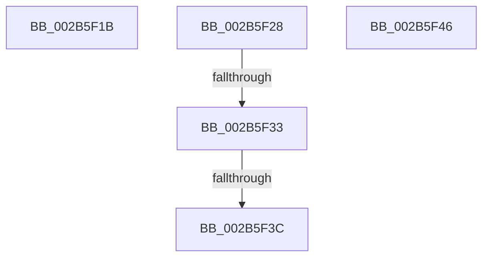

# sub_002B5F1B

- RVA: `0x002B5F1B`–`0x002B5F52` (길이 `55` bytes)
- VA: `0x00000001402B5F1B`
- 실행 섹션: `.text`
- PDB 이름 있음: `아니요`; PDB Function 태그: `아니요`
- unwind 정보 RVA: `0x0006D91C`
- 디코드: `13`개 명령, `55/55` bytes 표시
- 미해석 바이트: `0` (있으면 어셈블리에 `.byte`로 보존)

> 이 문서는 커널 이미지의 기계어와 PDB 기호를 분석해 생성했습니다. 4번과 5번은 함수 원형과 자료형을 바이너리 사용 방식에서 추정한 C 해석이며 원본 소스 복구 결과는 아닙니다.

## 1. Dependencies

- 직접 호출 지점: **0**; 고유 호출 대상: **0**
- 직접 호출자로 확인된 함수: **0**
- RIP 상대 이미지 참조: **0**

### Outgoing calls
- 직접 디코드된 call 명령이 없습니다.

### Direct callers
- 이 함수 시작 RVA로 연결되는 직접 call은 확인되지 않았습니다. 간접 호출은 완전히 역산할 수 없습니다.

### Static image references
- 디코드된 RIP-relative 메모리 참조가 없습니다.

## 2. Other-region calls and transfers

- 다른 실행 섹션으로 향하는 call: **0**
- call이 아닌 외부 분기/꼬리 이동: **5**
  - `0x002B5F23` → [MiResolveDemandZeroFault + 0xC4](MiResolveDemandZeroFault_function_002B5A40.md) (`tail-transfer`)
  - `0x002B5F2D` → [MiResolveDemandZeroFault + 0xCD](MiResolveDemandZeroFault_function_002B5A40.md) (`tail-transfer`)
  - `0x002B5F36` → [sub_002B609E](Unknown_function_002B609E.md) (`tail-transfer`)
  - `0x002B5F41` → [sub_002B5BF4](Unknown_function_002B5BF4.md) (`tail-transfer`)
  - `0x002B5F4D` → [MiResolveDemandZeroFault + 0xB9](MiResolveDemandZeroFault_function_002B5A40.md) (`tail-transfer`)

## 3. Assembly (complete function range)

```asm
002B5F1B  0F BA E9 12                     bts ecx, 0x12
002B5F1F  89 4C 24 60                     mov dword ptr [rsp + 0x60], ecx
002B5F23  E9 DC FB FF FF                  jmp 0x1402b5b04
002B5F28  8B 42 38                        mov eax, dword ptr [rdx + 0x38]
002B5F2B  A8 08                           test al, 8
002B5F2D  0F 84 DA FB FF FF               je 0x1402b5b0d
002B5F33  4D 85 E4                        test r12, r12
002B5F36  0F 85 62 01 00 00               jne 0x1402b609e
002B5F3C  B8 17 00 00 C0                  mov eax, 0xc0000017
002B5F41  E9 AE FC FF FF                  jmp 0x1402b5bf4
002B5F46  83 C9 40                        or ecx, 0x40
002B5F49  89 4C 24 60                     mov dword ptr [rsp + 0x60], ecx
002B5F4D  E9 A7 FB FF FF                  jmp 0x1402b5af9
```

## 4. C-style interpretation (structured pseudocode)

```c
__int64 __fastcall sub_002B5F1B(int a1, __int64 a2)
{
    unsigned int v_stack_p60;

    v_stack_p60 = a1;
}
```

## 5. (Beta) C Style

```c
int64_t sub_002B5F1B(int32_t Arg1, int64_t Arg2)
{
    uint32_t v_stack_p60;

    v_stack_p60 = Arg1;
}
```

## 6. Execution-region graph

[열기: 2D/3D 그래프와 함수 탐색 컨트롤 패널](../../../control-panel.html?section=text&rva=0x002B5F1B&view=graph)

- 2D 그래프는 위에서 아래로 흐르고, 3D 그래프는 빈 공간을 드래그해 회전합니다. Shift+드래그는 이동, 휠은 확대·축소, 함수 노드 선택은 대상 보고서 이동입니다.

### Static fallback


