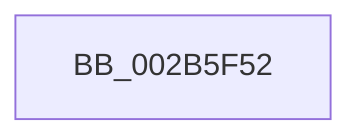

# sub_002B5F52

- RVA: `0x002B5F52`–`0x002B5F67` (길이 `21` bytes)
- VA: `0x00000001402B5F52`
- 실행 섹션: `.text`
- PDB 이름 있음: `아니요`; PDB Function 태그: `아니요`
- unwind 정보 RVA: `0x0006D92C`
- 디코드: `5`개 명령, `21/21` bytes 표시
- 미해석 바이트: `0` (있으면 어셈블리에 `.byte`로 보존)

> 이 문서는 커널 이미지의 기계어와 PDB 기호를 분석해 생성했습니다. 4번과 5번은 함수 원형과 자료형을 바이너리 사용 방식에서 추정한 C 해석이며 원본 소스 복구 결과는 아닙니다.

## 1. Dependencies

- 직접 호출 지점: **1**; 고유 호출 대상: **1**
- 직접 호출자로 확인된 함수: **0**
- RIP 상대 이미지 참조: **0**

### Outgoing calls
- `0x002B5F5D` → [MiObtainProtoReference](../31/MiObtainProtoReference_function_00318178.md) (function, `0x00318178`)

### Direct callers
- 이 함수 시작 RVA로 연결되는 직접 call은 확인되지 않았습니다. 간접 호출은 완전히 역산할 수 없습니다.

### Static image references
- 디코드된 RIP-relative 메모리 참조가 없습니다.

## 2. Other-region calls and transfers

- 다른 실행 섹션으로 향하는 call: **0**
- call이 아닌 외부 분기/꼬리 이동: **1**
  - `0x002B5F62` → [sub_002B5D4A + 0xCB](Unknown_function_002B5D4A.md) (`tail-transfer`)

## 3. Assembly (complete function range)

```asm
002B5F52  41 B7 01                        mov r15b, 1
002B5F55  49 8B CC                        mov rcx, r12
002B5F58  44 88 7C 24 30                  mov byte ptr [rsp + 0x30], r15b
002B5F5D  E8 16 22 06 00                  call 0x140318178
002B5F62  E9 AE FE FF FF                  jmp 0x1402b5e15
```

## 4. C-style interpretation (structured pseudocode)

```c
__int64 __fastcall sub_002B5F52(void)
{
    __int64 result;
    unsigned __int8 v_stack_p30;

    v_stack_p30 = 1;
    result = MiObtainProtoReference(v_r12, a2, a3, a4);
}
```

## 5. (Beta) C Style

```c
void sub_002B5F52(void)
{
    int64_t result;
    uint8_t v_stack_p30;

    v_stack_p30 = 1;
    result = MiObtainProtoReference(local_r12, a2, a3, a4);
}
```

## 6. Execution-region graph

[열기: 2D/3D 그래프와 함수 탐색 컨트롤 패널](../../../control-panel.html?section=text&rva=0x002B5F52&view=graph)

- 2D 그래프는 위에서 아래로 흐르고, 3D 그래프는 빈 공간을 드래그해 회전합니다. Shift+드래그는 이동, 휠은 확대·축소, 함수 노드 선택은 대상 보고서 이동입니다.

### Static fallback


