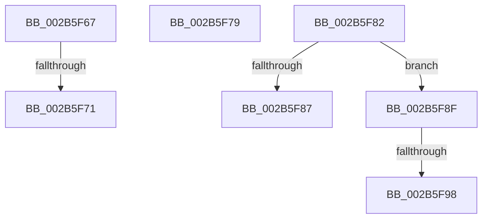

# sub_002B5F67

- RVA: `0x002B5F67`–`0x002B5FA0` (길이 `57` bytes)
- VA: `0x00000001402B5F67`
- 실행 섹션: `.text`
- PDB 이름 있음: `아니요`; PDB Function 태그: `아니요`
- unwind 정보 RVA: `0x0006D948`
- 디코드: `14`개 명령, `57/57` bytes 표시
- 미해석 바이트: `0` (있으면 어셈블리에 `.byte`로 보존)

> 이 문서는 커널 이미지의 기계어와 PDB 기호를 분석해 생성했습니다. 4번과 5번은 함수 원형과 자료형을 바이너리 사용 방식에서 추정한 C 해석이며 원본 소스 복구 결과는 아닙니다.

## 1. Dependencies

- 직접 호출 지점: **0**; 고유 호출 대상: **0**
- 직접 호출자로 확인된 함수: **0**
- RIP 상대 이미지 참조: **0**

### Outgoing calls
- 직접 디코드된 call 명령이 없습니다.

### Direct callers
- 이 함수 시작 RVA로 연결되는 직접 call은 확인되지 않았습니다. 간접 호출은 완전히 역산할 수 없습니다.

### Static image references
- 디코드된 RIP-relative 메모리 참조가 없습니다.

## 2. Other-region calls and transfers

- 다른 실행 섹션으로 향하는 call: **0**
- call이 아닌 외부 분기/꼬리 이동: **6**
  - `0x002B5F6B` → [MiResolveDemandZeroFault + 0xA2](MiResolveDemandZeroFault_function_002B5A40.md) (`tail-transfer`)
  - `0x002B5F74` → [sub_002B5CFD + 0x2E](Unknown_function_002B5CFD.md) (`tail-transfer`)
  - `0x002B5F7D` → [MiResolveDemandZeroFault + 0xC4](MiResolveDemandZeroFault_function_002B5A40.md) (`tail-transfer`)
  - `0x002B5F8A` → [sub_002B5CFD + 0xC](Unknown_function_002B5CFD.md) (`tail-transfer`)
  - `0x002B5F92` → [sub_002B5CFD + 0x10](Unknown_function_002B5CFD.md) (`tail-transfer`)
  - `0x002B5F9B` → [sub_002B5CFD + 0xC](Unknown_function_002B5CFD.md) (`tail-transfer`)

## 3. Assembly (complete function range)

```asm
002B5F67  0F BA E0 0E                     bt eax, 0xe
002B5F6B  0F 83 71 FB FF FF               jae 0x1402b5ae2
002B5F71  83 C9 14                        or ecx, 0x14
002B5F74  E9 B2 FD FF FF                  jmp 0x1402b5d2b
002B5F79  48 8B 55 98                     mov rdx, qword ptr [rbp - 0x68]
002B5F7D  E9 82 FB FF FF                  jmp 0x1402b5b04
002B5F82  80 3A 01                        cmp byte ptr [rdx], 1
002B5F85  75 08                           jne 0x1402b5f8f
002B5F87  83 C9 02                        or ecx, 2
002B5F8A  E9 7A FD FF FF                  jmp 0x1402b5d09
002B5F8F  80 3A 05                        cmp byte ptr [rdx], 5
002B5F92  0F 85 75 FD FF FF               jne 0x1402b5d0d
002B5F98  83 C9 20                        or ecx, 0x20
002B5F9B  E9 69 FD FF FF                  jmp 0x1402b5d09
```

## 4. C-style interpretation (structured pseudocode)

```c
__int64 __fastcall sub_002B5F67(int a1)
{
    a1 = (unsigned int)((a1) | (20));
}
```

## 5. (Beta) C Style

```c
int64_t sub_002B5F67(int32_t Arg1)
{
    Arg1 = (uint32_t)((Arg1) | (20));
}
```

## 6. Execution-region graph

[열기: 2D/3D 그래프와 함수 탐색 컨트롤 패널](../../../control-panel.html?section=text&rva=0x002B5F67&view=graph)

- 2D 그래프는 위에서 아래로 흐르고, 3D 그래프는 빈 공간을 드래그해 회전합니다. Shift+드래그는 이동, 휠은 확대·축소, 함수 노드 선택은 대상 보고서 이동입니다.

### Static fallback


