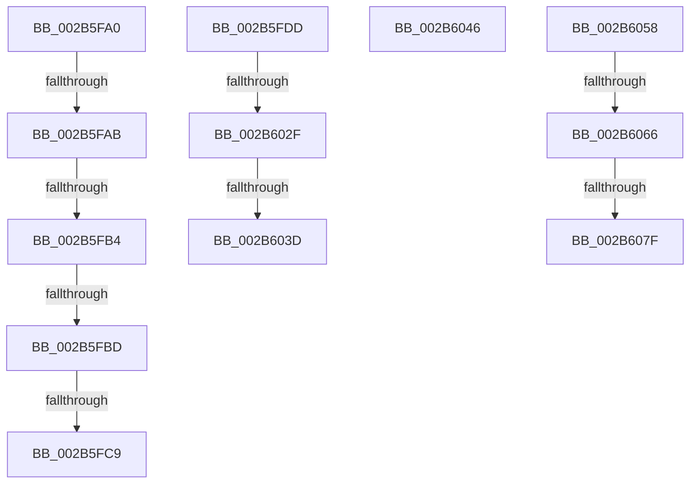

# sub_002B5FA0

- RVA: `0x002B5FA0`–`0x002B609E` (길이 `254` bytes)
- VA: `0x00000001402B5FA0`
- 실행 섹션: `.text`
- PDB 이름 있음: `아니요`; PDB Function 태그: `아니요`
- unwind 정보 RVA: `0x0006D958`
- 디코드: `57`개 명령, `254/254` bytes 표시
- 미해석 바이트: `0` (있으면 어셈블리에 `.byte`로 보존)

> 이 문서는 커널 이미지의 기계어와 PDB 기호를 분석해 생성했습니다. 4번과 5번은 함수 원형과 자료형을 바이너리 사용 방식에서 추정한 C 해석이며 원본 소스 복구 결과는 아닙니다.

## 1. Dependencies

- 직접 호출 지점: **5**; 고유 호출 대상: **5**
- 직접 호출자로 확인된 함수: **0**
- RIP 상대 이미지 참조: **1**

### Outgoing calls
- `0x002B5FCE` → [MiExpandSharedZeroCluster](../36/MiExpandSharedZeroCluster_function_0036F20C.md) (function, `0x0036F20C`)
- `0x002B6001` → [MI_READ_PTE_LOCK_FREE](../28/MI_READ_PTE_LOCK_FREE_function_002828A0.md) (function, `0x002828A0`)
- `0x002B600C` → [MiIsPrototypePteVadLookup](../32/MiIsPrototypePteVadLookup_function_00328B70.md) (function, `0x00328B70`)
- `0x002B604B` → [MiUnlockProtoPoolPage](../24/MiUnlockProtoPoolPage_function_00246090.md) (function, `0x00246090`)
- `0x002B608F` → [MiCheckUserVirtualAddress](../48/MiCheckUserVirtualAddress_function_00488834.md) (function, `0x00488834`)

### Direct callers
- 이 함수 시작 RVA로 연결되는 직접 call은 확인되지 않았습니다. 간접 호출은 완전히 역산할 수 없습니다.

### Static image references
- `0x002B606A` → RVA `0x00014578` (`.rdata`; read)

## 2. Other-region calls and transfers

- 다른 실행 섹션으로 향하는 call: **0**
- call이 아닌 외부 분기/꼬리 이동: **12**
  - `0x002B5FA5` → [sub_002B5D4A + 0x33](Unknown_function_002B5D4A.md) (`tail-transfer`)
  - `0x002B5FAE` → [sub_002B5D4A + 0x33](Unknown_function_002B5D4A.md) (`tail-transfer`)
  - `0x002B5FB7` → [sub_002B5D4A + 0x33](Unknown_function_002B5D4A.md) (`tail-transfer`)
  - `0x002B5FC3` → [sub_002B5D4A + 0x33](Unknown_function_002B5D4A.md) (`tail-transfer`)
  - `0x002B5FD8` → [sub_002B5D4A + 0x33](Unknown_function_002B5D4A.md) (`tail-transfer`)
  - `0x002B6029` → [sub_002B5C0F + 0x73](Unknown_function_002B5C0F.md) (`tail-transfer`)
  - `0x002B6037` → [sub_002B5C0F + 0x73](Unknown_function_002B5C0F.md) (`tail-transfer`)
  - `0x002B6041` → [sub_002B5D4A + 0x1C](Unknown_function_002B5D4A.md) (`tail-transfer`)
  - `0x002B6053` → [sub_002B5B1B + 0xC1](Unknown_function_002B5B1B.md) (`tail-transfer`)
  - `0x002B6060` → [sub_002B5D4A + 0x9](Unknown_function_002B5D4A.md) (`tail-transfer`)
  - `0x002B6079` → [sub_002B5D4A + 0x9](Unknown_function_002B5D4A.md) (`tail-transfer`)
  - `0x002B6099` → [sub_002B5C0F + 0xC9](Unknown_function_002B5C0F.md) (`tail-transfer`)

## 3. Assembly (complete function range)

```asm
002B5FA0  48 39 5C 24 40                  cmp qword ptr [rsp + 0x40], rbx
002B5FA5  0F 84 D2 FD FF FF               je 0x1402b5d7d
002B5FAB  4D 85 F6                        test r14, r14
002B5FAE  0F 84 C9 FD FF FF               je 0x1402b5d7d
002B5FB4  83 F9 18                        cmp ecx, 0x18
002B5FB7  0F 84 C0 FD FF FF               je 0x1402b5d7d
002B5FBD  83 E1 F8                        and ecx, 0xfffffff8
002B5FC0  83 F9 10                        cmp ecx, 0x10
002B5FC3  0F 84 B4 FD FF FF               je 0x1402b5d7d
002B5FC9  48 8D 4C 24 60                  lea rcx, [rsp + 0x60]
002B5FCE  E8 39 92 0B 00                  call 0x14036f20c
002B5FD3  48 89 44 24 50                  mov qword ptr [rsp + 0x50], rax
002B5FD8  E9 A0 FD FF FF                  jmp 0x1402b5d7d
002B5FDD  48 B8 F8 FF FF FF 7F 00 00 00   movabs rax, 0x7ffffffff8
002B5FE7  49 8B CF                        mov rcx, r15
002B5FEA  48 C1 E9 09                     shr rcx, 9
002B5FEE  48 23 C8                        and rcx, rax
002B5FF1  48 B8 00 00 00 00 80 F6 FF FF   movabs rax, 0xfffff68000000000
002B5FFB  48 8B C0                        mov rax, rax
002B5FFE  48 03 C8                        add rcx, rax
002B6001  E8 9A C8 FC FF                  call 0x1402828a0
002B6006  48 8B C8                        mov rcx, rax
002B6009  4C 8B C0                        mov r8, rax
002B600C  E8 5F 2B 07 00                  call 0x140328b70
002B6011  49 C1 E8 05                     shr r8, 5
002B6015  49 C1 ED 05                     shr r13, 5
002B6019  85 C0                           test eax, eax
002B601B  8B 44 24 38                     mov eax, dword ptr [rsp + 0x38]
002B601F  4D 0F 45 E8                     cmovne r13, r8
002B6023  83 E0 F8                        and eax, 0xfffffff8
002B6026  83 F8 10                        cmp eax, 0x10
002B6029  0F 84 53 FC FF FF               je 0x1402b5c82
002B602F  41 80 E5 18                     and r13b, 0x18
002B6033  41 80 FD 10                     cmp r13b, 0x10
002B6037  0F 84 45 FC FF FF               je 0x1402b5c82
002B603D  8B 4C 24 60                     mov ecx, dword ptr [rsp + 0x60]
002B6041  E9 20 FD FF FF                  jmp 0x1402b5d66
002B6046  B2 11                           mov dl, 0x11
002B6048  49 8B CC                        mov rcx, r12
002B604B  E8 40 00 F9 FF                  call 0x140246090
002B6050  41 8B C6                        mov eax, r14d
002B6053  E9 84 FB FF FF                  jmp 0x1402b5bdc
002B6058  41 8B 46 30                     mov eax, dword ptr [r14 + 0x30]
002B605C  0F BA E0 15                     bt eax, 0x15
002B6060  0F 82 ED FC FF FF               jb 0x1402b5d53
002B6066  48 C1 E8 13                     shr rax, 0x13
002B606A  48 8D 15 07 E5 D5 FF            lea rdx, [rip - 0x2a1af9]
002B6071  83 E0 03                        and eax, 3
002B6074  48 83 3C C2 10                  cmp qword ptr [rdx + rax*8], 0x10
002B6079  0F 85 D4 FC FF FF               jne 0x1402b5d53
002B607F  4C 8D 4C 24 34                  lea r9, [rsp + 0x34]
002B6084  C6 44 24 30 01                  mov byte ptr [rsp + 0x30], 1
002B6089  49 8B D6                        mov rdx, r14
002B608C  49 8B CF                        mov rcx, r15
002B608F  E8 A0 27 1D 00                  call 0x140488834
002B6094  48 89 44 24 40                  mov qword ptr [rsp + 0x40], rax
002B6099  E9 3A FC FF FF                  jmp 0x1402b5cd8
```

## 4. C-style interpretation (structured pseudocode)

```c
__int64 __fastcall sub_002B5FA0(int a1, __int64 a2, __int64 a3, __int64 a4, __int64 a5, __int64 a6, __int64 a7, __int64 a8, __int64 a9, __int64 a10, __int64 a11, __int64 a12)
{
    __int64 result;
    unsigned __int8 v_stack_p30;
    unsigned __int64 v_stack_p34;
    unsigned int v_stack_p38;
    unsigned __int64 v_stack_p40;
    unsigned __int64 v_stack_p50;
    unsigned int v_stack_p60;

    a1 = (unsigned int)((a1) & (0xFFFFFFF8ULL));
    result = MiExpandSharedZeroCluster(a12, a2, a3, a4);
    v_stack_p50 = result;
}
```

## 5. (Beta) C Style

```c
int64_t sub_002B5FA0(int32_t Arg1, int64_t Arg2, int64_t Arg3, int64_t Arg4, uint64_t Arg5, uint64_t Arg6, uint64_t Arg7, int64_t Arg8, uint64_t Arg9, uint64_t Arg10, uint64_t Arg11, int64_t Arg12)
{
    int64_t result;
    uint8_t v_stack_p30;
    uint64_t v_stack_p34;
    uint32_t v_stack_p38;
    uint64_t v_stack_p40;
    uint64_t v_stack_p50;
    uint32_t v_stack_p60;

    Arg1 = (uint32_t)((Arg1) & (0xFFFFFFF8ULL));
    result = MiExpandSharedZeroCluster(Arg12, Arg2, Arg3, Arg4);
    v_stack_p50 = result;
}
```

## 6. Execution-region graph

[열기: 2D/3D 그래프와 함수 탐색 컨트롤 패널](../../../control-panel.html?section=text&rva=0x002B5FA0&view=graph)

- 2D 그래프는 위에서 아래로 흐르고, 3D 그래프는 빈 공간을 드래그해 회전합니다. Shift+드래그는 이동, 휠은 확대·축소, 함수 노드 선택은 대상 보고서 이동입니다.

### Static fallback


