# sub_002B674F

- RVA: `0x002B674F`–`0x002B6988` (길이 `569` bytes)
- VA: `0x00000001402B674F`
- 실행 섹션: `.text`
- PDB 이름 있음: `아니요`; PDB Function 태그: `아니요`
- unwind 정보 RVA: `0x0006D9E4`
- 디코드: `147`개 명령, `569/569` bytes 표시
- 미해석 바이트: `0` (있으면 어셈블리에 `.byte`로 보존)

> 이 문서는 커널 이미지의 기계어와 PDB 기호를 분석해 생성했습니다. 4번과 5번은 함수 원형과 자료형을 바이너리 사용 방식에서 추정한 C 해석이며 원본 소스 복구 결과는 아닙니다.

## 1. Dependencies

- 직접 호출 지점: **5**; 고유 호출 대상: **5**
- 직접 호출자로 확인된 함수: **0**
- RIP 상대 이미지 참조: **5**

### Outgoing calls
- `0x002B6779` → [MI_READ_PTE_LOCK_FREE](../28/MI_READ_PTE_LOCK_FREE_function_002828A0.md) (function, `0x002828A0`)
- `0x002B6872` → [MiLockVadTree](../27/MiLockVadTree_function_0027C0F0.md) (function, `0x0027C0F0`)
- `0x002B687A` → [MiLocateAddress](../31/MiLocateAddress_function_003168D0.md) (function, `0x003168D0`)
- `0x002B68B8` → [ExpReleaseSpinLockSharedFromDpcLevelInstrumented](../2F/ExpReleaseSpinLockSharedFromDpcLevelInstrumented_function_002F0F48.md) (function, `0x002F0F48`)
- `0x002B68C9` → [Feature_2429262139__private_IsEnabledNoReportingNoInline](../66/Feature_2429262139__private_IsEnabledNoReportingNoInline_function_0066E0A8.md) (function, `0x0066E0A8`)

### Direct callers
- 이 함수 시작 RVA로 연결되는 직접 call은 확인되지 않았습니다. 간접 호출은 완전히 역산할 수 없습니다.

### Static image references
- `0x002B678B` → RVA `0x00E2DC80` (`.data`; read)
- `0x002B68A0` → RVA `0x00FC6B06` (`ALMOSTRO`; read)
- `0x002B68A9` → RVA `0x00F0DE58` (`.data`; read)
- `0x002B6908` → RVA `0x00E36048` (`.data`; read)
- `0x002B695F` → RVA `0x00E30088` (`.data`; read)

## 2. Other-region calls and transfers

- 다른 실행 섹션으로 향하는 call: **0**
- 별도 외부 분기/꼬리 이동을 확인하지 못했습니다.

## 3. Assembly (complete function range)

```asm
002B674F  48 89 7C 24 30                  mov qword ptr [rsp + 0x30], rdi
002B6754  48 8B 3C C8                     mov rdi, qword ptr [rax + rcx*8]
002B6758  48 8B CE                        mov rcx, rsi
002B675B  48 C1 E9 09                     shr rcx, 9
002B675F  48 B8 F8 FF FF FF 7F 00 00 00   movabs rax, 0x7ffffffff8
002B6769  48 23 C8                        and rcx, rax
002B676C  48 B8 00 00 00 00 80 F6 FF FF   movabs rax, 0xfffff68000000000
002B6776  48 03 C8                        add rcx, rax
002B6779  E8 22 C1 FC FF                  call 0x1402828a0
002B677E  41 B8 FF FF FF FF               mov r8d, 0xffffffff
002B6784  48 0F BA E0 0A                  bt rax, 0xa
002B6789  73 4D                           jae 0x1402b67d8
002B678B  48 8B 15 EE 74 B7 00            mov rdx, qword ptr [rip + 0xb774ee]
002B6792  48 8B C8                        mov rcx, rax
002B6795  48 85 D2                        test rdx, rdx
002B6798  74 13                           je 0x1402b67ad
002B679A  A8 10                           test al, 0x10
002B679C  75 0B                           jne 0x1402b67a9
002B679E  48 8B CA                        mov rcx, rdx
002B67A1  48 F7 D1                        not rcx
002B67A4  48 23 C8                        and rcx, rax
002B67A7  EB 04                           jmp 0x1402b67ad
002B67A9  48 83 E1 EF                     and rcx, 0xffffffffffffffef
002B67AD  48 C1 E9 20                     shr rcx, 0x20
002B67B1  49 3B C8                        cmp rcx, r8
002B67B4  74 22                           je 0x1402b67d8
002B67B6  48 8B C8                        mov rcx, rax
002B67B9  48 C1 E9 0B                     shr rcx, 0xb
002B67BD  F6 C1 01                        test cl, 1
002B67C0  74 16                           je 0x1402b67d8
002B67C2  48 8D 43 E0                     lea rax, [rbx - 0x20]
002B67C6  48 25 00 F0 FF FF               and rax, 0xfffffffffffff000
002B67CC  48 8B 40 10                     mov rax, qword ptr [rax + 0x10]
002B67D0  48 8B 00                        mov rax, qword ptr [rax]
002B67D3  E9 9B 01 00 00                  jmp 0x1402b6973
002B67D8  48 B9 00 00 00 00 00 80 FF FF   movabs rcx, 0xffff800000000000
002B67E2  48 3B F1                        cmp rsi, rcx
002B67E5  0F 83 11 01 00 00               jae 0x1402b68fc
002B67EB  48 0F BA E0 0A                  bt rax, 0xa
002B67F0  73 25                           jae 0x1402b6817
002B67F2  48 8B 0D 87 74 B7 00            mov rcx, qword ptr [rip + 0xb77487]
002B67F9  48 85 C9                        test rcx, rcx
002B67FC  74 10                           je 0x1402b680e
002B67FE  A8 10                           test al, 0x10
002B6800  75 08                           jne 0x1402b680a
002B6802  48 F7 D1                        not rcx
002B6805  48 23 C1                        and rax, rcx
002B6808  EB 04                           jmp 0x1402b680e
002B680A  48 83 E0 EF                     and rax, 0xffffffffffffffef
002B680E  48 C1 E8 20                     shr rax, 0x20
002B6812  49 3B C0                        cmp rax, r8
002B6815  74 56                           je 0x1402b686d
002B6817  65 48 8B 04 25 88 01 00 00      mov rax, qword ptr gs:[0x188]
002B6820  48 8B 88 B8 00 00 00            mov rcx, qword ptr [rax + 0xb8]
002B6827  48 8B 81 80 02 00 00            mov rax, qword ptr [rcx + 0x280]
002B682E  48 85 C0                        test rax, rax
002B6831  74 38                           je 0x1402b686b
002B6833  48 3B 58 20                     cmp rbx, qword ptr [rax + 0x20]
002B6837  76 06                           jbe 0x1402b683f
002B6839  48 8B 40 08                     mov rax, qword ptr [rax + 8]
002B683D  EB 09                           jmp 0x1402b6848
002B683F  48 3B 58 18                     cmp rbx, qword ptr [rax + 0x18]
002B6843  73 08                           jae 0x1402b684d
002B6845  48 8B 00                        mov rax, qword ptr [rax]
002B6848  48 85 C0                        test rax, rax
002B684B  75 E6                           jne 0x1402b6833
002B684D  48 85 C0                        test rax, rax
002B6850  74 19                           je 0x1402b686b
002B6852  48 83 78 30 00                  cmp qword ptr [rax + 0x30], 0
002B6857  74 12                           je 0x1402b686b
002B6859  48 8B 40 38                     mov rax, qword ptr [rax + 0x38]
002B685D  48 8B 78 18                     mov rdi, qword ptr [rax + 0x18]
002B6861  48 85 FF                        test rdi, rdi
002B6864  74 07                           je 0x1402b686d
002B6866  E9 05 01 00 00                  jmp 0x1402b6970
002B686B  33 FF                           xor edi, edi
002B686D  B9 01 00 00 00                  mov ecx, 1
002B6872  E8 79 58 FC FF                  call 0x14027c0f0
002B6877  48 8B CE                        mov rcx, rsi
002B687A  E8 51 00 06 00                  call 0x1403168d0
002B687F  65 48 8B 0C 25 88 01 00 00      mov rcx, qword ptr gs:[0x188]
002B6888  48 8B D8                        mov rbx, rax
002B688B  48 8B 91 B8 00 00 00            mov rdx, qword ptr [rcx + 0xb8]
002B6892  48 8B 8A 10 04 00 00            mov rcx, qword ptr [rdx + 0x410]
002B6899  48 81 C1 EC 03 00 00            add rcx, 0x3ec
002B68A0  F6 05 5F 02 D1 00 01            test byte ptr [rip + 0xd1025f], 1
002B68A7  74 16                           je 0x1402b68bf
002B68A9  8B 15 A9 75 C5 00               mov edx, dword ptr [rip + 0xc575a9]
002B68AF  85 D2                           test edx, edx
002B68B1  75 0C                           jne 0x1402b68bf
002B68B3  48 8B 54 24 28                  mov rdx, qword ptr [rsp + 0x28]
002B68B8  E8 8B A6 03 00                  call 0x1402f0f48
002B68BD  EB 0A                           jmp 0x1402b68c9
002B68BF  F0 81 21 FF FF FF BF            lock and dword ptr [rcx], 0xbfffffff
002B68C6  F0 FF 09                        lock dec dword ptr [rcx]
002B68C9  E8 DA 77 3B 00                  call 0x14066e0a8
002B68CE  48 85 DB                        test rbx, rbx
002B68D1  0F 84 99 00 00 00               je 0x1402b6970
002B68D7  85 C0                           test eax, eax
002B68D9  74 09                           je 0x1402b68e4
002B68DB  F7 43 30 04 00 20 00            test dword ptr [rbx + 0x30], 0x200004
002B68E2  EB 07                           jmp 0x1402b68eb
002B68E4  F7 43 30 00 00 20 00            test dword ptr [rbx + 0x30], 0x200000
002B68EB  0F 85 7F 00 00 00               jne 0x1402b6970
002B68F1  48 8B 43 48                     mov rax, qword ptr [rbx + 0x48]
002B68F5  48 85 C0                        test rax, rax
002B68F8  74 76                           je 0x1402b6970
002B68FA  EB 57                           jmp 0x1402b6953
002B68FC  8B 85 B8 00 00 00               mov eax, dword ptr [rbp + 0xb8]
002B6902  24 0F                           and al, 0xf
002B6904  3C 04                           cmp al, 4
002B6906  75 68                           jne 0x1402b6970
002B6908  48 8B 15 39 F7 B7 00            mov rdx, qword ptr [rip + 0xb7f739]
002B690F  48 85 D2                        test rdx, rdx
002B6912  74 5C                           je 0x1402b6970
002B6914  0F 1F 40 00                     nop dword ptr [rax]
002B6918  0F 1F 84 00 00 00 00 00         nop dword ptr [rax + rax]
002B6920  4C 8B 42 58                     mov r8, qword ptr [rdx + 0x58]
002B6924  48 8B 4A 20                     mov rcx, qword ptr [rdx + 0x20]
002B6928  49 81 E0 00 F0 FF FF            and r8, 0xfffffffffffff000
002B692F  49 03 C8                        add rcx, r8
002B6932  48 3B F1                        cmp rsi, rcx
002B6935  72 06                           jb 0x1402b693d
002B6937  48 8B 52 08                     mov rdx, qword ptr [rdx + 8]
002B693B  EB 08                           jmp 0x1402b6945
002B693D  49 3B F0                        cmp rsi, r8
002B6940  73 08                           jae 0x1402b694a
002B6942  48 8B 12                        mov rdx, qword ptr [rdx]
002B6945  48 85 D2                        test rdx, rdx
002B6948  75 D6                           jne 0x1402b6920
002B694A  48 85 D2                        test rdx, rdx
002B694D  74 21                           je 0x1402b6970
002B694F  48 8B 42 30                     mov rax, qword ptr [rdx + 0x30]
002B6953  48 8B 08                        mov rcx, qword ptr [rax]
002B6956  48 85 C9                        test rcx, rcx
002B6959  74 15                           je 0x1402b6970
002B695B  0F B7 49 3C                     movzx ecx, word ptr [rcx + 0x3c]
002B695F  48 8B 05 22 97 B7 00            mov rax, qword ptr [rip + 0xb79722]
002B6966  81 E1 FF 03 00 00               and ecx, 0x3ff
002B696C  48 8B 3C C8                     mov rdi, qword ptr [rax + rcx*8]
002B6970  48 8B C7                        mov rax, rdi
002B6973  48 8B 7C 24 30                  mov rdi, qword ptr [rsp + 0x30]
002B6978  48 8B 5C 24 38                  mov rbx, qword ptr [rsp + 0x38]
002B697D  48 8B 6C 24 40                  mov rbp, qword ptr [rsp + 0x40]
002B6982  48 83 C4 20                     add rsp, 0x20
002B6986  5E                              pop rsi
002B6987  C3                              ret
```

## 4. C-style interpretation (structured pseudocode)

```c
__int64 __fastcall sub_002B674F(__int64 a1, __int64 a2, __int64 a3, __int64 a4, __int64 a5, __int64 a6, __int64 a7, __int64 a8)
{
    __int64 result;
    __int64 v_rdi;
    __int64 v_rsp;
    unsigned __int64 v_stack_p30;

    v_stack_p30 = v_rdi;
    a1 = (v_rsi) >> (9);
    a1 = (a1) & (result);
    a1 = (a1) + (result);
    result = MI_READ_PTE_LOCK_FREE(a1, a2, a3, a4);
    if (condition_is_above_or_equal) goto loc_002B67D8;
    if (*(unsigned __int64 *)(v_rip + 12023022) == 0) goto loc_002B67AD;
    if ((((unsigned __int8)(result)) & (16)) != 0) goto loc_002B67A9;
    a1 = ~(*(unsigned __int64 *)(v_rip + 12023022));
    a1 = (a1) & (result);
    goto loc_002B67AD;
loc_002B67A9:
    a1 = (a1) & (-17);
loc_002B67AD:
    a1 = (a1) >> (32);
    if (a1 == ((unsigned int)(0xFFFFFFFFULL))) goto loc_002B67D8;
    a1 = (result) >> (11);
    if ((((unsigned __int8)(a1)) & (1)) == 0) goto loc_002B67D8;
    result = (v_rbx - 32) & (0xFFFFFFFFFFFFF000ULL);
    goto loc_002B6973;
loc_002B67D8:
    if (v_rsi >= a1) goto loc_002B68FC;
    if (v_rsi >= a1) goto loc_002B6817;
    if (*(unsigned __int64 *)(v_rip + 12022919) == 0) goto loc_002B680E;
    if ((((unsigned __int8)(*(unsigned __int64 *)(*(unsigned __int64 *)(result + 16)))) & (16)) != 0) goto loc_002B680A;
    a1 = ~(*(unsigned __int64 *)(v_rip + 12022919));
    result = (*(unsigned __int64 *)(*(unsigned __int64 *)(result + 16))) & (a1);
    goto loc_002B680E;
loc_002B680A:
    result = (result) & (-17);
loc_002B680E:
    result = (result) >> (32);
    if (result == ((unsigned int)(0xFFFFFFFFULL))) goto loc_002B686D;
loc_002B6817:
    if (*(unsigned __int64 *)(*(unsigned __int64 *)(*(unsigned __int64 *)(gs_base + (0 + 392)) + 184) + 640) == 0) goto loc_002B686B;
loc_002B6833:
    if (v_rbx <= (*(unsigned __int64 *)(*(unsigned __int64 *)(*(unsigned __int64 *)(*(unsigned __int64 *)(gs_base + (0 + 392)) + 184) + 640) + 32))) goto loc_002B683F;
    goto loc_002B6848;
loc_002B683F:
    if (v_rbx >= (*(unsigned __int64 *)(*(unsigned __int64 *)(*(unsigned __int64 *)(*(unsigned __int64 *)(*(unsigned __int64 *)(gs_base + (0 + 392)) + 184) + 640) + 8) + 24))) goto loc_002B684D;
loc_002B6848:
    if (*(unsigned __int64 *)(*(unsigned __int64 *)(*(unsigned __int64 *)(*(unsigned __int64 *)(*(unsigned __int64 *)(gs_base + (0 + 392)) + 184) + 640) + 8)) != 0) goto loc_002B6833;
loc_002B684D:
    if (*(unsigned __int64 *)(*(unsigned __int64 *)(*(unsigned __int64 *)(*(unsigned __int64 *)(*(unsigned __int64 *)(gs_base + (0 + 392)) + 184) + 640) + 8)) == 0) goto loc_002B686B;
    if ((*(unsigned __int64 *)(*(unsigned __int64 *)(*(unsigned __int64 *)(*(unsigned __int64 *)(*(unsigned __int64 *)(*(unsigned __int64 *)(gs_base + (0 + 392)) + 184) + 640) + 8)) + 48)) == 0) goto loc_002B686B;
    if (*(unsigned __int64 *)(*(unsigned __int64 *)(*(unsigned __int64 *)(*(unsigned __int64 *)(*(unsigned __int64 *)(*(unsigned __int64 *)(*(unsigned __int64 *)(gs_base + (0 + 392)) + 184) + 640) + 8)) + 56) + 24) == 0) goto loc_002B686D;
    goto loc_002B6970;
loc_002B686B:
    v_rdi = 0;
loc_002B686D:
    result = MiLockVadTree(1, *(unsigned __int64 *)(v_rip + 12023022), (unsigned int)(0xFFFFFFFFULL), a4);
    result = MiLocateAddress(v_rsi, *(unsigned __int64 *)(v_rip + 12023022), (unsigned int)(0xFFFFFFFFULL), a4);
    a1 = (*(unsigned __int64 *)(*(unsigned __int64 *)(*(unsigned __int64 *)(gs_base + (0 + 392)) + 184) + 1040)) + (0x3ECULL);
    if (((*(unsigned __int8 *)(v_rip + 13697631)) & (1)) == 0) goto loc_002B68BF;
    if ((unsigned int)((unsigned int)(*(unsigned int *)(v_rip + 12940713))) != 0) goto loc_002B68BF;
    result = ExpReleaseSpinLockSharedFromDpcLevelInstrumented(a1, a5, (unsigned int)(0xFFFFFFFFULL), a4);
    goto loc_002B68C9;
loc_002B68BF:
loc_002B68C9:
    result = Feature_2429262139__private_IsEnabledNoReportingNoInline(a1, a5, (unsigned int)(0xFFFFFFFFULL), a4);
    if (result == 0) goto loc_002B6970;
    if ((unsigned int)(result) == 0) goto loc_002B68E4;
    goto loc_002B68EB;
loc_002B68E4:
loc_002B68EB:
    if (((*(unsigned int *)(result + 48)) & (0x200000ULL)) != 0) goto loc_002B6970;
    if (*(unsigned __int64 *)(result + 72) == 0) goto loc_002B6970;
    goto loc_002B6953;
loc_002B68FC:
    result = (unsigned __int8)(((unsigned int)(*(unsigned int *)(v_rbp + 184))) & (15));
    if (((unsigned __int8)(result)) != 4) goto loc_002B6970;
    if (*(unsigned __int64 *)(v_rip + 12056377) == 0) goto loc_002B6970;
loc_002B6920:
    a3 = (*(unsigned __int64 *)(*(unsigned __int64 *)(v_rip + 12056377) + 88)) & (0xFFFFFFFFFFFFF000ULL);
    a1 = (*(unsigned __int64 *)(*(unsigned __int64 *)(v_rip + 12056377) + 32)) + (a3);
    if (v_rsi < a1) goto loc_002B693D;
    goto loc_002B6945;
loc_002B693D:
    if (v_rsi >= a3) goto loc_002B694A;
loc_002B6945:
    if (*(unsigned __int64 *)(*(unsigned __int64 *)(*(unsigned __int64 *)(v_rip + 12056377) + 8)) != 0) goto loc_002B6920;
loc_002B694A:
    if (*(unsigned __int64 *)(*(unsigned __int64 *)(*(unsigned __int64 *)(v_rip + 12056377) + 8)) == 0) goto loc_002B6970;
loc_002B6953:
    result = *(unsigned __int64 *)(*(unsigned __int64 *)(*(unsigned __int64 *)(*(unsigned __int64 *)(v_rip + 12056377) + 8)) + 48);
    if (*(unsigned __int64 *)(*(unsigned __int64 *)(*(unsigned __int64 *)(*(unsigned __int64 *)(*(unsigned __int64 *)(v_rip + 12056377) + 8)) + 48)) != 0) {
        a1 = *(unsigned __int16 *)(*(unsigned __int64 *)(*(unsigned __int64 *)(*(unsigned __int64 *)(*(unsigned __int64 *)(*(unsigned __int64 *)(v_rip + 12056377) + 8)) + 48)) + 60);
        result = *(unsigned __int64 *)(v_rip + 12031778);
        a1 = (unsigned int)((a1) & (0x3FFULL));
        v_rdi = *(unsigned __int64 *)(result + a1 * 8);
    }
loc_002B6973:
    v_rsp = (v_rsp) + (32);
    return v_rdi;
}
```

## 5. (Beta) C Style

```c
int64_t sub_002B674F(int64_t Arg1, int64_t Arg2, int64_t Arg3, int64_t Arg4, int64_t Arg5, int64_t Arg6, int64_t Arg7, int64_t Arg8)
{
    int64_t result;
    int64_t local_rdi;
    int64_t local_rsp;
    uint64_t v_stack_p30;

    v_stack_p30 = local_rdi;
    Arg1 = (local_rsi) >> (9);
    Arg1 = (Arg1) & (result);
    Arg1 = (Arg1) + (result);
    result = MI_READ_PTE_LOCK_FREE(Arg1, Arg2, Arg3, Arg4);
    if (condition_is_above_or_equal) goto loc_002B67D8;
    if (*(uint64_t *)(v_rip + 0xB774EE) == 0) goto loc_002B67AD;
    if ((((uint8_t)(result)) & (16)) != 0) goto loc_002B67A9;
    Arg1 = ~(*(uint64_t *)(v_rip + 0xB774EE));
    Arg1 = (Arg1) & (result);
    goto loc_002B67AD;
loc_002B67A9:
    Arg1 = (Arg1) & (-17);
loc_002B67AD:
    Arg1 = (Arg1) >> (32);
    if (Arg1 == ((uint32_t)(0xFFFFFFFFULL))) goto loc_002B67D8;
    Arg1 = (result) >> (11);
    if ((((uint8_t)(Arg1)) & (1)) == 0) goto loc_002B67D8;
    result = (local_rbx - 32) & (0xFFFFFFFFFFFFF000ULL);
    goto loc_002B6973;
loc_002B67D8:
    if (local_rsi >= Arg1) goto loc_002B68FC;
    if (local_rsi >= Arg1) goto loc_002B6817;
    if (*(uint64_t *)(v_rip + 0xB77487) == 0) goto loc_002B680E;
    if ((((uint8_t)(*(uint64_t *)(*(uint64_t *)(result + 0x10)))) & (16)) != 0) goto loc_002B680A;
    Arg1 = ~(*(uint64_t *)(v_rip + 0xB77487));
    result = (*(uint64_t *)(*(uint64_t *)(result + 0x10))) & (Arg1);
    goto loc_002B680E;
loc_002B680A:
    result = (result) & (-17);
loc_002B680E:
    result = (result) >> (32);
    if (result == ((uint32_t)(0xFFFFFFFFULL))) goto loc_002B686D;
loc_002B6817:
    if (*(uint64_t *)(*(uint64_t *)(*(uint64_t *)(gs_base + (0 + 0x188)) + 0xB8) + 0x280) == 0) goto loc_002B686B;
loc_002B6833:
    if (local_rbx <= (*(uint64_t *)(*(uint64_t *)(*(uint64_t *)(*(uint64_t *)(gs_base + (0 + 0x188)) + 0xB8) + 0x280) + 0x20))) goto loc_002B683F;
    goto loc_002B6848;
loc_002B683F:
    if (local_rbx >= (*(uint64_t *)(*(uint64_t *)(*(uint64_t *)(*(uint64_t *)(*(uint64_t *)(gs_base + (0 + 0x188)) + 0xB8) + 0x280) + 0x8) + 0x18))) goto loc_002B684D;
loc_002B6848:
    if (*(uint64_t *)(*(uint64_t *)(*(uint64_t *)(*(uint64_t *)(*(uint64_t *)(gs_base + (0 + 0x188)) + 0xB8) + 0x280) + 0x8)) != 0) goto loc_002B6833;
loc_002B684D:
    if (*(uint64_t *)(*(uint64_t *)(*(uint64_t *)(*(uint64_t *)(*(uint64_t *)(gs_base + (0 + 0x188)) + 0xB8) + 0x280) + 0x8)) == 0) goto loc_002B686B;
    if ((*(uint64_t *)(*(uint64_t *)(*(uint64_t *)(*(uint64_t *)(*(uint64_t *)(*(uint64_t *)(gs_base + (0 + 0x188)) + 0xB8) + 0x280) + 0x8)) + 0x30)) == 0) goto loc_002B686B;
    if (*(uint64_t *)(*(uint64_t *)(*(uint64_t *)(*(uint64_t *)(*(uint64_t *)(*(uint64_t *)(*(uint64_t *)(gs_base + (0 + 0x188)) + 0xB8) + 0x280) + 0x8)) + 0x38) + 0x18) == 0) goto loc_002B686D;
    goto loc_002B6970;
loc_002B686B:
    local_rdi = 0;
loc_002B686D:
    result = MiLockVadTree(1, *(uint64_t *)(v_rip + 0xB774EE), (uint32_t)(0xFFFFFFFFULL), Arg4);
    result = MiLocateAddress(local_rsi, *(uint64_t *)(v_rip + 0xB774EE), (uint32_t)(0xFFFFFFFFULL), Arg4);
    Arg1 = (*(uint64_t *)(*(uint64_t *)(*(uint64_t *)(gs_base + (0 + 0x188)) + 0xB8) + 0x410)) + (0x3ECULL);
    if (((*(uint8_t *)(v_rip + 0xD1025F)) & (1)) == 0) goto loc_002B68BF;
    if ((uint32_t)((uint32_t)(*(uint32_t *)(v_rip + 0xC575A9))) != 0) goto loc_002B68BF;
    result = ExpReleaseSpinLockSharedFromDpcLevelInstrumented(Arg1, Arg5, (uint32_t)(0xFFFFFFFFULL), Arg4);
    goto loc_002B68C9;
loc_002B68BF:
loc_002B68C9:
    result = Feature_2429262139__private_IsEnabledNoReportingNoInline(Arg1, Arg5, (uint32_t)(0xFFFFFFFFULL), Arg4);
    if (result == 0) goto loc_002B6970;
    if ((uint32_t)(result) == 0) goto loc_002B68E4;
    goto loc_002B68EB;
loc_002B68E4:
loc_002B68EB:
    if (((*(uint32_t *)(result + 0x30)) & (0x200000ULL)) != 0) goto loc_002B6970;
    if (*(uint64_t *)(result + 0x48) == 0) goto loc_002B6970;
    goto loc_002B6953;
loc_002B68FC:
    result = (uint8_t)(((uint32_t)(*(uint32_t *)(local_rbp + 0xB8))) & (15));
    if (((uint8_t)(result)) != 4) goto loc_002B6970;
    if (*(uint64_t *)(v_rip + 0xB7F739) == 0) goto loc_002B6970;
loc_002B6920:
    Arg3 = (*(uint64_t *)(*(uint64_t *)(v_rip + 0xB7F739) + 0x58)) & (0xFFFFFFFFFFFFF000ULL);
    Arg1 = (*(uint64_t *)(*(uint64_t *)(v_rip + 0xB7F739) + 0x20)) + (Arg3);
    if (local_rsi < Arg1) goto loc_002B693D;
    goto loc_002B6945;
loc_002B693D:
    if (local_rsi >= Arg3) goto loc_002B694A;
loc_002B6945:
    if (*(uint64_t *)(*(uint64_t *)(*(uint64_t *)(v_rip + 0xB7F739) + 0x8)) != 0) goto loc_002B6920;
loc_002B694A:
    if (*(uint64_t *)(*(uint64_t *)(*(uint64_t *)(v_rip + 0xB7F739) + 0x8)) == 0) goto loc_002B6970;
loc_002B6953:
    result = *(uint64_t *)(*(uint64_t *)(*(uint64_t *)(*(uint64_t *)(v_rip + 0xB7F739) + 0x8)) + 0x30);
    if (*(uint64_t *)(*(uint64_t *)(*(uint64_t *)(*(uint64_t *)(*(uint64_t *)(v_rip + 0xB7F739) + 0x8)) + 0x30)) != 0) {
        Arg1 = *(uint16_t *)(*(uint64_t *)(*(uint64_t *)(*(uint64_t *)(*(uint64_t *)(*(uint64_t *)(v_rip + 0xB7F739) + 0x8)) + 0x30)) + 0x3C);
        result = *(uint64_t *)(v_rip + 0xB79722);
        Arg1 = (uint32_t)((Arg1) & (0x3FFULL));
        local_rdi = *(uint64_t *)(result + Arg1 * 8);
    }
loc_002B6973:
    local_rsp = (local_rsp) + (32);
    return local_rdi;
}
```

## 6. Execution-region graph

[열기: 2D/3D 그래프와 함수 탐색 컨트롤 패널](../../../control-panel.html?section=text&rva=0x002B674F&view=graph)

- 2D 그래프는 위에서 아래로 흐르고, 3D 그래프는 빈 공간을 드래그해 회전합니다. Shift+드래그는 이동, 휠은 확대·축소, 함수 노드 선택은 대상 보고서 이동입니다.

### Static fallback

```mermaid
flowchart TD
  bb_002B674F[BB_002B674F]
  bb_002B678B[BB_002B678B]
  bb_002B679A[BB_002B679A]
  bb_002B679E[BB_002B679E]
  bb_002B67A9[BB_002B67A9]
  bb_002B67AD[BB_002B67AD]
  bb_002B67B6[BB_002B67B6]
  bb_002B67C2[BB_002B67C2]
  bb_002B67D8[BB_002B67D8]
  bb_002B67EB[BB_002B67EB]
  bb_002B67F2[BB_002B67F2]
  bb_002B67FE[BB_002B67FE]
  bb_002B6802[BB_002B6802]
  bb_002B680A[BB_002B680A]
  bb_002B680E[BB_002B680E]
  bb_002B6817[BB_002B6817]
  bb_002B6833[BB_002B6833]
  bb_002B6839[BB_002B6839]
  bb_002B683F[BB_002B683F]
  bb_002B6845[BB_002B6845]
  bb_002B6848[BB_002B6848]
  bb_002B684D[BB_002B684D]
  bb_002B6852[BB_002B6852]
  bb_002B6859[BB_002B6859]
  bb_002B6866[BB_002B6866]
  bb_002B686B[BB_002B686B]
  bb_002B686D[BB_002B686D]
  bb_002B68A9[BB_002B68A9]
  bb_002B68B3[BB_002B68B3]
  bb_002B68BF[BB_002B68BF]
  bb_002B68C9[BB_002B68C9]
  bb_002B68D7[BB_002B68D7]
  bb_002B68DB[BB_002B68DB]
  bb_002B68E4[BB_002B68E4]
  bb_002B68EB[BB_002B68EB]
  bb_002B68F1[BB_002B68F1]
  bb_002B68FA[BB_002B68FA]
  bb_002B68FC[BB_002B68FC]
  bb_002B6908[BB_002B6908]
  bb_002B6914[BB_002B6914]
  bb_002B6920[BB_002B6920]
  bb_002B6937[BB_002B6937]
  bb_002B693D[BB_002B693D]
  bb_002B6942[BB_002B6942]
  bb_002B6945[BB_002B6945]
  bb_002B694A[BB_002B694A]
  bb_002B694F[BB_002B694F]
  bb_002B6953[BB_002B6953]
  bb_002B695B[BB_002B695B]
  bb_002B6970[BB_002B6970]
  bb_002B6973[BB_002B6973]
  bb_002B674F -->|branch| bb_002B67D8
  bb_002B674F -->|fallthrough| bb_002B678B
  bb_002B678B -->|branch| bb_002B67AD
  bb_002B678B -->|fallthrough| bb_002B679A
  bb_002B679A -->|branch| bb_002B67A9
  bb_002B679A -->|fallthrough| bb_002B679E
  bb_002B679E -->|branch| bb_002B67AD
  bb_002B67A9 -->|flow| bb_002B67AD
  bb_002B67AD -->|branch| bb_002B67D8
  bb_002B67AD -->|fallthrough| bb_002B67B6
  bb_002B67B6 -->|branch| bb_002B67D8
  bb_002B67B6 -->|fallthrough| bb_002B67C2
  bb_002B67C2 -->|branch| bb_002B6973
  bb_002B67D8 -->|branch| bb_002B68FC
  bb_002B67D8 -->|fallthrough| bb_002B67EB
  bb_002B67EB -->|branch| bb_002B6817
  bb_002B67EB -->|fallthrough| bb_002B67F2
  bb_002B67F2 -->|branch| bb_002B680E
  bb_002B67F2 -->|fallthrough| bb_002B67FE
  bb_002B67FE -->|branch| bb_002B680A
  bb_002B67FE -->|fallthrough| bb_002B6802
  bb_002B6802 -->|branch| bb_002B680E
  bb_002B680A -->|flow| bb_002B680E
  bb_002B680E -->|branch| bb_002B686D
  bb_002B680E -->|fallthrough| bb_002B6817
  bb_002B6817 -->|branch| bb_002B686B
  bb_002B6817 -->|fallthrough| bb_002B6833
  bb_002B6833 -->|branch| bb_002B683F
  bb_002B6833 -->|fallthrough| bb_002B6839
  bb_002B6839 -->|branch| bb_002B6848
  bb_002B683F -->|branch| bb_002B684D
  bb_002B683F -->|fallthrough| bb_002B6845
  bb_002B6845 -->|flow| bb_002B6848
  bb_002B6848 -->|branch| bb_002B6833
  bb_002B6848 -->|fallthrough| bb_002B684D
  bb_002B684D -->|branch| bb_002B686B
  bb_002B684D -->|fallthrough| bb_002B6852
  bb_002B6852 -->|branch| bb_002B686B
  bb_002B6852 -->|fallthrough| bb_002B6859
  bb_002B6859 -->|branch| bb_002B686D
  bb_002B6859 -->|fallthrough| bb_002B6866
  bb_002B6866 -->|branch| bb_002B6970
  bb_002B686B -->|flow| bb_002B686D
  bb_002B686D -->|branch| bb_002B68BF
  bb_002B686D -->|fallthrough| bb_002B68A9
  bb_002B68A9 -->|branch| bb_002B68BF
  bb_002B68A9 -->|fallthrough| bb_002B68B3
  bb_002B68B3 -->|branch| bb_002B68C9
  bb_002B68BF -->|flow| bb_002B68C9
  bb_002B68C9 -->|branch| bb_002B6970
  bb_002B68C9 -->|fallthrough| bb_002B68D7
  bb_002B68D7 -->|branch| bb_002B68E4
  bb_002B68D7 -->|fallthrough| bb_002B68DB
  bb_002B68DB -->|branch| bb_002B68EB
  bb_002B68E4 -->|flow| bb_002B68EB
  bb_002B68EB -->|branch| bb_002B6970
  bb_002B68EB -->|fallthrough| bb_002B68F1
  bb_002B68F1 -->|branch| bb_002B6970
  bb_002B68F1 -->|fallthrough| bb_002B68FA
  bb_002B68FA -->|branch| bb_002B6953
  bb_002B68FC -->|branch| bb_002B6970
  bb_002B68FC -->|fallthrough| bb_002B6908
  bb_002B6908 -->|branch| bb_002B6970
  bb_002B6908 -->|fallthrough| bb_002B6914
  bb_002B6914 -->|flow| bb_002B6920
  bb_002B6920 -->|branch| bb_002B693D
  bb_002B6920 -->|fallthrough| bb_002B6937
  bb_002B6937 -->|branch| bb_002B6945
  bb_002B693D -->|branch| bb_002B694A
  bb_002B693D -->|fallthrough| bb_002B6942
  bb_002B6942 -->|flow| bb_002B6945
  bb_002B6945 -->|branch| bb_002B6920
  bb_002B6945 -->|fallthrough| bb_002B694A
  bb_002B694A -->|branch| bb_002B6970
  bb_002B694A -->|fallthrough| bb_002B694F
  bb_002B694F -->|flow| bb_002B6953
  bb_002B6953 -->|branch| bb_002B6970
  bb_002B6953 -->|fallthrough| bb_002B695B
  bb_002B695B -->|flow| bb_002B6970
  bb_002B6970 -->|flow| bb_002B6973
```


