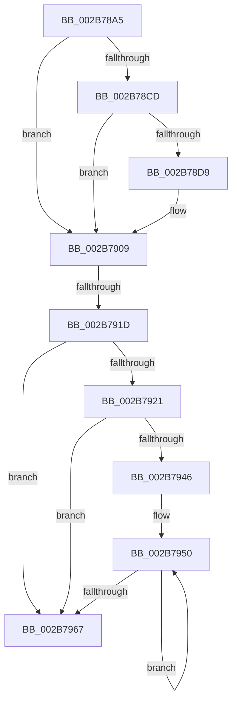

# sub_002B78A5

- RVA: `0x002B78A5`–`0x002B7976` (길이 `209` bytes)
- VA: `0x00000001402B78A5`
- 실행 섹션: `.text`
- PDB 이름 있음: `아니요`; PDB Function 태그: `아니요`
- unwind 정보 RVA: `0x0006DA7C`
- 디코드: `55`개 명령, `209/209` bytes 표시
- 미해석 바이트: `0` (있으면 어셈블리에 `.byte`로 보존)

> 이 문서는 커널 이미지의 기계어와 PDB 기호를 분석해 생성했습니다. 4번과 5번은 함수 원형과 자료형을 바이너리 사용 방식에서 추정한 C 해석이며 원본 소스 복구 결과는 아닙니다.

## 1. Dependencies

- 직접 호출 지점: **2**; 고유 호출 대상: **2**
- 직접 호출자로 확인된 함수: **0**
- RIP 상대 이미지 참조: **0**

### Outgoing calls
- `0x002B78E4` → [MiZeroPhysicalPage](../33/MiZeroPhysicalPage_function_00332590.md) (function, `0x00332590`)
- `0x002B78FF` → [MiSetPfnTbFlushStamp](MiSetPfnTbFlushStamp_function_002B7A70.md) (function, `0x002B7A70`)

### Direct callers
- 이 함수 시작 RVA로 연결되는 직접 call은 확인되지 않았습니다. 간접 호출은 완전히 역산할 수 없습니다.

### Static image references
- 디코드된 RIP-relative 메모리 참조가 없습니다.

## 2. Other-region calls and transfers

- 다른 실행 섹션으로 향하는 call: **0**
- call이 아닌 외부 분기/꼬리 이동: **1**
  - `0x002B7917` → [sub_002B79EA](Unknown_function_002B79EA.md) (`tail-transfer`)

## 3. Assembly (complete function range)

```asm
002B78A5  48 89 6C 24 50                  mov qword ptr [rsp + 0x50], rbp
002B78AA  41 8B C0                        mov eax, r8d
002B78AD  83 E0 01                        and eax, 1
002B78B0  4C 89 64 24 60                  mov qword ptr [rsp + 0x60], r12
002B78B5  4C 89 74 24 28                  mov qword ptr [rsp + 0x28], r14
002B78BA  33 ED                           xor ebp, ebp
002B78BC  44 8B F0                        mov r14d, eax
002B78BF  41 C1 E6 04                     shl r14d, 4
002B78C3  44 8D 24 00                     lea r12d, [rax + rax]
002B78C7  41 F6 C0 20                     test r8b, 0x20
002B78CB  74 3C                           je 0x1402b7909
002B78CD  48 8B 43 10                     mov rax, qword ptr [rbx + 0x10]
002B78D1  48 A9 E0 03 00 00               test rax, 0x3e0
002B78D7  74 30                           je 0x1402b7909
002B78D9  44 8B CE                        mov r9d, esi
002B78DC  45 8B C4                        mov r8d, r12d
002B78DF  49 8B D7                        mov rdx, r15
002B78E2  33 C9                           xor ecx, ecx
002B78E4  E8 A7 AC 07 00                  call 0x140332590
002B78E9  48 8B 43 10                     mov rax, qword ptr [rbx + 0x10]
002B78ED  45 33 C0                        xor r8d, r8d
002B78F0  48 25 1F FC FF FF               and rax, 0xfffffffffffffc1f
002B78F6  33 D2                           xor edx, edx
002B78F8  48 8B CB                        mov rcx, rbx
002B78FB  48 89 43 10                     mov qword ptr [rbx + 0x10], rax
002B78FF  E8 6C 01 00 00                  call 0x1402b7a70
002B7904  BD 01 00 00 00                  mov ebp, 1
002B7909  8B 43 20                        mov eax, dword ptr [rbx + 0x20]
002B790C  C1 E8 10                        shr eax, 0x10
002B790F  0F B6 C8                        movzx ecx, al
002B7912  C1 E9 06                        shr ecx, 6
002B7915  3B CE                           cmp ecx, esi
002B7917  0F 85 CD 00 00 00               jne 0x1402b79ea
002B791D  85 ED                           test ebp, ebp
002B791F  75 46                           jne 0x1402b7967
002B7921  48 8B 53 18                     mov rdx, qword ptr [rbx + 0x18]
002B7925  49 B9 FF FF FF FF FF FF FF C7   movabs r9, 0xc7ffffffffffffff
002B792F  48 8B CA                        mov rcx, rdx
002B7932  48 8B C2                        mov rax, rdx
002B7935  49 23 C9                        and rcx, r9
002B7938  F0 48 0F B1 4B 18               lock cmpxchg qword ptr [rbx + 0x18], rcx
002B793E  4C 8B C0                        mov r8, rax
002B7941  48 3B D0                        cmp rdx, rax
002B7944  74 21                           je 0x1402b7967
002B7946  66 66 0F 1F 84 00 00 00 00 00   nop word ptr [rax + rax]
002B7950  49 8B C8                        mov rcx, r8
002B7953  4D 23 C1                        and r8, r9
002B7956  48 8B C1                        mov rax, rcx
002B7959  F0 4C 0F B1 43 18               lock cmpxchg qword ptr [rbx + 0x18], r8
002B795F  4C 8B C0                        mov r8, rax
002B7962  48 3B C8                        cmp rcx, rax
002B7965  75 E9                           jne 0x1402b7950
002B7967  4C 8B 64 24 60                  mov r12, qword ptr [rsp + 0x60]
002B796C  48 8B 6C 24 50                  mov rbp, qword ptr [rsp + 0x50]
002B7971  4C 8B 74 24 28                  mov r14, qword ptr [rsp + 0x28]
```

## 4. C-style interpretation (structured pseudocode)

```c
__int64 __fastcall sub_002B78A5(int a1, __int64 a2, int a3, __int64 a4, __int64 a5, __int64 a6, __int64 a7, __int64 a8, __int64 a9, __int64 a10, __int64 a11, __int64 a12)
{
    __int64 result;
    __int64 v_r14;
    __int64 v_rbp;
    unsigned __int64 v_stack_p28;
    unsigned __int64 v_stack_p50;
    unsigned __int64 v_stack_p60;

    v_stack_p50 = v_rbp;
    result = (unsigned int)(((unsigned int)(a3)) & (1));
    v_stack_p60 = v_r12;
    v_stack_p28 = v_r14;
    v_rbp = 0;
    v_r14 = (unsigned int)(((unsigned int)((unsigned int)(result))) << (4));
    if ((((unsigned __int8)(a3)) & (32)) == 0) goto loc_002B7909;
    result = *(unsigned __int64 *)(v_rbx + 16);
    if (((*(unsigned __int64 *)(v_rbx + 16)) & (992)) != 0) {
        a4 = (unsigned int)(v_rsi);
        a3 = (unsigned int)(result + result * 1);
        a2 = v_r15;
        a1 = 0;
        result = MiZeroPhysicalPage(a1, a2, a3, a4);
        result = *(unsigned __int64 *)(v_rbx + 16);
        a3 = 0;
        result = (result) & (-993);
        a2 = 0;
        a1 = v_rbx;
        *(unsigned __int64 *)(v_rbx + 16) = result;
        result = MiSetPfnTbFlushStamp(a1, a2, a3, a4);
        v_rbp = 1;
    }
    result = (unsigned int)(((unsigned int)(*(unsigned int *)(v_rbx + 32))) >> (16));
    a1 = (unsigned int)(((unsigned __int8)(result)) >> (6));
    if ((unsigned int)(v_rbp) != 0) goto loc_002B7967;
    a1 = (*(unsigned __int64 *)(v_rbx + 24)) & (a4);
    if ((*(unsigned __int64 *)(v_rbx + 24)) == (*(unsigned __int64 *)(v_rbx + 24))) goto loc_002B7967;
loc_002B7950:
    a3 = (*(unsigned __int64 *)(v_rbx + 24)) & (a4);
    if ((*(unsigned __int64 *)(v_rbx + 24)) != (*(unsigned __int64 *)(v_rbx + 24))) goto loc_002B7950;
loc_002B7967:
    return *(unsigned __int64 *)(v_rbx + 24);
}
```

## 5. (Beta) C Style

```c
int64_t sub_002B78A5(int32_t Arg1, int64_t Arg2, void *Arg3, int64_t Arg4, int64_t Arg5, uint64_t Arg6, uint64_t Arg7, uint64_t Arg8, uint64_t Arg9, int64_t Arg10, uint64_t Arg11, int64_t Arg12)
{
    uint8_t *arg3 = (uint8_t *)Arg3;

    int64_t result;
    int64_t local_r14;
    int64_t local_rbp;
    uint64_t v_stack_p28;
    uint64_t v_stack_p50;
    uint64_t v_stack_p60;

    v_stack_p50 = local_rbp;
    result = (uint32_t)(((uint32_t)(Arg3)) & (1));
    v_stack_p60 = local_r12;
    v_stack_p28 = local_r14;
    local_rbp = 0;
    local_r14 = (uint32_t)(((uint32_t)((uint32_t)(result))) << (4));
    if ((((uint8_t)(Arg3)) & (32)) == 0) goto loc_002B7909;
    result = *(uint64_t *)(local_rbx + 0x10);
    if (((*(uint64_t *)(local_rbx + 0x10)) & (992)) != 0) {
        Arg4 = (uint32_t)(local_rsi);
        Arg3 = (uint32_t)(result + result * 1);
        Arg2 = local_r15;
        Arg1 = 0;
        result = MiZeroPhysicalPage(Arg1, Arg2, Arg3, Arg4);
        result = *(uint64_t *)(local_rbx + 0x10);
        Arg3 = 0;
        result = (result) & (-993);
        Arg2 = 0;
        Arg1 = local_rbx;
        *(uint64_t *)(local_rbx + 0x10) = result;
        result = MiSetPfnTbFlushStamp(Arg1, Arg2, Arg3, Arg4);
        local_rbp = 1;
    }
    result = (uint32_t)(((uint32_t)(*(uint32_t *)(local_rbx + 0x20))) >> (16));
    Arg1 = (uint32_t)(((uint8_t)(result)) >> (6));
    if ((uint32_t)(local_rbp) != 0) goto loc_002B7967;
    Arg1 = (*(uint64_t *)(local_rbx + 0x18)) & (Arg4);
    if ((*(uint64_t *)(local_rbx + 0x18)) == (*(uint64_t *)(local_rbx + 0x18))) goto loc_002B7967;
loc_002B7950:
    Arg3 = (*(uint64_t *)(local_rbx + 0x18)) & (Arg4);
    if ((*(uint64_t *)(local_rbx + 0x18)) != (*(uint64_t *)(local_rbx + 0x18))) goto loc_002B7950;
loc_002B7967:
    return *(uint64_t *)(local_rbx + 0x18);
}
```

### 관측된 메모리 오프셋

구조체 형식이 확인되지 않은 접근은 인자 기준의 오프셋으로만 기록했습니다.

| 기준 인자 | 오프셋 표현 | 폭 (bit) | 접근 |
|---|---:|---:|---|
| `Arg3` | `+ 0x0 + rax*1` | `32` | `R` |

## 6. Execution-region graph

[열기: 2D/3D 그래프와 함수 탐색 컨트롤 패널](../../../control-panel.html?section=text&rva=0x002B78A5&view=graph)

- 2D 그래프는 위에서 아래로 흐르고, 3D 그래프는 빈 공간을 드래그해 회전합니다. Shift+드래그는 이동, 휠은 확대·축소, 함수 노드 선택은 대상 보고서 이동입니다.

### Static fallback


