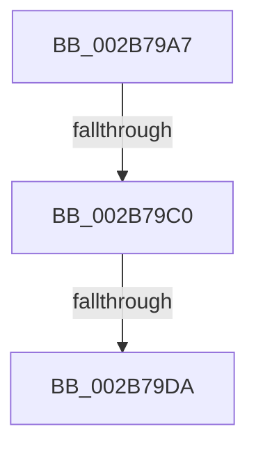

# sub_002B79A7

- RVA: `0x002B79A7`–`0x002B79EA` (길이 `67` bytes)
- VA: `0x00000001402B79A7`
- 실행 섹션: `.text`
- PDB 이름 있음: `아니요`; PDB Function 태그: `아니요`
- unwind 정보 RVA: `0x0006DABC`
- 디코드: `18`개 명령, `67/67` bytes 표시
- 미해석 바이트: `0` (있으면 어셈블리에 `.byte`로 보존)

> 이 문서는 커널 이미지의 기계어와 PDB 기호를 분석해 생성했습니다. 4번과 5번은 함수 원형과 자료형을 바이너리 사용 방식에서 추정한 C 해석이며 원본 소스 복구 결과는 아닙니다.

## 1. Dependencies

- 직접 호출 지점: **2**; 고유 호출 대상: **2**
- 직접 호출자로 확인된 함수: **0**
- RIP 상대 이미지 참조: **1**

### Outgoing calls
- `0x002B79C3` → [MiMakeLinkedListPte](../2C/MiMakeLinkedListPte_function_002C98C0.md) (function, `0x002C98C0`)
- `0x002B79E3` → [MiPerformFinalZeroing](../4F/MiPerformFinalZeroing_function_004F9594.md) (function, `0x004F9594`)

### Direct callers
- 이 함수 시작 RVA로 연결되는 직접 call은 확인되지 않았습니다. 간접 호출은 완전히 역산할 수 없습니다.

### Static image references
- `0x002B79B4` → RVA `0x00E2DCD8` (`.data`; reference)

## 2. Other-region calls and transfers

- 다른 실행 섹션으로 향하는 call: **0**
- call이 아닌 외부 분기/꼬리 이동: **3**
  - `0x002B79BA` → [sub_002B78A5](Unknown_function_002B78A5.md) (`tail-transfer`)
  - `0x002B79D8` → [sub_002B7976](Unknown_function_002B7976.md) (`tail-transfer`)
  - `0x002B79E8` → [sub_002B7976](Unknown_function_002B7976.md) (`tail-transfer`)

## 3. Assembly (complete function range)

```asm
002B79A7  B8 01 00 00 00                  mov eax, 1
002B79AC  D2 E0                           shl al, cl
002B79AE  0F B6 C8                        movzx ecx, al
002B79B1  0F AB F1                        bts ecx, esi
002B79B4  84 0D 1E 63 B7 00               test byte ptr [rip + 0xb7631e], cl
002B79BA  0F 84 E5 FE FF FF               je 0x1402b78a5
002B79C0  48 8B 0A                        mov rcx, qword ptr [rdx]
002B79C3  E8 F8 1E 01 00                  call 0x1402c98c0
002B79C8  48 89 43 10                     mov qword ptr [rbx + 0x10], rax
002B79CC  48 FF 42 08                     inc qword ptr [rdx + 8]
002B79D0  48 83 7A 08 10                  cmp qword ptr [rdx + 8], 0x10
002B79D5  4C 89 3A                        mov qword ptr [rdx], r15
002B79D8  75 9C                           jne 0x1402b7976
002B79DA  41 83 E0 01                     and r8d, 1
002B79DE  8B D6                           mov edx, esi
002B79E0  49 8B CD                        mov rcx, r13
002B79E3  E8 AC 1B 24 00                  call 0x1404f9594
002B79E8  EB 8C                           jmp 0x1402b7976
```

## 4. C-style interpretation (structured pseudocode)

```c
__int64 __fastcall sub_002B79A7(unsigned __int8 a1, __int64 a2, int a3)
{
    __int64 result;

    result = (unsigned __int8)((1) << (a1));
    result = MiMakeLinkedListPte(*(unsigned __int64 *)(a2), a2, a3, a4);
    *(unsigned __int64 *)(v_rbx + 16) = result;
    *(unsigned __int64 *)(a2) = v_r15;
    a3 = (unsigned int)((a3) & (1));
    result = MiPerformFinalZeroing(v_r13, (unsigned int)((unsigned int)(v_rsi)), a3, a4);
}
```

## 5. (Beta) C Style

```c
int64_t sub_002B79A7(uint8_t Arg1, void *Arg2, int32_t Arg3)
{
    uint8_t *arg2 = (uint8_t *)Arg2;

    int64_t result;

    result = (uint8_t)((1) << (Arg1));
    result = MiMakeLinkedListPte(*(uint64_t *)(arg2), Arg2, Arg3, a4);
    *(uint64_t *)(local_rbx + 0x10) = result;
    *(uint64_t *)(arg2) = local_r15;
    Arg3 = (uint32_t)((Arg3) & (1));
    result = MiPerformFinalZeroing(local_r13, (uint32_t)((uint32_t)(local_rsi)), Arg3, a4);
}
```

### 관측된 메모리 오프셋

구조체 형식이 확인되지 않은 접근은 인자 기준의 오프셋으로만 기록했습니다.

| 기준 인자 | 오프셋 표현 | 폭 (bit) | 접근 |
|---|---:|---:|---|
| `Arg2` | `+ 0x0` | `64` | `R` |

## 6. Execution-region graph

[열기: 2D/3D 그래프와 함수 탐색 컨트롤 패널](../../../control-panel.html?section=text&rva=0x002B79A7&view=graph)

- 2D 그래프는 위에서 아래로 흐르고, 3D 그래프는 빈 공간을 드래그해 회전합니다. Shift+드래그는 이동, 휠은 확대·축소, 함수 노드 선택은 대상 보고서 이동입니다.

### Static fallback


