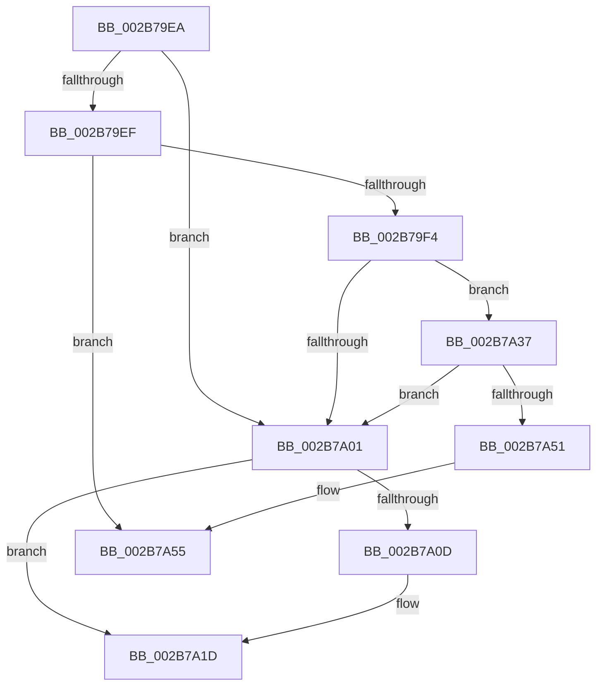

# sub_002B79EA

- RVA: `0x002B79EA`–`0x002B7A67` (길이 `125` bytes)
- VA: `0x00000001402B79EA`
- 실행 섹션: `.text`
- PDB 이름 있음: `아니요`; PDB Function 태그: `아니요`
- unwind 정보 RVA: `0x0006DAD8`
- 디코드: `34`개 명령, `125/125` bytes 표시
- 미해석 바이트: `0` (있으면 어셈블리에 `.byte`로 보존)

> 이 문서는 커널 이미지의 기계어와 PDB 기호를 분석해 생성했습니다. 4번과 5번은 함수 원형과 자료형을 바이너리 사용 방식에서 추정한 C 해석이며 원본 소스 복구 결과는 아닙니다.

## 1. Dependencies

- 직접 호출 지점: **4**; 고유 호출 대상: **4**
- 직접 호출자로 확인된 함수: **0**
- RIP 상대 이미지 참조: **1**

### Outgoing calls
- `0x002B7A18` → [MiZeroPhysicalPage](../33/MiZeroPhysicalPage_function_00332590.md) (function, `0x00332590`)
- `0x002B7A21` → [MiMakeLinkedListPte](../2C/MiMakeLinkedListPte_function_002C98C0.md) (function, `0x002C98C0`)
- `0x002B7A48` → [MiTbFlushTimeStampMayNeedFlush](../45/MiTbFlushTimeStampMayNeedFlush_function_004584B8.md) (function, `0x004584B8`)
- `0x002B7A5D` → [MiChangePageAttribute](../33/MiChangePageAttribute_function_00332ECC.md) (function, `0x00332ECC`)

### Direct callers
- 이 함수 시작 RVA로 연결되는 직접 call은 확인되지 않았습니다. 간접 호출은 완전히 역산할 수 없습니다.

### Static image references
- `0x002B7A3C` → RVA `0x00FCF080` (`CACHEALI`; read)

## 2. Other-region calls and transfers

- 다른 실행 섹션으로 향하는 call: **0**
- call이 아닌 외부 분기/꼬리 이동: **2**
  - `0x002B7A32` → [sub_002B78A5 + 0xC2](Unknown_function_002B78A5.md) (`tail-transfer`)
  - `0x002B7A62` → [sub_002B78A5 + 0x78](Unknown_function_002B78A5.md) (`tail-transfer`)

## 3. Assembly (complete function range)

```asm
002B79EA  83 F9 01                        cmp ecx, 1
002B79ED  74 12                           je 0x1402b7a01
002B79EF  83 F9 03                        cmp ecx, 3
002B79F2  74 61                           je 0x1402b7a55
002B79F4  48 8B 4B 18                     mov rcx, qword ptr [rbx + 0x18]
002B79F8  48 C1 E9 3B                     shr rcx, 0x3b
002B79FC  83 E1 07                        and ecx, 7
002B79FF  75 36                           jne 0x1402b7a37
002B7A01  48 8B 43 10                     mov rax, qword ptr [rbx + 0x10]
002B7A05  48 A9 E0 03 00 00               test rax, 0x3e0
002B7A0B  74 10                           je 0x1402b7a1d
002B7A0D  44 8B CE                        mov r9d, esi
002B7A10  45 8B C4                        mov r8d, r12d
002B7A13  49 8B D7                        mov rdx, r15
002B7A16  33 C9                           xor ecx, ecx
002B7A18  E8 73 AB 07 00                  call 0x140332590
002B7A1D  49 8B 4D 10                     mov rcx, qword ptr [r13 + 0x10]
002B7A21  E8 9A 1E 01 00                  call 0x1402c98c0
002B7A26  48 89 43 10                     mov qword ptr [rbx + 0x10], rax
002B7A2A  49 FF 45 18                     inc qword ptr [r13 + 0x18]
002B7A2E  4D 89 7D 10                     mov qword ptr [r13 + 0x10], r15
002B7A32  E9 30 FF FF FF                  jmp 0x1402b7967
002B7A37  F0 83 0C 24 00                  lock or dword ptr [rsp], 0
002B7A3C  8B 15 3E 76 D1 00               mov edx, dword ptr [rip + 0xd1763e]
002B7A42  41 B8 07 00 00 00               mov r8d, 7
002B7A48  E8 6B 0A 1A 00                  call 0x1404584b8
002B7A4D  84 C0                           test al, al
002B7A4F  75 B0                           jne 0x1402b7a01
002B7A51  41 83 CE 04                     or r14d, 4
002B7A55  45 8B C6                        mov r8d, r14d
002B7A58  8B D6                           mov edx, esi
002B7A5A  48 8B CB                        mov rcx, rbx
002B7A5D  E8 6A B4 07 00                  call 0x140332ecc
002B7A62  E9 B6 FE FF FF                  jmp 0x1402b791d
```

## 4. C-style interpretation (structured pseudocode)

```c
__int64 __fastcall sub_002B79EA(int a1)
{
    __int64 result;
    __int64 v_r14;
    unsigned int v_stack_p0;

    if (a1 == 1) goto loc_002B7A01;
    if (a1 == 3) goto loc_002B7A55;
    a1 = (*(unsigned __int64 *)(v_rbx + 24)) >> (59);
    a1 = (unsigned int)((a1) & (7));
    if (condition_is_not_equal) goto loc_002B7A37;
loc_002B7A01:
    result = *(unsigned __int64 *)(v_rbx + 16);
    if (((*(unsigned __int64 *)(v_rbx + 16)) & (992)) != 0) {
        a4 = (unsigned int)(v_rsi);
        a3 = (unsigned int)(v_r12);
        a2 = v_r15;
        a1 = 0;
        result = MiZeroPhysicalPage(a1, a2, a3, a4);
    }
    result = MiMakeLinkedListPte(*(unsigned __int64 *)(v_r13 + 16), a2, a3, a4);
    *(unsigned __int64 *)(v_rbx + 16) = result;
    *(unsigned __int64 *)(v_r13 + 16) = v_r15;
loc_002B7A37:
    result = MiTbFlushTimeStampMayNeedFlush(*(unsigned __int64 *)(v_r13 + 16), (unsigned int)(*(unsigned int *)(v_rip + 13727294)), 7, a4);
    if ((unsigned __int8)(result) != 0) goto loc_002B7A01;
    v_r14 = (unsigned int)((v_r14) | (4));
loc_002B7A55:
    result = MiChangePageAttribute(v_rbx, (unsigned int)((unsigned int)(v_rsi)), (unsigned int)((unsigned int)(v_r14)), a4);
}
```

## 5. (Beta) C Style

```c
int64_t sub_002B79EA(int32_t Arg1)
{
    int64_t result;
    int64_t local_r14;
    uint32_t v_stack_p0;

    if (Arg1 == 1) goto loc_002B7A01;
    if (Arg1 == 3) goto loc_002B7A55;
    Arg1 = (*(uint64_t *)(local_rbx + 0x18)) >> (59);
    Arg1 = (uint32_t)((Arg1) & (7));
    if (condition_is_not_equal) goto loc_002B7A37;
loc_002B7A01:
    result = *(uint64_t *)(local_rbx + 0x10);
    if (((*(uint64_t *)(local_rbx + 0x10)) & (992)) != 0) {
        a4 = (uint32_t)(local_rsi);
        a3 = (uint32_t)(local_r12);
        a2 = local_r15;
        Arg1 = 0;
        result = MiZeroPhysicalPage(Arg1, a2, a3, a4);
    }
    result = MiMakeLinkedListPte(*(uint64_t *)(local_r13 + 0x10), a2, a3, a4);
    *(uint64_t *)(local_rbx + 0x10) = result;
    *(uint64_t *)(local_r13 + 0x10) = local_r15;
loc_002B7A37:
    result = MiTbFlushTimeStampMayNeedFlush(*(uint64_t *)(local_r13 + 0x10), (uint32_t)(*(uint32_t *)(v_rip + 0xD1763E)), 7, a4);
    if ((uint8_t)(result) != 0) goto loc_002B7A01;
    local_r14 = (uint32_t)((local_r14) | (4));
loc_002B7A55:
    result = MiChangePageAttribute(local_rbx, (uint32_t)((uint32_t)(local_rsi)), (uint32_t)((uint32_t)(local_r14)), a4);
}
```

## 6. Execution-region graph

[열기: 2D/3D 그래프와 함수 탐색 컨트롤 패널](../../../control-panel.html?section=text&rva=0x002B79EA&view=graph)

- 2D 그래프는 위에서 아래로 흐르고, 3D 그래프는 빈 공간을 드래그해 회전합니다. Shift+드래그는 이동, 휠은 확대·축소, 함수 노드 선택은 대상 보고서 이동입니다.

### Static fallback


