# sub_002B933E

- RVA: `0x002B933E`–`0x002B97FB` (길이 `1,213` bytes)
- VA: `0x00000001402B933E`
- 실행 섹션: `.text`
- PDB 이름 있음: `아니요`; PDB Function 태그: `아니요`
- unwind 정보 RVA: `0x0006DC1C`
- 디코드: `288`개 명령, `1,213/1,213` bytes 표시
- 미해석 바이트: `0` (있으면 어셈블리에 `.byte`로 보존)

> 이 문서는 커널 이미지의 기계어와 PDB 기호를 분석해 생성했습니다. 4번과 5번은 함수 원형과 자료형을 바이너리 사용 방식에서 추정한 C 해석이며 원본 소스 복구 결과는 아닙니다.

## 1. Dependencies

- 직접 호출 지점: **0**; 고유 호출 대상: **0**
- 직접 호출자로 확인된 함수: **0**
- RIP 상대 이미지 참조: **8**

### Outgoing calls
- 직접 디코드된 call 명령이 없습니다.

### Direct callers
- 이 함수 시작 RVA로 연결되는 직접 call은 확인되지 않았습니다. 간접 호출은 완전히 역산할 수 없습니다.

### Static image references
- `0x002B9358` → RVA `0x00E2DBC0` (`.data`; read)
- `0x002B9365` → RVA `0x00E2DBC4` (`.data`; read)
- `0x002B937E` → RVA `0x00E2DC20` (`.data`; read)
- `0x002B93CA` → RVA `0x00E2DBC0` (`.data`; write)
- `0x002B93D1` → RVA `0x00E2DC28` (`.data`; read)
- `0x002B940A` → RVA `0x00E3CBE6` (`.data`; read)
- `0x002B9413` → RVA `0x00E3D240` (`.data`; read)
- `0x002B943F` → RVA `0x00E30088` (`.data`; read)

## 2. Other-region calls and transfers

- 다른 실행 섹션으로 향하는 call: **0**
- call이 아닌 외부 분기/꼬리 이동: **19**
  - `0x002B9346` → [sub_002B98DD + 0x26](Unknown_function_002B98DD.md) (`tail-transfer`)
  - `0x002B9399` → [sub_002B97FC](Unknown_function_002B97FC.md) (`tail-transfer`)
  - `0x002B93B7` → [sub_002B99FA](Unknown_function_002B99FA.md) (`tail-transfer`)
  - `0x002B93C4` → [sub_002B98DD](Unknown_function_002B98DD.md) (`tail-transfer`)
  - `0x002B93DC` → [sub_002B98DD + 0x43](Unknown_function_002B98DD.md) (`tail-transfer`)
  - `0x002B93F3` → [sub_002B99FA + 0xA8](Unknown_function_002B99FA.md) (`tail-transfer`)
  - `0x002B93FB` → [sub_002B99FA + 0xA8](Unknown_function_002B99FA.md) (`tail-transfer`)
  - `0x002B9404` → [sub_002B99FA + 0xA8](Unknown_function_002B99FA.md) (`tail-transfer`)
  - `0x002B9425` → [sub_002B99FA + 0x7F](Unknown_function_002B99FA.md) (`tail-transfer`)
  - `0x002B9493` → [sub_002B982E](Unknown_function_002B982E.md) (`tail-transfer`)
  - `0x002B94B1` → [sub_002B99FA + 0x24](Unknown_function_002B99FA.md) (`tail-transfer`)
  - `0x002B94BE` → [sub_002B98DD + 0x13](Unknown_function_002B98DD.md) (`tail-transfer`)
  - `0x002B94EB` → [sub_002B982E + 0x7D](Unknown_function_002B982E.md) (`tail-transfer`)
  - `0x002B9512` → [sub_002B98DD + 0x65](Unknown_function_002B98DD.md) (`tail-transfer`)
  - `0x002B953D` → [sub_002B99FA + 0x48](Unknown_function_002B99FA.md) (`tail-transfer`)
  - `0x002B968A` → [sub_002B99FA + 0xDB](Unknown_function_002B99FA.md) (`tail-transfer`)
  - `0x002B96C4` → [sub_002B982E + 0x52](Unknown_function_002B982E.md) (`tail-transfer`)
  - `0x002B9729` → [sub_002B982E + 0x1A](Unknown_function_002B982E.md) (`tail-transfer`)
  - `0x002B9747` → [sub_002B99FA + 0x11D](Unknown_function_002B99FA.md) (`tail-transfer`)

## 3. Assembly (complete function range)

```asm
002B933E  48 89 B4 24 F8 00 00 00         mov qword ptr [rsp + 0xf8], rsi
002B9346  0F 85 B7 05 00 00               jne 0x1402b9903
002B934C  32 D2                           xor dl, dl
002B934E  88 94 24 F0 00 00 00            mov byte ptr [rsp + 0xf0], dl
002B9355  49 8B C2                        mov rax, r10
002B9358  48 63 0D 61 48 B7 00            movsxd rcx, dword ptr [rip + 0xb74861]
002B935F  49 8B F7                        mov rsi, r15
002B9362  48 2B F0                        sub rsi, rax
002B9365  8B 05 59 48 B7 00               mov eax, dword ptr [rip + 0xb74859]
002B936B  48 C1 FE 04                     sar rsi, 4
002B936F  48 0F AF F3                     imul rsi, rbx
002B9373  3B C8                           cmp ecx, eax
002B9375  77 1D                           ja 0x1402b9394
002B9377  48 8B D9                        mov rbx, rcx
002B937A  48 C1 E3 04                     shl rbx, 4
002B937E  48 03 1D 9B 48 B7 00            add rbx, qword ptr [rip + 0xb7489b]
002B9385  48 3B 33                        cmp rsi, qword ptr [rbx]
002B9388  72 0A                           jb 0x1402b9394
002B938A  3B C8                           cmp ecx, eax
002B938C  74 43                           je 0x1402b93d1
002B938E  48 3B 73 10                     cmp rsi, qword ptr [rbx + 0x10]
002B9392  72 3D                           jb 0x1402b93d1
002B9394  41 8B C9                        mov ecx, r9d
002B9397  3B C1                           cmp eax, ecx
002B9399  0F 8C 5D 04 00 00               jl 0x1402b97fc
002B939F  44 8D 04 01                     lea r8d, [rcx + rax]
002B93A3  41 D1 F8                        sar r8d, 1
002B93A6  49 63 D8                        movsxd rbx, r8d
002B93A9  48 C1 E3 04                     shl rbx, 4
002B93AD  48 03 1D 6C 48 B7 00            add rbx, qword ptr [rip + 0xb7486c]
002B93B4  48 3B 33                        cmp rsi, qword ptr [rbx]
002B93B7  0F 82 3D 06 00 00               jb 0x1402b99fa
002B93BD  44 3B 05 00 48 B7 00            cmp r8d, dword ptr [rip + 0xb74800]
002B93C4  0F 85 13 05 00 00               jne 0x1402b98dd
002B93CA  44 89 05 EF 47 B7 00            mov dword ptr [rip + 0xb747ef], r8d
002B93D1  48 83 3D 4F 48 B7 00 00         cmp qword ptr [rip + 0xb7484f], 0
002B93D9  8B 5B 08                        mov ebx, dword ptr [rbx + 8]
002B93DC  0F 85 3E 05 00 00               jne 0x1402b9920
002B93E2  32 C9                           xor cl, cl
002B93E4  49 8B 44 24 28                  mov rax, qword ptr [r12 + 0x28]
002B93E9  44 8B 84 24 00 01 00 00         mov r8d, dword ptr [rsp + 0x100]
002B93F1  3B FB                           cmp edi, ebx
002B93F3  0F 85 A9 06 00 00               jne 0x1402b9aa2
002B93F9  3A D1                           cmp dl, cl
002B93FB  0F 85 A1 06 00 00               jne 0x1402b9aa2
002B9401  45 3B C5                        cmp r8d, r13d
002B9404  0F 85 98 06 00 00               jne 0x1402b9aa2
002B940A  80 3D D5 37 B8 00 00            cmp byte ptr [rip + 0xb837d5], 0
002B9411  74 18                           je 0x1402b942b
002B9413  48 8B 0D 26 3E B8 00            mov rcx, qword ptr [rip + 0xb83e26]
002B941A  49 C1 EE 09                     shr r14, 9
002B941E  42 0F B6 04 71                  movzx eax, byte ptr [rcx + r14*2]
002B9423  85 C0                           test eax, eax
002B9425  0F 85 4E 06 00 00               jne 0x1402b9a79
002B942B  4C 8D 0C 76                     lea r9, [rsi + rsi*2]
002B942F  49 C1 E1 04                     shl r9, 4
002B9433  49 8B C2                        mov rax, r10
002B9436  49 8D 3C 01                     lea rdi, [r9 + rax]
002B943A  49 8B 44 01 28                  mov rax, qword ptr [r9 + rax + 0x28]
002B943F  48 8B 0D 42 6C B7 00            mov rcx, qword ptr [rip + 0xb76c42]
002B9446  48 C1 E8 2B                     shr rax, 0x2b
002B944A  25 FF 03 00 00                  and eax, 0x3ff
002B944F  48 89 7C 24 38                  mov qword ptr [rsp + 0x38], rdi
002B9454  48 8B 14 C1                     mov rdx, qword ptr [rcx + rax*8]
002B9458  48 89 54 24 30                  mov qword ptr [rsp + 0x30], rdx
002B945D  48 63 15 5C 47 B7 00            movsxd rdx, dword ptr [rip + 0xb7475c]
002B9464  8B 0D 5A 47 B7 00               mov ecx, dword ptr [rip + 0xb7475a]
002B946A  3B D1                           cmp edx, ecx
002B946C  77 1D                           ja 0x1402b948b
002B946E  48 8B C2                        mov rax, rdx
002B9471  48 C1 E0 04                     shl rax, 4
002B9475  48 03 05 A4 47 B7 00            add rax, qword ptr [rip + 0xb747a4]
002B947C  48 3B 30                        cmp rsi, qword ptr [rax]
002B947F  72 0A                           jb 0x1402b948b
002B9481  3B D1                           cmp edx, ecx
002B9483  74 48                           je 0x1402b94cd
002B9485  48 3B 70 10                     cmp rsi, qword ptr [rax + 0x10]
002B9489  72 42                           jb 0x1402b94cd
002B948B  45 33 F6                        xor r14d, r14d
002B948E  41 8B D6                        mov edx, r14d
002B9491  3B CA                           cmp ecx, edx
002B9493  0F 8C 95 03 00 00               jl 0x1402b982e
002B9499  44 8D 04 0A                     lea r8d, [rdx + rcx]
002B949D  41 D1 F8                        sar r8d, 1
002B94A0  49 63 C0                        movsxd rax, r8d
002B94A3  48 C1 E0 04                     shl rax, 4
002B94A7  48 03 05 72 47 B7 00            add rax, qword ptr [rip + 0xb74772]
002B94AE  48 3B 30                        cmp rsi, qword ptr [rax]
002B94B1  0F 82 67 05 00 00               jb 0x1402b9a1e
002B94B7  44 3B 05 06 47 B7 00            cmp r8d, dword ptr [rip + 0xb74706]
002B94BE  0F 85 2C 04 00 00               jne 0x1402b98f0
002B94C4  44 89 05 F5 46 B7 00            mov dword ptr [rip + 0xb746f5], r8d
002B94CB  EB 03                           jmp 0x1402b94d0
002B94CD  45 33 F6                        xor r14d, r14d
002B94D0  8B 40 08                        mov eax, dword ptr [rax + 8]
002B94D3  44 8B 47 20                     mov r8d, dword ptr [rdi + 0x20]
002B94D7  89 44 24 48                     mov dword ptr [rsp + 0x48], eax
002B94DB  8B 47 20                        mov eax, dword ptr [rdi + 0x20]
002B94DE  C1 E8 18                        shr eax, 0x18
002B94E1  44 89 84 24 F0 00 00 00         mov dword ptr [rsp + 0xf0], r8d
002B94E9  A8 08                           test al, 8
002B94EB  0F 85 BA 03 00 00               jne 0x1402b98ab
002B94F1  49 BB AB AA AA AA AA AA AA AA   movabs r11, 0xaaaaaaaaaaaaaaab
002B94FB  0F B6 9C 24 F3 00 00 00         movzx ebx, byte ptr [rsp + 0xf3]
002B9503  83 E3 07                        and ebx, 7
002B9506  48 83 3D 1A 47 B7 00 00         cmp qword ptr [rip + 0xb7471a], 0
002B950E  89 5C 24 4C                     mov dword ptr [rsp + 0x4c], ebx
002B9512  0F 85 2A 04 00 00               jne 0x1402b9942
002B9518  45 32 C0                        xor r8b, r8b
002B951B  8B 44 24 48                     mov eax, dword ptr [rsp + 0x48]
002B951F  4C 69 C8 80 DF 00 00            imul r9, rax, 0xdf80
002B9526  48 8B 44 24 30                  mov rax, qword ptr [rsp + 0x30]
002B952B  44 88 44 24 50                  mov byte ptr [rsp + 0x50], r8b
002B9530  44 89 6C 24 54                  mov dword ptr [rsp + 0x54], r13d
002B9535  4C 03 48 10                     add r9, qword ptr [rax + 0x10]
002B9539  41 83 FD 09                     cmp r13d, 9
002B953D  0F 8C FF 04 00 00               jl 0x1402b9a42
002B9543  8B C3                           mov eax, ebx
002B9545  41 0F B6 C8                     movzx ecx, r8b
002B9549  48 8D 0C CD 3B 00 00 00         lea rcx, [rcx*8 + 0x3b]
002B9551  48 03 C8                        add rcx, rax
002B9554  48 6B C1 58                     imul rax, rcx, 0x58
002B9558  49 03 C1                        add rax, r9
002B955B  48 89 44 24 40                  mov qword ptr [rsp + 0x40], rax
002B9560  4D 8B 44 24 28                  mov r8, qword ptr [r12 + 0x28]
002B9565  4D 8D 5F 24                     lea r11, [r15 + 0x24]
002B9569  4D 8B 0C 24                     mov r9, qword ptr [r12]
002B956D  49 8D 5C 24 24                  lea rbx, [r12 + 0x24]
002B9572  49 C1 E9 14                     shr r9, 0x14
002B9576  0F 57 C0                        xorps xmm0, xmm0
002B9579  48 B9 00 00 00 00 00 00 80 0F   movabs rcx, 0xf80000000000000
002B9583  4C 89 74 24 60                  mov qword ptr [rsp + 0x60], r14
002B9588  49 8B C0                        mov rax, r8
002B958B  49 BD FF FF FF FF FF FF 7F F0   movabs r13, 0xf07fffffffffffff
002B9595  48 23 C1                        and rax, rcx
002B9598  0F 57 C9                        xorps xmm1, xmm1
002B959B  49 8B 0F                        mov rcx, qword ptr [r15]
002B959E  4C 0B C8                        or r9, rax
002B95A1  8B 03                           mov eax, dword ptr [rbx]
002B95A3  48 25 00 00 E0 FF               and rax, 0xffffffffffe00000
002B95A9  49 C1 E9 14                     shr r9, 0x14
002B95AD  48 C1 E0 03                     shl rax, 3
002B95B1  4C 0B C8                        or r9, rax
002B95B4  48 B8 FF FF FF FF FF 00 00 00   movabs rax, 0xffffffffff
002B95BE  48 23 C8                        and rcx, rax
002B95C1  49 8B C1                        mov rax, r9
002B95C4  48 C1 E0 28                     shl rax, 0x28
002B95C8  48 0B C8                        or rcx, rax
002B95CB  41 8B 03                        mov eax, dword ptr [r11]
002B95CE  49 89 0F                        mov qword ptr [r15], rcx
002B95D1  25 FF FF 1F 00                  and eax, 0x1fffff
002B95D6  49 8B C9                        mov rcx, r9
002B95D9  48 C1 E9 18                     shr rcx, 0x18
002B95DD  C1 E1 15                        shl ecx, 0x15
002B95E0  0B C8                           or ecx, eax
002B95E2  41 89 0B                        mov dword ptr [r11], ecx
002B95E5  49 8B 57 28                     mov rdx, qword ptr [r15 + 0x28]
002B95E9  48 8B CA                        mov rcx, rdx
002B95EC  48 89 94 24 88 00 00 00         mov qword ptr [rsp + 0x88], rdx
002B95F4  49 33 C8                        xor rcx, r8
002B95F7  48 8B C2                        mov rax, rdx
002B95FA  49 23 CD                        and rcx, r13
002B95FD  49 33 C8                        xor rcx, r8
002B9600  F3 0F 7F 44 24 68               movdqu xmmword ptr [rsp + 0x68], xmm0
002B9606  F3 0F 7F 4C 24 78               movdqu xmmword ptr [rsp + 0x78], xmm1
002B960C  0F 11 84 24 90 00 00 00         movups xmmword ptr [rsp + 0x90], xmm0
002B9614  0F 11 84 24 A0 00 00 00         movups xmmword ptr [rsp + 0xa0], xmm0
002B961C  0F 11 84 24 B0 00 00 00         movups xmmword ptr [rsp + 0xb0], xmm0
002B9624  F0 49 0F B1 4F 28               lock cmpxchg qword ptr [r15 + 0x28], rcx
002B962A  48 89 84 24 B8 00 00 00         mov qword ptr [rsp + 0xb8], rax
002B9632  48 3B D0                        cmp rdx, rax
002B9635  74 3C                           je 0x1402b9673
002B9637  4D 8B C1                        mov r8, r9
002B963A  49 C1 E0 14                     shl r8, 0x14
002B963E  66 90                           nop
002B9640  49 8B C8                        mov rcx, r8
002B9643  48 89 84 24 88 00 00 00         mov qword ptr [rsp + 0x88], rax
002B964B  48 33 C8                        xor rcx, rax
002B964E  48 8B D0                        mov rdx, rax
002B9651  49 23 CD                        and rcx, r13
002B9654  49 33 C8                        xor rcx, r8
002B9657  F0 49 0F B1 4F 28               lock cmpxchg qword ptr [r15 + 0x28], rcx
002B965D  48 89 84 24 B8 00 00 00         mov qword ptr [rsp + 0xb8], rax
002B9665  48 3B D0                        cmp rdx, rax
002B9668  75 D6                           jne 0x1402b9640
002B966A  49 8D 5C 24 24                  lea rbx, [r12 + 0x24]
002B966F  4D 8D 5F 24                     lea r11, [r15 + 0x24]
002B9673  48 BF FF FF FF FF 3F 00 00 00   movabs rdi, 0x3fffffffff
002B967D  49 BE FF FF FF FF FF 00 00 F8   movabs r14, 0xf80000ffffffffff
002B9687  4C 3B CF                        cmp r9, rdi
002B968A  0F 84 45 04 00 00               je 0x1402b9ad5
002B9690  4F 8D 0C 49                     lea r9, [r9 + r9*2]
002B9694  49 C1 E1 04                     shl r9, 4
002B9698  49 8B C2                        mov rax, r10
002B969B  4C 03 C8                        add r9, rax
002B969E  4C 8B D6                        mov r10, rsi
002B96A1  49 C1 E2 28                     shl r10, 0x28
002B96A5  49 8B CA                        mov rcx, r10
002B96A8  49 8B 51 18                     mov rdx, qword ptr [r9 + 0x18]
002B96AC  48 33 CA                        xor rcx, rdx
002B96AF  48 8B C2                        mov rax, rdx
002B96B2  49 23 CE                        and rcx, r14
002B96B5  49 33 CA                        xor rcx, r10
002B96B8  F0 49 0F B1 49 18               lock cmpxchg qword ptr [r9 + 0x18], rcx
002B96BE  4C 8B C0                        mov r8, rax
002B96C1  48 3B D0                        cmp rdx, rax
002B96C4  0F 85 B6 01 00 00               jne 0x1402b9880
002B96CA  41 8B 41 24                     mov eax, dword ptr [r9 + 0x24]
002B96CE  48 8B CE                        mov rcx, rsi
002B96D1  48 C1 E9 13                     shr rcx, 0x13
002B96D5  33 C8                           xor ecx, eax
002B96D7  81 E1 FF FF 1F 00               and ecx, 0x1fffff
002B96DD  33 C8                           xor ecx, eax
002B96DF  41 89 49 24                     mov dword ptr [r9 + 0x24], ecx
002B96E3  49 8B 44 24 18                  mov rax, qword ptr [r12 + 0x18]
002B96E8  44 8B 0B                        mov r9d, dword ptr [rbx]
002B96EB  49 8B 57 18                     mov rdx, qword ptr [r15 + 0x18]
002B96EF  41 81 E1 FF FF 1F 00            and r9d, 0x1fffff
002B96F6  48 C1 E8 28                     shr rax, 0x28
002B96FA  48 8B C8                        mov rcx, rax
002B96FD  49 C1 E1 13                     shl r9, 0x13
002B9701  81 E1 FF FF 07 00               and ecx, 0x7ffff
002B9707  48 C1 E0 28                     shl rax, 0x28
002B970B  4C 0B C9                        or r9, rcx
002B970E  48 8B CA                        mov rcx, rdx
002B9711  48 33 C8                        xor rcx, rax
002B9714  49 23 CE                        and rcx, r14
002B9717  48 33 C8                        xor rcx, rax
002B971A  48 8B C2                        mov rax, rdx
002B971D  F0 49 0F B1 4F 18               lock cmpxchg qword ptr [r15 + 0x18], rcx
002B9723  4C 8B C0                        mov r8, rax
002B9726  48 3B D0                        cmp rdx, rax
002B9729  0F 85 19 01 00 00               jne 0x1402b9848
002B972F  41 8B 47 24                     mov eax, dword ptr [r15 + 0x24]
002B9733  49 8B C9                        mov rcx, r9
002B9736  48 C1 E9 13                     shr rcx, 0x13
002B973A  25 00 00 E0 FF                  and eax, 0xffe00000
002B973F  0B C8                           or ecx, eax
002B9741  41 89 0B                        mov dword ptr [r11], ecx
002B9744  4C 3B CF                        cmp r9, rdi
002B9747  0F 84 CA 03 00 00               je 0x1402b9b17
002B974D  4F 8D 04 49                     lea r8, [r9 + r9*2]
002B9751  48 B8 00 00 00 00 00 DE FF FF   movabs rax, 0xffffde0000000000
002B975B  49 C1 E0 04                     shl r8, 4
002B975F  48 8B C0                        mov rax, rax
002B9762  4C 03 C0                        add r8, rax
002B9765  48 B8 FF FF FF FF FF 00 00 00   movabs rax, 0xffffffffff
002B976F  49 8B 08                        mov rcx, qword ptr [r8]
002B9772  48 23 C8                        and rcx, rax
002B9775  48 8B C6                        mov rax, rsi
002B9778  48 C1 E0 28                     shl rax, 0x28
002B977C  48 0B C8                        or rcx, rax
002B977F  41 8B 40 24                     mov eax, dword ptr [r8 + 0x24]
002B9783  49 89 08                        mov qword ptr [r8], rcx
002B9786  25 FF FF 1F 00                  and eax, 0x1fffff
002B978B  48 8B CE                        mov rcx, rsi
002B978E  48 C1 E6 14                     shl rsi, 0x14
002B9792  48 C1 E9 18                     shr rcx, 0x18
002B9796  C1 E1 15                        shl ecx, 0x15
002B9799  0B C8                           or ecx, eax
002B979B  41 89 48 24                     mov dword ptr [r8 + 0x24], ecx
002B979F  49 8B 50 28                     mov rdx, qword ptr [r8 + 0x28]
002B97A3  48 8B CA                        mov rcx, rdx
002B97A6  48 8B C2                        mov rax, rdx
002B97A9  48 33 CE                        xor rcx, rsi
002B97AC  49 23 CD                        and rcx, r13
002B97AF  48 33 CE                        xor rcx, rsi
002B97B2  F0 49 0F B1 48 28               lock cmpxchg qword ptr [r8 + 0x28], rcx
002B97B8  48 3B D0                        cmp rdx, rax
002B97BB  74 1D                           je 0x1402b97da
002B97BD  0F 1F 00                        nop dword ptr [rax]
002B97C0  48 8B C8                        mov rcx, rax
002B97C3  48 8B D0                        mov rdx, rax
002B97C6  48 33 CE                        xor rcx, rsi
002B97C9  49 23 CD                        and rcx, r13
002B97CC  48 33 CE                        xor rcx, rsi
002B97CF  F0 49 0F B1 48 28               lock cmpxchg qword ptr [r8 + 0x28], rcx
002B97D5  48 3B D0                        cmp rdx, rax
002B97D8  75 E6                           jne 0x1402b97c0
002B97DA  48 8B B4 24 F8 00 00 00         mov rsi, qword ptr [rsp + 0xf8]
002B97E2  48 8B 9C 24 08 01 00 00         mov rbx, qword ptr [rsp + 0x108]
002B97EA  48 81 C4 C0 00 00 00            add rsp, 0xc0
002B97F1  41 5F                           pop r15
002B97F3  41 5E                           pop r14
002B97F5  41 5D                           pop r13
002B97F7  41 5C                           pop r12
002B97F9  5F                              pop rdi
002B97FA  C3                              ret
```

## 4. C-style interpretation (structured pseudocode)

```c
__int64 __fastcall sub_002B933E(__int64 a1, unsigned __int8 a2, __int64 a3, int a4, __int64 a5, __int64 a6, __int64 a7, __int64 a8, unsigned int a9, __int64 a10, __int64 a11, __int64 a12, __int64 a13, __int64 a14, __int64 a15, __int64 a16, __int64 a17, __int64 a18, __int64 a19, __int64 a20, __int64 a21, __int64 a22, __int64 a23, __int64 a24, __int64 a25, __int64 a26, __int64 a27, __int64 a28, __int64 a29, __int64 a30, __int64 a31, unsigned int a32, __int64 a33)
{
    __int64 result;
    __int64 v_r10;
    __int64 v_r14;
    __int64 v_rbx;
    __int64 v_rsi;
    __int64 v_rsp;
    unsigned __int64 v_stack_p30;
    unsigned __int64 v_stack_p38;
    unsigned __int64 v_stack_p40;
    unsigned int v_stack_p48;
    unsigned int v_stack_p4C;
    unsigned __int8 v_stack_p50;
    unsigned int v_stack_p54;
    unsigned __int64 v_stack_p60;
    unsigned __int64 v_stack_p68;
    unsigned __int64 v_stack_p78;
    unsigned __int64 v_stack_p88;
    unsigned __int64 v_stack_pB8;
    unsigned __int8 v_stack_pF0;
    unsigned __int8 v_stack_pF3;
    unsigned __int64 v_stack_pF8;

    v_stack_pF8 = v_rsi;
    a2 = 0;
    v_stack_pF0 = 0;
    v_rsi = (v_r15) - (v_r10);
    v_rsi = (v_rsi) >> (4);
    v_rsi = (v_rsi) * (v_rbx);
    if (((unsigned int)((int)(*(unsigned int *)(v_rip + 12011617)))) > ((unsigned int)((unsigned int)(*(unsigned int *)(v_rip + 12011609))))) goto loc_002B9394;
    v_rbx = ((int)(*(unsigned int *)(v_rip + 12011617))) << (4);
    v_rbx = (v_rbx) + (*(unsigned __int64 *)(v_rip + 12011675));
    if (v_rsi < (*(unsigned __int64 *)(v_rbx))) goto loc_002B9394;
    if (((unsigned int)((int)(*(unsigned int *)(v_rip + 12011617)))) == ((unsigned int)((unsigned int)(*(unsigned int *)(v_rip + 12011609))))) goto loc_002B93D1;
    if (v_rsi < (*(unsigned __int64 *)(v_rbx + 16))) goto loc_002B93D1;
loc_002B9394:
    a3 = (unsigned int)(((unsigned int)(a4) + (unsigned int)(*(unsigned int *)(v_rip + 12011609)) * 1) >> (1));
    v_rbx = ((int)((unsigned int)(a3))) << (4);
    v_rbx = (v_rbx) + (*(unsigned __int64 *)(v_rip + 12011628));
    *(unsigned int *)(v_rip + 12011503) = (unsigned int)(a3);
loc_002B93D1:
    a1 = 0;
    if ((*(unsigned __int8 *)(v_rip + 12072917)) == 0) goto loc_002B942B;
    v_r14 = (v_r14) >> (9);
loc_002B942B:
    a4 = (v_rsi + v_rsi * 2) << (4);
    result = (*(unsigned __int64 *)(a4 + v_r10 * 1 + 40)) >> (43);
    result = (unsigned int)((result) & (0x3FFULL));
    v_stack_p38 = a4 + v_r10 * 1;
    v_stack_p30 = *(unsigned __int64 *)(*(unsigned __int64 *)(v_rip + 12020802) + result * 8);
    if (((unsigned int)((int)(*(unsigned int *)(v_rip + 12011356)))) > ((unsigned int)((unsigned int)(*(unsigned int *)(v_rip + 12011354))))) goto loc_002B948B;
    result = ((int)(*(unsigned int *)(v_rip + 12011356))) << (4);
    result = (result) + (*(unsigned __int64 *)(v_rip + 12011428));
    if (v_rsi < (*(unsigned __int64 *)(result))) goto loc_002B948B;
    if (((unsigned int)((int)(*(unsigned int *)(v_rip + 12011356)))) == ((unsigned int)((unsigned int)(*(unsigned int *)(v_rip + 12011354))))) goto loc_002B94CD;
    if (v_rsi < (*(unsigned __int64 *)(result + 16))) goto loc_002B94CD;
loc_002B948B:
    v_r14 = 0;
    a3 = (unsigned int)((0 + (unsigned int)(*(unsigned int *)(v_rip + 12011354)) * 1) >> (1));
    result = ((int)((unsigned int)(a3))) << (4);
    result = (result) + (*(unsigned __int64 *)(v_rip + 12011378));
    *(unsigned int *)(v_rip + 12011253) = (unsigned int)(a3);
    goto loc_002B94D0;
loc_002B94CD:
    v_r14 = 0;
loc_002B94D0:
    v_stack_p48 = (unsigned int)((unsigned int)(*(unsigned int *)(result + 8)));
    result = (unsigned int)(((unsigned int)(*(unsigned int *)(a4 + v_r10 * 1 + 32))) >> (24));
    v_stack_pF0 = (unsigned int)((unsigned int)(*(unsigned int *)(a4 + v_r10 * 1 + 32)));
    v_rbx = (unsigned int)((v_stack_pF3) & (7));
    v_stack_p4C = (unsigned int)(v_rbx);
    a3 = 0;
    a4 = (a4) * ((unsigned int)(a9));
    v_stack_p50 = 0;
    v_stack_p54 = (unsigned int)(v_r13);
    a4 = (a4) + (*(unsigned __int64 *)(a6 + 16));
    a1 = (0 * 8 + 59) + ((unsigned int)((unsigned int)(v_rbx)));
    result = ((unsigned int)((unsigned int)(v_rbx))) * (a1);
    result = (result) + (a4);
    v_stack_p40 = result;
    a4 = (*(unsigned __int64 *)(v_r12)) >> (20);
    v_stack_p60 = 0;
    result = (*(unsigned __int64 *)(v_r12 + 40)) & (a1);
    a4 = (a4) | (result);
    result = ((unsigned int)(*(unsigned int *)(v_r12 + 36))) & (0xFFFFFFFFFFE00000ULL);
    a4 = (a4) >> (20);
    result = (result) << (3);
    a4 = (a4) | (result);
    a1 = (*(unsigned __int64 *)(v_r15)) & (result);
    result = (a4) << (40);
    a1 = (a1) | (result);
    *(unsigned __int64 *)(v_r15) = a1;
    result = (unsigned int)(((unsigned int)(*(unsigned int *)(v_r15 + 36))) & (0x1FFFFFULL));
    a1 = (a4) >> (24);
    a1 = (unsigned int)((a1) << (21));
    a1 = (unsigned int)((a1) | ((unsigned int)(result)));
    *(unsigned int *)(v_r15 + 36) = (unsigned int)(a1);
    v_stack_p88 = *(unsigned __int64 *)(v_r15 + 40);
    a1 = (*(unsigned __int64 *)(v_r15 + 40)) ^ (*(unsigned __int64 *)(v_r12 + 40));
    a1 = (a1) & (v_r13);
    a1 = (a1) ^ (*(unsigned __int64 *)(v_r12 + 40));
    v_stack_p68 = v_xmm0;
    v_stack_p78 = v_xmm1;
    a18 = v_xmm0;
    a20 = v_xmm0;
    a22 = v_xmm0;
    v_stack_pB8 = *(unsigned __int64 *)(v_r15 + 40);
    if ((*(unsigned __int64 *)(v_r15 + 40)) == (*(unsigned __int64 *)(v_r15 + 40))) goto loc_002B9673;
    a3 = (a4) << (20);
loc_002B9640:
    v_stack_p88 = *(unsigned __int64 *)(v_r15 + 40);
    a1 = (a3) ^ (*(unsigned __int64 *)(v_r15 + 40));
    a1 = (a1) & (v_r13);
    a1 = (a1) ^ (a3);
    v_stack_pB8 = *(unsigned __int64 *)(v_r15 + 40);
    if ((*(unsigned __int64 *)(v_r15 + 40)) != (*(unsigned __int64 *)(v_r15 + 40))) goto loc_002B9640;
loc_002B9673:
    a4 = (a4 + a4 * 2) << (4);
    a4 = (a4) + (v_r10);
    v_r10 = (v_rsi) << (40);
    a1 = (v_r10) ^ (*(unsigned __int64 *)(a4 + 24));
    a1 = (a1) & (0);
    a1 = (a1) ^ (v_r10);
    a1 = (v_rsi) >> (19);
    a1 = (unsigned int)((a1) ^ ((unsigned int)((unsigned int)(*(unsigned int *)(a4 + 36)))));
    a1 = (unsigned int)((a1) & (0x1FFFFFULL));
    a1 = (unsigned int)((a1) ^ ((unsigned int)((unsigned int)(*(unsigned int *)(a4 + 36)))));
    *(unsigned int *)(a4 + 36) = (unsigned int)(a1);
    a4 = (unsigned int)(((unsigned int)(*(unsigned int *)(v_r12 + 36))) & (0x1FFFFFULL));
    result = (*(unsigned __int64 *)(v_r12 + 24)) >> (40);
    a4 = (a4) << (19);
    a1 = (unsigned int)((result) & (0x7FFFFULL));
    result = (result) << (40);
    a4 = (a4) | (a1);
    a1 = (*(unsigned __int64 *)(v_r15 + 24)) ^ (result);
    a1 = (a1) & (0);
    a1 = (a1) ^ (result);
    a1 = (a4) >> (19);
    result = (unsigned int)(((unsigned int)(*(unsigned int *)(v_r15 + 36))) & (0xFFE00000ULL));
    a1 = (unsigned int)((a1) | ((unsigned int)(result)));
    *(unsigned int *)(v_r15 + 36) = (unsigned int)(a1);
    a3 = (a4 + a4 * 2) << (4);
    a3 = (a3) + (result);
    a1 = (*(unsigned __int64 *)(a3)) & (result);
    result = (v_rsi) << (40);
    a1 = (a1) | (result);
    *(unsigned __int64 *)(a3) = a1;
    result = (unsigned int)(((unsigned int)(*(unsigned int *)(a3 + 36))) & (0x1FFFFFULL));
    v_rsi = (v_rsi) << (20);
    a1 = (v_rsi) >> (24);
    a1 = (unsigned int)((a1) << (21));
    a1 = (unsigned int)((a1) | ((unsigned int)(result)));
    *(unsigned int *)(a3 + 36) = (unsigned int)(a1);
    a1 = (*(unsigned __int64 *)(a3 + 40)) ^ (v_rsi);
    a1 = (a1) & (v_r13);
    a1 = (a1) ^ (v_rsi);
    if ((*(unsigned __int64 *)(a3 + 40)) == (*(unsigned __int64 *)(a3 + 40))) goto loc_002B97DA;
loc_002B97C0:
    a1 = (*(unsigned __int64 *)(a3 + 40)) ^ (v_rsi);
    a1 = (a1) & (v_r13);
    a1 = (a1) ^ (v_rsi);
    if ((*(unsigned __int64 *)(a3 + 40)) != (*(unsigned __int64 *)(a3 + 40))) goto loc_002B97C0;
loc_002B97DA:
    v_rsp = (v_rsp) + (192);
    return *(unsigned __int64 *)(a3 + 40);
}
```

## 5. (Beta) C Style

```c
int64_t sub_002B933E(int64_t Arg1, uint8_t Arg2, int64_t Arg3, void *Arg4, uint64_t Arg5, void *Arg6, uint64_t Arg7, uint64_t Arg8, uint32_t Arg9, uint64_t Arg10, uint64_t Arg11, uint64_t Arg12, uint64_t Arg13, uint64_t Arg14, uint64_t Arg15, uint64_t Arg16, uint64_t Arg17, int64_t Arg18, uint64_t Arg19, int64_t Arg20, uint64_t Arg21, int64_t Arg22, uint64_t Arg23, uint64_t Arg24, uint64_t Arg25, uint64_t Arg26, uint64_t Arg27, uint64_t Arg28, uint64_t Arg29, uint64_t Arg30, int64_t Arg31, uint32_t Arg32, int64_t Arg33)
{
    uint8_t *arg4 = (uint8_t *)Arg4;
    uint8_t *arg6 = (uint8_t *)Arg6;

    int64_t result;
    int64_t local_r10;
    int64_t local_r14;
    int64_t local_rbx;
    int64_t local_rsi;
    int64_t local_rsp;
    uint64_t v_stack_p30;
    uint64_t v_stack_p38;
    uint64_t v_stack_p40;
    uint32_t v_stack_p48;
    uint32_t v_stack_p4C;
    uint8_t v_stack_p50;
    uint32_t v_stack_p54;
    uint64_t v_stack_p60;
    uint64_t v_stack_p68;
    uint64_t v_stack_p78;
    uint64_t v_stack_p88;
    uint64_t v_stack_pB8;
    uint8_t v_stack_pF0;
    uint8_t v_stack_pF3;
    uint64_t v_stack_pF8;

    v_stack_pF8 = local_rsi;
    Arg2 = 0;
    v_stack_pF0 = 0;
    local_rsi = (local_r15) - (local_r10);
    local_rsi = (local_rsi) >> (4);
    local_rsi = (local_rsi) * (local_rbx);
    if (((uint32_t)((int32_t)(*(uint32_t *)(v_rip + 0xB74861)))) > ((uint32_t)((uint32_t)(*(uint32_t *)(v_rip + 0xB74859))))) goto loc_002B9394;
    local_rbx = ((int32_t)(*(uint32_t *)(v_rip + 0xB74861))) << (4);
    local_rbx = (local_rbx) + (*(uint64_t *)(v_rip + 0xB7489B));
    if (local_rsi < (*(uint64_t *)(local_rbx))) goto loc_002B9394;
    if (((uint32_t)((int32_t)(*(uint32_t *)(v_rip + 0xB74861)))) == ((uint32_t)((uint32_t)(*(uint32_t *)(v_rip + 0xB74859))))) goto loc_002B93D1;
    if (local_rsi < (*(uint64_t *)(local_rbx + 0x10))) goto loc_002B93D1;
loc_002B9394:
    Arg3 = (uint32_t)(((uint32_t)(Arg4) + (uint32_t)(*(uint32_t *)(v_rip + 0xB74859)) * 1) >> (1));
    local_rbx = ((int32_t)((uint32_t)(Arg3))) << (4);
    local_rbx = (local_rbx) + (*(uint64_t *)(v_rip + 0xB7486C));
    *(uint32_t *)(v_rip + 0xB747EF) = (uint32_t)(Arg3);
loc_002B93D1:
    Arg1 = 0;
    if ((*(uint8_t *)(v_rip + 0xB837D5)) == 0) goto loc_002B942B;
    local_r14 = (local_r14) >> (9);
loc_002B942B:
    Arg4 = (local_rsi + local_rsi * 2) << (4);
    result = (*(uint64_t *)(arg4 + local_r10 * 1 + 0x28)) >> (43);
    result = (uint32_t)((result) & (0x3FFULL));
    v_stack_p38 = Arg4 + local_r10 * 1;
    v_stack_p30 = *(uint64_t *)(*(uint64_t *)(v_rip + 0xB76C42) + result * 8);
    if (((uint32_t)((int32_t)(*(uint32_t *)(v_rip + 0xB7475C)))) > ((uint32_t)((uint32_t)(*(uint32_t *)(v_rip + 0xB7475A))))) goto loc_002B948B;
    result = ((int32_t)(*(uint32_t *)(v_rip + 0xB7475C))) << (4);
    result = (result) + (*(uint64_t *)(v_rip + 0xB747A4));
    if (local_rsi < (*(uint64_t *)(result))) goto loc_002B948B;
    if (((uint32_t)((int32_t)(*(uint32_t *)(v_rip + 0xB7475C)))) == ((uint32_t)((uint32_t)(*(uint32_t *)(v_rip + 0xB7475A))))) goto loc_002B94CD;
    if (local_rsi < (*(uint64_t *)(result + 0x10))) goto loc_002B94CD;
loc_002B948B:
    local_r14 = 0;
    Arg3 = (uint32_t)((0 + (uint32_t)(*(uint32_t *)(v_rip + 0xB7475A)) * 1) >> (1));
    result = ((int32_t)((uint32_t)(Arg3))) << (4);
    result = (result) + (*(uint64_t *)(v_rip + 0xB74772));
    *(uint32_t *)(v_rip + 0xB746F5) = (uint32_t)(Arg3);
    goto loc_002B94D0;
loc_002B94CD:
    local_r14 = 0;
loc_002B94D0:
    v_stack_p48 = (uint32_t)((uint32_t)(*(uint32_t *)(result + 0x8)));
    result = (uint32_t)(((uint32_t)(*(uint32_t *)(arg4 + local_r10 * 1 + 0x20))) >> (24));
    v_stack_pF0 = (uint32_t)((uint32_t)(*(uint32_t *)(arg4 + local_r10 * 1 + 0x20)));
    local_rbx = (uint32_t)((v_stack_pF3) & (7));
    v_stack_p4C = (uint32_t)(local_rbx);
    Arg3 = 0;
    Arg4 = (Arg4) * ((uint32_t)(Arg9));
    v_stack_p50 = 0;
    v_stack_p54 = (uint32_t)(local_r13);
    Arg4 = (Arg4) + (*(uint64_t *)(arg6 + 0x10));
    Arg1 = (0 * 8 + 59) + ((uint32_t)((uint32_t)(local_rbx)));
    result = ((uint32_t)((uint32_t)(local_rbx))) * (Arg1);
    result = (result) + (Arg4);
    v_stack_p40 = result;
    Arg4 = (*(uint64_t *)(local_r12)) >> (20);
    v_stack_p60 = 0;
    result = (*(uint64_t *)(local_r12 + 0x28)) & (Arg1);
    Arg4 = (Arg4) | (result);
    result = ((uint32_t)(*(uint32_t *)(local_r12 + 0x24))) & (0xFFFFFFFFFFE00000ULL);
    Arg4 = (Arg4) >> (20);
    result = (result) << (3);
    Arg4 = (Arg4) | (result);
    Arg1 = (*(uint64_t *)(local_r15)) & (result);
    result = (Arg4) << (40);
    Arg1 = (Arg1) | (result);
    *(uint64_t *)(local_r15) = Arg1;
    result = (uint32_t)(((uint32_t)(*(uint32_t *)(local_r15 + 0x24))) & (0x1FFFFFULL));
    Arg1 = (Arg4) >> (24);
    Arg1 = (uint32_t)((Arg1) << (21));
    Arg1 = (uint32_t)((Arg1) | ((uint32_t)(result)));
    *(uint32_t *)(local_r15 + 0x24) = (uint32_t)(Arg1);
    v_stack_p88 = *(uint64_t *)(local_r15 + 0x28);
    Arg1 = (*(uint64_t *)(local_r15 + 0x28)) ^ (*(uint64_t *)(local_r12 + 0x28));
    Arg1 = (Arg1) & (local_r13);
    Arg1 = (Arg1) ^ (*(uint64_t *)(local_r12 + 0x28));
    v_stack_p68 = v_xmm0;
    v_stack_p78 = v_xmm1;
    Arg18 = v_xmm0;
    Arg20 = v_xmm0;
    Arg22 = v_xmm0;
    v_stack_pB8 = *(uint64_t *)(local_r15 + 0x28);
    if ((*(uint64_t *)(local_r15 + 0x28)) == (*(uint64_t *)(local_r15 + 0x28))) goto loc_002B9673;
    Arg3 = (Arg4) << (20);
loc_002B9640:
    v_stack_p88 = *(uint64_t *)(local_r15 + 0x28);
    Arg1 = (Arg3) ^ (*(uint64_t *)(local_r15 + 0x28));
    Arg1 = (Arg1) & (local_r13);
    Arg1 = (Arg1) ^ (Arg3);
    v_stack_pB8 = *(uint64_t *)(local_r15 + 0x28);
    if ((*(uint64_t *)(local_r15 + 0x28)) != (*(uint64_t *)(local_r15 + 0x28))) goto loc_002B9640;
loc_002B9673:
    Arg4 = (Arg4 + Arg4 * 2) << (4);
    Arg4 = (Arg4) + (local_r10);
    local_r10 = (local_rsi) << (40);
    Arg1 = (local_r10) ^ (*(uint64_t *)(arg4 + 0x18));
    Arg1 = (Arg1) & (0);
    Arg1 = (Arg1) ^ (local_r10);
    Arg1 = (local_rsi) >> (19);
    Arg1 = (uint32_t)((Arg1) ^ ((uint32_t)((uint32_t)(*(uint32_t *)(arg4 + 0x24)))));
    Arg1 = (uint32_t)((Arg1) & (0x1FFFFFULL));
    Arg1 = (uint32_t)((Arg1) ^ ((uint32_t)((uint32_t)(*(uint32_t *)(arg4 + 0x24)))));
    *(uint32_t *)(arg4 + 0x24) = (uint32_t)(Arg1);
    Arg4 = (uint32_t)(((uint32_t)(*(uint32_t *)(local_r12 + 0x24))) & (0x1FFFFFULL));
    result = (*(uint64_t *)(local_r12 + 0x18)) >> (40);
    Arg4 = (Arg4) << (19);
    Arg1 = (uint32_t)((result) & (0x7FFFFULL));
    result = (result) << (40);
    Arg4 = (Arg4) | (Arg1);
    Arg1 = (*(uint64_t *)(local_r15 + 0x18)) ^ (result);
    Arg1 = (Arg1) & (0);
    Arg1 = (Arg1) ^ (result);
    Arg1 = (Arg4) >> (19);
    result = (uint32_t)(((uint32_t)(*(uint32_t *)(local_r15 + 0x24))) & (0xFFE00000ULL));
    Arg1 = (uint32_t)((Arg1) | ((uint32_t)(result)));
    *(uint32_t *)(local_r15 + 0x24) = (uint32_t)(Arg1);
    Arg3 = (Arg4 + Arg4 * 2) << (4);
    Arg3 = (Arg3) + (result);
    Arg1 = (*(uint64_t *)(Arg3)) & (result);
    result = (local_rsi) << (40);
    Arg1 = (Arg1) | (result);
    *(uint64_t *)(Arg3) = Arg1;
    result = (uint32_t)(((uint32_t)(*(uint32_t *)(Arg3 + 0x24))) & (0x1FFFFFULL));
    local_rsi = (local_rsi) << (20);
    Arg1 = (local_rsi) >> (24);
    Arg1 = (uint32_t)((Arg1) << (21));
    Arg1 = (uint32_t)((Arg1) | ((uint32_t)(result)));
    *(uint32_t *)(Arg3 + 0x24) = (uint32_t)(Arg1);
    Arg1 = (*(uint64_t *)(Arg3 + 0x28)) ^ (local_rsi);
    Arg1 = (Arg1) & (local_r13);
    Arg1 = (Arg1) ^ (local_rsi);
    if ((*(uint64_t *)(Arg3 + 0x28)) == (*(uint64_t *)(Arg3 + 0x28))) goto loc_002B97DA;
loc_002B97C0:
    Arg1 = (*(uint64_t *)(Arg3 + 0x28)) ^ (local_rsi);
    Arg1 = (Arg1) & (local_r13);
    Arg1 = (Arg1) ^ (local_rsi);
    if ((*(uint64_t *)(Arg3 + 0x28)) != (*(uint64_t *)(Arg3 + 0x28))) goto loc_002B97C0;
loc_002B97DA:
    local_rsp = (local_rsp) + (192);
    return *(uint64_t *)(Arg3 + 0x28);
}
```

### 관측된 메모리 오프셋

구조체 형식이 확인되지 않은 접근은 인자 기준의 오프셋으로만 기록했습니다.

| 기준 인자 | 오프셋 표현 | 폭 (bit) | 접근 |
|---|---:|---:|---|
| `Arg4` | `+ 0x0 + rax*1` | `32` | `R` |
| `Arg6` | `+ 0x10` | `64` | `R` |

## 6. Execution-region graph

[열기: 2D/3D 그래프와 함수 탐색 컨트롤 패널](../../../control-panel.html?section=text&rva=0x002B933E&view=graph)

- 2D 그래프는 위에서 아래로 흐르고, 3D 그래프는 빈 공간을 드래그해 회전합니다. Shift+드래그는 이동, 휠은 확대·축소, 함수 노드 선택은 대상 보고서 이동입니다.

### Static fallback

```mermaid
flowchart TD
  bb_002B933E[BB_002B933E]
  bb_002B934C[BB_002B934C]
  bb_002B9377[BB_002B9377]
  bb_002B938A[BB_002B938A]
  bb_002B938E[BB_002B938E]
  bb_002B9394[BB_002B9394]
  bb_002B939F[BB_002B939F]
  bb_002B93BD[BB_002B93BD]
  bb_002B93CA[BB_002B93CA]
  bb_002B93D1[BB_002B93D1]
  bb_002B93E2[BB_002B93E2]
  bb_002B93F9[BB_002B93F9]
  bb_002B9401[BB_002B9401]
  bb_002B940A[BB_002B940A]
  bb_002B9413[BB_002B9413]
  bb_002B942B[BB_002B942B]
  bb_002B946E[BB_002B946E]
  bb_002B9481[BB_002B9481]
  bb_002B9485[BB_002B9485]
  bb_002B948B[BB_002B948B]
  bb_002B9499[BB_002B9499]
  bb_002B94B7[BB_002B94B7]
  bb_002B94C4[BB_002B94C4]
  bb_002B94CD[BB_002B94CD]
  bb_002B94D0[BB_002B94D0]
  bb_002B94F1[BB_002B94F1]
  bb_002B9518[BB_002B9518]
  bb_002B9543[BB_002B9543]
  bb_002B9637[BB_002B9637]
  bb_002B9640[BB_002B9640]
  bb_002B966A[BB_002B966A]
  bb_002B9673[BB_002B9673]
  bb_002B9690[BB_002B9690]
  bb_002B96CA[BB_002B96CA]
  bb_002B972F[BB_002B972F]
  bb_002B974D[BB_002B974D]
  bb_002B97BD[BB_002B97BD]
  bb_002B97C0[BB_002B97C0]
  bb_002B97DA[BB_002B97DA]
  bb_002B933E -->|fallthrough| bb_002B934C
  bb_002B934C -->|branch| bb_002B9394
  bb_002B934C -->|fallthrough| bb_002B9377
  bb_002B9377 -->|branch| bb_002B9394
  bb_002B9377 -->|fallthrough| bb_002B938A
  bb_002B938A -->|branch| bb_002B93D1
  bb_002B938A -->|fallthrough| bb_002B938E
  bb_002B938E -->|branch| bb_002B93D1
  bb_002B938E -->|fallthrough| bb_002B9394
  bb_002B9394 -->|fallthrough| bb_002B939F
  bb_002B939F -->|fallthrough| bb_002B93BD
  bb_002B93BD -->|fallthrough| bb_002B93CA
  bb_002B93CA -->|flow| bb_002B93D1
  bb_002B93D1 -->|fallthrough| bb_002B93E2
  bb_002B93E2 -->|fallthrough| bb_002B93F9
  bb_002B93F9 -->|fallthrough| bb_002B9401
  bb_002B9401 -->|fallthrough| bb_002B940A
  bb_002B940A -->|branch| bb_002B942B
  bb_002B940A -->|fallthrough| bb_002B9413
  bb_002B9413 -->|fallthrough| bb_002B942B
  bb_002B942B -->|branch| bb_002B948B
  bb_002B942B -->|fallthrough| bb_002B946E
  bb_002B946E -->|branch| bb_002B948B
  bb_002B946E -->|fallthrough| bb_002B9481
  bb_002B9481 -->|branch| bb_002B94CD
  bb_002B9481 -->|fallthrough| bb_002B9485
  bb_002B9485 -->|branch| bb_002B94CD
  bb_002B9485 -->|fallthrough| bb_002B948B
  bb_002B948B -->|fallthrough| bb_002B9499
  bb_002B9499 -->|fallthrough| bb_002B94B7
  bb_002B94B7 -->|fallthrough| bb_002B94C4
  bb_002B94C4 -->|branch| bb_002B94D0
  bb_002B94CD -->|flow| bb_002B94D0
  bb_002B94D0 -->|fallthrough| bb_002B94F1
  bb_002B94F1 -->|fallthrough| bb_002B9518
  bb_002B9518 -->|fallthrough| bb_002B9543
  bb_002B9543 -->|branch| bb_002B9673
  bb_002B9543 -->|fallthrough| bb_002B9637
  bb_002B9637 -->|flow| bb_002B9640
  bb_002B9640 -->|branch| bb_002B9640
  bb_002B9640 -->|fallthrough| bb_002B966A
  bb_002B966A -->|flow| bb_002B9673
  bb_002B9673 -->|fallthrough| bb_002B9690
  bb_002B9690 -->|fallthrough| bb_002B96CA
  bb_002B96CA -->|fallthrough| bb_002B972F
  bb_002B972F -->|fallthrough| bb_002B974D
  bb_002B974D -->|branch| bb_002B97DA
  bb_002B974D -->|fallthrough| bb_002B97BD
  bb_002B97BD -->|flow| bb_002B97C0
  bb_002B97C0 -->|branch| bb_002B97C0
  bb_002B97C0 -->|fallthrough| bb_002B97DA
```


