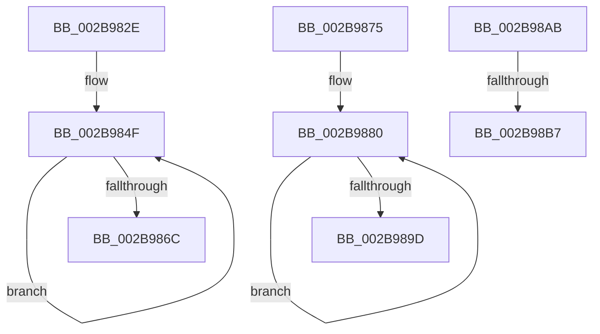

# sub_002B982E

- RVA: `0x002B982E`–`0x002B98CB` (길이 `157` bytes)
- VA: `0x00000001402B982E`
- 실행 섹션: `.text`
- PDB 이름 있음: `아니요`; PDB Function 태그: `아니요`
- unwind 정보 RVA: `0x0006DC68`
- 디코드: `39`개 명령, `157/157` bytes 표시
- 미해석 바이트: `0` (있으면 어셈블리에 `.byte`로 보존)

> 이 문서는 커널 이미지의 기계어와 PDB 기호를 분석해 생성했습니다. 4번과 5번은 함수 원형과 자료형을 바이너리 사용 방식에서 추정한 C 해석이며 원본 소스 복구 결과는 아닙니다.

## 1. Dependencies

- 직접 호출 지점: **1**; 고유 호출 대상: **1**
- 직접 호출자로 확인된 함수: **0**
- RIP 상대 이미지 참조: **0**

### Outgoing calls
- `0x002B9842` → [KeBugCheckEx](../4F/KeBugCheckEx_function_004FD660.md) (function, `0x004FD660`)

### Direct callers
- 이 함수 시작 RVA로 연결되는 직접 call은 확인되지 않았습니다. 간접 호출은 완전히 역산할 수 없습니다.

### Static image references
- 디코드된 RIP-relative 메모리 참조가 없습니다.

## 2. Other-region calls and transfers

- 다른 실행 섹션으로 향하는 call: **0**
- call이 아닌 외부 분기/꼬리 이동: **4**
  - `0x002B9870` → [sub_002B933E + 0x3F1](Unknown_function_002B933E.md) (`tail-transfer`)
  - `0x002B98A6` → [sub_002B933E + 0x38C](Unknown_function_002B933E.md) (`tail-transfer`)
  - `0x002B98B1` → [sub_002B98DD + 0x88](Unknown_function_002B98DD.md) (`tail-transfer`)
  - `0x002B98C6` → [sub_002B933E + 0x1C8](Unknown_function_002B933E.md) (`tail-transfer`)

## 3. Assembly (complete function range)

```asm
002B982E  45 33 C9                        xor r9d, r9d
002B9831  4C 89 74 24 20                  mov qword ptr [rsp + 0x20], r14
002B9836  4C 8B C6                        mov r8, rsi
002B9839  BA 80 51 00 00                  mov edx, 0x5180
002B983E  41 8D 49 1A                     lea ecx, [r9 + 0x1a]
002B9842  E8 19 3E 24 00                  call 0x1404fd660
002B9847  CC                              int3
002B9848  49 8B D1                        mov rdx, r9
002B984B  48 C1 E2 28                     shl rdx, 0x28
002B984F  49 8B C8                        mov rcx, r8
002B9852  4C 33 C2                        xor r8, rdx
002B9855  4D 23 C6                        and r8, r14
002B9858  48 8B C1                        mov rax, rcx
002B985B  4C 33 C2                        xor r8, rdx
002B985E  F0 4D 0F B1 47 18               lock cmpxchg qword ptr [r15 + 0x18], r8
002B9864  4C 8B C0                        mov r8, rax
002B9867  48 3B C8                        cmp rcx, rax
002B986A  75 E3                           jne 0x1402b984f
002B986C  4D 8D 5F 24                     lea r11, [r15 + 0x24]
002B9870  E9 BA FE FF FF                  jmp 0x1402b972f
002B9875  66 66 66 0F 1F 84 00 00 00 00 00  nop word ptr [rax + rax]
002B9880  49 8B C8                        mov rcx, r8
002B9883  4D 33 C2                        xor r8, r10
002B9886  4D 23 C6                        and r8, r14
002B9889  48 8B C1                        mov rax, rcx
002B988C  4D 33 C2                        xor r8, r10
002B988F  F0 4D 0F B1 41 18               lock cmpxchg qword ptr [r9 + 0x18], r8
002B9895  4C 8B C0                        mov r8, rax
002B9898  48 3B C8                        cmp rcx, rax
002B989B  75 E3                           jne 0x1402b9880
002B989D  49 8D 5C 24 24                  lea rbx, [r12 + 0x24]
002B98A2  4D 8D 5F 24                     lea r11, [r15 + 0x24]
002B98A6  E9 1F FE FF FF                  jmp 0x1402b96ca
002B98AB  49 8B C2                        mov rax, r10
002B98AE  48 3B F8                        cmp rdi, rax
002B98B1  0F 83 AE 00 00 00               jae 0x1402b9965
002B98B7  49 BB AB AA AA AA AA AA AA AA   movabs r11, 0xaaaaaaaaaaaaaaab
002B98C1  BB 05 00 00 00                  mov ebx, 5
002B98C6  E9 3B FC FF FF                  jmp 0x1402b9506
```

## 4. C-style interpretation (structured pseudocode)

```c
__int64 __fastcall sub_002B982E(__int64 a1, __int64 a2, __int64 a3, int a4)
{
    __int64 result;
    unsigned __int64 v_stack_p20;

    a4 = 0;
    v_stack_p20 = v_r14;
    result = KeBugCheckEx(a4 + 26, (unsigned int)(0x5180ULL), v_rsi, a4);
    a2 = (0) << (40);
loc_002B984F:
    a3 = (v_rsi) ^ (a2);
    a3 = (a3) & (v_r14);
    a3 = (a3) ^ (a2);
    if (v_rsi != v_rsi) goto loc_002B984F;
}
```

## 5. (Beta) C Style

```c
int64_t sub_002B982E(int64_t Arg1, int64_t Arg2, int64_t Arg3, int32_t Arg4)
{
    int64_t result;
    uint64_t v_stack_p20;

    Arg4 = 0;
    v_stack_p20 = local_r14;
    result = KeBugCheckEx(Arg4 + 26, (uint32_t)(0x5180ULL), local_rsi, Arg4);
    Arg2 = (0) << (40);
loc_002B984F:
    Arg3 = (local_rsi) ^ (Arg2);
    Arg3 = (Arg3) & (local_r14);
    Arg3 = (Arg3) ^ (Arg2);
    if (local_rsi != local_rsi) goto loc_002B984F;
}
```

## 6. Execution-region graph

[열기: 2D/3D 그래프와 함수 탐색 컨트롤 패널](../../../control-panel.html?section=text&rva=0x002B982E&view=graph)

- 2D 그래프는 위에서 아래로 흐르고, 3D 그래프는 빈 공간을 드래그해 회전합니다. Shift+드래그는 이동, 휠은 확대·축소, 함수 노드 선택은 대상 보고서 이동입니다.

### Static fallback


