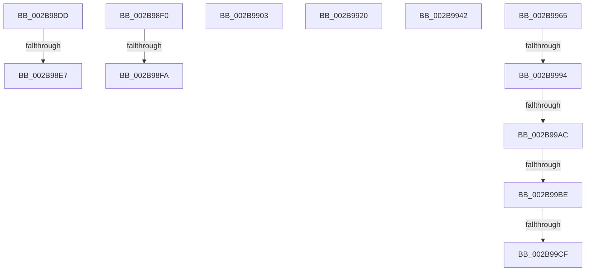

# sub_002B98DD

- RVA: `0x002B98DD`–`0x002B99D7` (길이 `250` bytes)
- VA: `0x00000001402B98DD`
- 실행 섹션: `.text`
- PDB 이름 있음: `아니요`; PDB Function 태그: `아니요`
- unwind 정보 RVA: `0x0006DC8C`
- 디코드: `51`개 명령, `250/250` bytes 표시
- 미해석 바이트: `0` (있으면 어셈블리에 `.byte`로 보존)

> 이 문서는 커널 이미지의 기계어와 PDB 기호를 분석해 생성했습니다. 4번과 5번은 함수 원형과 자료형을 바이너리 사용 방식에서 추정한 C 해석이며 원본 소스 복구 결과는 아닙니다.

## 1. Dependencies

- 직접 호출 지점: **5**; 고유 호출 대상: **3**
- 직접 호출자로 확인된 함수: **0**
- RIP 상대 이미지 참조: **1**

### Outgoing calls
- `0x002B9906` → [MiPageToChannel](MiPageToChannel_function_002B9B48.md) (function, `0x002B9B48`)
- `0x002B9923` → [MiPageToChannel](MiPageToChannel_function_002B9B48.md) (function, `0x002B9B48`)
- `0x002B994D` → [MiPageToChannel](MiPageToChannel_function_002B9B48.md) (function, `0x002B9B48`)
- `0x002B999F` → [MiIsDecayPfn](MiIsDecayPfn_function_002B9240.md) (function, `0x002B9240`)
- `0x002B99C1` → [MiGetPfnSlabType](../28/MiGetPfnSlabType_function_0028E2D0.md) (function, `0x0028E2D0`)

### Direct callers
- 이 함수 시작 RVA로 연결되는 직접 call은 확인되지 않았습니다. 간접 호출은 완전히 역산할 수 없습니다.

### Static image references
- `0x002B9965` → RVA `0x00E2DCE0` (`.data`; read)

## 2. Other-region calls and transfers

- 다른 실행 섹션으로 향하는 call: **0**
- call이 아닌 외부 분기/꼬리 이동: **12**
  - `0x002B98E1` → [sub_002B933E + 0x8C](Unknown_function_002B933E.md) (`tail-transfer`)
  - `0x002B98EB` → [sub_002B933E + 0x59](Unknown_function_002B933E.md) (`tail-transfer`)
  - `0x002B98F4` → [sub_002B933E + 0x186](Unknown_function_002B933E.md) (`tail-transfer`)
  - `0x002B98FE` → [sub_002B933E + 0x153](Unknown_function_002B933E.md) (`tail-transfer`)
  - `0x002B991B` → [sub_002B933E + 0x10](Unknown_function_002B933E.md) (`tail-transfer`)
  - `0x002B993D` → [sub_002B933E + 0xA6](Unknown_function_002B933E.md) (`tail-transfer`)
  - `0x002B9960` → [sub_002B933E + 0x1DD](Unknown_function_002B933E.md) (`tail-transfer`)
  - `0x002B998E` → [sub_002B982E + 0x93](Unknown_function_002B982E.md) (`tail-transfer`)
  - `0x002B99A6` → [sub_002B982E + 0x93](Unknown_function_002B982E.md) (`tail-transfer`)
  - `0x002B99B8` → [sub_002B933E + 0x1BD](Unknown_function_002B933E.md) (`tail-transfer`)
  - `0x002B99C9` → [sub_002B933E + 0x1BD](Unknown_function_002B933E.md) (`tail-transfer`)
  - `0x002B99D2` → [sub_002B933E + 0x1C8](Unknown_function_002B933E.md) (`tail-transfer`)

## 3. Assembly (complete function range)

```asm
002B98DD  48 3B 73 10                     cmp rsi, qword ptr [rbx + 0x10]
002B98E1  0F 82 E3 FA FF FF               jb 0x1402b93ca
002B98E7  41 8D 48 01                     lea ecx, [r8 + 1]
002B98EB  E9 A7 FA FF FF                  jmp 0x1402b9397
002B98F0  48 3B 70 10                     cmp rsi, qword ptr [rax + 0x10]
002B98F4  0F 82 CA FB FF FF               jb 0x1402b94c4
002B98FA  41 8D 50 01                     lea edx, [r8 + 1]
002B98FE  E9 8E FB FF FF                  jmp 0x1402b9491
002B9903  49 8B CE                        mov rcx, r14
002B9906  E8 3D 02 00 00                  call 0x1402b9b48
002B990B  0F B6 D0                        movzx edx, al
002B990E  49 BA 00 00 00 00 00 DE FF FF   movabs r10, 0xffffde0000000000
002B9918  45 33 C9                        xor r9d, r9d
002B991B  E9 2E FA FF FF                  jmp 0x1402b934e
002B9920  48 8B CE                        mov rcx, rsi
002B9923  E8 20 02 00 00                  call 0x1402b9b48
002B9928  0F B6 94 24 F0 00 00 00         movzx edx, byte ptr [rsp + 0xf0]
002B9930  0F B6 C8                        movzx ecx, al
002B9933  49 BA 00 00 00 00 00 DE FF FF   movabs r10, 0xffffde0000000000
002B993D  E9 A2 FA FF FF                  jmp 0x1402b93e4
002B9942  49 C1 F9 04                     sar r9, 4
002B9946  4D 0F AF CB                     imul r9, r11
002B994A  49 8B C9                        mov rcx, r9
002B994D  E8 F6 01 00 00                  call 0x1402b9b48
002B9952  44 0F B6 C0                     movzx r8d, al
002B9956  49 BA 00 00 00 00 00 DE FF FF   movabs r10, 0xffffde0000000000
002B9960  E9 B6 FB FF FF                  jmp 0x1402b951b
002B9965  48 8B 05 74 43 B7 00            mov rax, qword ptr [rip + 0xb74374]
002B996C  48 8D 0C 40                     lea rcx, [rax + rax*2]
002B9970  48 C1 E1 04                     shl rcx, 4
002B9974  48 B8 30 00 00 00 00 DE FF FF   movabs rax, 0xffffde0000000030
002B997E  48 03 C8                        add rcx, rax
002B9981  49 BB AB AA AA AA AA AA AA AA   movabs r11, 0xaaaaaaaaaaaaaaab
002B998B  48 3B F9                        cmp rdi, rcx
002B998E  0F 83 2D FF FF FF               jae 0x1402b98c1
002B9994  49 8B C9                        mov rcx, r9
002B9997  48 C1 F9 04                     sar rcx, 4
002B999B  49 0F AF CB                     imul rcx, r11
002B999F  E8 9C F8 FF FF                  call 0x1402b9240
002B99A4  85 C0                           test eax, eax
002B99A6  0F 85 15 FF FF FF               jne 0x1402b98c1
002B99AC  41 C1 E8 10                     shr r8d, 0x10
002B99B0  41 80 E0 07                     and r8b, 7
002B99B4  41 80 F8 06                     cmp r8b, 6
002B99B8  0F 84 3D FB FF FF               je 0x1402b94fb
002B99BE  48 8B CF                        mov rcx, rdi
002B99C1  E8 0A 49 FD FF                  call 0x14028e2d0
002B99C6  83 F8 09                        cmp eax, 9
002B99C9  0F 85 2C FB FF FF               jne 0x1402b94fb
002B99CF  8D 58 FC                        lea ebx, [rax - 4]
002B99D2  E9 2F FB FF FF                  jmp 0x1402b9506
```

## 4. C-style interpretation (structured pseudocode)

```c
__int64 __fastcall sub_002B98DD(__int64 a1, __int64 a2, __int64 a3, int a4)
{
    unsigned __int8 v_stack_pF0;
}
```

## 5. (Beta) C Style

```c
int64_t sub_002B98DD(int64_t Arg1, int64_t Arg2, void *Arg3, int32_t Arg4)
{
    uint8_t *arg3 = (uint8_t *)Arg3;

    uint8_t v_stack_pF0;
}
```

### 관측된 메모리 오프셋

구조체 형식이 확인되지 않은 접근은 인자 기준의 오프셋으로만 기록했습니다.

| 기준 인자 | 오프셋 표현 | 폭 (bit) | 접근 |
|---|---:|---:|---|
| `Arg3` | `+ 0x1` | `32` | `R` |

## 6. Execution-region graph

[열기: 2D/3D 그래프와 함수 탐색 컨트롤 패널](../../../control-panel.html?section=text&rva=0x002B98DD&view=graph)

- 2D 그래프는 위에서 아래로 흐르고, 3D 그래프는 빈 공간을 드래그해 회전합니다. Shift+드래그는 이동, 휠은 확대·축소, 함수 노드 선택은 대상 보고서 이동입니다.

### Static fallback


