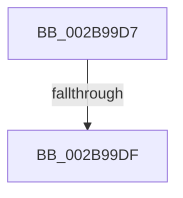

# sub_002B99D7

- RVA: `0x002B99D7`–`0x002B99FA` (길이 `35` bytes)
- VA: `0x00000001402B99D7`
- 실행 섹션: `.text`
- PDB 이름 있음: `아니요`; PDB Function 태그: `아니요`
- unwind 정보 RVA: `0x0006DCA0`
- 디코드: `9`개 명령, `35/35` bytes 표시
- 미해석 바이트: `0` (있으면 어셈블리에 `.byte`로 보존)

> 이 문서는 커널 이미지의 기계어와 PDB 기호를 분석해 생성했습니다. 4번과 5번은 함수 원형과 자료형을 바이너리 사용 방식에서 추정한 C 해석이며 원본 소스 복구 결과는 아닙니다.

## 1. Dependencies

- 직접 호출 지점: **1**; 고유 호출 대상: **1**
- 직접 호출자로 확인된 함수: **0**
- RIP 상대 이미지 참조: **0**

### Outgoing calls
- `0x002B99F4` → [KeBugCheckEx](../4F/KeBugCheckEx_function_004FD660.md) (function, `0x004FD660`)

### Direct callers
- 이 함수 시작 RVA로 연결되는 직접 call은 확인되지 않았습니다. 간접 호출은 완전히 역산할 수 없습니다.

### Static image references
- 디코드된 RIP-relative 메모리 참조가 없습니다.

## 2. Other-region calls and transfers

- 다른 실행 섹션으로 향하는 call: **0**
- call이 아닌 외부 분기/꼬리 이동: **1**
  - `0x002B99D9` → [sub_002B9B25](Unknown_function_002B9B25.md) (`tail-transfer`)

## 3. Assembly (complete function range)

```asm
002B99D7  85 D2                           test edx, edx
002B99D9  0F 85 46 01 00 00               jne 0x1402b9b25
002B99DF  4C 89 4C 24 20                  mov qword ptr [rsp + 0x20], r9
002B99E4  4D 8B C6                        mov r8, r14
002B99E7  4C 8B CF                        mov r9, rdi
002B99EA  BA 80 51 00 00                  mov edx, 0x5180
002B99EF  B9 1A 00 00 00                  mov ecx, 0x1a
002B99F4  E8 67 3C 24 00                  call 0x1404fd660
002B99F9  CC                              int3
```

## 4. C-style interpretation (structured pseudocode)

```c
__int64 __fastcall sub_002B99D7(__int64 a1, int a2, __int64 a3, __int64 a4)
{
    __int64 result;
    unsigned __int64 v_stack_p20;

    v_stack_p20 = a4;
    result = KeBugCheckEx(26, (unsigned int)(0x5180ULL), v_r14, v_rdi);
    return result;
}
```

## 5. (Beta) C Style

```c
int64_t sub_002B99D7(int64_t Arg1, int32_t Arg2, int64_t Arg3, int64_t Arg4)
{
    int64_t result;
    uint64_t v_stack_p20;

    v_stack_p20 = Arg4;
    result = KeBugCheckEx(26, (uint32_t)(0x5180ULL), local_r14, local_rdi);
    return result;
}
```

## 6. Execution-region graph

[열기: 2D/3D 그래프와 함수 탐색 컨트롤 패널](../../../control-panel.html?section=text&rva=0x002B99D7&view=graph)

- 2D 그래프는 위에서 아래로 흐르고, 3D 그래프는 빈 공간을 드래그해 회전합니다. Shift+드래그는 이동, 휠은 확대·축소, 함수 노드 선택은 대상 보고서 이동입니다.

### Static fallback


