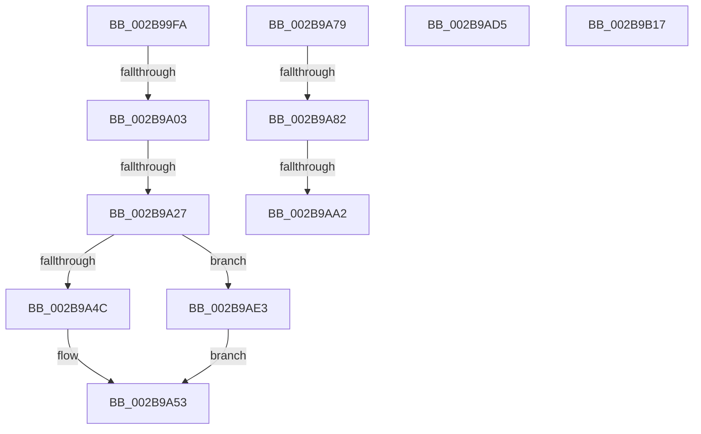

# sub_002B99FA

- RVA: `0x002B99FA`–`0x002B9B25` (길이 `299` bytes)
- VA: `0x00000001402B99FA`
- 실행 섹션: `.text`
- PDB 이름 있음: `아니요`; PDB Function 태그: `아니요`
- unwind 정보 RVA: `0x0006DCB0`
- 디코드: `69`개 명령, `299/299` bytes 표시
- 미해석 바이트: `0` (있으면 어셈블리에 `.byte`로 보존)

> 이 문서는 커널 이미지의 기계어와 PDB 기호를 분석해 생성했습니다. 4번과 5번은 함수 원형과 자료형을 바이너리 사용 방식에서 추정한 C 해석이며 원본 소스 복구 결과는 아닙니다.

## 1. Dependencies

- 직접 호출 지점: **4**; 고유 호출 대상: **3**
- 직접 호출자로 확인된 함수: **0**
- RIP 상대 이미지 참조: **1**

### Outgoing calls
- `0x002B9A18` → [KeBugCheckEx](../4F/KeBugCheckEx_function_004FD660.md) (function, `0x004FD660`)
- `0x002B9A3C` → [KeBugCheckEx](../4F/KeBugCheckEx_function_004FD660.md) (function, `0x004FD660`)
- `0x002B9AA8` → [MiUnlinkSecondaryListStandbyPage](../33/MiUnlinkSecondaryListStandbyPage_function_0033B080.md) (function, `0x0033B080`)
- `0x002B9ACB` → [MiInsertSecondaryListStandbyPage](../33/MiInsertSecondaryListStandbyPage_function_0033BEE0.md) (function, `0x0033BEE0`)

### Direct callers
- 이 함수 시작 RVA로 연결되는 직접 call은 확인되지 않았습니다. 간접 호출은 완전히 역산할 수 없습니다.

### Static image references
- `0x002B9AFB` → RVA `0x00E3D240` (`.data`; read)

## 2. Other-region calls and transfers

- 다른 실행 섹션으로 향하는 call: **0**
- call이 아닌 외부 분기/꼬리 이동: **8**
  - `0x002B99FD` → [sub_002B9B2D](Unknown_function_002B9B2D.md) (`tail-transfer`)
  - `0x002B9A21` → [sub_002B9B2D + 0x9](Unknown_function_002B9B2D.md) (`tail-transfer`)
  - `0x002B9A74` → [sub_002B933E + 0x222](Unknown_function_002B933E.md) (`tail-transfer`)
  - `0x002B9A7C` → [sub_002B933E + 0xED](Unknown_function_002B933E.md) (`tail-transfer`)
  - `0x002B9A9C` → [sub_002B933E + 0xED](Unknown_function_002B933E.md) (`tail-transfer`)
  - `0x002B9AD0` → [sub_002B933E + 0x49C](Unknown_function_002B933E.md) (`tail-transfer`)
  - `0x002B9ADE` → [sub_002B933E + 0x3A5](Unknown_function_002B933E.md) (`tail-transfer`)
  - `0x002B9B20` → [sub_002B933E + 0x49C](Unknown_function_002B933E.md) (`tail-transfer`)

## 3. Assembly (complete function range)

```asm
002B99FA  45 85 C0                        test r8d, r8d
002B99FD  0F 85 2A 01 00 00               jne 0x1402b9b2d
002B9A03  4C 89 4C 24 20                  mov qword ptr [rsp + 0x20], r9
002B9A08  4C 8B C6                        mov r8, rsi
002B9A0B  4C 8B CB                        mov r9, rbx
002B9A0E  BA 80 51 00 00                  mov edx, 0x5180
002B9A13  B9 1A 00 00 00                  mov ecx, 0x1a
002B9A18  E8 43 3C 24 00                  call 0x1404fd660
002B9A1D  CC                              int3
002B9A1E  45 85 C0                        test r8d, r8d
002B9A21  0F 85 0F 01 00 00               jne 0x1402b9b36
002B9A27  4C 8B C8                        mov r9, rax
002B9A2A  4C 89 74 24 20                  mov qword ptr [rsp + 0x20], r14
002B9A2F  4C 8B C6                        mov r8, rsi
002B9A32  BA 80 51 00 00                  mov edx, 0x5180
002B9A37  B9 1A 00 00 00                  mov ecx, 0x1a
002B9A3C  E8 1F 3C 24 00                  call 0x1404fd660
002B9A41  CC                              int3
002B9A42  41 83 FD 08                     cmp r13d, 8
002B9A46  0F 84 97 00 00 00               je 0x1402b9ae3
002B9A4C  C6 44 24 58 00                  mov byte ptr [rsp + 0x58], 0
002B9A51  32 C9                           xor cl, cl
002B9A53  0F B6 C9                        movzx ecx, cl
002B9A56  8B C3                           mov eax, ebx
002B9A58  48 8D 0C C8                     lea rcx, [rax + rcx*8]
002B9A5C  48 6B D1 58                     imul rdx, rcx, 0x58
002B9A60  49 69 CD E8 00 00 00            imul rcx, r13, 0xe8
002B9A67  4A 03 94 09 98 3D 00 00         add rdx, qword ptr [rcx + r9 + 0x3d98]
002B9A6F  48 89 54 24 40                  mov qword ptr [rsp + 0x40], rdx
002B9A74  E9 E7 FA FF FF                  jmp 0x1402b9560
002B9A79  83 F8 09                        cmp eax, 9
002B9A7C  0F 85 A9 F9 FF FF               jne 0x1402b942b
002B9A82  42 0F B6 54 71 01               movzx edx, byte ptr [rcx + r14*2 + 1]
002B9A88  48 8B C6                        mov rax, rsi
002B9A8B  48 C1 E8 09                     shr rax, 9
002B9A8F  80 E2 7F                        and dl, 0x7f
002B9A92  0F B6 4C 41 01                  movzx ecx, byte ptr [rcx + rax*2 + 1]
002B9A97  80 E1 7F                        and cl, 0x7f
002B9A9A  3A D1                           cmp dl, cl
002B9A9C  0F 84 89 F9 FF FF               je 0x1402b942b
002B9AA2  41 8B D0                        mov edx, r8d
002B9AA5  49 8B CC                        mov rcx, r12
002B9AA8  E8 D3 15 08 00                  call 0x14033b080
002B9AAD  48 8B 84 24 10 01 00 00         mov rax, qword ptr [rsp + 0x110]
002B9AB5  41 BE 00 00 00 00               mov r14d, 0
002B9ABB  41 8B D5                        mov edx, r13d
002B9ABE  49 8B CF                        mov rcx, r15
002B9AC1  80 38 00                        cmp byte ptr [rax], 0
002B9AC4  49 0F 44 C6                     cmove rax, r14
002B9AC8  4C 8B C0                        mov r8, rax
002B9ACB  E8 10 24 08 00                  call 0x14033bee0
002B9AD0  E9 05 FD FF FF                  jmp 0x1402b97da
002B9AD5  48 8B 44 24 40                  mov rax, qword ptr [rsp + 0x40]
002B9ADA  48 89 70 18                     mov qword ptr [rax + 0x18], rsi
002B9ADE  E9 00 FC FF FF                  jmp 0x1402b96e3
002B9AE3  49 8B C2                        mov rax, r10
002B9AE6  48 2B F8                        sub rdi, rax
002B9AE9  48 B8 AB AA AA AA AA AA AA AA   movabs rax, 0xaaaaaaaaaaaaaaab
002B9AF3  48 C1 FF 04                     sar rdi, 4
002B9AF7  48 0F AF F8                     imul rdi, rax
002B9AFB  48 8B 05 3E 37 B8 00            mov rax, qword ptr [rip + 0xb8373e]
002B9B02  48 C1 EF 09                     shr rdi, 9
002B9B06  0F B6 4C 78 01                  movzx ecx, byte ptr [rax + rdi*2 + 1]
002B9B0B  80 E1 7F                        and cl, 0x7f
002B9B0E  88 4C 24 58                     mov byte ptr [rsp + 0x58], cl
002B9B12  E9 3C FF FF FF                  jmp 0x1402b9a53
002B9B17  48 8B 44 24 40                  mov rax, qword ptr [rsp + 0x40]
002B9B1C  48 89 70 10                     mov qword ptr [rax + 0x10], rsi
002B9B20  E9 B5 FC FF FF                  jmp 0x1402b97da
```

## 4. C-style interpretation (structured pseudocode)

```c
__int64 __fastcall sub_002B99FA(__int64 a1, __int64 a2, int a3, __int64 a4)
{
    __int64 result;
    __int64 v_rdi;
    unsigned __int64 v_stack_p110;
    unsigned __int64 v_stack_p20;
    unsigned __int64 v_stack_p40;
    unsigned __int8 v_stack_p58;

    v_stack_p20 = a4;
    result = KeBugCheckEx(26, (unsigned int)(0x5180ULL), v_rsi, v_rbx);
    v_stack_p20 = v_r14;
    result = KeBugCheckEx(26, (unsigned int)(0x5180ULL), v_rsi, result);
    if (((unsigned int)(v_r13)) == 8) goto loc_002B9AE3;
    v_stack_p58 = 0;
    a1 = 0;
loc_002B9A53:
    a2 = ((unsigned int)(0x5180ULL)) * ((unsigned int)((unsigned int)(v_rbx)) + 0 * 8);
    a1 = ((unsigned int)((unsigned int)(v_rbx)) + 0 * 8) * (v_r13);
    a2 = (a2) + (*(unsigned __int64 *)(a1 + result * 1 + 15768));
    v_stack_p40 = a2;
loc_002B9AE3:
    v_rdi = (v_rdi) - (v_r10);
    v_rdi = (v_rdi) >> (4);
    v_rdi = (v_rdi) * (v_r10);
    v_rdi = (v_rdi) >> (9);
    a1 = (unsigned __int8)((*(unsigned __int8 *)(*(unsigned __int64 *)(v_rip + 12072766) + v_rdi * 2 + 1)) & (127));
    v_stack_p58 = (unsigned __int8)(a1);
    goto loc_002B9A53;
}
```

## 5. (Beta) C Style

```c
int64_t sub_002B99FA(int64_t Arg1, int64_t Arg2, int32_t Arg3, int64_t Arg4)
{
    int64_t result;
    int64_t local_rdi;
    uint64_t v_stack_p110;
    uint64_t v_stack_p20;
    uint64_t v_stack_p40;
    uint8_t v_stack_p58;

    v_stack_p20 = Arg4;
    result = KeBugCheckEx(26, (uint32_t)(0x5180ULL), local_rsi, local_rbx);
    v_stack_p20 = local_r14;
    result = KeBugCheckEx(26, (uint32_t)(0x5180ULL), local_rsi, result);
    if (((uint32_t)(local_r13)) == 8) goto loc_002B9AE3;
    v_stack_p58 = 0;
    Arg1 = 0;
loc_002B9A53:
    Arg2 = ((uint32_t)(0x5180ULL)) * ((uint32_t)((uint32_t)(local_rbx)) + 0 * 8);
    Arg1 = ((uint32_t)((uint32_t)(local_rbx)) + 0 * 8) * (local_r13);
    Arg2 = (Arg2) + (*(uint64_t *)(Arg1 + result * 1 + 0x3D98));
    v_stack_p40 = Arg2;
loc_002B9AE3:
    local_rdi = (local_rdi) - (local_r10);
    local_rdi = (local_rdi) >> (4);
    local_rdi = (local_rdi) * (local_r10);
    local_rdi = (local_rdi) >> (9);
    Arg1 = (uint8_t)((*(uint8_t *)(*(uint64_t *)(v_rip + 0xB8373E) + local_rdi * 2 + 0x1)) & (127));
    v_stack_p58 = (uint8_t)(Arg1);
    goto loc_002B9A53;
}
```

## 6. Execution-region graph

[열기: 2D/3D 그래프와 함수 탐색 컨트롤 패널](../../../control-panel.html?section=text&rva=0x002B99FA&view=graph)

- 2D 그래프는 위에서 아래로 흐르고, 3D 그래프는 빈 공간을 드래그해 회전합니다. Shift+드래그는 이동, 휠은 확대·축소, 함수 노드 선택은 대상 보고서 이동입니다.

### Static fallback


