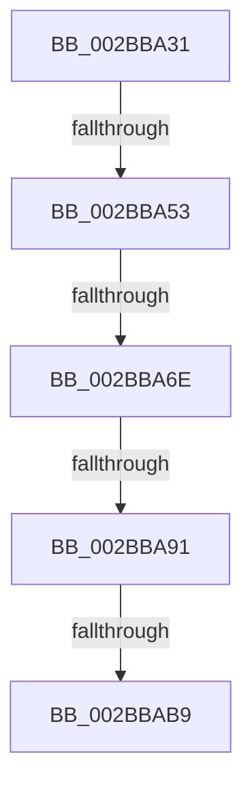

# sub_002BBA31

- RVA: `0x002BBA31`–`0x002BBACF` (길이 `158` bytes)
- VA: `0x00000001402BBA31`
- 실행 섹션: `.text`
- PDB 이름 있음: `아니요`; PDB Function 태그: `아니요`
- unwind 정보 RVA: `0x0006DE28`
- 디코드: `40`개 명령, `158/158` bytes 표시
- 미해석 바이트: `0` (있으면 어셈블리에 `.byte`로 보존)

> 이 문서는 커널 이미지의 기계어와 PDB 기호를 분석해 생성했습니다. 4번과 5번은 함수 원형과 자료형을 바이너리 사용 방식에서 추정한 C 해석이며 원본 소스 복구 결과는 아닙니다.

## 1. Dependencies

- 직접 호출 지점: **2**; 고유 호출 대상: **1**
- 직접 호출자로 확인된 함수: **0**
- RIP 상대 이미지 참조: **0**

### Outgoing calls
- `0x002BBA5D` → [MiLocateSubsectionNode](MiLocateSubsectionNode_function_002BBEE0.md) (function, `0x002BBEE0`)
- `0x002BBAA8` → [MiLocateSubsectionNode](MiLocateSubsectionNode_function_002BBEE0.md) (function, `0x002BBEE0`)

### Direct callers
- 이 함수 시작 RVA로 연결되는 직접 call은 확인되지 않았습니다. 간접 호출은 완전히 역산할 수 없습니다.

### Static image references
- 디코드된 RIP-relative 메모리 참조가 없습니다.

## 2. Other-region calls and transfers

- 다른 실행 섹션으로 향하는 call: **0**
- call이 아닌 외부 분기/꼬리 이동: **4**
  - `0x002BBA4D` → [sub_002BBBB5](Unknown_function_002BBBB5.md) (`tail-transfer`)
  - `0x002BBA68` → [sub_002BBBB5 + 0x42](Unknown_function_002BBBB5.md) (`tail-transfer`)
  - `0x002BBA8B` → [sub_002BBC73](Unknown_function_002BBC73.md) (`tail-transfer`)
  - `0x002BBAB3` → [sub_002BBC73](Unknown_function_002BBC73.md) (`tail-transfer`)

## 3. Assembly (complete function range)

```asm
002BBA31  48 89 74 24 50                  mov qword ptr [rsp + 0x50], rsi
002BBA36  48 8D B1 80 00 00 00            lea rsi, [rcx + 0x80]
002BBA3D  4C 89 64 24 58                  mov qword ptr [rsp + 0x58], r12
002BBA42  4C 89 74 24 20                  mov qword ptr [rsp + 0x20], r14
002BBA47  45 33 F6                        xor r14d, r14d
002BBA4A  4D 85 C0                        test r8, r8
002BBA4D  0F 84 62 01 00 00               je 0x1402bbbb5
002BBA53  4D 8B 20                        mov r12, qword ptr [r8]
002BBA56  45 8D 46 01                     lea r8d, [r14 + 1]
002BBA5A  49 8B D4                        mov rdx, r12
002BBA5D  E8 7E 04 00 00                  call 0x1402bbee0
002BBA62  48 8B F0                        mov rsi, rax
002BBA65  48 85 C0                        test rax, rax
002BBA68  0F 84 89 01 00 00               je 0x1402bbbf7
002BBA6E  8B 48 20                        mov ecx, dword ptr [rax + 0x20]
002BBA71  8B 40 24                        mov eax, dword ptr [rax + 0x24]
002BBA74  81 E1 C0 FF 00 00               and ecx, 0xffc0
002BBA7A  48 C1 E1 1A                     shl rcx, 0x1a
002BBA7E  48 0B C8                        or rcx, rax
002BBA81  49 C1 EC 0C                     shr r12, 0xc
002BBA85  4C 2B E1                        sub r12, rcx
002BBA88  4D 85 FF                        test r15, r15
002BBA8B  0F 84 E2 01 00 00               je 0x1402bbc73
002BBA91  48 8B 17                        mov rdx, qword ptr [rdi]
002BBA94  45 8D 46 01                     lea r8d, [r14 + 1]
002BBA98  49 FF CF                        dec r15
002BBA9B  48 8B CB                        mov rcx, rbx
002BBA9E  49 03 D7                        add rdx, r15
002BBAA1  4C 8B FA                        mov r15, rdx
002BBAA4  49 C1 EF 0C                     shr r15, 0xc
002BBAA8  E8 33 04 00 00                  call 0x1402bbee0
002BBAAD  48 8B F8                        mov rdi, rax
002BBAB0  48 85 C0                        test rax, rax
002BBAB3  0F 84 BA 01 00 00               je 0x1402bbc73
002BBAB9  8B 50 20                        mov edx, dword ptr [rax + 0x20]
002BBABC  8B 48 24                        mov ecx, dword ptr [rax + 0x24]
002BBABF  81 E2 C0 FF 00 00               and edx, 0xffc0
002BBAC5  48 C1 E2 1A                     shl rdx, 0x1a
002BBAC9  48 0B D1                        or rdx, rcx
002BBACC  4C 2B FA                        sub r15, rdx
```

## 4. C-style interpretation (structured pseudocode)

```c
__int64 __fastcall sub_002BBA31(__int64 a1, __int64 a2, __int64 a3)
{
    __int64 result;
    __int64 v_r12;
    __int64 v_r14;
    __int64 v_r15;
    unsigned __int64 v_stack_p20;
    unsigned __int64 v_stack_p50;
    unsigned __int64 v_stack_p58;

    v_stack_p50 = v_rsi;
    v_stack_p58 = v_r12;
    v_stack_p20 = v_r14;
    v_r14 = 0;
    result = MiLocateSubsectionNode(a1, *(unsigned __int64 *)(a3), v_r14 + 1, a4);
    a1 = (unsigned int)(((unsigned int)(*(unsigned int *)(result + 32))) & (0xFFC0ULL));
    a1 = (a1) << (26);
    a1 = (a1) | ((unsigned int)(*(unsigned int *)(result + 36)));
    v_r12 = (*(unsigned __int64 *)(a3)) >> (12);
    v_r12 = (v_r12) - (a1);
    v_r15 = (v_r15) - 1;
    a2 = (*(unsigned __int64 *)(v_rdi)) + (v_r15);
    v_r15 = (a2) >> (12);
    result = MiLocateSubsectionNode(v_rbx, a2, v_r14 + 1, a4);
    a2 = (unsigned int)(((unsigned int)(*(unsigned int *)(result + 32))) & (0xFFC0ULL));
    a2 = (a2) << (26);
    a2 = (a2) | ((unsigned int)(*(unsigned int *)(result + 36)));
    v_r15 = (v_r15) - (a2);
    return result;
}
```

## 5. (Beta) C Style

```c
int64_t sub_002BBA31(void *Arg1, int64_t Arg2, int64_t Arg3)
{
    uint8_t *arg1 = (uint8_t *)Arg1;

    int64_t result;
    int64_t local_r12;
    int64_t local_r14;
    int64_t local_r15;
    uint64_t v_stack_p20;
    uint64_t v_stack_p50;
    uint64_t v_stack_p58;

    v_stack_p50 = local_rsi;
    v_stack_p58 = local_r12;
    v_stack_p20 = local_r14;
    local_r14 = 0;
    result = MiLocateSubsectionNode(Arg1, *(uint64_t *)(Arg3), local_r14 + 1, a4);
    Arg1 = (uint32_t)(((uint32_t)(*(uint32_t *)(result + 0x20))) & (0xFFC0ULL));
    Arg1 = (Arg1) << (26);
    Arg1 = (Arg1) | ((uint32_t)(*(uint32_t *)(result + 0x24)));
    local_r12 = (*(uint64_t *)(Arg3)) >> (12);
    local_r12 = (local_r12) - (Arg1);
    local_r15 = (local_r15) - 1;
    Arg2 = (*(uint64_t *)(local_rdi)) + (local_r15);
    local_r15 = (Arg2) >> (12);
    result = MiLocateSubsectionNode(local_rbx, Arg2, local_r14 + 1, a4);
    Arg2 = (uint32_t)(((uint32_t)(*(uint32_t *)(result + 0x20))) & (0xFFC0ULL));
    Arg2 = (Arg2) << (26);
    Arg2 = (Arg2) | ((uint32_t)(*(uint32_t *)(result + 0x24)));
    local_r15 = (local_r15) - (Arg2);
    return result;
}
```

### 관측된 메모리 오프셋

구조체 형식이 확인되지 않은 접근은 인자 기준의 오프셋으로만 기록했습니다.

| 기준 인자 | 오프셋 표현 | 폭 (bit) | 접근 |
|---|---:|---:|---|
| `Arg1` | `+ 0x80` | `64` | `R` |

## 6. Execution-region graph

[열기: 2D/3D 그래프와 함수 탐색 컨트롤 패널](../../../control-panel.html?section=text&rva=0x002BBA31&view=graph)

- 2D 그래프는 위에서 아래로 흐르고, 3D 그래프는 빈 공간을 드래그해 회전합니다. Shift+드래그는 이동, 휠은 확대·축소, 함수 노드 선택은 대상 보고서 이동입니다.

### Static fallback


