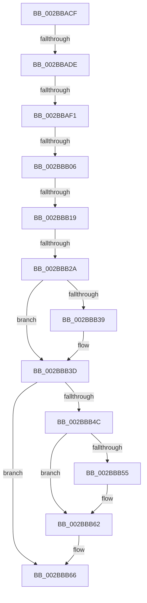

# sub_002BBACF

- RVA: `0x002BBACF`–`0x002BBB9B` (길이 `204` bytes)
- VA: `0x00000001402BBACF`
- 실행 섹션: `.text`
- PDB 이름 있음: `아니요`; PDB Function 태그: `아니요`
- unwind 정보 RVA: `0x0006DE44`
- 디코드: `50`개 명령, `204/204` bytes 표시
- 미해석 바이트: `0` (있으면 어셈블리에 `.byte`로 보존)

> 이 문서는 커널 이미지의 기계어와 PDB 기호를 분석해 생성했습니다. 4번과 5번은 함수 원형과 자료형을 바이너리 사용 방식에서 추정한 C 해석이며 원본 소스 복구 결과는 아닙니다.

## 1. Dependencies

- 직접 호출 지점: **6**; 고유 호출 대상: **5**
- 직접 호출자로 확인된 함수: **0**
- RIP 상대 이미지 참조: **1**

### Outgoing calls
- `0x002BBAE3` → [MiReferenceSubsection](../24/MiReferenceSubsection_function_00249200.md) (function, `0x00249200`)
- `0x002BBB0B` → [MiReferenceSubsection](../24/MiReferenceSubsection_function_00249200.md) (function, `0x00249200`)
- `0x002BBB2D` → [MiRemoveUnusedSegment](MiRemoveUnusedSegment_function_002BBE74.md) (function, `0x002BBE74`)
- `0x002BBB41` → [ExReleaseSpinLockExclusiveFromDpcLevel](../24/ExReleaseSpinLockExclusiveFromDpcLevel_function_002497E0.md) (function, `0x002497E0`)
- `0x002BBB5D` → [KiLowerIrqlProcessIrqlFlags](../4F/KiLowerIrqlProcessIrqlFlags_function_004F5698.md) (function, `0x004F5698`)
- `0x002BBB68` → [MiReleaseControlAreaWaiters](../28/MiReleaseControlAreaWaiters_function_002865F0.md) (function, `0x002865F0`)

### Direct callers
- 이 함수 시작 RVA로 연결되는 직접 call은 확인되지 않았습니다. 간접 호출은 완전히 역산할 수 없습니다.

### Static image references
- `0x002BBB4C` → RVA `0x00FC6D20` (`ALMOSTRO`; read)

## 2. Other-region calls and transfers

- 다른 실행 섹션으로 향하는 call: **0**
- call이 아닌 외부 분기/꼬리 이동: **5**
  - `0x002BBAD8` → [sub_002BBC22](Unknown_function_002BBC22.md) (`tail-transfer`)
  - `0x002BBAEB` → [sub_002BBC22](Unknown_function_002BBC22.md) (`tail-transfer`)
  - `0x002BBB00` → [sub_002BBC22 + 0x20](Unknown_function_002BBC22.md) (`tail-transfer`)
  - `0x002BBB13` → [sub_002BBC22 + 0x20](Unknown_function_002BBC22.md) (`tail-transfer`)
  - `0x002BBB24` → [sub_002BBC8B + 0x15](Unknown_function_002BBC8B.md) (`tail-transfer`)

## 3. Assembly (complete function range)

```asm
002BBACF  4C 89 6C 24 60                  mov qword ptr [rsp + 0x60], r13
002BBAD4  44 39 76 68                     cmp dword ptr [rsi + 0x68], r14d
002BBAD8  0F 84 44 01 00 00               je 0x1402bbc22
002BBADE  33 D2                           xor edx, edx
002BBAE0  48 8B CE                        mov rcx, rsi
002BBAE3  E8 18 D7 F8 FF                  call 0x140249200
002BBAE8  83 F8 01                        cmp eax, 1
002BBAEB  0F 8E 31 01 00 00               jle 0x1402bbc22
002BBAF1  48 8B 46 08                     mov rax, qword ptr [rsi + 8]
002BBAF5  45 8B EE                        mov r13d, r14d
002BBAF8  4E 8D 24 E0                     lea r12, [rax + r12*8]
002BBAFC  44 39 77 68                     cmp dword ptr [rdi + 0x68], r14d
002BBB00  0F 84 3C 01 00 00               je 0x1402bbc42
002BBB06  33 D2                           xor edx, edx
002BBB08  48 8B CF                        mov rcx, rdi
002BBB0B  E8 F0 D6 F8 FF                  call 0x140249200
002BBB10  83 F8 01                        cmp eax, 1
002BBB13  0F 8E 29 01 00 00               jle 0x1402bbc42
002BBB19  48 FF 43 28                     inc qword ptr [rbx + 0x28]
002BBB1D  48 8B 4B 50                     mov rcx, qword ptr [rbx + 0x50]
002BBB21  48 85 C9                        test rcx, rcx
002BBB24  0F 85 76 01 00 00               jne 0x1402bbca0
002BBB2A  48 8B CB                        mov rcx, rbx
002BBB2D  E8 42 03 00 00                  call 0x1402bbe74
002BBB32  83 7C 24 70 00                  cmp dword ptr [rsp + 0x70], 0
002BBB37  74 04                           je 0x1402bbb3d
002BBB39  83 4B 38 04                     or dword ptr [rbx + 0x38], 4
002BBB3D  48 8D 4B 48                     lea rcx, [rbx + 0x48]
002BBB41  E8 9A DC F8 FF                  call 0x1402497e0
002BBB46  40 80 FD 11                     cmp bpl, 0x11
002BBB4A  74 1A                           je 0x1402bbb66
002BBB4C  83 3D CD B1 D0 00 00            cmp dword ptr [rip + 0xd0b1cd], 0
002BBB53  74 0D                           je 0x1402bbb62
002BBB55  44 0F 20 C1                     mov rcx, cr8
002BBB59  40 0F B6 D5                     movzx edx, bpl
002BBB5D  E8 36 9B 23 00                  call 0x1404f5698
002BBB62  44 0F 22 C5                     mov cr8, rbp
002BBB66  33 C9                           xor ecx, ecx
002BBB68  E8 83 AA FC FF                  call 0x1402865f0
002BBB6D  48 8B 54 24 78                  mov rdx, qword ptr [rsp + 0x78]
002BBB72  48 8B 47 08                     mov rax, qword ptr [rdi + 8]
002BBB76  48 89 1A                        mov qword ptr [rdx], rbx
002BBB79  4A 8D 0C F8                     lea rcx, [rax + r15*8]
002BBB7D  4C 89 62 08                     mov qword ptr [rdx + 8], r12
002BBB81  48 89 4A 10                     mov qword ptr [rdx + 0x10], rcx
002BBB85  B8 03 01 00 00                  mov eax, 0x103
002BBB8A  48 89 72 18                     mov qword ptr [rdx + 0x18], rsi
002BBB8E  48 89 7A 20                     mov qword ptr [rdx + 0x20], rdi
002BBB92  44 89 6A 28                     mov dword ptr [rdx + 0x28], r13d
002BBB96  4C 8B 6C 24 60                  mov r13, qword ptr [rsp + 0x60]
```

## 4. C-style interpretation (structured pseudocode)

```c
__int64 __fastcall sub_002BBACF(__int64 a1, int a2, __int64 a3, __int64 a4, __int64 a5, __int64 a6, __int64 a7, __int64 a8, __int64 a9, __int64 a10, __int64 a11, __int64 a12, __int64 a13, unsigned int a14, __int64 a15)
{
    __int64 result;
    unsigned __int64 v_stack_p60;

    v_stack_p60 = v_r13;
    a2 = 0;
    result = MiReferenceSubsection(v_rsi, a2, a3, a4);
    a2 = 0;
    result = MiReferenceSubsection(v_rdi, a2, a3, a4);
    result = MiRemoveUnusedSegment(v_rbx, a2, a3, a4);
    if (a14 != 0) {
    }
    result = ExReleaseSpinLockExclusiveFromDpcLevel(v_rbx + 72, a2, a3, a4);
    if (((unsigned __int8)(v_rbp)) == 17) goto loc_002BBB66;
    if ((*(unsigned int *)(v_rip + 13677005)) != 0) {
        a1 = v_cr8;
        a2 = (unsigned __int8)(v_rbp);
        result = KiLowerIrqlProcessIrqlFlags(a1, a2, a3, a4);
    }
loc_002BBB66:
    a1 = 0;
    result = MiReleaseControlAreaWaiters(a1, a2, a3, a4);
    *(unsigned __int64 *)(a15) = v_rbx;
    *(unsigned __int64 *)(a15 + 8) = *(unsigned __int64 *)(v_rsi + 8) + v_r12 * 8;
    *(unsigned __int64 *)(a15 + 16) = *(unsigned __int64 *)(v_rdi + 8) + v_r15 * 8;
    *(unsigned __int64 *)(a15 + 24) = v_rsi;
    *(unsigned __int64 *)(a15 + 32) = v_rdi;
    *(unsigned int *)(a15 + 40) = (unsigned int)((unsigned int)((unsigned int)(v_r14)));
    return 259;
}
```

## 5. (Beta) C Style

```c
int64_t sub_002BBACF(int64_t Arg1, int32_t Arg2, int64_t Arg3, int64_t Arg4, uint64_t Arg5, uint64_t Arg6, uint64_t Arg7, uint64_t Arg8, uint64_t Arg9, uint64_t Arg10, uint64_t Arg11, int64_t Arg12, uint64_t Arg13, uint32_t Arg14, void *Arg15)
{
    uint8_t *arg15 = (uint8_t *)Arg15;

    int64_t result;
    uint64_t v_stack_p60;

    v_stack_p60 = local_r13;
    Arg2 = 0;
    result = MiReferenceSubsection(local_rsi, Arg2, Arg3, Arg4);
    Arg2 = 0;
    result = MiReferenceSubsection(local_rdi, Arg2, Arg3, Arg4);
    result = MiRemoveUnusedSegment(local_rbx, Arg2, Arg3, Arg4);
    if (Arg14 != 0) {
    }
    result = ExReleaseSpinLockExclusiveFromDpcLevel(local_rbx + 72, Arg2, Arg3, Arg4);
    if (((uint8_t)(local_rbp)) == 17) goto loc_002BBB66;
    if ((*(uint32_t *)(v_rip + 0xD0B1CD)) != 0) {
        Arg1 = v_cr8;
        Arg2 = (uint8_t)(local_rbp);
        result = KiLowerIrqlProcessIrqlFlags(Arg1, Arg2, Arg3, Arg4);
    }
loc_002BBB66:
    Arg1 = 0;
    result = MiReleaseControlAreaWaiters(Arg1, Arg2, Arg3, Arg4);
    *(uint64_t *)(arg15) = local_rbx;
    *(uint64_t *)(arg15 + 0x8) = *(uint64_t *)(local_rsi + 0x8) + local_r12 * 8;
    *(uint64_t *)(arg15 + 0x10) = *(uint64_t *)(local_rdi + 0x8) + local_r15 * 8;
    *(uint64_t *)(arg15 + 0x18) = local_rsi;
    *(uint64_t *)(arg15 + 0x20) = local_rdi;
    *(uint32_t *)(arg15 + 0x28) = (uint32_t)((uint32_t)((uint32_t)(local_r14)));
    return 259;
}
```

### 관측된 메모리 오프셋

구조체 형식이 확인되지 않은 접근은 인자 기준의 오프셋으로만 기록했습니다.

| 기준 인자 | 오프셋 표현 | 폭 (bit) | 접근 |
|---|---:|---:|---|
| `Arg15` | `+ 0x0` | `64` | `W` |
| `Arg15` | `+ 0x8` | `64` | `W` |
| `Arg15` | `+ 0x10` | `64` | `W` |
| `Arg15` | `+ 0x18` | `64` | `W` |
| `Arg15` | `+ 0x20` | `64` | `W` |
| `Arg15` | `+ 0x28` | `32` | `W` |

## 6. Execution-region graph

[열기: 2D/3D 그래프와 함수 탐색 컨트롤 패널](../../../control-panel.html?section=text&rva=0x002BBACF&view=graph)

- 2D 그래프는 위에서 아래로 흐르고, 3D 그래프는 빈 공간을 드래그해 회전합니다. Shift+드래그는 이동, 휠은 확대·축소, 함수 노드 선택은 대상 보고서 이동입니다.

### Static fallback


