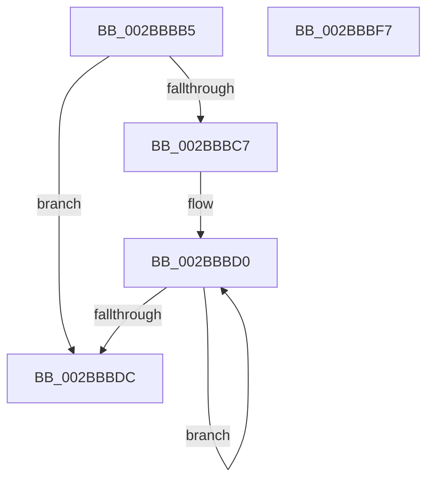

# sub_002BBBB5

- RVA: `0x002BBBB5`–`0x002BBC08` (길이 `83` bytes)
- VA: `0x00000001402BBBB5`
- 실행 섹션: `.text`
- PDB 이름 있음: `아니요`; PDB Function 태그: `아니요`
- unwind 정보 RVA: `0x0006DE7C`
- 디코드: `22`개 명령, `83/83` bytes 표시
- 미해석 바이트: `0` (있으면 어셈블리에 `.byte`로 보존)

> 이 문서는 커널 이미지의 기계어와 PDB 기호를 분석해 생성했습니다. 4번과 5번은 함수 원형과 자료형을 바이너리 사용 방식에서 추정한 C 해석이며 원본 소스 복구 결과는 아닙니다.

## 1. Dependencies

- 직접 호출 지점: **1**; 고유 호출 대상: **1**
- 직접 호출자로 확인된 함수: **0**
- RIP 상대 이미지 참조: **0**

### Outgoing calls
- `0x002BBBFF` → [MiReleaseSpinLockExclusive](../24/MiReleaseSpinLockExclusive_function_002482C0.md) (function, `0x002482C0`)

### Direct callers
- 이 함수 시작 RVA로 연결되는 직접 call은 확인되지 않았습니다. 간접 호출은 완전히 역산할 수 없습니다.

### Static image references
- 디코드된 RIP-relative 메모리 참조가 없습니다.

## 2. Other-region calls and transfers

- 다른 실행 섹션으로 향하는 call: **0**
- call이 아닌 외부 분기/꼬리 이동: **2**
  - `0x002BBBF2` → [sub_002BBACF](Unknown_function_002BBACF.md) (`tail-transfer`)
  - `0x002BBC06` → [sub_002BBB9B](Unknown_function_002BBB9B.md) (`tail-transfer`)

## 3. Assembly (complete function range)

```asm
002BBBB5  48 8B 81 18 01 00 00            mov rax, qword ptr [rcx + 0x118]
002BBBBC  4D 8B E6                        mov r12, r14
002BBBBF  49 8B FE                        mov rdi, r14
002BBBC2  48 85 C0                        test rax, rax
002BBBC5  74 15                           je 0x1402bbbdc
002BBBC7  66 0F 1F 84 00 00 00 00 00      nop word ptr [rax + rax]
002BBBD0  48 8B F8                        mov rdi, rax
002BBBD3  48 8B 40 08                     mov rax, qword ptr [rax + 8]
002BBBD7  48 85 C0                        test rax, rax
002BBBDA  75 F4                           jne 0x1402bbbd0
002BBBDC  8B 47 FC                        mov eax, dword ptr [rdi - 4]
002BBBDF  48 83 C7 C8                     add rdi, -0x38
002BBBE3  44 8B 7F 2C                     mov r15d, dword ptr [rdi + 0x2c]
002BBBE7  25 FF FF FF 3F                  and eax, 0x3fffffff
002BBBEC  44 2B F8                        sub r15d, eax
002BBBEF  41 FF CF                        dec r15d
002BBBF2  E9 D8 FE FF FF                  jmp 0x1402bbacf
002BBBF7  48 8D 4B 48                     lea rcx, [rbx + 0x48]
002BBBFB  40 0F B6 D5                     movzx edx, bpl
002BBBFF  E8 BC C6 F8 FF                  call 0x1402482c0
002BBC04  33 C0                           xor eax, eax
002BBC06  EB 93                           jmp 0x1402bbb9b
```

## 4. C-style interpretation (structured pseudocode)

```c
__int64 __fastcall sub_002BBBB5(__int64 a1)
{
    __int64 result;
    __int64 v_r15;
    __int64 v_rdi;

    if (*(unsigned __int64 *)(a1 + 280) == 0) goto loc_002BBBDC;
loc_002BBBD0:
    if (*(unsigned __int64 *)(*(unsigned __int64 *)(a1 + 280) + 8) != 0) goto loc_002BBBD0;
loc_002BBBDC:
    v_rdi = (*(unsigned __int64 *)(a1 + 280)) + (-56);
    result = (unsigned int)(((unsigned int)(*(unsigned int *)(*(unsigned __int64 *)(a1 + 280) - 4))) & (0x3FFFFFFFULL));
    v_r15 = (unsigned int)(((unsigned int)(*(unsigned int *)(v_rdi + 44))) - ((unsigned int)(result)));
    v_r15 = (unsigned int)((v_r15) - 1);
}
```

## 5. (Beta) C Style

```c
int64_t sub_002BBBB5(void *Arg1)
{
    uint8_t *arg1 = (uint8_t *)Arg1;

    int64_t result;
    int64_t local_r15;
    int64_t local_rdi;

    if (*(uint64_t *)(arg1 + 0x118) == 0) goto loc_002BBBDC;
loc_002BBBD0:
    if (*(uint64_t *)(*(uint64_t *)(arg1 + 0x118) + 0x8) != 0) goto loc_002BBBD0;
loc_002BBBDC:
    local_rdi = (*(uint64_t *)(arg1 + 0x118)) + (-56);
    result = (uint32_t)(((uint32_t)(*(uint32_t *)(*(uint64_t *)(arg1 + 0x118) - 0x4))) & (0x3FFFFFFFULL));
    local_r15 = (uint32_t)(((uint32_t)(*(uint32_t *)(local_rdi + 0x2C))) - ((uint32_t)(result)));
    local_r15 = (uint32_t)((local_r15) - 1);
}
```

### 관측된 메모리 오프셋

구조체 형식이 확인되지 않은 접근은 인자 기준의 오프셋으로만 기록했습니다.

| 기준 인자 | 오프셋 표현 | 폭 (bit) | 접근 |
|---|---:|---:|---|
| `Arg1` | `+ 0x118` | `64` | `R` |

## 6. Execution-region graph

[열기: 2D/3D 그래프와 함수 탐색 컨트롤 패널](../../../control-panel.html?section=text&rva=0x002BBBB5&view=graph)

- 2D 그래프는 위에서 아래로 흐르고, 3D 그래프는 빈 공간을 드래그해 회전합니다. Shift+드래그는 이동, 휠은 확대·축소, 함수 노드 선택은 대상 보고서 이동입니다.

### Static fallback


