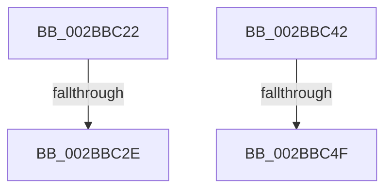

# sub_002BBC22

- RVA: `0x002BBC22`–`0x002BBC73` (길이 `81` bytes)
- VA: `0x00000001402BBC22`
- 실행 섹션: `.text`
- PDB 이름 있음: `아니요`; PDB Function 태그: `아니요`
- unwind 정보 RVA: `0x0006DEAC`
- 디코드: `22`개 명령, `81/81` bytes 표시
- 미해석 바이트: `0` (있으면 어셈블리에 `.byte`로 보존)

> 이 문서는 커널 이미지의 기계어와 PDB 기호를 분석해 생성했습니다. 4번과 5번은 함수 원형과 자료형을 바이너리 사용 방식에서 추정한 C 해석이며 원본 소스 복구 결과는 아닙니다.

## 1. Dependencies

- 직접 호출 지점: **2**; 고유 호출 대상: **2**
- 직접 호출자로 확인된 함수: **0**
- RIP 상대 이미지 참조: **0**

### Outgoing calls
- `0x002BBC36` → [MiReleaseSpinLockExclusive](../24/MiReleaseSpinLockExclusive_function_002482C0.md) (function, `0x002482C0`)
- `0x002BBC57` → [MiReferenceSubsection](../24/MiReferenceSubsection_function_00249200.md) (function, `0x00249200`)

### Direct callers
- 이 함수 시작 RVA로 연결되는 직접 call은 확인되지 않았습니다. 간접 호출은 완전히 역산할 수 없습니다.

### Static image references
- 디코드된 RIP-relative 메모리 참조가 없습니다.

## 2. Other-region calls and transfers

- 다른 실행 섹션으로 향하는 call: **0**
- call이 아닌 외부 분기/꼬리 이동: **4**
  - `0x002BBC2C` → [sub_002BBC8B](Unknown_function_002BBC8B.md) (`tail-transfer`)
  - `0x002BBC3D` → [sub_002BBACF + 0xC7](Unknown_function_002BBACF.md) (`tail-transfer`)
  - `0x002BBC49` → [sub_002BBC8B + 0x4C](Unknown_function_002BBC8B.md) (`tail-transfer`)
  - `0x002BBC6E` → [sub_002BBACF + 0x4A](Unknown_function_002BBACF.md) (`tail-transfer`)

## 3. Assembly (complete function range)

```asm
002BBC22  44 8B 6E 2C                     mov r13d, dword ptr [rsi + 0x2c]
002BBC26  45 2B EC                        sub r13d, r12d
002BBC29  48 3B F7                        cmp rsi, rdi
002BBC2C  75 5D                           jne 0x1402bbc8b
002BBC2E  40 0F B6 D5                     movzx edx, bpl
002BBC32  48 8D 4B 48                     lea rcx, [rbx + 0x48]
002BBC36  E8 85 C6 F8 FF                  call 0x1402482c0
002BBC3B  33 C0                           xor eax, eax
002BBC3D  E9 54 FF FF FF                  jmp 0x1402bbb96
002BBC42  48 8B 46 10                     mov rax, qword ptr [rsi + 0x10]
002BBC46  48 3B C7                        cmp rax, rdi
002BBC49  0F 85 88 00 00 00               jne 0x1402bbcd7
002BBC4F  48 8B FE                        mov rdi, rsi
002BBC52  33 D2                           xor edx, edx
002BBC54  48 8B CF                        mov rcx, rdi
002BBC57  E8 A4 D5 F8 FF                  call 0x140249200
002BBC5C  8B 47 34                        mov eax, dword ptr [rdi + 0x34]
002BBC5F  44 8B 7F 2C                     mov r15d, dword ptr [rdi + 0x2c]
002BBC63  25 FF FF FF 3F                  and eax, 0x3fffffff
002BBC68  44 2B F8                        sub r15d, eax
002BBC6B  41 FF CF                        dec r15d
002BBC6E  E9 A6 FE FF FF                  jmp 0x1402bbb19
```

## 4. C-style interpretation (structured pseudocode)

```c
__int64 __fastcall sub_002BBC22(void)
{
    __int64 result;
    __int64 v_r13;

    v_r13 = (unsigned int)(((unsigned int)(*(unsigned int *)(v_rsi + 44))) - ((unsigned int)(v_r12)));
    result = MiReleaseSpinLockExclusive(v_rbx + 72, (unsigned __int8)(v_rbp), a3, a4);
    result = 0;
}
```

## 5. (Beta) C Style

```c
void sub_002BBC22(void)
{
    int64_t result;
    int64_t local_r13;

    local_r13 = (uint32_t)(((uint32_t)(*(uint32_t *)(local_rsi + 0x2C))) - ((uint32_t)(local_r12)));
    result = MiReleaseSpinLockExclusive(local_rbx + 72, (uint8_t)(local_rbp), a3, a4);
    result = 0;
}
```

## 6. Execution-region graph

[열기: 2D/3D 그래프와 함수 탐색 컨트롤 패널](../../../control-panel.html?section=text&rva=0x002BBC22&view=graph)

- 2D 그래프는 위에서 아래로 흐르고, 3D 그래프는 빈 공간을 드래그해 회전합니다. Shift+드래그는 이동, 휠은 확대·축소, 함수 노드 선택은 대상 보고서 이동입니다.

### Static fallback


