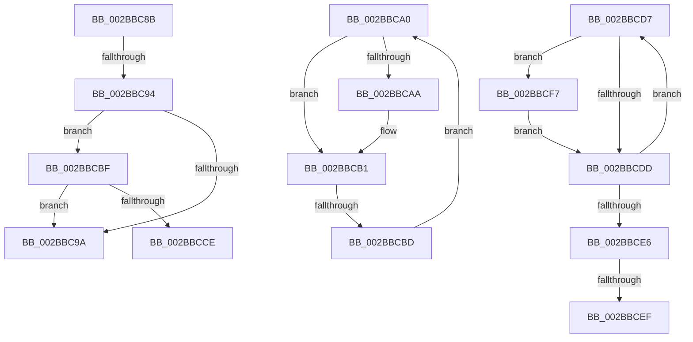

# sub_002BBC8B

- RVA: `0x002BBC8B`–`0x002BBD02` (길이 `119` bytes)
- VA: `0x00000001402BBC8B`
- 실행 섹션: `.text`
- PDB 이름 있음: `아니요`; PDB Function 태그: `아니요`
- unwind 정보 RVA: `0x0006DEE8`
- 디코드: `35`개 명령, `119/119` bytes 표시
- 미해석 바이트: `0` (있으면 어셈블리에 `.byte`로 보존)

> 이 문서는 커널 이미지의 기계어와 PDB 기호를 분석해 생성했습니다. 4번과 5번은 함수 원형과 자료형을 바이너리 사용 방식에서 추정한 C 해석이며 원본 소스 복구 결과는 아닙니다.

## 1. Dependencies

- 직접 호출 지점: **1**; 고유 호출 대상: **1**
- 직접 호출자로 확인된 함수: **0**
- RIP 상대 이미지 참조: **0**

### Outgoing calls
- `0x002BBCC4` → [MiReferenceSubsection](../24/MiReferenceSubsection_function_00249200.md) (function, `0x00249200`)

### Direct callers
- 이 함수 시작 RVA로 연결되는 직접 call은 확인되지 않았습니다. 간접 호출은 완전히 역산할 수 없습니다.

### Static image references
- 디코드된 RIP-relative 메모리 참조가 없습니다.

## 2. Other-region calls and transfers

- 다른 실행 섹션으로 향하는 call: **0**
- call이 아닌 외부 분기/꼬리 이동: **6**
  - `0x002BBC92` → [sub_002BBC22 + 0xC](Unknown_function_002BBC22.md) (`tail-transfer`)
  - `0x002BBC9E` → [sub_002BBC22 + 0x7](Unknown_function_002BBC22.md) (`tail-transfer`)
  - `0x002BBCB7` → [sub_002BBACF + 0x5B](Unknown_function_002BBACF.md) (`tail-transfer`)
  - `0x002BBCD2` → [sub_002BBACF + 0x2D](Unknown_function_002BBACF.md) (`tail-transfer`)
  - `0x002BBCE9` → [sub_002BBC22 + 0x2D](Unknown_function_002BBC22.md) (`tail-transfer`)
  - `0x002BBCF2` → [sub_002BBC22 + 0x30](Unknown_function_002BBC22.md) (`tail-transfer`)

## 3. Assembly (complete function range)

```asm
002BBC8B  48 8B 76 10                     mov rsi, qword ptr [rsi + 0x10]
002BBC8F  48 85 F6                        test rsi, rsi
002BBC92  74 9A                           je 0x1402bbc2e
002BBC94  44 39 76 68                     cmp dword ptr [rsi + 0x68], r14d
002BBC98  75 25                           jne 0x1402bbcbf
002BBC9A  44 03 6E 2C                     add r13d, dword ptr [rsi + 0x2c]
002BBC9E  EB 89                           jmp 0x1402bbc29
002BBCA0  8B 41 08                        mov eax, dword ptr [rcx + 8]
002BBCA3  48 8B 11                        mov rdx, qword ptr [rcx]
002BBCA6  A8 04                           test al, 4
002BBCA8  74 07                           je 0x1402bbcb1
002BBCAA  C7 41 0C 01 00 00 00            mov dword ptr [rcx + 0xc], 1
002BBCB1  48 8B CA                        mov rcx, rdx
002BBCB4  48 85 D2                        test rdx, rdx
002BBCB7  0F 84 6D FE FF FF               je 0x1402bbb2a
002BBCBD  EB E1                           jmp 0x1402bbca0
002BBCBF  33 D2                           xor edx, edx
002BBCC1  48 8B CE                        mov rcx, rsi
002BBCC4  E8 37 D5 F8 FF                  call 0x140249200
002BBCC9  83 F8 01                        cmp eax, 1
002BBCCC  7E CC                           jle 0x1402bbc9a
002BBCCE  4C 8B 66 08                     mov r12, qword ptr [rsi + 8]
002BBCD2  E9 25 FE FF FF                  jmp 0x1402bbafc
002BBCD7  83 78 68 00                     cmp dword ptr [rax + 0x68], 0
002BBCDB  75 1A                           jne 0x1402bbcf7
002BBCDD  48 8B 40 10                     mov rax, qword ptr [rax + 0x10]
002BBCE1  48 3B C7                        cmp rax, rdi
002BBCE4  75 F1                           jne 0x1402bbcd7
002BBCE6  4D 85 F6                        test r14, r14
002BBCE9  0F 84 60 FF FF FF               je 0x1402bbc4f
002BBCEF  49 8B FE                        mov rdi, r14
002BBCF2  E9 5B FF FF FF                  jmp 0x1402bbc52
002BBCF7  48 83 78 08 00                  cmp qword ptr [rax + 8], 0
002BBCFC  4C 0F 45 F0                     cmovne r14, rax
002BBD00  EB DB                           jmp 0x1402bbcdd
```

## 4. C-style interpretation (structured pseudocode)

```c
__int64 __fastcall sub_002BBC8B(__int64 a1)
{
    __int64 result;
    __int64 v_r13;

    if ((*(unsigned int *)(*(unsigned __int64 *)(v_rsi + 16) + 104)) != ((unsigned int)(v_r14))) goto loc_002BBCBF;
loc_002BBC9A:
    v_r13 = (unsigned int)((v_r13) + (*(unsigned int *)(*(unsigned __int64 *)(v_rsi + 16) + 44)));
loc_002BBCBF:
    a2 = 0;
    result = MiReferenceSubsection(*(unsigned __int64 *)(v_rsi + 16), a2, a3, a4);
    if (((unsigned int)(result)) <= 1) goto loc_002BBC9A;
}
```

## 5. (Beta) C Style

```c
int64_t sub_002BBC8B(int64_t Arg1)
{
    int64_t result;
    int64_t local_r13;

    if ((*(uint32_t *)(*(uint64_t *)(local_rsi + 0x10) + 0x68)) != ((uint32_t)(local_r14))) goto loc_002BBCBF;
loc_002BBC9A:
    local_r13 = (uint32_t)((local_r13) + (*(uint32_t *)(*(uint64_t *)(local_rsi + 0x10) + 0x2C)));
loc_002BBCBF:
    a2 = 0;
    result = MiReferenceSubsection(*(uint64_t *)(local_rsi + 0x10), a2, a3, a4);
    if (((uint32_t)(result)) <= 1) goto loc_002BBC9A;
}
```

## 6. Execution-region graph

[열기: 2D/3D 그래프와 함수 탐색 컨트롤 패널](../../../control-panel.html?section=text&rva=0x002BBC8B&view=graph)

- 2D 그래프는 위에서 아래로 흐르고, 3D 그래프는 빈 공간을 드래그해 회전합니다. Shift+드래그는 이동, 휠은 확대·축소, 함수 노드 선택은 대상 보고서 이동입니다.

### Static fallback


