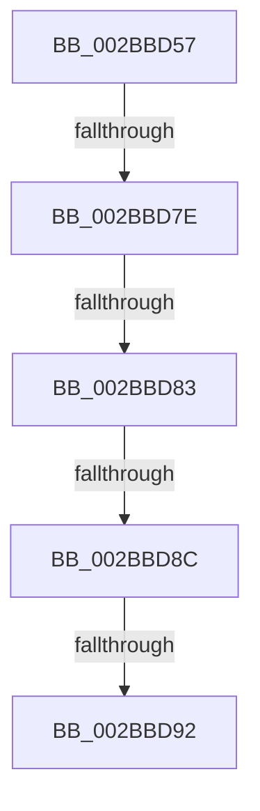

# sub_002BBD57

- RVA: `0x002BBD57`–`0x002BBD98` (길이 `65` bytes)
- VA: `0x00000001402BBD57`
- 실행 섹션: `.text`
- PDB 이름 있음: `아니요`; PDB Function 태그: `아니요`
- unwind 정보 RVA: `0x0006DF18`
- 디코드: `20`개 명령, `65/65` bytes 표시
- 미해석 바이트: `0` (있으면 어셈블리에 `.byte`로 보존)

> 이 문서는 커널 이미지의 기계어와 PDB 기호를 분석해 생성했습니다. 4번과 5번은 함수 원형과 자료형을 바이너리 사용 방식에서 추정한 C 해석이며 원본 소스 복구 결과는 아닙니다.

## 1. Dependencies

- 직접 호출 지점: **1**; 고유 호출 대상: **1**
- 직접 호출자로 확인된 함수: **0**
- RIP 상대 이미지 참조: **0**

### Outgoing calls
- `0x002BBD68` → [ExAcquireSpinLockExclusiveAtDpcLevel](../24/ExAcquireSpinLockExclusiveAtDpcLevel_function_00248E80.md) (function, `0x00248E80`)

### Direct callers
- 이 함수 시작 RVA로 연결되는 직접 call은 확인되지 않았습니다. 간접 호출은 완전히 역산할 수 없습니다.

### Static image references
- 디코드된 RIP-relative 메모리 참조가 없습니다.

## 2. Other-region calls and transfers

- 다른 실행 섹션으로 향하는 call: **0**
- call이 아닌 외부 분기/꼬리 이동: **5**
  - `0x002BBD78` → [sub_002BBE08](Unknown_function_002BBE08.md) (`tail-transfer`)
  - `0x002BBD81` → [sub_002BBDCA](Unknown_function_002BBDCA.md) (`tail-transfer`)
  - `0x002BBD8A` → [sub_002BBE08](Unknown_function_002BBE08.md) (`tail-transfer`)
  - `0x002BBD90` → [sub_002BBE08](Unknown_function_002BBE08.md) (`tail-transfer`)
  - `0x002BBD96` → [sub_002BBE08](Unknown_function_002BBE08.md) (`tail-transfer`)

## 3. Assembly (complete function range)

```asm
002BBD57  48 89 74 24 58                  mov qword ptr [rsp + 0x58], rsi
002BBD5C  48 89 7C 24 60                  mov qword ptr [rsp + 0x60], rdi
002BBD61  48 8B 3B                        mov rdi, qword ptr [rbx]
002BBD64  48 8D 4F 48                     lea rcx, [rdi + 0x48]
002BBD68  E8 13 D1 F8 FF                  call 0x140248e80
002BBD6D  8B 4F 38                        mov ecx, dword ptr [rdi + 0x38]
002BBD70  8B C1                           mov eax, ecx
002BBD72  D1 E8                           shr eax, 1
002BBD74  0B C1                           or eax, ecx
002BBD76  A8 01                           test al, 1
002BBD78  0F 85 8A 00 00 00               jne 0x1402bbe08
002BBD7E  F6 C1 20                        test cl, 0x20
002BBD81  75 47                           jne 0x1402bbdca
002BBD83  8B 43 20                        mov eax, dword ptr [rbx + 0x20]
002BBD86  0F BA E0 10                     bt eax, 0x10
002BBD8A  72 7C                           jb 0x1402bbe08
002BBD8C  4C 39 6B 08                     cmp qword ptr [rbx + 8], r13
002BBD90  74 76                           je 0x1402bbe08
002BBD92  44 39 6B 6C                     cmp dword ptr [rbx + 0x6c], r13d
002BBD96  75 70                           jne 0x1402bbe08
```

## 4. C-style interpretation (structured pseudocode)

```c
__int64 __fastcall sub_002BBD57(void)
{
    __int64 result;
    unsigned __int64 v_stack_p58;
    unsigned __int64 v_stack_p60;

    v_stack_p58 = v_rsi;
    v_stack_p60 = v_rdi;
    result = ExAcquireSpinLockExclusiveAtDpcLevel(*(unsigned __int64 *)(v_rbx) + 72, a2, a3, a4);
    result = (unsigned int)(((unsigned int)((unsigned int)((unsigned int)(*(unsigned int *)(*(unsigned __int64 *)(v_rbx) + 56))))) >> (1));
    result = (unsigned int)((result) | ((unsigned int)((unsigned int)(*(unsigned int *)(*(unsigned __int64 *)(v_rbx) + 56)))));
}
```

## 5. (Beta) C Style

```c
void sub_002BBD57(void)
{
    int64_t result;
    uint64_t v_stack_p58;
    uint64_t v_stack_p60;

    v_stack_p58 = local_rsi;
    v_stack_p60 = local_rdi;
    result = ExAcquireSpinLockExclusiveAtDpcLevel(*(uint64_t *)(local_rbx) + 72, a2, a3, a4);
    result = (uint32_t)(((uint32_t)((uint32_t)((uint32_t)(*(uint32_t *)(*(uint64_t *)(local_rbx) + 0x38))))) >> (1));
    result = (uint32_t)((result) | ((uint32_t)((uint32_t)(*(uint32_t *)(*(uint64_t *)(local_rbx) + 0x38)))));
}
```

## 6. Execution-region graph

[열기: 2D/3D 그래프와 함수 탐색 컨트롤 패널](../../../control-panel.html?section=text&rva=0x002BBD57&view=graph)

- 2D 그래프는 위에서 아래로 흐르고, 3D 그래프는 빈 공간을 드래그해 회전합니다. Shift+드래그는 이동, 휠은 확대·축소, 함수 노드 선택은 대상 보고서 이동입니다.

### Static fallback


