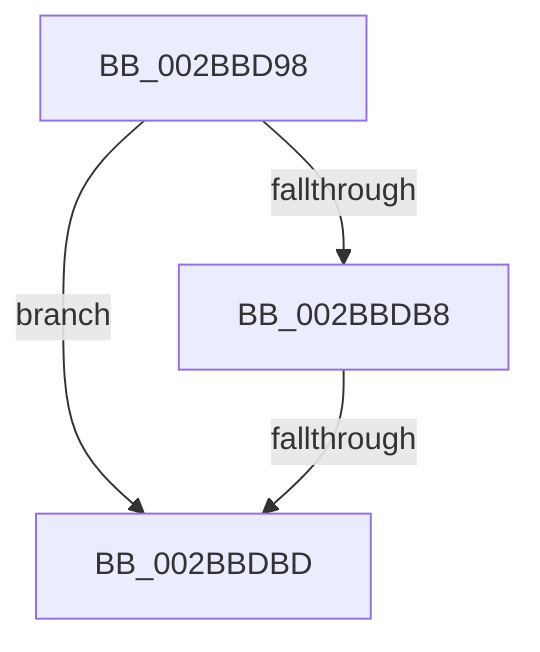

# sub_002BBD98

- RVA: `0x002BBD98`–`0x002BBDCA` (길이 `50` bytes)
- VA: `0x00000001402BBD98`
- 실행 섹션: `.text`
- PDB 이름 있음: `아니요`; PDB Function 태그: `아니요`
- unwind 정보 RVA: `0x0006DF30`
- 디코드: `14`개 명령, `50/50` bytes 표시
- 미해석 바이트: `0` (있으면 어셈블리에 `.byte`로 보존)

> 이 문서는 커널 이미지의 기계어와 PDB 기호를 분석해 생성했습니다. 4번과 5번은 함수 원형과 자료형을 바이너리 사용 방식에서 추정한 C 해석이며 원본 소스 복구 결과는 아닙니다.

## 1. Dependencies

- 직접 호출 지점: **1**; 고유 호출 대상: **1**
- 직접 호출자로 확인된 함수: **0**
- RIP 상대 이미지 참조: **0**

### Outgoing calls
- `0x002BBDAE` → [MiIncrementSubsectionViewCount](../24/MiIncrementSubsectionViewCount_function_00249440.md) (function, `0x00249440`)

### Direct callers
- 이 함수 시작 RVA로 연결되는 직접 call은 확인되지 않았습니다. 간접 호출은 완전히 역산할 수 없습니다.

### Static image references
- 디코드된 RIP-relative 메모리 참조가 없습니다.

## 2. Other-region calls and transfers

- 다른 실행 섹션으로 향하는 call: **0**
- call이 아닌 외부 분기/꼬리 이동: **1**
  - `0x002BBDBB` → [sub_002BBE15](Unknown_function_002BBE15.md) (`tail-transfer`)

## 3. Assembly (complete function range)

```asm
002BBD98  48 89 6C 24 50                  mov qword ptr [rsp + 0x50], rbp
002BBD9D  33 D2                           xor edx, edx
002BBD9F  48 8B 2B                        mov rbp, qword ptr [rbx]
002BBDA2  48 8B CB                        mov rcx, rbx
002BBDA5  4C 89 64 24 20                  mov qword ptr [rsp + 0x20], r12
002BBDAA  4C 8B 65 40                     mov r12, qword ptr [rbp + 0x40]
002BBDAE  E8 8D D6 F8 FF                  call 0x140249440
002BBDB3  83 F8 01                        cmp eax, 1
002BBDB6  7E 05                           jle 0x1402bbdbd
002BBDB8  4D 85 E4                        test r12, r12
002BBDBB  75 58                           jne 0x1402bbe15
002BBDBD  4C 8B 64 24 20                  mov r12, qword ptr [rsp + 0x20]
002BBDC2  48 8B 6C 24 50                  mov rbp, qword ptr [rsp + 0x50]
002BBDC7  49 89 1E                        mov qword ptr [r14], rbx
```

## 4. C-style interpretation (structured pseudocode)

```c
__int64 __fastcall sub_002BBD98(__int64 a1, int a2, __int64 a3, __int64 a4, __int64 a5, __int64 a6, __int64 a7, __int64 a8, __int64 a9, __int64 a10)
{
    __int64 result;
    unsigned __int64 v_stack_p20;
    unsigned __int64 v_stack_p50;

    v_stack_p50 = v_rbp;
    a2 = 0;
    v_stack_p20 = v_r12;
    result = MiIncrementSubsectionViewCount(v_rbx, a2, a3, a4);
    if (((unsigned int)(result)) <= 1) goto loc_002BBDBD;
loc_002BBDBD:
    *(unsigned __int64 *)(v_r14) = v_rbx;
    return result;
}
```

## 5. (Beta) C Style

```c
int64_t sub_002BBD98(int64_t Arg1, int32_t Arg2, int64_t Arg3, int64_t Arg4, uint64_t Arg5, uint64_t Arg6, uint64_t Arg7, uint64_t Arg8, uint64_t Arg9, int64_t Arg10)
{
    int64_t result;
    uint64_t v_stack_p20;
    uint64_t v_stack_p50;

    v_stack_p50 = local_rbp;
    Arg2 = 0;
    v_stack_p20 = local_r12;
    result = MiIncrementSubsectionViewCount(local_rbx, Arg2, Arg3, Arg4);
    if (((uint32_t)(result)) <= 1) goto loc_002BBDBD;
loc_002BBDBD:
    *(uint64_t *)(local_r14) = local_rbx;
    return result;
}
```

## 6. Execution-region graph

[열기: 2D/3D 그래프와 함수 탐색 컨트롤 패널](../../../control-panel.html?section=text&rva=0x002BBD98&view=graph)

- 2D 그래프는 위에서 아래로 흐르고, 3D 그래프는 빈 공간을 드래그해 회전합니다. Shift+드래그는 이동, 휠은 확대·축소, 함수 노드 선택은 대상 보고서 이동입니다.

### Static fallback


